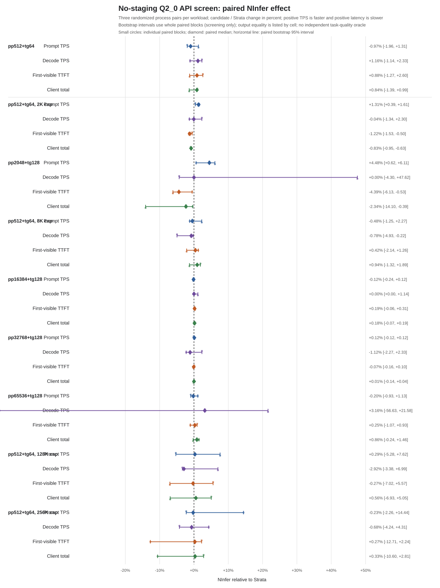

# No-trace API screen: Q2_0 pp32768+tg128 at 64K capacity

Date: 2026-10-29. Device: Jetson AGX Orin 64GB. Model: Qwen3.8-Flash-Next
GSQ-RCO Q2_0, same GGUF shards, PLE pack, expert profile and 3,000-slot
expert cache in both arms. Source revision: `5c94944c6f98869fd8b9d1cb6c0ac3f25bfbe784`;
binary SHA-256: `fbd40926be198adc92cd9a1b7b7b5d32b431445bef4e909c10de99e027c078e4`.

## Method

Three same-day fresh-process pairs compared the Strata expert backend with
strict NInfer at 65,536 configured context. The formatted prompt had exactly
32,768 tokens and each request generated 128 tokens. PCIe staging and prompt
cache were disabled in both arms, and tracing was disabled. Each process sent
one same-workload warmup followed by one measured streaming API request. The
randomized pair orders were NInfer → Strata, Strata → NInfer, and Strata →
NInfer. Warmup and measured content matched byte-for-byte within every pair.
This generic generation workload has no independent answer oracle; persistent
state fingerprints were not captured.

| Pair | Order | Prompt TPS | Decode TPS | First-visible TTFT | Client total |
| --- | --- | ---: | ---: | ---: | ---: |
| 0 | NInfer → Strata | -0.12% | +2.33% | +0.10% | +0.01% |
| 1 | Strata → NInfer | +0.12% | -2.27% | -0.07% | +0.04% |
| 2 | Strata → NInfer | +0.12% | -1.12% | -0.16% | -0.14% |
| Median paired change |  | **+0.12%** | **-1.12%** | **-0.07%** | **+0.01%** |

The paired 95% bootstrap intervals were -0.12% to +0.12% prompt TPS, -2.27%
to +2.33% decode TPS, -0.16% to +0.10% TTFT, and -0.14% to +0.04% client
total. They include no effect and none approaches the 5% useful-effect
threshold. The median arm rates were 86.4/86.5 prompt tok/s and 8.8/8.8 decode
tok/s (Strata/NInfer); median TTFT was 379.34/379.10 s and client time was
393.64/393.79 s. No confirmation campaign or acceleration claim is warranted.

Minimum available memory across the six processes was 9.95 GiB. Peak sampled
swap was 2.76 GiB. Cgroup low/high/max/OOM/OOM-kill counters remained zero.
Observed CPU clocks ranged from 729.6 to 2,201.6 MHz and GPU clocks from 306 to
1,300.5 MHz; EMC readback was unavailable. Energy was not measured. No clock or
service settings were changed. The supervised campaign took 82.2 minutes. This
is a three-pair screen for one synthetic API shape, not broad workload or
release qualification. Raw captures remain local-only.

## Paired-effect chart

The combined chart includes the 1K, 4K, 16K, 32K and 64K prompt screens. Sanitized
paired values and bootstrap intervals are in
[JSON](no-trace-api-effects-summary.json) and
[CSV](no-trace-api-effects-chart/paired-effects.csv).
