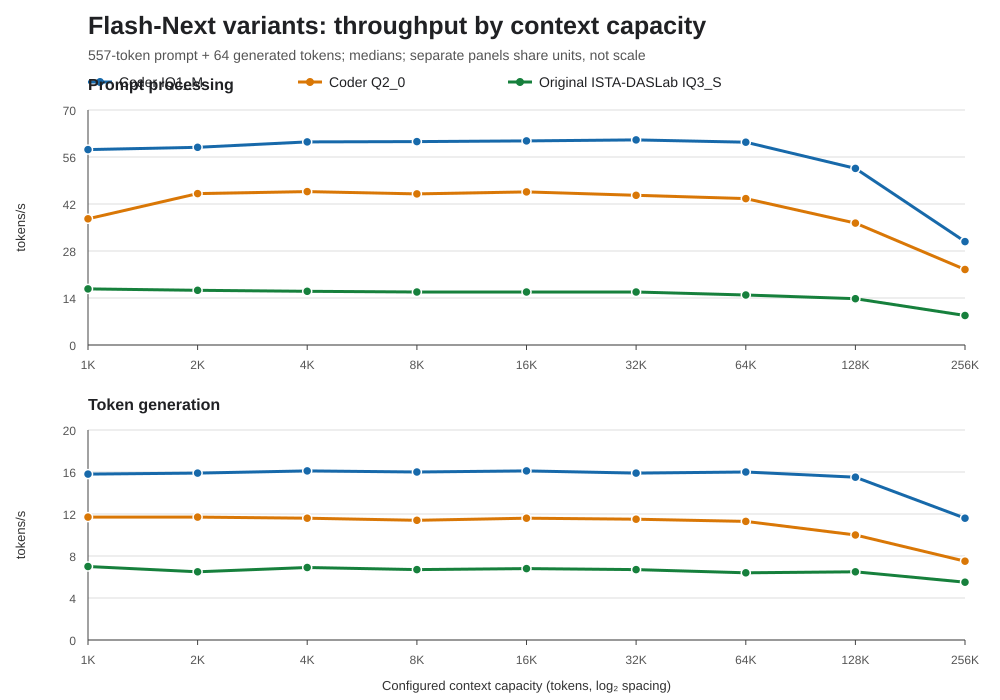

**E6 Q2_0 CTA schedule screen (2026-10-31):** an opt-in 256-thread CTA mapping passed independent D3/D4 oracle and grouped-output checks, including exact grouped intermediates and output hashes. Across six paired operator blocks it was slower than the 128-thread default by 2.46% for one token, 2.92% for grouped 64 and 2.50% for grouped 128; paired bootstrap intervals excluded zero but the small, imperfectly balanced screen is not confirmation. The grouped NInfer/Strata descriptive ratio also worsened from about 1.14–1.15x to 1.17–1.18x. Keep the default unchanged and do not advance this candidate to service testing. The opt-in path remains available only for reproducible schedule experiments. Minimum available RAM was 24.33 GiB; clocks were dynamic and energy was not measured. E6/E7 remain open. See the [operator report](../../bench/results/2026-10-31-e6-ninfer-q2-cta256-screen/README.md).

**E6 Q2_0 adaptive 5K backend screen (2026-10-31):** three randomized NIMBUS pp512+tg128 pairs compared Strata and strict NInfer with 5,000 starting slots and the same adaptive-swap policy. After warmup, both backends recorded 76.0% GPU-cache hits and 1,142 exchanges. NInfer decode TPS was −1.08% at the paired median (95% three-pair screening interval −5.21% to 0.00%); prompt TPS was tied, TTFT was −0.23%, and client time was −0.30%. All six measured responses returned the exact answer, 128 tokens and one shared text hash. Minimum available RAM was 8.98 GiB; peak swap was 2.42 GiB; sampled OOM kills were zero. The high-hit condition still showed no NInfer-specific end-to-end benefit, so no confirmation is justified. A static 5K pilot reached only 21.4% NIMBUS hits and was not used for performance inference. [Report and paired data](../../bench/results/2026-10-31-e6-q2-ninfer-adaptive-5k-screen/README.md).

**E6 adaptive 5K final-state check (2026-10-31):** a separate hash-instrumented pair matched all ten final-state fingerprints between Strata and NInfer for both request ordinals. Within each process, the same warmup and measured prompt produced different response hashes and different GDN, PLE, tail, pooled, KV, pooled-full and previous-embedding state fingerprints. This shared request-order variation remains unexplained; hashing timings are excluded. Minimum available RAM was 8.95 GiB for Strata and 9.02 GiB for NInfer. [State record](../../bench/results/2026-10-31-e6-q2-ninfer-adaptive-5k-screen/state-parity.json).

**E6 adaptive 5K reset/prefill capture (2026-10-31):** corrected hash-flag propagation enabled post-reset and prompt-boundary captures. Repeated requests matched reset and prefill hashes through position 384; the prompt-boundary fingerprints first differed at position 511 in GDN, pooled, KV and pooled-full. Strata and NInfer matched at each request ordinal. The tier logged 684 expert exchanges after warmup and 1,142 after the measured request. This associates the sampled state change with adaptive request history, but no slot-level causal proof was captured. [Boundary record](../../bench/results/2026-10-31-e6-q2-ninfer-adaptive-5k-screen/boundary-capture.json).

**E6 Q2_0 fixed route-ranked 5K backend screen (2026-10-31):** a profile ranked from the NIMBUS route trace gave Strata and strict NInfer identical fixed resident IDs with adaptation disabled. The 5,000 slots covered 85.23% of trace selections, and both measured arms logged 84.9% GPU hits. Across three pairs, paired median effects favored NInfer by 0.01% prompt TPS, 1.19% decode TPS, 0.03% TTFT and 0.29% client time; the decode interval was −0.25% to +2.50%. All six responses matched. No effect reached 5%; do not confirm. The route-derived profile is an oracle diagnostic, not a deployable/held-out cache profile. Minimum available RAM was 9.11 GiB, peak swap 1.71 GiB, with zero sampled OOM kills. [Report and paired data](../../bench/results/2026-10-31-e6-q2-ninfer-fixed-route-5k-screen/README.md).

**E6 fixed-map final-state check (2026-10-31):** a separate single Strata/NInfer pair used the same 5K profile with adaptation disabled and final-state hashing enabled. Warmup and measured responses matched exactly; all ten recorded persistent-state fingerprints matched within and across backends. This adds one bounded final-state point, not accepted-prefix or byte-level parity. Minimum available RAM was 9.08 GiB. [State record](../../bench/results/2026-10-31-e6-q2-ninfer-fixed-route-5k-screen/state-parity.json).

# Integration status

**E0/E6 Q2_0 Nsight kernel inventory (2026-10-31):** CUDA graph-node tracing confirmed that the NInfer Q2_0 grouped D3/D4 and SwiGLU kernels ran on the strict backend. Their combined duration was 287 ms across one warmup and one 32-token measured request, 0.95% of the CUDA kernel interval union. Summed kernel events overlap by only 105 ms out of 30.25 seconds in the NInfer trace, so the corrected GPU-active-time share remains 0.95%. This is not a request wall-time fraction or end-to-end ceiling; CPU/GPU overlap and profiler overhead remain, and Strata type-42 matmuls are not separated by dense versus expert work. Large wait-flag and dequantization activity also remains. The limited kernel share makes a large service gain from optimizing only these kernels unlikely for this short workload, but does not close E6 or justify a release profile. [Diagnostic report](../../bench/results/2026-10-31-e6-q2-ninfer-kernel-share-diagnostic/README.md).

**E6 4K-cache longer-prompt backend follow-up (2026-10-31):** a three-pair pp2048+tg128 natural-stop retrieval/arithmetic screen compared Strata and strict NInfer at the same 4K cache. All six outputs matched the exact ordered codes and suffix sum, naturally stopping at 47 tokens. Decode TPS, the primary metric, was tied (0.00% paired median; 95% three-pair interval −2.47% to +1.15%); prompt/TTFT/client medians favored NInfer slightly but intervals were wide and crossed zero. No metric met the 5% screen. [Report](../../bench/results/2026-10-31-e6-q2-ninfer-backend-4k-pp2048-tg128-screen/README.md).

**E6 4K-cache backend follow-up (2026-10-31):** a three-pair pp512+tg128 NIMBUS comparison held the 4K cache and runtime profile fixed while switching Strata versus strict NInfer. NInfer median paired effects were −1.30% prompt TPS, −1.27% decode TPS, −1.24% first-visible TTFT and −1.20% client time; every three-pair interval crossed zero. All six outputs had the same 128-token hash and exact answer prefix. No metric met the 5% screen, so no confirmation is indicated. This does not show the 4K cache-policy gain to be NInfer-specific. [Report](../../bench/results/2026-10-31-e6-q2-ninfer-backend-4k-tg128-screen/README.md).

**E6 Q2_0 exact-entry grouped operator experiment (2026-10-31):** seven paired operator blocks show an opt-in compile-time 2/3/4-entry specialization improves grouped NInfer latency by 11.03% at 64 tokens and 11.82% at 128, while one-token latency regresses 3.13%. Independent numerical checks and output hashes pass. Two request-level screens found no useful end-to-end benefit: pp512 retrieval was tied/slower by task, and pp2048 prompt/decode/client changes stayed within about 1.2%. Do not promote or run service confirmation. The variant remains opt-in for reproducible operator work. [Report](../../bench/results/2026-10-31-e6-ninfer-q2-exact-entry-screen/README.md).

**E6 Strata-backend cache-capacity ablation (2026-10-31):** with Strata held fixed, 3K→4K expert-cache slots increased median decode TPS by 16.92% on NIMBUS (three-pair 95% interval −2.86% to +22.86%) and 20.83% on ORBIT (+19.72% to +42.37%). Cache-hit rates rose 11.2 and 12.8 points. Prompt TPS and TTFT regressed about 8–10%, while client-total latency was effectively tied. This indicates cache capacity with adaptive swaps can explain decode gains without NInfer, and the tested 4K policy fails the combined regression gate. No seven-pair confirmation is justified. [Ablation report](../../bench/results/2026-10-31-e6-q2-strata-cache-capacity-ablation/README.md).

**E6 4K-cache backend API screen (2026-10-31):** three paired pp512+tg64, 8K-context requests compared strict NInfer with Strata at the same 4,000-slot cache. Median decode TPS advantage was +3.33%, but the 95% paired interval included zero (0.00% to +14.46%); prompt TPS and TTFT were tied. No seven-pair confirmation is indicated. All six capped outputs shared the same hash. See the [screen report](../../bench/results/2026-10-31-e6-q2-ninfer-backend-4k-api-screen/README.md).

**E6 layer-1 intervention repeat (2026-10-31):** a second exact-position
forced-CPU run at layer 1 expert 3 returned the same 32 token IDs and passed
with 8.70 GiB minimum available RAM. Its full 36-layer GDN state differs from
the first forced-CPU run by relative L2 `0.01078`, essentially the same as the
forced/adaptive difference. Layers 0–2 remain exact and the earlier local
layer-1/2 counterfactual stands; the whole-model layer-1 causal effect is not
repeatable in these captures. [Report](../../bench/results/2026-10-31-e6-q2-owner-intervention/layer1-full-state-repeat.md).

**E6 3K/4K cache-policy confirmation (2026-10-31):** the initial randomized
three-pair 8K/pp512+tg64 screen found +6.33% median decode TPS for 4K versus
3K with strict NInfer. A seven-pair held-out confirmation then measured two
retrieval tasks: decode TPS advantage was +17.97% (95% paired bootstrap
interval +11.01% to +22.88%) and +25.20% (+23.13% to +28.28%). All 28 measured
responses started with the exact expected answer and contained 64 tokens.
Minimum sampled available RAM was 10.25 GiB; peak swap was 2.66 GiB; OOM kills
were zero. Adaptive swaps were active, so this evaluates configured cache
capacity plus that policy; the profile-prefix hash is not a runtime resident-ID
map. This is a candidate policy only for Q2_0 at 8K/pp512+tg64, not fixed-map
evidence or a general/release profile. The separate 4K NInfer-versus-Strata
screen did not meet 5%. E6/E7 remain open. [Confirmation](../../bench/results/2026-10-31-e6-q2-cache-size-confirm/README.md),
[screen](../../bench/results/2026-10-31-e6-q2-cache-size-screen/README.md).

**E6 longer-prompt cache-capacity screen (2026-10-31):** at the same 8K
reservation and adaptive-swap settings, three randomized 3K/4K NInfer pairs
used a tokenizer-verified pp2048+tg48 retrieval/checksum workload. All six
responses returned the exact ordered codes and sum; each emitted 47 tokens.
The 4K arm was 3.79% slower in median decode TPS (three-pair interval −4.28%
to −3.15%), with no metric crossing a 5% regression threshold. Minimum
available RAM was 10.28 GiB; peak sampled swap 2.77 GiB; OOM kills were zero.
This does not replicate the pp512+tg64 decode gain, indicating workload
dependence and limiting the 4K candidate policy to the previously confirmed
short-prompt domain. Adaptive swaps remain active, so no fixed-map effect is
isolated. E6/E7 remain open. [Report](../../bench/results/2026-10-31-e6-q2-cache-capacity-pp2048/README.md).

**E6 longer-generation cache-capacity screen (2026-10-31):** at 8K context,
three randomized 3K/4K pairs used the heldout NIMBUS retrieval task with
pp512+tg128. All six eligible responses returned the exact answer and 128
tokens. Median decode TPS favored 4K by 9.40% (paired interval +3.55% to
+10.63%); other medians improved less than 5%. The second heldout ORBIT task
naturally stopped at 117 tokens on 3K and was excluded, so only one task informs
the effect. Minimum available RAM was 10.28 GiB; peak sampled swap 2.67 GiB;
OOM kills were zero. Adaptive swaps were active. This merits a better matched
multi-prompt confirmation, not a general profile. [Report](../../bench/results/2026-10-31-e6-q2-cache-size-tg128/README.md).

**E6 pp512+tg128 natural-stop confirmation (2026-10-31):** seven randomized
3K/4K pairs retained both heldout retrieval tasks after enabling natural-stop
qualification. All 28 measured answers began with the expected value. On
NIMBUS, both arms produced 128 tokens; 4K decode TPS improved 10.10% (95%
paired interval +9.91% to +10.53%), while prompt TPS and TTFT were slower by
3.63% and 3.85% on median. Decode GPU-cache hit medians rose 59.8%→69.5% on
NIMBUS and 58.7%→69.2% on ORBIT. On ORBIT, 3K naturally stopped at 117 tokens
in all seven pairs while 4K reached its 128-token cap; decode TPS improved 12.45%
(+4.83% to +15.97%). That output-length/termination difference means full-text
quality is not equivalent and ORBIT client-total time is length-confounded.
Minimum available RAM was 10.23 GiB; peak swap 2.68 GiB; OOM counters were
zero. Adaptive swaps remained active. This confirms a scoped per-token decode
benefit, not fixed residency or a release profile. The earlier fixed-length
pilot's excluded ORBIT cell is superseded. [Seven-pair confirmation](../../bench/results/2026-10-31-e6-q2-cache-size-tg128-confirm/README.md).

Updated: 2026-10-31. Phases 1 through 4 are complete for their documented tested
Orin scopes (Phase 3 Q2_0; Phase 4 opt-in kernel/CPU candidates). Phase 7 is
complete for its bounded Orin qualification matrix under [its closeout]
(PHASE7_CLOSEOUT.md), and Phase 8 is complete for the bounded Q2_0 release
profile under [its closeout](PHASE8_CLOSEOUT.md). Phase 5 is complete for the tested single-live transaction/graph scope and
Phase 6 is complete for the tested factor domains under their closeouts. The
release profile still excludes unresolved multi-live/adaptive paths and does
not promote a universal parametric profile. This records tested cells, not general product support.

**Current E6 ownership finding (2026-10-30):** the repeated 65K Q2_0 request's
expert-320 output change coincides with an owner transition. At layer 1,
position 65,535, request 1 had no GPU cache slot for expert 320 (CPU miss),
while request 2 used resident GPU slot 145. The grouped Q8_1 capture was
byte-identical; request 2's 1,382,400 device weight bytes were captured. The
previous per-expert bundle shows request 2 matches the independent GPU oracle
and request 1 does not. Exact-input native CPU/GPU replay matched the
corresponding service rows bit-for-bit; cross-owner outputs differed in
2,220/2,560 values (relative L2 `5.25e-4`). This attributes the change to
CPU-versus-GPU execution under changing cache residency, not an NInfer kernel
changing under fixed GPU inputs. The supervised run passed with 8.54 GiB
minimum available RAM and zero cgroup OOM kills; its timing is diagnostic
only. A static-cache 65K/32 repeat then kept expert 320 CPU-owned in both
requests. Its full layer-1 MoE bundle (route, input, all expert rows and
combined output) and every recorded prompt-boundary/final state fingerprint
matched byte-for-byte. This supports the CPU/GPU owner transition as the cause
of the earlier request-order change in this case. The fixed-CPU control had a
12.0% GPU-cache hit rate and is not a performance candidate; minimum available
RAM was 8.74 GiB, with no cgroup OOM kills. A follow-up fixed-GPU control
profile-ranked expert 320 into slot 0 and kept it GPU-owned for both requests.
The complete layer-1 MoE bundle and recorded prompt-boundary/final state
fingerprints matched exactly across requests. Its instrumented prefill rates
were 87.0/87.6 tok/s and decode rates 1.2/1.3 tok/s; these are diagnostics,
not backend comparisons. The custom static profile had 12.2% GPU-cache hits.
Minimum available RAM was 8.72 GiB, peak swap 4.13 GiB, and cgroup OOM kills
zero. The append-only execution dump captured both requests in each GPU-owned
pair; weight and Q8_1 bytes matched within each pair. A sampled
accepted-prefix repeat under this fixed-GPU profile matched all 32 token IDs
and eleven persistent-state fields at five sampled commit lengths in both
requests. Trace synchronization made 32-token decode take about 119 seconds;
these rates are diagnostic only. Minimum available RAM was 8.75 GiB, peak
swap 3.41 GiB and sampled cgroup OOM kills zero. The matching fixed-CPU
accepted-prefix repeat also matched both 32-token sequences and all eleven
state fingerprints at five sampled commits. Its minimum available RAM was
8.74 GiB, peak swap 1.96 GiB, and sampled cgroup OOM kills zero. CPU- and
GPU-owned prompt states differ; sampled output tokens first split at the third
checkpoint, although each owner mode repeats exactly against itself. Trace
rates are excluded because synchronization slowed 32-token decode to about
119 seconds. Next resume broader quality and no-trace performance
qualification. E6/E7 remain open. See the
[expert-320 ownership report](../../bench/results/2026-10-30-e6-q2-identical-65k-request-repeat/layer1-moe-expert320-transition.md).

**E6 adaptive-owner trace follow-up (2026-10-30):** a matched layer-0 capture
at positions 65,536–65,542 found identical expert IDs, owner kinds and all
2,560 MoE input values between fixed and adaptive residency. Output-token and
prefix-8 raw GDN dump hashes also reproduced. Minimum available RAM was 8.57
GiB fixed-owner and 8.44 GiB adaptive; both passed with no sampled OOM kills.
This rules out a layer-0 difference only at those sampled dispatches. Together
with the layer-1 expert-3 GPU→CPU transition and layer-2 input delta documented
in the [diagnostic](../../bench/results/2026-10-30-e6-q2-identical-65k-request-repeat/adaptive-long-prefix-state-diagnostic.md),
it narrows the observed change to layer 1 for this interval, while other layers
and unsampled positions remain under investigation.

An all-layer MoE bundle at position 65,540 extends that trace across all 47
model layers. The first changed MoE part is layer 1 expert 3; the MoE input
first differs at layer 2. Small differences accumulate through layer 12, then
layer 13 has input relative L2 `3.45e-4`, expert-parts `6.92e-3`, and combined
output `5.47e-3`. Route IDs remain equal through layer 16 and first differ at
layer 17. Both arms still emit the same 32 output tokens, but that is not
accepted-state parity. A direct layer-13 owner capture found experts 474, 385
and 250 moved CPU→GPU. Native CPU/GPU oracles match their corresponding service
rows bit-for-bit; the same-input owner gap is about `1.1e-7` relative L2. The
fixed/adaptive layer-13 input difference changes those expert rows by
`5.99–6.68e-3` on either backend, indicating upstream input drift dominates
that local output change. Similar CPU→GPU oracle matches were found for active
experts 229, 285 and 234 in layers 3, 6 and 11. The specific upstream source
and its causal relation to the prefix-8 state mismatch remain open. See the
[all-layer comparison](../../bench/results/2026-10-30-e6-q2-identical-65k-request-repeat/all-layer-position65540-comparison.json)
and [owner/oracle comparison](../../bench/results/2026-10-30-e6-q2-identical-65k-request-repeat/active-owner-oracle-position65540.json).

A layer-13 GDN-stage capture finds `x` differs by `1.56e-7` relative L2 and
projected `qkv` matches bit-for-bit, but recurrent output `h` differs by
`2.52e-5`. The delta grows to `1.05e-3` at normalized GDN output; the
layer-13 MoE input is off by `3.45e-4`. Committed state after position 65,540
differs in 795,106/817,152 values (relative L2 `2.35e-5`). This focuses the
next experiment on whether layer-13 recurrent state is already different
before the sampled token. See the
[stage comparison](../../bench/results/2026-10-30-e6-q2-identical-65k-request-repeat/gdn-layer13-position65540-comparison.json).

**E6 fixed-GPU backend pilot (2026-10-30):** a no-trace 65K/32 pair toggled
only the resident backend under the same fixed GPU profile. Both arms emitted
identical token IDs and recorded 12.2% GPU-cache hits. NInfer measured 86.6/3.9
prompt/decode tok/s versus Strata's 87.0/4.1, changes of -0.46%/-4.88%.
Minimum available RAM was 8.68 GiB, peak swap 1.69 GiB, and sampled cgroup OOM
kills zero. This single pair is a pilot only; two randomized screens remain,
and no confirmation is warranted unless their median reaches the 5% threshold.
See the [pilot report](../../bench/results/2026-10-30-e6-q2-identical-65k-request-repeat/fixed-gpu-resident-backend-ablation-pilot.md).

**E6 64K no-trace API screen (2026-10-29):** three fresh-process pairs
measured a 65,536-token prompt plus 128 generated tokens at 131,072 context,
with PCIe staging, prompt cache and tracing disabled. All six processes and
both requests per process passed. The benchmark explicitly set temperature 0
(greedy). Warmup content matched byte-for-byte in all pairs, but measured
response text differed in all three pairs. Five of six same-process
warmup-to-measured comparisons also differed. This is not quality-equivalent
generation evidence and indicates an unresolved repeatability/state issue.
Median paired NInfer changes were
-0.20% prompt TPS, +3.16% decode TPS, +0.25% first-visible TTFT and +0.86%
client total; all 95% paired bootstrap intervals included zero. One candidate
decode result was an unrepeated outlier, widening its interval to -56.63% to
+21.58%. Minimum available RAM was 7.12 GiB, peak sampled swap 6.33 GiB, and
cgroup pressure/OOM counters were zero. Energy was not measured; clocks
remained dynamic. Decode and client-total comparisons are confounded by the
different generated text paths. This does not meet the 5% performance screen
or establish quality equivalence. E6/E7 remain open. The next capture compared
sampled accepted-prefix state with full tracing disabled.
See the [64K report and combined
chart](../../bench/results/2026-10-29-e6-q2-state-repeatability-length-screen/no-trace-api-pp65536-cap131072-README.md).

The first accepted-prefix follow-up traced one 128-token warmup and a 32-token
measured continuation at 65K prompt length. Strata and NInfer matched every
token ID and all ten state fingerprints across the 32 measured checkpoints.
That instrumented run did not reproduce the no-trace divergence; it took about
76 minutes per arm and is not performance evidence. A second diagnostic used
sampled accepted-prefix state with full tracing disabled. The identical
65K/128 warmup text and all 17 sampled state checkpoints matched across
backends. On the measured 65K/32 request, state fingerprints already differed
at the first checkpoint; sampled token IDs matched at lengths 1 and 8, then
diverged by length 16. Output text split after 52 common characters. Baseline
measured output matched its warmup; NInfer measured output did not. Prompt TPS
was 85.8/86.0 and decode TPS 0.3/0.3 (Strata/NInfer), but a single pair with
different outputs is not a performance comparison. Minimum available RAM was
8.60/8.67 GiB and peak swap 0.73/1.83 GiB; OOM counters were zero. The sampled
hashing still synchronizes. The opt-in prompt-boundary capture then showed that
the 65K measured state already differs before the first generated-token commit:
GDN, tail, pooled, pooled-full and KV differed across backends, despite exact
warmup-boundary parity. Within both backends, the boundary state also changed
between identical warmup and measured prompts. Both measured responses differed
from warmup and from each other after 52 common characters. This points to
request-history or persistent-state variation before commit, but does not
identify its source. The capture has only one pair and adds synchronization, so
it is not performance evidence. E6/E7 remain open pending request-state
lifecycle investigation. See
the [accepted-prefix report and sanitized summary](../../bench/results/2026-10-29-e6-q2-state-repeatability-length-screen/accepted-prefix-instrumentation-README.md).

A current-source same-backend repeat then sent the exact 65K prompt twice
through one strict-NInfer process, with cache disabled and both requests
limited to one generated token. Both passed, returned `A`, and had identical
prompt-boundary and final persistent-state fingerprints. This supports
repeatability for that matched request shape, but does not explain the earlier
128-token-warmup/32-token-measured divergence or establish cross-backend
parity. The hook emitted on the current binary; an initial attempt used an
older Oct 28 binary and is excluded. The diagnostic did not collect continuous
memory, clock, or energy telemetry and is not performance evidence. Next
the exact 65K prompt was repeated with a matched 32-token generation limit. See the
[current-source repeat report](../../bench/results/2026-10-30-e6-q2-identical-65k-request-repeat/README.md).

In that matched 65K/32 repeat, the first strict-NInfer request's boundary
fingerprint matched the one-token repeat, but the second identical request
differed in GDN, tail, pooled, KV, dead and pooled-full state; PLE, MTP, stale
and PLE previous-token fields matched. Both API calls passed, but the 32-token
response hashes differed. Since prompt reuse was disabled and the source calls
`session_zero` at `resume == 0`, the divergence is present after the explicit
reset and by prompt completion. This does not identify the computation or
attribute the issue to an NInfer kernel. The current-source Strata-backend
repeat also diverged on its second request; both backends produced the same
response hashes in request order. That points to an order-sensitive shared
path, not a uniquely NInfer-specific failure. Next capture state immediately
after `session_zero` to check whether the reset itself is repeatable. See the
[NInfer repeat](../../bench/results/2026-10-30-e6-q2-identical-65k-request-repeat/32-token-repeat.md)
and [Strata control](../../bench/results/2026-10-30-e6-q2-identical-65k-request-repeat/strata-backend-repeat.md) reports.

An opt-in post-`session_zero` fingerprint hook is now built and smoke-tested.
It captures recurrent and QSA index state before prompt evaluation; the two
512-token requests had identical reset and prompt-boundary hashes. The 8
harness tests pass. At 65K/32, both NInfer requests had identical immediate
reset fingerprints, then differed at prompt boundary in GDN, pooled, KV and
pooled-full state. The output hashes also differed. This indicates divergence
after reset and by prompt completion, but the synchronizing capture may alter
execution and does not identify the operation. The earlier Strata-backend
repeat also diverged, so the behavior is not unique to NInfer. Compact
same-process prefill captures now match across repeated requests at 8,192,
16,384, 32,768, 49,152, 53,248, 57,344, 61,440 and 65,535. The prompt-boundary
capture occurs after the verifier processes the last prompt token at position
65,535; it then shows the prior GDN, pooled, KV and pooled-full differences.
This localizes the first observed state transition to the one-token verifier
window for the final prompt token, before any generated-token commit. It does
not identify an operator or arithmetic cause, and both captures synchronize
and copy state. Per-layer hashes immediately after that window match for the
first two GDN state ordinals and first differ at ordinal 2 (model layer 2);
all QSA layer hashes from model layer 3 onward differ. The model-layer-2 raw
capture found its entering recurrent matrix and convolution history bit-identical,
while its 2,560-value input activation already differed in 2,554 values
(relative L2 `3.10649e-05`). Differences propagated through the projections
and output; post-window recurrent state differed in 784,908/786,432 values
(relative L2 `5.5023e-05`) and convolution history in 10,237/30,720
(relative L2 `1.91276e-04`). The preceding model-layer-1 boundary capture
found the residual stream and hyperconnection term exact, but 1,658/2,560
values in its MoE/output vector differed (maximum `1.73e-06`, relative L2
`5.56115e-05`). The model-layer-1 GDN intermediates (`x`, QKV, recurrent
projections, `y`, GDN output), its MoE input and pre/post recurrent state all
matched exactly. The first changed captured field is the combined MoE output:
1,658/2,560 values differ by at most `1.73e-06` (relative L2 `5.56115e-05`).
Next capture layer 1's route IDs, weights, expert parts and output to identify
which MoE stage introduces the difference. That bundle found identical route
IDs, route weights, MoE input and shared output, with only expert 320's row
changing (2,220/2,560 values; max `3.18e-05`, relative L2 `5.24514e-04`).
The second request's row matched an independent Q2_0 × Q8_1 oracle to relative
L2 `5.79e-08`; the first request differed by `5.24529e-04`. Route-weighting
the expert-row delta predicts the combined-output delta (cosine similarity
`0.99999980`). This localizes the pair's output change to that expert row but
does not identify its runtime cause. Next compare expert-320 weight bytes and
grouped-kernel intermediate state across requests. The matched Strata-backend
pair reproduced the same per-request change; every captured MoE field was
byte-identical between backends. A focused single-entry grouped replay then
passed 32 fixed-input repetitions for both backends, and direct NInfer D3/D4
matched the independent FP64 oracle at relative L2 `1.57e-07`. This narrows
the issue to shared service/runtime context, without yet identifying a cause.
Next capture expert-320's actual device weight bytes and Q8_1 input at the
grouped service dispatch. See the [expert-320 MoE report](../../bench/results/2026-10-30-e6-q2-identical-65k-request-repeat/layer1-moe-expert320-transition.md),
the [layer-1 GDN-to-MoE
report](../../bench/results/2026-10-30-e6-q2-identical-65k-request-repeat/layer1-gdn-to-moe-transition.md),
the [layer-1 boundary report](../../bench/results/2026-10-30-e6-q2-identical-65k-request-repeat/layer1-boundary-transition.md),
the [raw layer-2 transition
report](../../bench/results/2026-10-30-e6-q2-identical-65k-request-repeat/gdn-layer2-raw-transition.md),
the
[reset-state repeat](../../bench/results/2026-10-30-e6-q2-identical-65k-request-repeat/reset-state-65k-repeat.md),
[position checkpoints](../../bench/results/2026-10-30-e6-q2-identical-65k-request-repeat/prompt-position-checkpoints.md)
and [per-layer verifier report](../../bench/results/2026-10-30-e6-q2-identical-65k-request-repeat/verifier-first-layer-state-hashes.md).

The latest E6 pilot repeated the 16K Q2_0 retrieval fixture at 262,144
capacity with PCIe staging disabled, comparing Strata with strict NInfer.
Both arms matched the exact answer, all 47 tokens, all persistent-state
fingerprints and residency. One ordered pair measured 61.0 versus 62.8 prompt
tokens/s and 4.01 versus 4.12 generated tokens/s (Strata versus NInfer).
Because this was one fixed-order diagnostic pair, it is not evidence of a
repeatable speedup; TTFT and energy were not measured. Minimum available RAM
was 7.11 GiB with zero OOM kills. E6/E7 remain open. See the [E6
report](../../bench/results/2026-10-29-e6-q2-state-repeatability-length-screen/README.md).

An order-reversed repeat passed the same correctness gates, with NInfer first
at 61.1/4.00 prompt/decode tokens/s and Strata second at 64.9/4.26. The
apparent faster backend switched with arm order, indicating strong order/cache
sensitivity. At that point, no backend performance ranking was supported.
E6/E7 remain open.

The completed four-pair balanced-order screen (two pairs per order) passed
exact answer, token, residency and persistent-state checks in every block.
Median paired NInfer/Strata differences were +0.67% prompt throughput and
+1.17% decode throughput, below the 5% screen threshold; paired ranges crossed
zero. This 16K/262K no-staging resident-backend screen does not proceed to
confirmation. Minimum available RAM stayed at 7.10–7.31 GiB, with no OOM
kills. Continue the E6 screen at other context lengths and workload sizes.

At 32K prompt / 262K capacity, three no-staging Strata/NInfer retrieval pairs
also passed exact answer, token, residency and persistent-state checks. Median
paired throughput differences were +0.57% for prompt and +0.01% for decode;
the first pair's +7.90% prompt result did not repeat. This cell also misses
the 5% screen threshold. Minimum available RAM was 6.97–7.08 GiB and OOM
kills were zero. TTFT and energy were not measured. E6 remains open; see the
[measurement report](../../bench/results/2026-10-29-e6-q2-state-repeatability-length-screen/README.md).

One 64K prompt / 131K capacity no-staging pair also passed exact answer,
tokens, residency and persistent-state checks. Strata/NInfer prompt rates were
102.65/102.52 tokens/s and decode rates 4.55/4.68 tokens/s. The NInfer
differences (-0.13% prompt, +2.76% decode) are below the 5% threshold and
remain one-pair observations. Minimum available RAM was 8.19 GiB, peak swap
5.34 GiB, with no OOM kills. This is not near-limit 131K ingestion or
performance qualification. [Report](../../bench/results/2026-10-29-e6-q2-state-repeatability-length-screen/README.md).

The 128K prompt / 256K capacity no-staging pair passed exact answer, tokens,
residency and persistent-state checks. Strata/NInfer prompt throughput was
105.38/103.19 tokens/s; decode throughput was 3.93/3.83 tokens/s. NInfer was
2.07% slower on prompt and 2.51% slower on decode in this one pair, so no
performance confirmation is indicated. Minimum available RAM was 6.50 GiB,
peak swap 1.43 GiB and OOM kills zero. The run completed 128K ingestion,
not near-limit 256K. [Report](../../bench/results/2026-10-29-e6-q2-state-repeatability-length-screen/README.md).

An E6 diagnostic found and fixed the missing multi-layer MoE bundle write on
ordinary single-request verifier windows. The bundle buffers were captured, but
the serializer had only been called by the batch verifier path; this held-out
retrieval workload uses the ordinary path. A paired 2,048-token Q2_0 run now
emits valid three-layer bundles at position 2,049 for both Strata and strict
NInfer execution. Route IDs/weights, inputs, expert outputs, shared outputs and
combined outputs matched exactly on layers 1, 7 and 8. The expected answer,
token IDs, resident map and all nine final state fields also matched. Minimum
available memory was 11.77 GiB; this is a correctness diagnostic, not a
performance result. The 160K state divergence remains unresolved and E6 stays
open. See the [bundle-writer follow-up](../../bench/results/2026-10-27-e6-q2-active-compute-quality-160k/generated-gdn-trace/moe-bundle-debug7-2049/README.md).

The corrected writer was then rerun on the 163,840-token retrieval prompt.
Both backends emitted valid all-layer boundary traces and the requested MoE
bundles. Boundaries matched through model layer 6; the first observed change
was a tiny layer-7 expert-output delta (relative L2 `3.82e-8`) with identical
routes and input. At layer 8, the MoE input had grown to relative L2 `6.54e-4`
and route weights differed, while route IDs still matched. The request returned
the same exact answer and token IDs, but the same five persistent fields still
differed. Minimum available memory was 6.87 GiB, peak swap 6.08 GiB and OOM
counters remained zero. This localizes the first perturbation and its later
amplification, but not the intervening operation or which backend is more
accurate. E6 remains open; see the [160K bundle and boundary analysis](../../bench/results/2026-10-27-e6-q2-active-compute-quality-160k/generated-gdn-trace/moe-bundle-fixed-163849/README.md).

**E6 layer-8 GDN diagnostic (2026-10-28):** a paired capture at the same
accepted position again found a layer-7 expert-output split at rounding-scale
magnitude (relative L2 `3.82e-8`). At layer 8, raw GDN `o` and normalized `y`
had relative L2 differences `6.49e-5` and `7.08e-4`; the subsequent MoE input
was `7.37e-4`. Route IDs remained exact but all ten route weights differed
(relative L2 `2.91e-4`); layer-8 combined MoE output differed by `8.25e-3`.
Both arms still matched exact answer, token IDs and residency while persistent
GDN/tail/pooled/pooled-full/KV state differed. This supports propagation through
layer-8 GDN as a candidate amplifier, but run-to-run instrumentation sensitivity
means causality and backend accuracy remain unknown. Minimum available memory
was 6.58 GiB, peak swap 1.38 GiB and sampled OOM kills were zero. Diagnostic
only; E6 remains open. See the [GDN/MoE capture report](../../bench/results/2026-10-27-e6-q2-active-compute-quality-160k/generated-gdn-trace/moe-layer8-gdn-163849/README.md).
An independent Q2_0/Q8_1 oracle check of all ten layer-7 selected experts found
both backend outputs within relative L2 `5.7e-8`–`9.4e-8`; NInfer was closer
for one expert and the two were equal at reported precision for the other nine.
This supports the active-expert operator calculation for this sample, but does
not explain the layer-8 GDN amplification or establish full state parity.
Parsing the same GDN capture showed layer-8 `x` differed by relative L2
`6.22e-8`; `qkv`, convolution output `h`, and `z` matched exactly. Small gate
and beta deltas preceded `y` at `7.08e-4` and projected GDN output at
`2.41e-3`. This localizes the growth to recurrence/normalization for this pair,
without establishing a stable cause. Details are in the linked report.

A reduced-capture paired repeat saved the committed layer-8 state immediately
before position 163,849 and passed both raw recurrence outputs against the
independent FP64 GDN equation oracle: relative L2 `1.11e-7` for Strata and
`7.99e-8` for NInfer. The two incoming recurrent states already differed by
`2.64e-4` relative L2, while convolution state matched. At the captured step,
`qkv`, `h`, and `z` again matched; small `x`/gate/beta deltas preceded larger
`y` and projected-output deltas. Both arms matched answer, tokens and residency,
but the same five persistent state fields differed. This supports correct
per-arm recurrence arithmetic and shifts the unresolved question to how the
incoming recurrent states diverge earlier. Minimum available RAM was 7.14 GiB,
peak swap 6.58 GiB, and OOM counters were zero. Diagnostic only; see the [state
and recurrence replay](../../bench/results/2026-10-27-e6-q2-active-compute-quality-160k/generated-gdn-trace/moe-gdn-oracle-163849/README.md).

A further state-only timeline captured layer-8 committed state at positions
163,840–163,849. State matched bitwise through position 163,846; the first
observed recurrent-state difference was at 163,847 (relative L2 `1.37e-8`, max
absolute `1.49e-8`). Recurrent-state differences remained about `1.3e-8`
through 163,849, while convolution state stayed bitwise equal. This contrasts
with the broader capture's `2.64e-4` difference at position 163,848 and
confirms strong capture/run sensitivity. The final persistent-state parity
check still fails. Minimum available RAM was 6.87 GiB, peak swap 4.50 GiB and
OOM kills zero. Diagnostic only; see the [layer-8 state timeline](../../bench/results/2026-10-27-e6-q2-active-compute-quality-160k/generated-gdn-trace/gdn-state-timeline-163840-163849/README.md).

Extending the state-only capture over the full answer produced a different
trajectory: layer-8 recurrent and convolution states matched at positions
163,840–163,841, then both differed at 163,842 (relative L2 `2.30e-4` and
`9.10e-4`). Recurrent-state difference peaked at `3.81e-3` by 163,869. This
contradicts the preceding state-only pair, where the first split was the tiny
`1.37e-8` delta at 163,847. It confirms run sensitivity and makes the exact
source unresolved. The exact answer, tokens and residency matched; persistent
state still differed. Minimum available RAM was 6.54 GiB, peak swap 1.40 GiB,
and OOM kills were zero. Next capture GDN inputs and the state update at 163,842
for an independent recurrence check. See the [full-answer timeline report](../../bench/results/2026-10-27-e6-q2-active-compute-quality-160k/generated-gdn-trace/gdn-state-timeline-full-answer/README.md).

A focused repeat at position 163,842 found the layer-8 pre-step state was
bitwise equal, but incoming GDN `x` already differed by relative L2
`3.90e-4`. The independent recurrence oracle reproduced each backend's raw
output within `1.0e-7`, so the post-step recurrent/convolution state delta
(`2.30e-4`/`9.10e-4`) comes from differing inputs rather than the recurrence
formula for this step. The GDN input is produced upstream; its source remains
unlocalized. Exact answer, tokens and residency matched, but final persistent
state did not. Minimum available RAM was 6.56 GiB, peak swap 1.31 GiB and OOM
kills were zero. See the [focused step report](../../bench/results/2026-10-27-e6-q2-active-compute-quality-160k/generated-gdn-trace/gdn-first-split-163842/README.md).

A same-position repeat added layer-7 MoE and layer-7/8 boundary captures. At
163,842, all captured layer-7/8 boundaries, layer-7 expert outputs, layer-8 raw
GDN `o`/`y`, and layer-8 pre/post states matched bitwise; both recurrence
oracles reported relative L2 `1.32e-7`. Yet final persistent state still
differed. This directly contradicts the prior same-position capture's material
GDN-input and post-state deltas, confirming strong capture/run sensitivity.
The first divergent operation is not stable enough to guide a backend change;
E6 remains open pending minimally instrumented repeatability. Minimum available
RAM was 6.51 GiB, peak swap 1.50 GiB, and OOM kills were zero. See the [same-
position upstream capture report](../../bench/results/2026-10-27-e6-q2-active-compute-quality-160k/generated-gdn-trace/gdn-upstream-layer7-163842/README.md).

Two no-capture 160K paired controls confirm persistent-state divergence on the
ordinary path: both backends matched the exact 47-token answer and residency in
both pairs, but `gdn`, `tail`, `pooled`, `pooled_full`, and `kv` differed within
each pair. Those same five raw-byte fingerprints also changed between the two
runs for each backend, while `ple`, `dead`, and `ple_prev` stayed equal. This
is genuine variation in the bytes covered by the state fingerprints, not hash
metadata such as pointers; the hashes do not quantify the numerical delta.
The result makes capture sidecars an insufficient explanation but leaves the
source of run-to-run variation unresolved. Minimum available RAM was 6.64 GiB
in pair 1 and 6.59 GiB in pair 2; peak swap was 4.55 and 1.30 GiB respectively;
sampled OOM kills were zero in both. See the [first control report](../../bench/results/2026-10-27-e6-q2-active-compute-quality-160k/generated-gdn-trace/minimal-paired-control/README.md)
and [repeat 2 report](../../bench/results/2026-10-27-e6-q2-active-compute-quality-160k/generated-gdn-trace/minimal-paired-control-repeat2/README.md).

A GDN-only final fingerprint repeat completed normally and localized the raw
state variation: of 36 GDN ordinals, ordinal 0 matched across backends and
across both runs with per-ordinal hashes; ordinal 1 was the first backend split,
and ordinals 1–35 varied between repeated runs for both backends. Both arms
still matched the exact answer, tokens, and residency, while the same five
persistent fields differed. A preceding attempt to hash each QSA/KV layer
individually exceeded the 60-second request watchdog after generation; it
emitted GDN hashes but is not a valid completed state comparison. The active
variation appears in GDN state from ordinal 1 onward, but its numerical size
and cause are unknown. See the [GDN-only report](../../bench/results/2026-10-27-e6-q2-active-compute-quality-160k/generated-gdn-trace/minimal-paired-control-gdn-layer-hashes/README.md)
and [QSA hash watchdog report](../../bench/results/2026-10-27-e6-q2-active-compute-quality-160k/generated-gdn-trace/minimal-paired-control-layer-hashes/README.md).

A final-state numeric dump now quantifies the GDN difference in an ordinary
160K pair. The 36-layer GDN arrays match exactly at ordinal 0; ordinals 1 and 2
differ only at relative L2 `5.98e-10` and `1.09e-9`. At GDN ordinal 3 (model
layer 4), relative L2 is `2.985e-3`, then reaches `6.73e-2` at ordinal 26. The
whole GDN array has relative L2 `3.042e-2`, with 27,185,540 of 29,417,472
values changed. Both arms still have the exact answer, matching tokens and
residency, and the same five final persistent-state fields differ. These are
end-of-request values; they do not locate the first divergence during prefill.
Next compare the inputs and recurrence stages around model layer 4 in a
focused paired capture. See the [numeric GDN report](../../bench/results/2026-10-27-e6-q2-active-compute-quality-160k/generated-gdn-trace/minimal-paired-control-gdn-dump/README.md).

The active E6 staged-compute capacity screens now include a three-pair 256K
configured-capacity request (2,048 prompt + 128 generated tokens). Median paired
changes were +1.57% prompt TPS, 0% decode TPS, −0.80% first-visible TTFT and
−1.09% client time; no metric reached the 5% screen threshold. One of three
measured NInfer outputs differed, so this was not a quality qualification. A
later text-captured three-pair repeat found output hashes differed in all three
pairs, even though the median prompt-TPS/TTFT/client changes were +5.57%/
−5.27%/−5.66%. Output variants recurred across different arm/pair positions,
leaving request-history or numerical sensitivity unresolved; there is no
independent task-quality oracle for this generic generation prompt. Timings are
therefore unqualified. Minimum available memory was 7.15 GiB, above the guard.
This short-request capacity test is not evidence for 256K prompt performance.
See the [captured repeat](../../bench/results/2026-10-27-e6-q2-staged-compute-256k-pp2048-repeat/README.md).
An independent exact-answer 2,048-token retrieval/arithmetic task was then run
through the active Strata-grouped and strict-NInfer-grouped paths with staging
enabled in both. Both returned the exact expected answer in 47 tokens, matched
all token IDs and all nine final state fields, and used the same resident map.
Minimum available memory was 11.59 GiB. This closes one bounded held-out
task/state cell, not broad natural-generation quality or performance. See the
[active-compute quality check](../../bench/results/2026-10-27-e6-q2-active-compute-quality-2k/README.md).
The same held-out test was extended to an exact 4,096-token prompt. Both active
staged-compute backends again returned the exact answer in 47 tokens and
matched token IDs, residency and all nine final state fields. Minimum
available memory was 11.62 GiB. This adds a second bounded quality/state point
but no performance evidence. See the [4K quality check](../../bench/results/2026-10-27-e6-q2-active-compute-quality-4k/README.md).
The held-out task also passed with an 8,192-token prompt under a 16K context
cap. The active staged backends returned the exact answer in 47 tokens and
matched token IDs, residency and all nine final state fields. Minimum
available memory was 11.40 GiB. The 2K/4K/8K progression is bounded correctness
evidence only, not long-context performance. See the [8K quality check](../../bench/results/2026-10-27-e6-q2-active-compute-quality-8k/README.md).
The same retrieval/state check passed at a 16,384-token prompt under a 32K
cap: exact answer, token IDs, resident map, and all nine final state fields
matched. Minimum available memory was 11.00 GiB with zero OOM events. This is
bounded correctness evidence, not near-limit ingestion or performance data.
See the [16K quality check](../../bench/results/2026-10-27-e6-q2-active-compute-quality-16k/README.md).
The matching 1K staged-compute cell (512+64) completed all three pairs with
matching output and resident-map hashes. Median changes were −1.64% prompt TPS,
−1.10% decode TPS, +1.24% first-visible TTFT and +1.08% client time, again
below the 5% screen threshold; minimum available memory was 11.67 GiB. Both
capacity cells remain screen-only and E6 is open. The 2K 512+64 cell also
completed with matching output and resident maps for all pairs; median changes
were −0.65% prompt TPS, +3.41% decode TPS, +0.54% first-visible TTFT and
−0.40% client time. Minimum available memory was 11.65 GiB; no median passed
the 5% screen. See the [256K report](../../bench/results/2026-10-26-e6-q2-staged-compute-256k-screen/README.md), [1K report](../../bench/results/2026-10-26-e6-q2-staged-compute-1k-screen/README.md), and [2K report](../../bench/results/2026-10-26-e6-q2-staged-compute-2k-pp512-screen/README.md).
The 4K 512+64 cell also passed all three output/residency checks. Median
changes were −1.97% prompt TPS, +2.27% decode TPS, +2.18% first-visible TTFT
and +0.95% client time; minimum available memory was 11.60 GiB. No metric
reached the registered threshold. See the [4K report](../../bench/results/2026-10-26-e6-q2-staged-compute-4k-pp512-screen/README.md).
At 4K capacity, the 2,048+128 cell also matched outputs and resident maps in
all pairs. Median changes were −1.44% prompt TPS, +2.30% decode TPS, +1.43%
first-visible TTFT and +0.50% client time; minimum available memory was
11.63 GiB. No metric reached the 5% screen threshold. See the [4K 2K-prompt
report](../../bench/results/2026-10-26-e6-q2-staged-compute-4k-pp2048-screen/README.md).
At 4K capacity, the 1,069+64 cell matched outputs and resident maps in all
pairs. Median changes were −0.98% prompt TPS, 0% decode TPS, +1.10%
first-visible TTFT and +1.00% client time; minimum available memory was
11.59 GiB. No metric reached the 5% screen threshold. See the [4K 1,069-token
report](../../bench/results/2026-10-26-e6-q2-staged-compute-4k-pp1069-screen/README.md).
The 4K 557+64 cell also matched all outputs and resident maps. Median changes
were −1.01% prompt TPS, 0% decode TPS, +0.92% first-visible TTFT and +0.18%
client time; minimum available memory was 11.58 GiB. One pair had a decode-rate
outlier without output divergence. See the [4K 557-token report](../../bench/results/2026-10-26-e6-q2-staged-compute-4k-pp557-screen/README.md).
The 4K 172+64 cell matched outputs and residency across all pairs. Median
changes were −1.35% prompt TPS, 0% decode TPS, +1.18% first-visible TTFT and
+0.46% client time; minimum available memory was 11.57 GiB. One pair's large
decode/client improvement did not repeat. See the [4K 172-token report](../../bench/results/2026-10-26-e6-q2-staged-compute-4k-pp172-screen/README.md).
At 16K capacity, the 2,048+128 cell matched outputs and residency in all
pairs. Median changes were −2.58% prompt TPS, 0% decode TPS, +2.56% first-visible
TTFT and +1.83% client time; minimum available memory was 11.29 GiB. Pair
direction varied and no median reached threshold. See the [16K 2K-prompt
report](../../bench/results/2026-10-26-e6-q2-staged-compute-16k-pp2048-screen/README.md).
At 32K capacity, the 2,048+128 cell also matched outputs and resident maps in
all pairs. Median changes were −0.44% prompt TPS, −2.30% decode TPS, +0.59%
first-visible TTFT and +0.56% client time; minimum available memory was
10.88 GiB. No median reached threshold. See the [32K 2K-prompt report](../../bench/results/2026-10-26-e6-q2-staged-compute-32k-pp2048-screen/README.md).
At 64K, the same 2,048+128 shape matched outputs and residency. Median changes
were +0.89% prompt TPS, −1.20% decode TPS, −1.01% first-visible TTFT and
−0.48% client time; minimum available memory was 10.05 GiB. No metric passed
the threshold. See the [64K 2K-prompt report](../../bench/results/2026-10-26-e6-q2-staged-compute-64k-pp2048-screen/README.md).
At 128K, the same 2,048+128 shape matched outputs and resident maps across all
pairs; minimum available memory was 8.36 GiB. Median changes were −0.46%
prompt TPS, 0% decode TPS, +0.31% first-visible TTFT and −1.16% client time.
No median passed threshold. See the [128K 2K-prompt report](../../bench/results/2026-10-26-e6-q2-staged-compute-128k-pp2048-screen/README.md).
The 16K 512+64 cell matched outputs and resident maps across all pairs. Median
changes were −2.92% prompt TPS, 0% decode TPS, +1.83% first-visible TTFT and
+1.09% client time; minimum available memory was 11.32 GiB. No median reached
the 5% threshold. See the [16K report](../../bench/results/2026-10-26-e6-q2-staged-compute-16k-pp512-screen/README.md).
At 32K, the same 512+64 cell matched outputs and residency in all pairs.
Median changes were −1.28% prompt TPS, −3.41% decode TPS, +1.36% first-visible
TTFT and +1.52% client time; minimum available memory was 10.92 GiB. This
remains below the gain threshold. See the [32K report](../../bench/results/2026-10-26-e6-q2-staged-compute-32k-pp512-screen/README.md).
At 64K, output and residency hashes matched across three pairs and minimum
available memory was 10.09 GiB. Median changes were −0.37% prompt TPS, +1.15%
decode TPS, +0.45% first-visible TTFT and +0.06% client time, but pair spreads
were wide (−9.47% to +9.92% prompt TPS). This is inconclusive and not a gain;
no confirmation was triggered. See the [64K report](../../bench/results/2026-10-26-e6-q2-staged-compute-64k-pp512-screen/README.md).
At 128K, all outputs and resident maps matched; minimum available memory was
8.47 GiB. Median changes were +0.45% prompt TPS, 0% decode TPS, −0.59%
first-visible TTFT and −0.08% client time, below the threshold. See the [128K
report](../../bench/results/2026-10-26-e6-q2-staged-compute-128k-pp512-screen/README.md).
At 256K, the 512+64 cell matched outputs and resident maps in all pairs, with
7.10 GiB minimum available memory. Medians were −2.89% prompt TPS, 0% decode
TPS, +3.17% first-visible TTFT and +2.51% client time, but pair spreads were
wide; this is inconclusive. It is distinct from the 2,048+128 256K cell above,
which had one output mismatch. See the [256K 512-token report](../../bench/results/2026-10-26-e6-q2-staged-compute-256k-pp512-screen/README.md).

The [NInfer expert execution plan](NINFER_EXPERT_EXECUTION_PLAN.md) is now in
progress: E0 is complete for bounded controls and Q2_0 timing; E1–E4 have
bounded Q2_0 prototype evidence, including 3/64/128-token grouped parity
checks, while
E4 leaves mixed-codec Coder IQ1_M and ISTA-DASLab IQ3_S unsupported; E5 is
complete for a bounded static Q2_0 profile, with passing MTP-2/MTP-4
cancellation-state checks and
MTP-off-versus-MTP-2/MTP-4 accepted-prefix parity runs, plus a three-request
MTP-4 continuation/recovery state-parity sequence and a 512-token strict-NInfer
retrieval/arithmetic check and a 4,096-token retrieval/arithmetic check. A
A pre-fix Strata-versus-strict-NInfer comparison returned matching short-task
tokens but showed GDN relative L2 0.0902 at the first committed token and 0.0337
at the final boundary; a pre-fix 4K comparison had different final-state
fingerprints, and a natural-generation sample first differed at token 9. After
the grouped SwiGLU precision correction, the short retrieval, two repetitions
of the same natural-generation prompt, and the 4K retrieval matched all token
IDs and all nine final state fields across Strata and strict NInfer. These
reruns supersede those specific pre-fix discrepancies; broader prompt quality
and a general cross-backend numerical bound remain open. Live state migration
is unsupported. E5 is complete only for the tested single-live static Q2_0
profile. A grouped SwiGLU precision fix restored exact standalone expert
parity and made the 512-token staged Strata/NInfer retrieval check match all
generated tokens and final-state fields. A seven-pair short-request 6-GiB
staging confirmation passed its pre-registered TTFT gate: median −5.96%,
paired bootstrap 95% interval −6.23% to −5.80%. Client completion improved
4.17% (interval −4.40% to −4.00%); all measured output and resident-map hashes
matched, while all warmup hashes differed between arms. This qualifies one
workload-specific TTFT effect. A corrected-binary 4K/8K context-capacity rerun
then passed all 20 eligible API/token-count checks with matching measured
output hashes and resident maps. The one-pair-per-capacity timing screen showed
no consistent backend advantage and one unexplained 4K/557-token NInfer TTFT
outlier; a randomized three-pair repeat did not reproduce it, with median TTFT
and client changes of −1.08% and −0.67%. E6 screening across
1K–256K is complete, but its broader performance exit criteria remain unmet.
See the [corrected capacity screen](../../bench/results/2026-10-25-phase-e6-q2-grouped-throughput/fixed-swiglu-context-check/README.md).
The subsequent randomized three-pair 8K screen of five natural-generation
shapes also had matching output and resident-map hashes, but median TTFT
changes were only −1.59% to +0.21%; one pair showed a 32.6% decode-time
regression on the 2,048+128 workload. No cell met the five-percent screen
threshold, and E6's broad performance exit remains unmet. See the [three-pair
screen](../../bench/results/2026-10-25-phase-e6-q2-grouped-throughput/fixed-swiglu-8k-paired-screen/README.md).
The following [CPU-miss versus strict-NInfer staged screen](../../bench/results/2026-10-26-phase-e6-q2-staged-workload-screen/README.md)
used balanced three-pair ordering and found a workload-specific 1,069-token
performance signal, but its output hashes differed in all three pairs; the
557-token cell also differed in all three. Temperature-zero direct repetitions
found exact CPU/NInfer token and persistent-state parity at each paired
ordinal. Two fresh-engine repeats were stable, while same-service repeats
changed output with cache reuse and with prompt caching disabled. The latter
also changed seven of nine final-state fingerprints on both routes; CPU-miss
and NInfer still matched exactly at each request ordinal. An opt-in
`STRATA_STATE_HASH=1` hook now enables this observation with cache disabled, and
the Orin CUDA rebuild passed its direct check. This is shared same-process
variation, but its cause and the original multi-workload cross-arm mismatches
remain unexplained. The full workload-order replay is complete and retains
cross-backend final-state differences on all five requests. A held-out
1,069-token quality diagnostic completed, but both backends missed the same
required opening word; it does not qualify either arm or resolve the differing
outputs. Performance confirmation and profile promotion remain deferred.
An additional exact-prefix state sweep at 128, 256, 512, 1,024 and 1,536
tokens found persistent-state mismatch at every length; the one generated token
also differed at 256 tokens. GDN global relative L2 was 0.03098–0.06257. The
first GDN ordinal above `1e-5` moved between ordinal 3/model layer 4 and
ordinal 5/model layer 6 as the prompt changed. At 128 tokens, sampled model
layer-2 MoE output differed by `1.00e-7` relative L2, while the subsequent
model-layer-3 MoE input differed by `5.47e-4`; model layer 3 is a QSA block.
The opt-in residual-boundary capture measured only `5.50e-8` at the post-read
QSA input. A later paired capture at model layer 3 / position 123 found exact
selected K/V, attention, gate and projection outputs; the QSA input and index
query differed by `1.84e-7` and `1.18e-7` relative L2. This sampled QSA step did
not explain the persistent-state mismatch. These are diagnostics, not quality
or timing evidence; minimum available memory was 11.36 GiB. See the [prefix
state sweep](../../bench/results/2026-10-26-e6-q2-prefix-context-state-sweep/README.md).
A held-out exact-answer retrieval/arithmetic check at an actual 8,192-token
prompt then matched the Strata and strict-NInfer token IDs and all nine final
state fields. Both returned the three codes and suffix sum exactly; minimum
available memory was 17.70 GiB with zero cgroup memory events. This is one
functional 8K retrieval case, not a timing estimate or near-limit 16K test.
See the [8K retrieval report](../../bench/results/2026-10-25-phase-e5-q2-ninfer-8k-retrieval/README.md).
The same task at 16,384 prompt tokens and 32K context cap also matched exactly
across backends; minimum available memory was 17.09 GiB with zero cgroup memory
events. These are two functional retrieval points, not long-context performance
or general task-quality estimates. See the [16K retrieval report](../../bench/results/2026-10-25-phase-e5-q2-ninfer-16k-retrieval/README.md).
At 32,768 prompt tokens with a 64K cap, the exact answer, token IDs and all
nine final state fields also matched; minimum available memory was 16.48 GiB
with zero cgroup events. This single retrieval task does not qualify 64K
near-limit ingestion. See the [32K retrieval report](../../bench/results/2026-10-25-phase-e5-q2-ninfer-32k-retrieval/README.md).
The actual 64K prompt also passed exact retrieval and cross-backend state
checks under a 128K cap; minimum available memory was 14.70 GiB with zero
cgroup events. This does not qualify near-limit 128K ingestion. See the [64K
retrieval report](../../bench/results/2026-10-25-phase-e5-q2-ninfer-64k-retrieval/README.md).
An actual 128K prompt also passed exact retrieval, token-ID and all-nine-field
state comparisons under a 256K cap; minimum available memory was 11.40 GiB
with zero cgroup events. This does not establish near-limit 256K quality or
performance. See the [128K retrieval report](../../bench/results/2026-10-25-phase-e5-q2-ninfer-128k-retrieval/README.md).
A 240,286-token held-out retrieval/arithmetic prompt under a 262,144-token cap
also completed on both backends: exact answer, generated token IDs and all nine
final state fields matched. The strict-NInfer resident grouped Q2_0 dispatch
was observed, minimum available memory was 11.44 GiB and cgroup memory events
were zero. This single sequential pair is functional evidence; its prompt and
decode timings are descriptive only. The previous 60-second watchdog failure
was resolved for this request with an experiment-only 300-second allowance;
runtime defaults remain unchanged. See the [240K retrieval
report](../../bench/results/2026-10-25-phase-e5-q2-ninfer-240k-retrieval/README.md).
E7 assessment proposes no
general release profile; current-source HIP and SYCL builds and model-free
help checks have now passed on maestro1, but this is x86 build evidence only,
not device/runtime qualification. NInfer remains opt-in. See the [E7
assessment](NINFER_E7_RELEASE_ASSESSMENT.md) and [maestro1 build report](../../bench/results/2026-10-26-e7-maestro-current-source-builds/README.md).
A new balanced three-pair CPU-miss versus strict
NInfer-staged screen across five 8K workload shapes found a 1,069-token cell
with median +7.04% prompt TPS, +8.54% decode TPS, −6.56% TTFT and −7.60% client
time. Its measured output hashes differed in all three pairs; a 557-token cell
also differed in all three. These are not quality-qualified effects and did
not advance to seven-pair confirmation. All six processes passed token-count
checks, matched the same startup residency map, and retained at least 11.42
GiB physical/admission memory with zero cgroup pressure events. See the [staged
workload report](../../bench/results/2026-10-26-phase-e6-q2-staged-workload-screen/README.md).
Nsight Systems identified scalar Q2 projections as the
main grouped-kernel cost. A packed `dp4a` revision passed grouped parity and
reduced the 64/128-token operator gap from 12.2× to 4.36×, but remained slower.
A fresh three-pair 8K service screen showed median NInfer latency changes of
+0.34% prompt, +1.77% decode, +0.82% client total and +0.36% TTFT; all measured
outputs and startup residency maps matched. Decode was slower in each pair.
The useful-effect gate was not met, so seven-pair confirmation is not justified.
A later four-entry/16-lane Q2 schedule reduced the grouped operator ratio to
1.107×/1.120× and brought the one-entry ratio to 0.980×, all with passing
operator parity. Its new three-pair 8K service screen was still slower: median
client total +2.74% and TTFT +2.70%; all three pairs were slower and output/map
hashes matched. A temporary fused D3+SwiGLU/Q8_1 candidate passed its operator
parity fixtures but measured 1.280×/1.283× Strata latency for grouped 64/128
token work. NCU recorded 168 registers/thread and 10.41% achieved occupancy on
a 20-block single-entry launch. A later exact grouped capture used a 200-block
grid and achieved 23.92% occupancy against the 25% register-limited ceiling;
compute/memory throughput were 40.25%/46.14%. This excludes severe grouped-grid
underfill, though register pressure and latency remain plausible limits. The
candidate was discarded. The restored four-entry build passed the
parity/operator harness again (exact grouped output; 1.109×/1.119× grouped
latency). No performance-qualified profile is available.
A two-entry variant of the same fused experiment also passed exact parity but
was slower at grouped sizes (1.421×/1.418× Strata); it was discarded without
promoting a new schedule.
A one-pair-per-capacity screen across 1K–256K has completed; every eligible API
and token-count check passed. Minimum available physical/admission memory was
11.31 GiB, above the 6 GiB floor, and all eighteen startup maps had the same
3,000-slot residency hash. Single-request TPS and TTFT vary without a consistent
backend advantage. Some long-output hashes differ, with no independent quality
oracle in this screen. These samples cannot qualify a performance effect. The
same-day 8K screen missed the useful-effect gate, so seven-pair confirmation
was not run and E6 performance exit criteria remain unmet. See the [E5 closeout](NINFER_E5_CLOSEOUT.md)
and [E6 report](../../bench/results/2026-10-25-phase-e6-q2-grouped-throughput/README.md).
The E2 resident and E3 staged-miss schedules both failed
initial performance screens. A three-pair `--pcie-frac 1.0` follow-up increased
selected staged work from 106 to 265 entries (0.8% to 1.9% of routed entries)
and reduced median client latency by 1.32%; each NInfer output hash differed
from its CPU-miss control, and no quality oracle was run. This remains below the
5% useful-effect gate and does not qualify the staging policy. See the
[max-offload screen](../../bench/results/2026-10-25-phase-e3-q2-ninfer-max-offload/README.md).
With only 1,000 GPU slots and the same 1-GiB complement, a second three-pair
screen selected 226 entries (1.6%) and improved median client latency by 0.72%;
all output hashes matched the CPU control. Reducing the cache therefore did not
increase staged coverage or meet the performance threshold. See the
[1,000-slot screen](../../bench/results/2026-10-25-phase-e3-q2-ninfer-cache1k-max-offload/README.md).
Further 3,000-slot complement screens at 2/4/6 GiB staged 537/922/1,364
entries (3.9%/6.6%/9.8%). Median client improvements were 1.00%/3.29%/4.09%;
TTFT improvements were 1.62%/3.80%/6.05%. Only the 6-GiB TTFT result crossed
5%; its client result did not. A held-out 512-token retrieval check at 6 GiB
returned the exact expected answer with identical token IDs, but persistent
GDN, tail, pooled, pooled-full and KV fingerprints differed. This fails the
state-parity quality gate; no confirmation or promotion is justified. Minimum
available memory remained 11.36 GiB. Direct GDN comparison found 90.80% of
values different (global relative L2 0.02396), beginning at layer 3 with a
small `1.2e-7` relative L2 delta. A same-position layer-3 MoE capture was bit
identical across backends, so the observed capture does not explain the
aggregate state mismatch; a layer-1 capture at the last prompt position was
also exact. A multi-position capture found an exact-input, exact-route expert
94 output difference at layer 3 / generated position 520 (relative L2
`7.15e-4`); four other sampled positions matched exactly. This narrows the
arithmetic difference but does not establish its first occurrence or full
causal path. Standalone replay of the captured activation passed the scalar
oracle at relative L2 `2.05e-7`, while grouped NInfer-versus-Strata failed its
relative-L1 `2e-4` limit at `6.71e-4`. Grouped 64/128-token operator latency
was 1.108×/1.121× Strata. A follow-up located the one-byte Q8_1 discrepancy
in NInfer's approximate `__fdividef` path. Matching Strata's precise SwiGLU
expression made all Q8_1 bytes and the grouped expert output exact. The same
held-out retrieval then passed exact token and final-state comparison. The
corrected three-pair screen measured median TTFT/client changes of
−6.29%/−4.57%; the seven-pair confirmation is summarized above. The
64/128-token grouped operator remains slower at 1.098×/1.123× Strata. See the
[complement sweep report](../../bench/results/2026-10-25-phase-e3-q2-complement-sweep/README.md),
[6-GiB quality diagnostic](../../bench/results/2026-10-25-phase-e3-q2-ninfer-complement6g-quality/README.md)
and [seven-pair confirmation](../../bench/results/2026-10-25-phase-e3-q2-ninfer-complement6g-fixed-swiglu-confirm7/README.md).
On 2026-10-25, E0 captured a supervised Coder IQ1_M decode profile
with Strata's existing expert backend. The opt-in decode timer measured 21.73 ms
per token-window in CPU expert work and 35.07 ms waiting for GPU reach; a
separate Nsight diagnostic recorded 255.8 ms of resident gate/up and 174.5 ms
of resident down-kernel duration summed across the measured request. These
overlapping kernel sums are not request critical-path fractions. A three-pair
same-day current-versus-pinned Strata screen found equal median prompt/decode
rates (58.9/16.1 tok/s) with identical 512+64 responses; it is a product
control, not an NInfer effect estimate. The profile indicates that a
resident-only kernel substitution leaves CPU-served misses and dense Q6_K work
untouched; bounded GPU staging for misses remains necessary to test the expected
larger end-to-end gain. The later E2 Q2_0 selector has now been exercised, with
three same-source paired service screens and matched resident-map hashes; it
was slower than the default. The Q2_0 timing breakdown now separates CPU expert
work, plan/activation/job setup, verifier GPU-reach wait and client latency for
one matched-residency pair; it is diagnostic, not a new effect estimate. The
pinned binary still does not expose a resident-ID map, while the same-source
backend comparison does. See the [E0 runtime audit](../../bench/results/2026-10-25-phase-e0-expert-runtime-audit/README.md),
[Q2_0 phase timing](../../bench/results/2026-10-25-phase-e0-expert-runtime-audit/q2-decode-breakdown/README.md)
and [E2 paired screen](../../bench/results/2026-10-25-phase-e2-q2-ninfer-resident-smoke/paired-screen/README.md).

E1 completed its first codec contract on 2026-10-25 from the actual Coder Q2_0
GGUF inventory. All 48 layers use Q2_0
for routed gate/up/down tensors at 2560/640 dimensions, with 512 experts and
top-10 routing. The new [E1 contract](E1_Q2_0_EXPERT_CONTRACT.md) records the
byte layout, ownership boundaries, NInfer incompatibilities and scalar oracle;
its synthetic codec, shape and route-map checks pass (4/4). Eight real Q2_0 tensors were also
decoded across 32,768 values by the Python oracle and `ggml::dequantize_row_q2_0`
from pinned llama.cpp commit `3cf03257`; every FP32 value matched bit-for-bit.
The FP64 oracle also ran an actual Q2_0 layer-0/expert-32 weight triplet against
a captured same-architecture IQ1_M activation; this is cross-variant, not the
Q2_0 model's own activation distribution. Its full-precision output matched the
current Strata parity harness's unquantized reference at relative L1 `3.76e-8`;
the existing quantized CPU/GPU routes were each about `1.2023%` from that
reference, and differed from one another by `1.04e-7`. This validates the
reference and existing route for one case. The NInfer-derived Q2_0 adapter has
since passed real-weight FP64 parity, grouped decode-route parity and a bounded
three-token grouped prefill-shaped parity case. Its operator and paired service
screens were slower than the Strata control. This is bounded Q2_0 functional
integration evidence, not performance qualification or mixed-codec model
support. See the [E4 coverage report](../../bench/results/2026-10-25-phase-e4-model-codec-coverage/README.md).

The current Coder two-live investigation refines that exclusion. At cache 3,000,
the default path's prompt-1 state first changed at position 105/layer 24 and its
output first differed at generated token 60. `STRATA_DEC_BATCH=0` retained the
state difference. The existing opt-in `STRATA_GR_V3=1` path matched committed
GDN state at position 105 and matched the prompt's serial output for 72 tokens.
GDN state was exact through position 133, then first changed at position 134,
layer 2, even though the target output still matched all 72 tokens. At that
boundary, layer-1 expert 75 moved GPU→CPU on exact activation and routing; its
CPU/GPU outputs differed, and the independent native oracle matched each
service owner bit-for-bit. A static rank-0 profile caused an earlier token-30
mismatch and was rejected. This is a bounded result for one prompt pair, not
held-out confirmation or a release qualification; multi-live remains outside
the supported Phase 5/8 scope. See the
[focused report](../../bench/results/2026-10-24-phase5-coder-cache3k-grv3-position105/README.md).

The held-out seven-block Coder IQ1_M [worker × transfer confirmation](../../bench/results/2026-10-24-phase6-coder-worker-transfer-confirm7/README.md)
passed all 28 cells with identical outputs and 3,903 actual expert-cache slots.
Four workers were slower than eight by median 7.36% for mapped and 6.50% for
`pread`; `pread` reduced request time by 2.72% at four workers and 1.94% at eight.
The worker × transfer interaction interval included zero. One 8-worker/mapped
decode outlier (22.5 s versus 3.5–3.7 s in its other blocks) is retained and
unexplained. Minimum physical/admission availability was 13.99/9.60 GiB with
zero cgroup events. Retrospective named-rail integration found `pread` reduced
median `VIN_SYS_5V0` joules/output-token by 1.28% at four workers
(95% interval −1.86% to −1.17%) and 1.02% at eight (−1.56% to +0.07%), while
the CPU/CV rail rose; readings include background load and rails are not
summed. The descriptive four-cell TTFT/request/decode plus named-rail view
leaves every worker/transfer setting nondominated; per-cell headroom and
physical disk traffic are unavailable, so this is not a serving frontier or
promotion basis. This supports bounded workload signals only; no default
changed and Phase 6 remains open. See the [Pareto table](../../bench/results/2026-10-24-phase6-coder-worker-transfer-confirm7/README.md#workload-specific-pareto-view).

The bounded Phase 8 Q2_0 release profile was rechecked on the current candidate
on 2026-10-22: the 8K-context, 3,000-slot, chunk-128 MTP-off profile passed its
7,498-token retrieval and same-service recovery check, and the current CUDA
CTest suite passed 130 tests with two optional IQ fixtures skipped; Python
integration tests passed 163/163. This is a fresh functional/regression smoke,
not a repeated performance confirmation and does not widen the Phase 8 support
scope. See the [smoke report](../../bench/results/2026-10-22-phase8-current-source-q2-profile-smoke/README.md).

A current-source Coder IQ1_M MTP2 cancellation check also passed: after five
visible deltas, eight tokens had committed across five accepted-prefix states
(lengths 48, 50, 51, 53 and 55). Two fresh exact-length controls matched every
token sequence and recorded persistent-state fingerprint; the canceled service
then returned the expected recovery response. Minimum host/admission
availability was 13.18/12.53 GiB with zero cgroup events. This covers the tested
cancellation boundaries only; Phase 5 remains open. See the
[cancellation report](../../bench/results/2026-10-22-phase5-coder-mtp2-cancel-state/README.md).

A held-out 256-token short–short–short Coder IQ1_M chain now has direct raw
layer-22 committed-state comparisons at accepted positions 515, 530 and 640.
The adaptive recovery state already differs at position 515—before the first
recovery token changes—in 786,405/786,432 recurrent values (relative L2
`2.60e-4`) and 30,719/30,720 convolution values (relative L2 `7.86e-4`). By
position 530 all captured values differ and recovery tokens diverge further.
The delayed-control initial/intermediate/recovery states are bit-identical at
all three positions. All nine raw records per arm were checked against the
service accepted-prefix hash. The adaptive endpoint-767 capture attempt failed
because the 256-token run ended at 766; the three valid positions were retained
and verified separately. This confirms long-chain adaptive state drift for this
workload but does not locate its responsible upstream operation or provide a
general tolerance. Phase 5 remains open. See the
[raw-state report](../../bench/results/2026-10-22-phase5-coder-long-chain-raw-state-pair-pos767/README.md).

A batch-aware `STBNDY2` residual capture and MoE owner trace localized one
target-only delayed-admission difference at position 119 to layer-11 expert
arithmetic. The layer-10 boundary and layer-11 MoE input, routes, weights and
shared-expert output matched serial; three routed expert parts switched from
primary VRAM to CPU in the batch row, and their weighted changes accounted for
the combined-output delta. Slot-0 output still matched all 96 serial tokens.
A same-input native expert oracle then matched each serial part to its CUDA
output and each batch part to its CPU output bit-for-bit, confirming the
owner-specific arithmetic path for all three rows. A paired all-layer capture
at the same committed position found GDN states exact through model layer 10,
then first changed at layer 12 (795,789/817,152 values; relative L2 0.00170369);
all 27 later GDN states differed. Across 36 layers, 21,504,757/29,417,472
floats changed (relative L2 0.00781353). All 96 generated slot-0 tokens still
matched serial.
A 3,000 MiB cache-cap follow-up had already diverged by layer 11. Capturing
layer 10 localized the first selected owner delta: its input, routes, weights
and shared output matched serial, while experts 150 and 2 moved primary
VRAM→CPU. Exact-activation native oracles matched the serial and batch service
parts to CUDA and CPU respectively; both expert outputs use IQ2_S gate/up and
Q2_0 down weights. This diagnoses the changed arithmetic path, not a cache
performance effect. It is a single-prompt correctness diagnostic; Phase 5
remains open.

See the [batch-MTP diagnostic](../../bench/results/2026-10-22-phase5-coder-batch-mtp-graph-lifecycle/README.md).

A supervised one-live-after-admission MTP2 trace now shows the same QSA state
boundary after the competing one-token request completes: lengths 70/72/74
match serial, while indexer and K/V hashes differ in all 12 layers at lengths
76 and 78, first at model layer 3. Slot 0 generated 96 tokens and the short
competitor one; both outputs exactly matched serial. Minimum host/admission
availability was 16.77/13.50 GiB with zero cgroup events. This removes the
need for two simultaneously active verifier rows to reproduce persistent QSA
drift, but leaves the solo-to-batch transition versus batch-slot execution
unresolved. Phase 5 remains open. See the [batch-MTP diagnostic](../../bench/results/2026-10-22-phase5-coder-batch-mtp-graph-lifecycle/README.md).

An extended one-live-after-admission run generated 96 tokens with exact serial
output parity. Early state samples were unpaired because batch and serial MTP2
recorded different accepted-length parity; at every common captured length
91–163 (41 samples), all 12 QSA indexer and K/V hashes differed. The run kept
16.76 GiB minimum host/admission availability and zero cgroup events. State
divergence therefore persists across this sampled range, but has no numerical
bound here and its effect on quality is unknown.

A direct numeric follow-up captured the one-live-after-admission MTP2 slot at
common committed position 126. Its output matched serial for all 96 tokens, but
all 36 GDN layers differed in 28,576,901/29,417,472 floats (relative L2
0.00972594, maximum absolute difference 0.373845; first changed model layer
1). The run retained 16.69 GiB minimum host/admission availability and zero
cgroup events. This confirms the longer one-slot QSA hash drift also accompanies
numeric recurrent-state movement; the cause and quality bound remain unknown.
A requested position-127 dump had no matching commit and yielded no records;
position 126 was the complete capture. See the [batch-MTP report](../../bench/results/2026-10-22-phase5-coder-batch-mtp-graph-lifecycle/README.md).

A matched target-only one-live-after-admission control also produced numeric
GDN drift at committed position 126 while matching all 96 serial output tokens.
All 36 layers changed (28,576,928/29,417,472 values; relative L2 0.00841253,
maximum absolute difference 0.46446; first changed model layer 1). Minimum
host/admission availability was 17.80 GiB with zero cgroup events. Since both
target-only and MTP2 reproduce the movement, MTP2 is not required; the shared
batch-row path versus solo-to-batch transition remains unresolved. This is
not a performance result.

A corrected [delayed-admission MTP2 trace](../../bench/results/2026-10-22-phase5-coder-batch-mtp-graph-lifecycle/README.md) submitted the second request only after slot 0 had generated 48 solo-path tokens. Both outputs matched serial (96 and one token). QSA hashes matched serial at the first common post-handoff lengths 121/122, then all 12 indexer/KV groups first differed at length 124/model layer 3 and remained different through 163. This places the first captured state change after the solo prefix and handoff, during later batch-slot work; it does not identify an operation. The earlier QSA `one-live` runs submitted both requests concurrently because of a harness name-check error; they show the long request continuing after its one-token peer finished, not a delayed arrival. The separate target-only GDN capture did wait for the first output token. Phase 5 remains open.

A matching all-layer GDN capture at the same delayed-admission boundary was
bit-identical to serial at committed positions 120 and 121. At position 123,
all 36 layers differed (28,228,404/29,417,472 floats; relative L2 0.0142116,
maximum absolute difference 0.518419; first changed model layer 1), aligning
with the first QSA hash divergence at accepted length 124. Slot-0 output stayed
exact for 96 tokens. Minimum host/admission availability was 16.78 GiB over 65
samples with zero cgroup events. A first multi-position attempt allowed the
engine to return to solo mode after the peer exited and captured only position
121; that incomplete attempt is excluded. The corrected harness pins the slot
route. Phase 5 remains open.

A delayed-admission target-only control matched serial GDN state through
committed positions 116–118, then first differed at position 119/model layer
12 (21,504,738/29,417,472 values; relative L2 0.00779578, max absolute
0.380125); at position 120 its first changed layer remained 12. Output matched
for 96 tokens. In MTP2, GDN remained exact at positions 120/121 and first
changed at 123/model layer 1. `STRATA_NO_BATCH_KV_STEP=1` and
`STRATA_DEC_BATCH=0` delayed-admission ablations both preserved the MTP2 QSA
onset at length 124 after exact lengths 121/122; each retained exact 96-token
output. This excludes either batched append or decoder compute as the sole
source in that controlled MTP2 case. MTP is not required for all batch-state
drift, though it changes the sampled onset and first layer. Phase 5 remains open.

The exact 48-token delayed-admission controls were extended through positions
116–120 for target-only decode and through 164 for MTP2. Target-only GDN state
first differed at position 119/model layer 12; MTP2 state first differed at
position 123/model layer 1 after exact positions 120/121. The two MTP2
per-token append/decoder ablations retained the first QSA hash difference at
length 124. All tested 96-token outputs matched serial, but the persistent
state drift remains unexplained and has no quality bound. maestro1 then
completed the one-job HIP build for the synced verifier/generator sources and
the configured `strata --help` check. Its separate SYCL overlay had no pending
build work and passed its configured help check; neither backend was run on an
accelerator. Details and logs are in the [batch-MTP report](../../bench/results/2026-10-22-phase5-coder-batch-mtp-graph-lifecycle/README.md).

The latest [MTP2 position-76 committed-state comparison](../../bench/results/2026-10-22-phase5-coder-batch-mtp-graph-lifecycle/README.md)
paired batch and serial rows by token. Prompt 0's 36-layer GDN state differs
in 26,965,859/29,417,472 floats (relative L2 0.0182307), first at GDN model
layer 4; the first four model layers are exact. Its 64-token output matches
serial. Prompt 1 has no capture at that accepted position. Batch QSA hashes
stop at state length 69 while serial reaches 77, so this does not locate an
earlier QSA difference. It is a state diagnostic only; Phase 5 remains open.

A fresh instrumented MTP2 run now pairs prompt 1's batch and isolated serial QSA
hashes at lengths 70, 72 and 74 (exact), then finds all 12 QSA layers changed
at lengths 76 and 77, beginning at model layer 3. Prompt 0 also differs across
all 12 QSA layers at length 77. Both ten-token outputs still match serial. This
reproduces an earlier QSA-state difference, but does not identify its cause or
prove it causes the output mismatch. The opt-in trace is diagnostic and adds
host-copy overhead. Details and the capture/analyzer scripts are in the linked
batch-MTP report; raw logs and hash streams remain local-only.

A component split of those hashes shows both QSA indexer state and QSA K/V
cache state matching serial through accepted length 74, then differing across
all 12 layers at lengths 76 and 77, beginning at model layer 3. Both ten-token
outputs remain exact. This confirms the divergence reaches both state groups,
but does not tell whether an upstream input difference or separate update
errors produce them. The supervised run retained 16.53 GiB minimum host and
admission availability with zero cgroup events.

Two same-profile negative controls set `STRATA_NO_BATCH_KV_STEP=1` and
`STRATA_DEC_BATCH=0` separately. Both retain the same exact-through-length-74
and first-difference-at-76 QSA indexer/KV pattern, with matching ten-token
outputs. This rules out the batched append path and batched decoder compute as
the sole cause for this repro. Minimum host/admission availability was at least
16.40 GiB in both runs, with zero cgroup events. No performance inference is
drawn from these ablations.

A concurrent duplicate-prompt MTP2 control found both batch slots' hashes equal
across all 12 QSA indexer and K/V groups at length 77, while each
differed from serial across all 12 groups. Their generated ten-token outputs
were exact. This rules against a disagreement between the two live rows for
identical inputs, but confirms batch-versus-serial persistent QSA drift can
occur without different prompt content. The run retained at least 16.37 GiB
host/admission availability and zero cgroup events. Phase 5 remains open.

A separate [MTP2 cancellation test](../../bench/results/2026-10-22-phase5-coder-mtp2-cancel-state/README.md)
passed at five accepted-prefix lengths (48, 50, 51, 53, 55). The canceled
request's token sequences and all state fingerprints matched two fresh
exact-length references; same-service recovery returned `Hello Orin!`.
Minimum host/admission availability was 13.18/12.53 GiB across 98 samples,
with zero cgroup memory events. This adds one bounded cancellation cell, not a
long-chain drift bound or multi-live batch-MTP qualification.

A [batch-MTP state/logit follow-up](../../bench/results/2026-10-22-phase5-coder-batch-mtp-graph-lifecycle/README.md)
captures full verifier rows and committed GDN arrays/hashes for the two-live
request reproducer. In target-only mode, the row mapped to prompt 0 matches
serial GDN hashes at positions 70 and 71, then differs at position 72 in
ordinals 5–35. The row mapped to prompt 1 matches at position 68, then differs
at 69 in ordinals 4–35. In MTP2 mode, the mapped prompt-1 row matches at
positions 68, 70, 72 and 74, then differs at 76 in ordinals 2–35. The MTP2
peer has no exact shared committed length in this sweep. The prompt-0
target-only request still returns identical 96-token text while its recurrent
state drifts; prompt 1 first differs in output at token 60. At position 127,
serial target-only and two-row target-only logits differ in 248,319/248,320
values (relative L2 0.03960), and their close top-two scores reverse order.
Serial MTP2 and batch-MTP differ in all 248,320 logits (relative L2 0.02568),
also reversing the top-two order. One sequential serial server changed the
second prompt versus a fresh process (first output difference at token 62),
so the per-layer sweep uses an isolated serial control for that prompt and
retains the sequential result as a separate session/cache question. These
captures localize state and verifier-row differences but do not identify the
upstream operation or prove GDN drift is the sole cause. Full state dumps stay
local-only. Current ARM64/CUDA focused tests passed 5/5; the modified shared
sources compiled and linked on maestro1 for HIP and SYCL, with both help
commands exiting 0 and no accelerator execution. This is diagnostic evidence,
not a Phase 5 gate pass or performance result.

A later fresh [maestro1 backend rebuild](../../bench/results/2026-10-22-phase5-maestro1-q8-selector-backend-build/README.md)
used an isolated current-worktree source snapshot. All seven shared files
matched their local SHA256 values. HIP and SYCL Release builds completed with
two jobs, and both binaries returned zero for `strata --help`. This is x86
compile/link and CLI-startup evidence only; no accelerator runtime was tested.

A selected-position raw all-layer committed-state run in the same diagnostic
bundle clarified prompt-to-slot pairing. Two position-67 prompt-boundary
captures were both logged against physical slot 0 before the live requests
settled into slots, invalidating the earlier layer-6-only follow-up's
assumption that a physical slot represented one prompt throughout. At generated
position 71, slot 0 was closer to isolated serial prompt 0 (relative L2 0.00940
versus 0.20284), and slot 1 was closer to prompt 1 (0.02314 versus 0.20366).
At position 72 the same assignments held (0.01079 versus 0.17960 for slot 0;
0.01942 versus 0.18092 for slot 1). Both states differed broadly from their
nearest serial controls even though the six generated tokens matched exactly;
both positions covered all 36 GDN layers. This supports short-output/state
divergence but does not explain the longer concurrent token-60 failure. The raw
capture retained 17.69 GiB minimum available RAM and zero cgroup OOM events.
Full arrays remain local-only; this is not a performance result or Phase 5
closeout.

A cap-1 batch-MTP graph lifecycle stress run then exercised the opt-in
`STRATA_BATCH_MTP_GRAPH_LIMIT` override (the default remains 64). Eight
concurrent requests on two slots completed six tokens each across 16 batch
windows. Logs show four graph-layout patterns, 14 LRU evictions, and 11
recaptures after eviction. The supervised run retained 16.50 GiB minimum
available RAM and zero cgroup memory events. This qualifies the forced cap-1
lifecycle only, not the default cap or speed. The updated ARM64/CUDA candidate
rebuilt with two jobs and focused accepted-window, batch-parity and graph tests
passed 5/5. A later fresh maestro1 scratch-volume build also compiled and
linked the latest shared sources for HIP and SYCL, with both help checks passing.
This remains Phase 5 diagnostic evidence, not a gate pass.

A no-override single-live-request check confirmed the batch-MTP graph limit
remains 64 and its six generated tokens matched serial MTP2 exactly. Minimum
available RAM was 16.97 GiB with zero cgroup OOM events. The full configured
CUDA CTest suite passed 130 tests with two optional IQ-fixture tests skipped
when the external one-layer Q2_0 S2 fixture was supplied. The initial run
without `STRATA_TEST_EXPERTS_BIN` failed only `pool_test` for the missing
fixture; the fixture-backed rerun passed it.

A supervised 80-request default-cap stress run exercised 88 unique batch graph
layouts with batch-MTP enabled. The first LRU eviction occurred after exactly
64 unique layouts, followed by 26 evictions; all 80 requests completed. Across
784 supervisor samples, minimum host/admission availability was 11.12 GiB and
cgroup low/high/max/OOM counters remained zero. This verifies default-cap
lifecycle and memory-headroom behavior only; it makes no serial-state, output
quality or performance claim. The test took 811 seconds. See
[`2026-10-22-phase5-coder-batch-mtp-graph-limit64`](../../bench/results/2026-10-22-phase5-coder-batch-mtp-graph-limit64/analysis.json).

The current-source ARM64/CUDA candidate then passed 28/28 focused
`native_expert` and `pool_test` cases with the external layer-0 S2 fixture,
including the new opt-in comma-list and reciprocal-SiLU selector contract
checks. The candidate’s CUDA route remains unchanged when the selectors are
unset; these CPU arithmetic hooks are diagnostic and have not fixed the
accepted-state mismatch. Details and reproduction are in the
[regression record](../../bench/results/2026-10-22-phase5-current-source-regression/README.md).

A current-source ARM64/CUDA 12.6 Release rebuild completed with two build jobs. The configured CTest suite passed 130 tests with the external one-layer Q2_0 S2 fixture supplied to the two pack-backed tests; two optional IQ-fixture tests skipped because their external fixtures are absent. Integration Python discovery passed 163/163. The NInfer import manifest verified 1,320 imports at pinned revision `b07248f2`; the matrix validator reported 162 proposed cells / 936 paired entries without executing them. These are current regression and specification checks, not Phase 5 or Phase 6 closeout. The initial missing-pack run is retained in the linked regression report.

A fresh [current-worktree regression rerun](../../bench/results/2026-10-22-phase5-current-source-regression/README.md) rebuilt the ARM64/CUDA candidate with two jobs and passed the focused accepted-window, verifier/GDN/KV, graph, Q8_1 and native-expert selection (29/29), plus Python integration discovery (163/163). The full configured CTest suite completed 132 tests with the external one-layer Q2_0 S2 fixture supplied through `STRATA_TEST_EXPERTS_BIN`: 130 passed and two optional IQ-fixture tests skipped. This includes passing `expert_parity` and `pool_test`; the initial missing-pack issue and fixture/source hashes remain documented. The full 48-layer arena-load test remains unrun. This is regression coverage only; Phase 5 accepted-state drift remains unresolved.

A fresh [accepted-state boundary capture at position 515](../../bench/results/2026-10-20-phase5-coder-adaptive-all-layer-position-trace/adaptive-current-source-boundary-position515/README.md) completed for the Coder IQ1_M short/long/short sequence. Delayed control reproduced the layer-16 verifier input, routes/weights, expert outputs, combined output, all captured residual/hyperconnection fields, and layer-17 GDN state bitwise. Adaptive recovery emitted the same short-request tokens, but its layer-16 verifier input already differed in all 2,560 values (relative L2 0.01280); expert IDs stayed fixed while weights and all captured expert/combined outputs changed. Its layer-16 boundary also changed, and layer-17 post-GDN state differed in 796,657/817,152 values (relative L2 0.00443) despite an exact pre-GDN state. Initial short-request captures matched across arms. This establishes that drift precedes the captured layer-16 expert computation, but does not locate its origin earlier in the network or qualify accepted-state recovery. Both supervised arms retained at least 14.09 GiB host/admission availability with zero cgroup events. Phase 5 remains open.

An [all-layer verifier-input follow-up at the same position](../../bench/results/2026-10-20-phase5-coder-adaptive-all-layer-position-trace/adaptive-current-source-all-layer-input-position515/README.md) found the first captured adaptive recovery difference at the input to model layer 12; delayed control and cross-arm initial inputs were exact at all 48 layers. Adaptive remained different through layer 47, with relative L2 0.000632 at layer 12. This moves the observed onset earlier than layer 16, but the origin before layer 12 remains unknown. The all-layer pair passed with 14.22/14.32 GiB minimum host availability and no cgroup events. This remains a one-prompt correctness localization, not Phase 5 exit evidence.

A further [layer-11 boundary and layer-12 GDN pair](../../bench/results/2026-10-20-phase5-coder-adaptive-all-layer-position-trace/adaptive-current-source-layer11-boundary-position515/README.md) found adaptive recovery's first changed captured boundary field in layer-11 `bo`: 2,560/2,560 values differ (relative L2 0.000102), while `R` and `inj2` remain exact. The layer-12 read and post-GDN state then differ, although its pre-GDN persistent state is exact. Initial captures matched across arms and delayed recovery stayed bitwise exact. This narrows the observed onset to the layer-11 `bo` boundary for this single sequence; the responsible layer-11 operation remains unknown. Minimum host availability was 14.17/14.28 GiB and cgroup events were zero. Phase 5 remains open.

A [same-input layer-11 owner/output capture and oracle](../../bench/results/2026-10-20-phase5-coder-adaptive-all-layer-position-trace/adaptive-current-source-layer11-owner-output-position515/README.md) now isolates expert 201 (IQ2_S/IQ4_NL) within that boundary. Adaptive recovery moves experts 201 and 63 CPU-to-GPU with unchanged layer input, IDs and router weights; expert 63's output is bit-identical, while expert 201 changes in all 2,560 values (relative L2 4.415e-4). Its service CPU/GPU outputs match the independent `native_expert_parity` outputs bitwise, whose CPU/GPU delta is 4.395e-4. The combined layer-11 MoE output and `bo` boundary change, followed by the layer-12 GDN delta. This links one migrated expert's numerical difference to the observed boundary for the captured token; longer accepted-state drift remains unresolved, so Phase 5 stays open.

A [raw accepted-state follow-up](../../bench/results/2026-10-20-phase5-coder-adaptive-all-layer-position-trace/adaptive-current-081212f0-state-bound-64pos/README.md) repeated the randomized 64-token short/long/short pair and captured layer-32 committed GDN arrays. Adaptive recovery's recurrent relative-L2 delta from its initial short request grew from 0.00166 at endpoint 515 to 0.02559 at endpoint 534; convolution-state relative L2 grew from 0.00735 to 0.02523. A separate adaptive-only rerun then captured the final endpoint 574: recurrent relative L2 was 0.5243 and convolution relative L2 0.9158, with all values changed and final token IDs 264/1785. All raw captures matched service hashes. The first token mismatch was at output index 23; delayed control retained exact state and tokens. This demonstrates substantial growth in this tested chain, not a general bound. Both paired runs and the endpoint rerun passed supervision with at least 13.93 GiB host/admission availability and zero sampled cgroup events. Phase 5 remains open.

Stage isolation for expert 201 found independent IQ2_S/Q8_1 gate/up dots bit-identical to CUDA gate/up (`0/1,920` differences); CPU hidden F32 was also unchanged when fed the exact GPU activation. After SwiGLU, only 3/60 hidden Q8_1 blocks differed, each by one code byte (32 vs 33) with equal scales and sums. CPU IQ4_NL down on the captured GPU hidden Q8_1 rows matched grouped CUDA output in all 7,680 values. A host replay from captured CUDA gate/up values found that CPU's multiply-by-sigmoid expression reproduces CPU hidden codes, while CUDA's direct-division expression reproduces all GPU hidden codes under both tested code quantizers. Both replays use the same host `std::exp`, so this isolates operation order for this row without establishing CUDA `__expf` equivalence or qualifying an accepted-state fix. A separate activation-quantizer check found stored-sum differences in 78/80 Q8_1 input blocks, but the exact gate/up and down-stage matches indicate that observation did not contribute to this row's output delta. See the raw stage dumps, host replay and supervisor records in the linked oracle directory.

The [layer-11 expert-201 replay record](../../bench/results/2026-10-20-phase5-coder-adaptive-all-layer-position-trace/operator-checks/layer11-position515/expert201/README.md) contains the captured input/output hashes and direct reproduction helper. The result narrows this single-row CPU/GPU operator delta to the SwiGLU expression order; it does not qualify broad CPU/GPU arithmetic parity or accepted-prefix recovery. No runtime code changed for this diagnostic.

At the layer-16 expert-118 SwiGLU seam, an [Orin NEON reciprocal replay](../../bench/results/2026-10-20-phase5-coder-adaptive-all-layer-position-trace/adaptive-current-081212f0-layer17-position515/division-formula-trial/neon-reciprocal/README.md) tested zero through three Newton refinements against the captured CUDA Q8_1 hidden blocks. One refinement matched all 60 `d` scales but moved the three one-half-step mismatches to FP16 `s` at blocks 8/28/48; two or three refinements matched `s` but retained three `d` mismatches at blocks 10/30/50. Codes matched in those refined variants, but none reproduced all packed bytes. This rejects a simple NEON reciprocal as the CUDA divide mirror for this row; it does not resolve the accepted-state divergence or establish a general arithmetic bound. A separate [current-source layer-31 expert-22 parity rerun](../../bench/results/2026-10-20-phase5-coder-adaptive-all-layer-position-trace/adaptive-current-081212f0-layer17-position515/division-formula-trial/current-source-recheck/README.md) passed the exact Q8_1 stage and expert-output oracle on the rebuilt binary, while the known layer-32 state divergence remained outside that operator check. Phase 5 remains open.

Phase 8 now has a consolidated [bounded Orin integration profile]
(RELEASE_PROFILE.md), including the current-source Q2_0 profile, reproduction
command, default regression and pinned-control API rollback evidence, and
explicit exclusions. This is an experimental profile for the measured Orin
cell, not a general support claim. Phase 8 remains open pending broader release
gates and the remaining Phase 5/6 work.

A [layer-31 expert-155 follow-up](../../bench/results/2026-10-20-phase5-coder-adaptive-all-layer-position-trace/adaptive-layer11-27-31-mirror-layer32-state-pair/README.md)
with the existing layer-11 and layer-27 Q8_1 mirrors found an identical-input
CPU-to-GPU owner change at layer 31. The IQ3_XXS/IQ4_NL service rows match the
independent oracle; their default CPU/GPU delta is 1.331% relative L2, and the
layer-31 Q8_1 selector makes both outputs bit-identical. In a fresh paired run,
that selector also makes the sampled layer-31 combine and layer-32 raw GDN
state exact across initial/intermediate/recovery requests. Delayed control
remained exact, but adaptive accepted-state fingerprints still differ at all
12 prefixes and the first captured activation difference moves to layer 33.
This is another narrow operator boundary, not an adaptive migration fix or
performance result; Phase 5 remains open.

The adaptive-migration localization has advanced through two further
same-service, randomized short/long/recovery pairs. With layer-1 and layer-3
Q8_1 mirrors, a [layer-4 trace](../../bench/results/2026-10-20-phase5-coder-adaptive-all-layer-position-trace/adaptive-layer1-3-combined-mirror-layer4-prompt-tail505-511-pair/README.md)
found expert 153 moving CPU-to-GPU at positions 505, 508, and 509; an
independent same-input oracle matched the two service owner rows and the
layer-4 Q8_1 mirror made CPU/GPU outputs bit-identical at the captured input.
Adding that layer-4 rule made the captured layer-5 MoE, GDN intermediates, and
committed state exact across adaptive initial/recovery. A [layer-6 follow-up](../../bench/results/2026-10-20-phase5-coder-adaptive-all-layer-position-trace/adaptive-layer1-3-4-combined-mirror-layer6-prompt-tail505-511-pair/README.md)
then found experts 110 and 162 moving CPU-to-GPU at positions 506–511 with
matching inputs, routes, and weights. Independent native expert oracles match
the service rows; the layer-6 Q8_1 mirror makes both CPU/GPU rows bit-identical
at position 511. The first changed dispatch activation remains at layer 7 for
positions 506–511 and layer 10 for position 505. Both delayed controls stayed
exact and all four supervised arms retained at least 14.17 GiB host/admission
availability with zero cgroup memory events. These are narrow correctness
localizations; adaptive accepted-prefix divergence remains and Phase 5 stays
open. The [layer-7 QSA/MoE capture](../../bench/results/2026-10-20-phase5-coder-adaptive-all-layer-position-trace/adaptive-layer1-3-4-6-combined-mirror-layer7-prompt-tail505-511-moe-only-pair/README.md)
was exact at all seven selected positions; its unsupported GDN hooks are
documented separately because layer 7 is QSA. A [layer-8 trace](../../bench/results/2026-10-20-phase5-coder-adaptive-all-layer-position-trace/adaptive-layer1-3-4-6-combined-mirror-layer8-prompt-tail505-511-pair/README.md)
found expert 196 moving CPU-to-GPU for IQ2_S/Q2_0; its same-input oracle
matched service output and the exact layer-8 Q8_1 mirror made CPU/GPU rows
bit-identical. A [layer-9 trace](../../bench/results/2026-10-20-phase5-coder-adaptive-all-layer-position-trace/adaptive-layer1-3-4-6-8-combined-mirror-layer9-prompt-tail505-511-pair/README.md)
then localized the next row to expert 235 at position 505; its IQ2_S/IQ4_NL
oracle and layer-9 mirror also match bitwise. Recovery tokens now match for
this 12-token request while terminal persistent fingerprints still differ.
The [layer-10 trace](../../bench/results/2026-10-20-phase5-coder-adaptive-all-layer-position-trace/adaptive-layer1-3-4-6-8-9-combined-mirror-layer10-prompt-tail505-511-pair/README.md)
then found IQ2_S/Q2_0 experts 113 and 232 moving CPU-to-GPU; both same-input
oracles match service rows, and the layer-10 mirror makes their CPU/GPU outputs
bit-identical. The following [layer-11/12 capture](../../bench/results/2026-10-20-phase5-coder-adaptive-all-layer-position-trace/adaptive-layer1-3-4-6-8-9-10-combined-mirror-layer11-12-prompt-tail505-511-pair/README.md)
found QSA experts 179 and 201 changing owners; their valid same-input oracles
and layer-11 mirrors also match bitwise. However, the 12-token recovery has no
shared token prefix and layer-12 GDN state differs. Follow-up paired runs found
owner changes at layer 12 for IQ3_XXS/Q2_0 experts 73 and 141; same-input CPU/GPU
oracles join the changed service rows. Adding the exact layer-12 mirror makes
captured layer-12 GDN intermediates and raw state exact, while layer-13 expert
147 (IQ2_S/Q2_0) then changes owners at all seven captured positions. Its
single-row oracles also join the service rows. A layer-13 mirror makes the
selected layer-14 MoE, GDN intermediates, raw state and accepted commit exact,
but the 12-token adaptive recovery IDs then differ at all positions. The
dispatch trace shows IQ2_S/IQ4_NL expert 250 changing CPU-to-GPU at layer 15,
position 505; its single-row CPU/GPU oracle matches the service owner rows.
The layer-15 mirror pair then identified 21 IQ3_XXS/IQ4_NL owner rows at layer
16 across experts 118, 220, 39, and 30; all single-row oracles join to service
outputs. Layer-16 raw recurrent state at accepted position 511 is exact across
recovery although `ffn_y` differs. Adding the layer-16 rule makes selected
layer-16 state and layer-17 MoE outputs exact, and recovery tokens match all 12
positions. All accepted-prefix state records still differ; the first captured
activation difference moves to layer 20, where expert 221 changes owner at
layer 19. Four exact-input oracle rows match service; adding the layer-19 rule
makes sampled layer-20 GDN state/intermediates and layer-21 MoE outputs exact.
Accepted-prefix state still differs, and the first prompt-tail activation
differences now move to layers 25–28. The dispatch trace identifies expert 173
at layer 24, expert 213 at layer 26, and expert 36 at layer 28. The current
paired capture checks layer 24's MoE/GDN boundary. Reports and raw evidence are
linked from the current [Phase 5 trace
bundle](../../bench/results/2026-10-20-phase5-coder-adaptive-all-layer-position-trace/).
The hash comparator records no-common-prefix cases without inventing
post-mismatch comparisons.

A same-position [Coder adaptive-migration trace and IQ3_XXS/Q2_0 CPU mirror
check](../../bench/results/2026-10-20-phase5-coder-adaptive-all-layer-position-trace/README.md)
found a layer-12 CPU-to-GPU owner change for a native format pair missing from
the earlier Q8_1 diagnostic selector. Extending the opt-in route matched that
real expert's CUDA output bit-for-bit for widths 1–8 and moved the first
captured activation divergence from layer 13 to layer 26 in one randomized
short/long/short comparison. The delayed control had no captured activation
divergence. Adaptive recovery tokens matched the initial short request and the
delayed control, but all 16 accepted-prefix state records still differed from
the adaptive initial short state; the remaining divergence is unresolved. The
Ten focused Orin CTests covering accepted windows, verifier/state parity, CPU
Q8_1 mirrors and the selector contract passed; the full integration Python
suite passed 163/163. A fresh GDN dump comparison reproduced the report's
numeric delta while validating both dumps against their logged per-layer
hashes. This is
correctness localization, not a migration fix or performance result. Phase 5
remains open. Current-source maestro1 HIP and SYCL compile/link plus `strata
--help` checks passed with two jobs; the fresh SYCL build completed 123/123
steps using its migrated `generate.cpp` overlay. This is x86_64 build evidence
only, with no accelerator runtime claim. See the backend report in the linked
result bundle.

A subsequent 64-token accepted-prefix pair extended the same Coder IQ1_M
workload. Token IDs still matched between initial short and recovery requests,
but adaptive state first differed at zero-based accepted prefix 8 and remained
different through prefix 63; delayed-control state and per-layer GDN hashes
matched at all 64 prefixes. The first adaptive GDN hash differences were
ordinals 24–35. Both supervised arms passed with 14.14 and 14.32 GiB minimum
host/admission availability and zero cgroup events. This shows the earlier
16-token recovery parity did not qualify longer accepted chains, without
identifying the first divergent operation. See the
[64-token trace](../../bench/results/2026-10-20-phase5-coder-adaptive-all-layer-position-trace/reproduction-q8-cuda-input-quantizer-long64/README.md).

A same-day [multi-position follow-up](../../bench/results/2026-10-20-phase5-coder-adaptive-all-layer-position-trace/adaptive-state-prefix8-capture/README.md)
captured positions 511–520 across all layers. The first adaptive accepted-state
mismatch remains prefix 8 at verifier position 519, with GDN ordinals 24–35
(model layers beginning at 32) changed. At that position, the first changed
captured MoE input is layer 32 (relative L2 `1.4294e-5`, maximum absolute delta
`5.2571e-5`); expert IDs match there but owner placement differs. Delayed
control remained exact at all captured positions. Earlier adaptive activation
differences did not yet change committed-state hashes. This narrows the
boundary without proving a causal operation; Phase 5 remains open.

A verifier-level [layer-31/layer-32 follow-up](../../bench/results/2026-10-20-phase5-coder-adaptive-all-layer-position-trace/adaptive-state-prefix8-verifier-capture/README.md)
strengthened the localization. At position 519, layer-31 IDs and router
weights matched; adaptive migration moved expert 22 from CPU to GPU, and its
service verifier contribution changed in 2,559/2,560 values. The weighted
layer-31 combine then differed in 2,555/2,560 values (relative L2
`3.38419e-5`), followed by changed layer-32 GDN input `x`; delayed control was
bit-identical. The same-input oracle found expert 76 bit-exact and expert 22
different across CPU/GPU. This strongly implicates layer-31 expert-22 arithmetic
as the immediate source of the observed layer-32 input change. A subsequent
[raw committed-state capture](../../bench/results/2026-10-20-phase5-coder-adaptive-all-layer-position-trace/adaptive-state-prefix8-committed-raw/README.md)
confirmed that the serving layer-32 recurrent matrix first differs at accepted
position 519 (564,534/786,432 values; relative L2 `1.28332e-7`), while its
convolution history remains exact. The raw per-layer hash matches the service
fingerprint; delayed control is bit-identical at positions 518–520. This
confirms the committed-state boundary but does not establish an accuracy
winner. Both supervisors passed with at least 14.22 GiB minimum
host/admission availability and zero cgroup events. Phase 5 remains open.

A same-input [expert-22 Q8_1 stage check](../../bench/results/2026-10-20-phase5-coder-adaptive-all-layer-position-trace/operator-checks/layer31-position519/README.md)
compared the actual captured layer-31 activation with the independent native
expert harness. CPU and CUDA input Q8_1 blocks and all 1,920 gate plus 1,920 up
dot values matched bitwise under mode 0. After SwiGLU, 3/60 hidden Q8_1 blocks
differed only in the FP16 `d` scale by one representable step; their sums and
integer codes matched. The default Orin mode produced the same CUDA hidden Q8_1
bytes as explicit mode 0. Replaying down projection on those CUDA-produced
hidden blocks yielded bit-identical CPU IQ4_NL and grouped CUDA outputs
(0/7,680 words different). This localizes the numeric seam to SwiGLU output or
its hidden quantization scale; the exact operation is not isolated. Phase 5
remains open.

The explicit reciprocal-sigmoid CPU operation order made the captured
layer-31 expert-22 CPU/CUDA outputs and hidden Q8_1 blocks bit-identical.
However, the [broad operation-order pair](../../bench/results/2026-10-20-phase5-coder-adaptive-all-layer-position-trace/adaptive-state-prefix8-reciprocal-silu-check/README.md)
changed 40/64 adaptive recovery tokens. Restricting it to layer 31 kept output
tokens equal but did not restore transaction state: the [targeted pair](../../bench/results/2026-10-20-phase5-coder-adaptive-all-layer-position-trace/adaptive-prefix8-layer31-silu-check/README.md)
found the layer-32 committed state already differed at position 518. Delayed
controls were exact in both pairs, and raw state captures matched their service
hashes. This is operator-level parity evidence, not a state-migration fix; the
arithmetic remains opt-in and Phase 5 stays open.

The [current worktree cross-backend rebuild](../../bench/results/2026-10-20-phase5-maestro1-current-worktree-rebuild/README.md)
refreshed maestro1's isolated source copy with the exact current C++/header
hashes, including the committed layer-aware native-expert declaration. HIP and
SYCL compiled and linked, and both binaries passed `--help`; the first HIP
attempt used a stale header in that remote copy and failed before the source
refresh. The Orin Release CUDA/SM87 targets then rebuilt from this worktree. A
focused accepted-prefix, verifier, GDN, KV, graph lifecycle, native expert and
selector selection passed 13/13; integration Python discovery passed 163/163.
The current build and test logs are retained in the [Orin current-source check
record](../../bench/results/2026-10-20-phase5-coder-adaptive-all-layer-position-trace/checks/orin-current-source/README.md).
This confirms build and selected contract coverage only; it provides no
HIP/SYCL runtime or performance result and does not resolve adaptive state
divergence. Phases 5 and 8 remain open.

A shorter [position-518 route trace](../../bench/results/2026-10-20-phase5-coder-adaptive-all-layer-position-trace/adaptive-position518-layer31-only-trace/README.md)
with the mirror limited to layer 31 found the first changed MoE input at layer
2, expert IDs first changed at layer 3, and adaptive owner placement first
changed at layer 6. Layer-32 committed state already differed at position 518,
although the 12 initial/recovery output token IDs matched. Delayed control was
exact across routes, outputs and captured state. This demonstrates earlier
owner-dependent work remains to be localized; it does not attribute the
position-518 delta to a particular operator. Phase 5 remains open.

A [layer-1 verifier follow-up](../../bench/results/2026-10-20-phase5-coder-adaptive-all-layer-position-trace/adaptive-position518-layer1-verifier/README.md)
at the same accepted position found identical initial/recovery router routes,
all ten expert contributions, shared-expert output and combined MoE output at
layer 1. The first changed dispatch input remained at layer 2 (all 2,560
values), so the captured layer-1 MoE path is excluded; the post-combine
residual/hyper-connection and layer-2 GDN transition remain unseparated.
Delayed control was exact, while adaptive output tokens matched but terminal
state fingerprints changed. Phase 5 remains open.

A same-input [layer-25 owner trace](../../bench/results/2026-10-20-phase5-coder-adaptive-all-layer-position-trace/layer25-owner-position505-506/README.md)
directly ties the position-505 adaptive divergence to expert 183 changing from
CPU to GPU at layer 25. Its input, route IDs and weights match bitwise; the
captured CPU and GPU outputs each match the corresponding same-input
`native_expert_parity` result exactly, but differ from one another by 1.2575%
relative L2. The combined layer-25 MoE output differs at position 505 and is
exact at position 506. Delayed control is exact at both positions. This
narrows the first observed boundary to owner-dependent IQ3_S/IQ4_NL expert
arithmetic, but does not yet qualify long-chain state drift or answer quality.
Both supervised arms passed at 14.17 and 14.31 GiB minimum host/admission
availability with zero sampled cgroup events. Phase 5 remains open; this is a
diagnostic result, not a migration fix or performance claim.

An opt-in CUDA-order CPU Q8_1 mirror for IQ3_S/IQ4_NL now makes expert 183's
captured layer-25 CPU and GPU outputs bit-identical. In a repeated same-service
pair with that mirror active, initial/recovery activations and combined layer-25
MoE output match at positions 505 and 506, but adaptive accepted-state
fingerprints still differ. A [position-520 trace](../../bench/results/2026-10-20-phase5-coder-adaptive-all-layer-position-trace/layer26-generated-position520/README.md)
found the first route-owner changes at layers 2 and 3 and the first activation
difference at layer 4. Layer-26 GDN input `x` was already different; the
delayed control remained bit-identical through the same captures. The adaptive
state mismatch therefore persists beyond the fixed-row operator difference,
and its first cause remains unresolved. Both arms passed supervision, retaining
14.25/14.36 GiB minimum host/admission availability and zero sampled cgroup
events. Phase 5 remains open.

A [generated-position-520 operator trace](../../bench/results/2026-10-20-phase5-coder-adaptive-all-layer-position-trace/layer3-generated-position520/README.md)
then captured the earlier layer-3 boundary. Expert 182 (`IQ2_S`/`IQ4_NL`)
changes from CPU to GPU on identical input, IDs and router weights. The two
service expert outputs match independent same-input CPU/GPU parity outputs
exactly, but differ from each other by 0.2819% relative L2. It is the only
changed routed expert row at that layer; the combined MoE output changes and
layer 4 is the first changed activation. The opt-in Q8_1 CPU mirror reduces
this row difference from 1.82% to 0.2819%, but does not remove it. The CPU
down projection on the GPU-produced hidden activation matches grouped CUDA
exactly, while the post-SwiGLU hidden Q8_1 blocks differ. The remaining
owner-dependent arithmetic boundary is before the down projection; the first
persistent-state write and complete recovery parity remain unresolved. A
separate opt-in hidden-stage capture with the existing unfused GPU path found
the CPU/GPU pre-quantized SwiGLU floats differ in all 1,920 values (relative
L2 0.00100083, maximum absolute difference 0.00019974); its GPU Q8_1 output is
bit-identical to the default fused path. This confirms the discrepancy is
present before hidden quantization, while gate/up and SwiGLU arithmetic remain
unseparated. Both
arms passed supervision with 14.22/14.37 GiB minimum host/admission
availability and zero cgroup memory events. The first optional input-quantizer
check exposed a host-oracle rounding mismatch and remains retained as a failed
checker cell. A corrected independent check now passes CPU code and both
stored-sum formulas; CUDA codes are exact or within one step (one block).
CPU/GPU stored sums differ by their documented GGML versus CUDA encodings.
This does not change the routed-row or state findings. Phase 5 remains open.

A follow-up corrected the Q8_1 input producer used by the opt-in CPU mirror to
match the grouped CUDA reduction and rounding contract. In a fresh same-service
adaptive/delayed pair, adaptive ownership still flipped at 14 layers, but the
captured dispatch activations and expert IDs matched across all 48 layers at
position 520. The layer-3 expert-hit rows (25,600 values), shared output,
combined MoE output and layer-26 GDN verifier fields were bit-identical. The
adaptive recovery also matched its initial short request's 16 token IDs and
nine accepted-state fingerprints. Two further same-service pair campaigns,
with the third reversing arm order, also matched all 16 recovery token IDs and
all nine accepted-state fingerprints in both arms. All six supervised runs
passed; minimum host/admission availability across them ranged from 14.03 to
14.32 GiB with no cgroup memory events. This is correctness evidence for one
model and workload, not broad migration qualification or a performance result;
the selector remains opt-in. All 11 Q8_1 selector/window CTest cases and the
163-test integration Python suite passed on this source. maestro1 rebuilt HIP
`strata` and `native_expert_parity`, passed the Strata help and GPU-free
selector-contract checks, and rebuilt the SYCL `strata` target with a
successful help check; the report distinguishes these x86_64 checks from
accelerator execution. Phase 5 remains open. See the
[quantizer follow-up report](../../bench/results/2026-10-20-phase5-coder-adaptive-all-layer-position-trace/layer3-generated-position520/README.md#cuda-order-q8_1-activation-quantizer-follow-up)
and [backend report](../../bench/results/2026-10-20-phase5-coder-adaptive-all-layer-position-trace/backend/maestro1-current-q8quant-2026-10-19/README.md), plus the retained raw pairs.

An earlier [layer-25 CPU-row capture](../../bench/results/2026-10-20-phase5-coder-adaptive-all-layer-position-trace/README.md#layer-25-cpu-row-follow-up)
joined the initial and recovery prompt at position 511. The route input, IDs
and owners matched, and the three CPU-owned expert rows matched bitwise across
7,680 values. This ruled out those rows for that position; later verifier
captures extended the comparison to GPU rows, router weights, shared output,
and the combined MoE vector.

A same-service [layer-25 verifier capture](../../bench/results/2026-10-20-phase5-coder-adaptive-all-layer-position-trace/layer25-verifier-parts/README.md)
then compared the router and all ten expert rows at position 511. Initial and
recovery token IDs, expert IDs, and router weights matched; all 25,600 FP32
values after expert-hit accumulation were bit-identical. This excludes the
captured routed-expert path for this row. A paired follow-up found the shared-
expert output and combined MoE vector bit-identical too; the remaining boundary
is after combine, at residual/hyper-connection application or the next recurrent
state transition. A same-service layer-26 GDN trace found identical per-token
inputs through `z` but a first difference in recurrent output `y` (5,152/6,144
values). A paired verifier-state snapshot found a pre-existing difference in
the incoming recurrent matrix (688,243/786,432 values) while convolution history
matched exactly. This narrows the immediate boundary but does not identify which
earlier token or operation caused it; the snapshot is verifier-owned, not the
serving session's accepted-prefix state. The
initial expert-parts capture passed with 14.31 GiB minimum host/admission
availability, 10.85 GiB maximum scope use, and zero cgroup events. The
shared/combined output capture passed with 14.37 GiB minimum availability,
10.92 GiB maximum scope use, and zero events. The layer-26 GDN trace passed
with 14.36 GiB minimum availability, 10.77 GiB maximum scope use, and zero
events. The verifier-state snapshot passed with 14.35 GiB minimum availability,
10.37 GiB maximum scope use, and zero events; see the linked report for raw-file
identity and state deltas in [the experiment bundle](../../bench/results/2026-10-20-phase5-coder-adaptive-all-layer-position-trace/layer26-gdn-state-pair/README.md).
maestro1 HIP recompiled the verifier for each diagnostic increment and for the
state capture, and passed `strata --help`; the SYCL overlay reported no work
and passed help. These are x86 compile/CLI checks only. Phase 5 remains open.

The follow-up [prefill-boundary capture](../../bench/results/2026-10-20-phase5-coder-adaptive-all-layer-position-trace/layer26-gdn-prefill-state-comparison/README.md)
found bit-identical layer-26 state at all eight captured ends of the initial and
recovery short-request prefill chunks, including exact raw-state equality at
boundary 505. The verifier pre-state at position 511 still differed in the
recurrent matrix while its convolution history matched. This places the observed
change after the captured prefill and before verifier capture, without naming a
specific transition because the samples are at different boundaries. The
28-GiB run passed with 14.33 GiB minimum availability and zero cgroup events.
Current-source maestro1 HIP rebuilt and linked; SYCL had no source work. Both
CLI help checks passed. This remains a diagnostic, not a correction or
performance result; Phase 5 remains open.

The subsequent [accepted-commit state trace](../../bench/results/2026-10-20-phase5-coder-adaptive-all-layer-position-trace/layer26-gdn-commit-state-trace/README.md)
narrowed the first captured divergence to layer-26 GDN state after the commit
ending at position 506. Initial and recovery token IDs matched. Recurrent state
and part of convolution history differed at 506; convolution history was exact
again at 508 while the recurrent matrix remained different. Position-510
committed state matched the earlier position-511 verifier pre-state byte-for-
byte in both requests. This identifies the first changed accepted-window
boundary after the bit-identical prefill snapshot, but it does not separate the
individual token computations inside that window or establish cause. The Orin
run passed at `MemoryMax=28G`, with 14.31 GiB minimum availability, 10.90 GiB
peak scope use and zero cgroup events. Phase 5 remains open.

An attempted `--spec 1` ablation could not split that two-token window: native
Coder packs reject `--spec < 2` before model loading. No runtime data was
collected, and the unsupported cell is retained with the trace. The current
evidence locates the first difference to endpoint 506; token-level separation
inside that supported window remains open.

The trace's per-layer accepted-prefix hashes now localize the adaptive state's
first mismatch: at the first recovery token, GDN ordinals 20–35 differed from
the initial short request, while ordinals 0–19 matched. Ordinal 20 maps to
model layer 26 with QSA interval 4, matching the first changed dispatch input;
delayed recovery matched all GDN hashes. The switched layer-24 expert 173 also
passed a captured-activation CPU/CUDA output oracle, so that isolated operator
does not explain the later state boundary. See the report's updated analysis
and `operator-checks/`. This narrows the follow-up target but does not identify
or fix the migration cause.

Two raw GDN state dumps at the same `L=512` accepted prefix now quantify this
boundary. Initial-state hashes were identical across the separate supervised
runs, and the recovery dump matched all per-layer hashes in its accepted-prefix
log. GDN ordinals 0–19 remained bit-identical; ordinals 20–35 differed in
12.92 million of 13.07 million float values. Overall relative L2 was 1.686%
with a 1.403 maximum absolute difference. Raw dumps remain outside Git under
`~/models/strata-orin-validation/experiments/phase5-gdn-state/`; the exact
comparison and supervisor records are linked in the report. This is a state
delta measurement, not an accuracy oracle or a cause/fix claim.

A corrected [layer-2 grouped IQ4_NL Q8_1 mapping](../../bench/results/2026-10-19-phase5-coder-layer2-hidden-q8_1/README.md)
now mirrors the grouped CUDA service reduction schedule. Three randomized,
fixed-residency owner pairs on the Coder IQ1_M artifact matched all 16 accepted-
prefix state fingerprints, completion IDs, prompt-end GDN hashes and captured
device route records. A raw GDN capture at the first accepted prefix also
matched byte-for-byte. The earlier layer-2 owner-placement counterexample and
operator residual were caused by comparing the CPU's standalone four-warp
mapping with the CUDA grouped lane-strided mapping; those pre-fix results remain
in their reports and are superseded for this selector. The CPU route remains
opt-in, and this one model/prompt/operator check has no performance or default-
selection claim. Phase 5 remains open for other formats, state transactions,
speculation, cancellation and broader workloads.

A pre-fix [layer-2 Coder expert oracle check](../../bench/results/2026-10-19-phase5-coder-layer2-operator-oracle/README.md)
reused the same captured position-511 activation for all seven CPU-owned
experts. Each uses IQ2_S gate/up and IQ4_NL down weights. CPU and CUDA expert
outputs differed in all 7,680 F32 values per expert, with relative-L1 deltas
of 1.38%–1.67%; both routes were compared against an FP64 accumulation using
GGML-decoded weights. This confirms a second same-input operator mismatch
downstream of layer 1, but it is not a router-weighted layer reconstruction or
service-level state-causality result. The 28-GiB scopes retained 24.51 GiB
minimum host/admission availability and zero cgroup events. Adaptive migration
and Phase 5 remain unqualified.

An earlier opt-in [layer-2 IQ4_NL CPU Q8_1 arithmetic mirror check](../../bench/results/2026-10-19-phase5-coder-layer2-q8_1-mirror/README.md)
matched standalone CUDA MMVQ, but not the grouped service kernel's lane-strided
reduction schedule. Its reported full-expert residual and paired service state
differences were measured before the correction linked above. The corrected
grouped mapping removed those differences in the fixed-residency pair sample;
it remains opt-in and adaptive migration is still unqualified. Current-source maestro1
HIP/SYCL compile/link and CLI-help checks passed, with no accelerator runtime
claim; see the [backend report](../../bench/results/2026-10-19-phase5-coder-layer2-q8_1-mirror/backend/maestro1/README.md).
Phase 5 remains open.

An opt-in [IQ3_XXS/IQ4_NL Q8_1 CPU mirror diagnostic](../../bench/results/2026-10-19-phase5-coder-layer0-iq3xxs-q8_1-mirror/README.md)
extended the CUDA-lane-order CPU dot to a captured layer-0 Coder expert. On the
two-row service activation, CPU-vs-CUDA expert relative L1 fell from 1.52% on
the default CPU path to `2.46e-8`; the IQ4_NL down projection matched exactly.
All six Q8_1 operator CTests passed. A same-binary fixed/adaptive service pair
enabled all supported Q8_1 CPU pairs, so it did not isolate IQ3_XXS. Its
persistent-state hashes differed on every request; output IDs differed by
10/16 on adaptive short/recovery and 3/16 on the fixed long request. The
format-specific [IQ3_XXS/IQ4_NL-only service diagnostic](../../bench/results/2026-10-19-phase5-coder-layer0-iq3xxs-only-service/README.md)
then enabled only that expert pair. With no accepted speculative drafts, it
still changed 6–7 of 9 persistent-state fields on every request, and changed
token IDs by 10/16 and 3/16 in the adaptive short/long requests and by 10/16 in
the fixed short, recovery and continuation requests. This does not isolate one
layer or qualify migration/state parity. The selector remains opt-in and
Phase 5 remains open.

The [layer-0 IQ3_XXS/IQ4_NL follow-up](../../bench/results/2026-10-19-phase5-coder-layer2-hidden-q8_1/iq3xxs-layer0-service-followup/README.md)
corrected a parity-harness omission: `native_expert_parity` had not passed the
requested layer into `native_fmt`, so its layer-scoped selector was not active
in those replays. With that fixed, seven CPU-owned experts from a live layer-0
service dispatch matched the service CPU outputs and grouped CUDA outputs
bit-for-bit on the captured activation. A paired layer-0 capture also found
identical verifier input, IDs, weights and owners at position 511; the seven
weighted CPU expert-output deltas reconstructed the combined `ffn_y` delta
with `1.116e-5` relative-L1 residual. Later completion IDs differed at 10/16
positions and all 16 accepted-prefix fingerprints differed, so the selector's
state and output effect remains real. This localizes the first combined layer
change to the opt-in activation-format arithmetic for that row; it does not
qualify the route as a default or establish broad quality. Phase 5 remains open.

The current-source [maestro1 HIP/SYCL rebuilds](../../bench/results/2026-10-19-phase5-coder-layer2-hidden-q8_1/backend/maestro1/README.md)
passed compile/link with two jobs. HIP `strata --help` exited 0. SYCL
`strata --help` could not run because maestro1 had no SYCL device available;
that is recorded separately from the successful build. These are x86_64 build
checks only, not accelerator execution or Orin performance.

A new supervised [Q2_0 short→long→short check](../../bench/results/2026-10-18-phase5-q2-short-long-short/README.md)
on the selected MTP-off, fixed-residency profile returned the same exact
512-token retrieval-and-sum answer before and after an uncached 7,498-token
retrieval. All three long-prompt markers appeared once and in order. Independent
review passed; minimum host/admission availability was 17.89/11.75 GiB across
343 samples, with zero observed cgroup events. This adds one same-service
functional state-recovery sequence; it does not prove persistent-state identity
or resolve the separate IQ1_M adaptive-migration divergence. Phase 5 remains
open.

A seven-block current-source [Q2_0 prefill-chunk confirmation](../../bench/results/2026-10-18-phase6-q2-current-source-prefill-confirm7/README.md)
repeated the selected 512-token retrieval-plus-arithmetic comparison on the
current candidate binary. All 14 fresh-service answers matched the exact
47-token oracle. Chunk 128 reduced paired median request time 40.75% (95%
interval −40.86% to −37.56%) and prompt time 48.21% (−48.50% to −46.49%);
decode change included zero. Paired request-window `VIN_SYS_5V0` energy per
output token fell 40.04% (−40.53% to −37.74%), but this rail includes board
idle/background activity and is not process energy. Minimum host/admission
availability was 18.06/14.70 GiB over 1,209 samples, with zero cgroup events.
This repeats an existing task at current source and supports the bounded
chunk-128 test profile only; no default changed and Phase 6 remains open.

Phase 6 has selected one bounded Q2_0 test profile for Phase 7 qualification:
FP16 KV, 8K context, MTP off, 3,000 expert slots, prefill chunk 128, eight
workers and prompt cache/adaptive swaps disabled. This is not a default or
general support claim. A supervised 30-minute 512-token retrieval-plus-sum
soak on that exact profile passed 101/101 exact-answer checks, with 17.73 GiB
minimum host and 8.51 GiB minimum admission availability. A separate selected-
profile 7,498-token 8K recall and same-service recovery check also passed, with
17.96 / 11.75 GiB minimum host/admission availability. The retained [soak
report](../../bench/results/2026-10-17-phase7-q2-prefill128/sustained-512/README.md)
and [recall report](../../bench/results/2026-10-17-phase7-q2-prefill128/near-limit-8k-recovery/README.md)
include independent review and raw telemetry. The selected-profile seven-case
API suite passed, and separate checks confirmed decode cancellation and active
prefill cancellation at 256 of 7,498 tokens, each followed by same-service
recovery. See the [protocol report](../../bench/results/2026-10-17-phase7-q2-prefill128/api-cancel-recovery/README.md)
and [active-prefill report](../../bench/results/2026-10-17-phase7-q2-prefill128/api-prefill-cancel/README.md).
The selected profile also passed three sequential fresh-service teardown
cycles with independent response and process-exit review; see the
[teardown report](../../bench/results/2026-10-17-phase7-q2-prefill128/teardown-3cycle/README.md).
The bounded Phase 7 matrix is now complete. Process-energy attribution and
broader Phase 6 interactions remain open.

The selected Q2_0 MTP-off profile also passed [16K](../../bench/results/2026-10-17-phase7-q2-prefill128-16k-selected-profile/README.md),
[32K](../../bench/results/2026-10-17-phase7-q2-prefill128-32k-selected-profile/README.md),
[64K](../../bench/results/2026-10-17-phase7-q2-prefill128-64k-selected-profile/README.md),
and [128K](../../bench/results/2026-10-17-phase7-q2-prefill128-128k-selected-profile/README.md)
near-limit retrieval and same-service recovery cells. The 15,003-, 30,032-,
60,071- and 120,149-token prompts each returned all three planted markers once
and in order, followed by `RECOVERED`. Minimum host/admission availability was
17.72/10.15 GiB at 16K, 17.52/11.89 GiB at 32K, 16.68/11.32 GiB at 64K and
15.02/11.73 GiB at 128K across 611, 1,106, 2,186 and 5,092 supervised samples;
all runs had zero cgroup memory events. This extends the exact selected profile
from 8K through one 128K capacity point. The 64K prompt took 2,251.7 seconds
at 26.7 tokens/s and the 128K prompt took 5,302.2 seconds at 22.7 tokens/s for
prefill. The 128K client request took 5,311.3 seconds. The selected profile also passed a
held-out [32K retrieval-plus-arithmetic task](../../bench/results/2026-10-17-phase7-q2-prefill128-32k-quality-mtp-off/README.md):
all three markers appeared once and in order, the independent suffix oracle
returned `1971`, and same-service recovery passed. That run retained 17.42/11.48
GiB minimum host/admission availability over 1,081 samples with zero cgroup
events. The separately tested contexts and quality cells are not a general
support claim; see the Phase 7 closeout for boundaries and exclusions.

The selected Q2_0 MTP-off profile also passed one [256K retrieval and recovery
cell](../../bench/results/2026-10-17-phase7-q2-prefill128-256k-selected-profile/README.md):
all three markers were returned once and in order from a 240,286-token uncached
prompt, followed by same-service `RECOVERED`. Independent review passed. Across
31,442 samples, minimum host/admission availability was 11.64/11.64 GiB and
cgroup memory events remained zero. Engine prefill took 32,851.9 seconds
(7.3 tokens/s). This is one functional capacity point with no energy
attribution, not repeated quality or sustained 256K evidence; Phase 7 remains
closed for the bounded matrix.

The selected profile also passed one [128K held-out retrieval, arithmetic and
recovery task](../../bench/results/2026-10-18-phase7-q2-prefill128-128k-heldout-quality/README.md).
The independent input review confirmed a 120,141-token uncached prompt with new
markers near 10/50/90%; the service returned all three in order and the
independent suffix oracle verified `417 + 638 + 925 = 1980`. Same-service
recovery returned `RECOVERED`. Across 5,528 samples, minimum host/admission
availability was 14.64/11.41 GiB with zero cgroup events. Prefill took 5,751.5
seconds at 20.9 tokens/s. This is one synthetic quality cell, not a broad score
or performance comparison; see the Phase 7 closeout for scope.

The selected Q2_0 MTP-off profile also passed one [64K retrieval-plus-arithmetic
replication](../../bench/results/2026-10-17-phase7-q2-prefill128-64k-quality-mtp-off/README.md)
of the task previously run under MTP4. The 60,079-token uncached prompt returned
the three codes in order and the independently checked suffix sum `1971`, then
the same service returned `RECOVERED`. Minimum host/admission availability was
16.71/10.74 GiB across 2,224 samples, with zero cgroup events. This is one
profile-specific replication, not a new held-out prompt or broad quality score;
broader quality is outside the bounded Phase 7 closeout.

The selected profile also passed one [two-slot streamed API overlap
check](../../bench/results/2026-10-17-phase7-q2-prefill128-concurrency2-selected-profile/README.md)
with distinct 7,498- and 15,003-token retrievals. Serial and candidate answers
passed exact prompt-count and marker checks; metrics observed two requests in
two active slots. Minimum host/admission availability was 16.86/8.32 GiB over
1,927 samples, with zero cgroup events. The two-slot requests took longer than
the serial controls in this single sequence, so it provides functional overlap
evidence and no latency benefit. Repeated concurrency and broader quality are
not claimed; see the Phase 7 closeout for exclusions.

A same-day [Coder GGUF quantization comparison](../../bench/results/2026-10-17-phase6-coder-quant-comparison/README.md)
then compared Q2_0 and IQ1_M from the same pinned Hugging Face repository
revision. After correcting an exploratory screen's cache-size mismatch, a
randomized three-pair cache-matched screen and seven-pair held-out confirmation
used 3,955 MiB of actual expert cache in every arm. All 14 held-out arms returned
the three planted retrieval markers exactly once and in order. IQ1_M median
prompt time was 30.83% lower (paired-block bootstrap 95% interval −31.12% to
−30.43%); client total time was 31.55% lower (−31.81% to −31.15%). Short
36-token completions make decode throughput less informative. This qualifies
only the tested prompts and Orin configuration; it is not broad answer-quality
evidence or a profile promotion. Phase 6 remains open.

An exploratory Phase 5 [Coder CPU-order recovery attempt](../../bench/results/2026-10-16-phase5-cpu-order-adaptive-recovery/README.md)
is excluded from numerical and quality conclusions. The flag dispatches to a
kernel for the packed Q2_0 expert layout, while this Coder pack stores native,
per-layer GGUF expert formats (including IQ3_XXS/IQ4_NL). The command accepted
that incompatible combination, so its output and state results are not valid
evidence about CPU-order arithmetic. A startup guard now rejects the option for
native packs. The guard built on Orin CUDA and in a targeted maestro1 HIP
service rebuild; the matching Coder config exited with status 2 before serving.
maestro1's HIP result is compile/CLI evidence only. Phase 5 remains open.

A randomized three-block [Coder IQ1_M swap-budget recovery screen](../../bench/results/2026-10-16-phase5-coder-swap-budget-screen/README.md)
completed all 12 arms. The active caps were 1, 8 and 96 swaps per adaptation;
each used the same short/long/short sequence, MTP off, accepted-prefix state
hashes and layer-0 route capture. Cap 8 exactly matched delayed-control recovery
tokens in all three blocks, but five persistent-state fingerprints still differed
from the control each time. Caps 1 and 96 differed at all 16 recovery-token
positions versus control in all three blocks, with seven changed fingerprints.
Every adaptive byte and residency verification passed. A three-block
continuation follow-up then found the same cap-8 pattern each time: the 2,048-
token response differed at 3/16 positions, the immediate recovery response
matched, and the next identical short response differed at 16/16 positions;
seven state fingerprints differed. Thus the apparent recovery match conceals a
state divergence that affects continuation. Minimum host/admission availability
was 14.33 GiB across 1,196 continuation samples; cgroup memory-event counters
were zero. Phase 5 remains open.

A seven-block [fixed-residency Coder IQ1_M confirmation](../../bench/results/2026-10-16-phase5-coder-fixed-residency-confirm7/README.md)
reproduced that continuation failure in all seven randomized pairs on the exact
`ISTA-DASLab/Qwen3.8-Flash-Next-GSQ-RCO-Coder-GGUF` IQ1_M snapshot. Cap-8
matched the immediate recovery tokens but differed in five persistent-state
fingerprints each time; the next identical short request differed at all 16
token positions in every block. The delayed-adaptation control restored both
the initial output and state fingerprints. All 14 services passed supervision,
with no cgroup memory events and at least 14.07 GiB host availability. This is
correctness/state evidence, not a performance comparison or a result for other
Coder quantizations. Adaptive migration remains unqualified and Phase 5 remains
open.

A three-block [all-layer Coder trace and CPU/GPU operator oracle](../../bench/results/2026-10-16-phase5-coder-swap-budget-screen/README.md#all-layer-route-trace-and-operator-oracle--2026-10-16)
reproduced the first cap-8 route changes at layer 1 on identical activations and
expert IDs. Short request changes at row 10 preceded layer-2 activation drift;
the long request showed four CPU-to-VRAM changes at layer 1, row 0. Independent
Q8_K/Q8_0 versus Q8_1/Q8_1 reconstruction closely matched all six observed
CPU/GPU expert deltas (0.85%–6.03% residual). This strengthens the arithmetic
mechanism hypothesis but does not prove full service-level causality or clear
the state/continuation failure. The six traces passed supervision with a
13.85-GiB minimum availability; Phase 5 remains open.

A [Q8_1 block comparison](../../bench/results/2026-10-16-phase5-coder-q8_1-quantizer-check/README.md)
compared the actual GGML CPU and CUDA activation producers on captured layer-1
Coder inputs. Across 80 blocks per input, both had identical FP16 scales and
int8 codes, with zero failures against an independent scalar block oracle.
Their stored sum fields differed in 76 and 78 blocks by design: GGML stores
`d*sum(q)`, while CUDA stores the original-input sum. The sampled symmetric
IQ2_S/Q2_0 CUDA dots do not consume that sum; other formats may. This makes a
host Q8_1 dot for these native formats a viable experiment, not an established
operator or service fix. The updated diagnostic target built with CUDA on Orin
and compiled/linked with HIP on maestro1; the latter is compile/usage evidence
only. Phase 5 remains open.

A follow-up [scalar CPU Q8_1 dot diagnostic](../../bench/results/2026-10-16-phase5-coder-q8_1-dot-check/README.md)
ran the actual IQ2_S/Q2_0 layer-1 expert on two captured activations. Its
dequantized-weight CPU oracle differed from CUDA by 9.33e-4 and 6.36e-4 relative
L1; every word differed bitwise on the short row, and 7,677/7,680 differed on
the long row. This supports the operator arithmetic contract but is not an
optimized CPU implementation, speed measurement, accepted-prefix check or
service parity result. All 15 Orin CUDA native-expert parity CTests pass. A
fresh maestro1 HIP rebuild first had a device-link bus error; the single-job
retry with `/mnt/sda2` temporaries linked and passed the usage check (compile/CLI
evidence only). Phase 5 remains open.

The [CPU Q8_1 CUDA-row mirror diagnostic](../../bench/results/2026-10-16-phase5-coder-q8_1-cuda-mirror-followup/README.md)
now implements CUDA's integer IQ2_S/Q2_0 row arithmetic behind an opt-in
environment flag. Synthetic parity and a captured Coder layer-1 expert row
matched CUDA bitwise; all 16 Orin native-expert parity CTests passed. A
randomized three-block active-swap screen then found a repeatable service-level
regression: after matching the initial and recovery answers, the identical
continuation differed at 13/16 token positions in all three mirror arms, while
all three default arms matched at 16/16. Both routes changed the same five
initial-to-recovery state fingerprints. All six arms passed 15/15 swap-byte
and 15/15 residency checks; minimum host availability was 14.22 GiB and
minimum admission availability was 9.35 GiB across 1,264 samples, with zero
cgroup memory events. The mirror is not promoted as a
recovery fix and no speed claim follows. Current-source HIP and SYCL service
builds and CLI checks passed on maestro1; these are compile/link checks only.
The follow-on method for a future Splash integration is recorded in
[PORTING_NOTES.md](PORTING_NOTES.md). Phase 5 remains open.

An opt-in [CPU Q8_1 route screen](../../bench/results/2026-10-16-phase5-coder-q8_1-cpu-route-check/README.md)
then ran one supervised default/candidate pair on the same Coder IQ1_M GGUF
revision. The route was exercised for 549 of 863 shared layer-1 expert calls;
owner choices matched. Recovery tokens and state matched within each service,
but the long answer differed at 3/16 token positions across arms and persistent
state fingerprints diverged across arms. The scalar CPU route is still an
exploratory candidate: one pair gives neither quality qualification nor a speed
claim, and the default remains unchanged. All 16 CUDA native-expert parity tests
passed; maestro1 HIP/SYCL results are host compile/link evidence only. Phase 5
remains open.

A randomized one-block [CPU arithmetic × swap-cadence screen](../../bench/results/2026-10-16-phase5-coder-q8_1-adaptive-swap-screen/README.md)
then exercised actual cadence-4 accepted-only swaps with and without the scalar
Q8_1 route, alongside delayed-swap controls. All 15 swap byte/residency checks
passed in both active arms. Delayed controls matched initial/recovery tokens and
state exactly. Both active routes differed from recovery on all 16 continuation
tokens; the default route changed five recovery-state fields, and the Q8_1 route
changed seven fields and six token positions versus its own initial short
request. This one block does not show that Q8_1 resolves swap-dependent state
drift; no quality or speed claim follows. Phase 5 remains open.

A four-pair [first-divergence trace and captured-input operator check](../../bench/results/2026-10-16-phase5-coder-q8_1-first-divergence-trace/README.md)
then localized an early route-dependent difference on the same Coder IQ1_M
snapshot, with the final pair running the mirror first. Every pair first
differed at dispatch 1394, layer 2, while expert IDs and owners still matched.
On the bitwise-identical preceding layer-1 activation, all four CPU-owned
IQ2_S/Q2_0 expert rows differed from CUDA under the default CPU route (all
7,680 words per row; relative L1 1.23e-2–1.57e-2); the CUDA-row mirror matched
CUDA bitwise for all four. Layer-2 relative L1 was 0.00381 in every pair. The
service differed at 3/16 long-response and 13/16 continuation token positions
in all four pairs, so this identifies a repeatable arithmetic contribution
without establishing a full-service fix. All eight arms passed with at least
14.35 GiB availability and no cgroup memory events. This is diagnostic only;
it makes no performance or quality claim. Phase 5 remains open.

A fifth [service CPU-row capture](../../bench/results/2026-10-16-phase5-coder-q8_1-first-divergence-trace/README.md#actual-service-cpu-row-capture)
at dispatch 1393/layer 1 confirmed that the arithmetic change is present in
the actual service output buffer before weighted combine. For identical input
activations, the default and mirror rows differed in all 2,560 values for each
CPU-owned expert; their relative L1 deltas (0.012306–0.015658) match the
standalone CPU/CUDA diagnostic. This localizes the first tested route change
to the CPU expert outputs.

A randomized [weighted-combine capture](../../bench/results/2026-10-16-phase5-coder-q8_1-combined-moe-capture/README.md)
then recorded the layer-1 verifier's `ffn_y` after expert weighting and shared
expert addition. Among 50 rows with matching positions and input tokens, no
combined output matched bitwise; the first shared row (position 511/token 271)
differed in all 2,560 values, with relative L1 0.004017. In the same pair,
dispatch 1393/layer 1 had matching input activations, expert IDs and owners,
while all four CPU-owned rows differed in all 2,560 values. The route and
combined-output captures were initially retained as separate observations.
A later [alignment audit](../../bench/results/2026-10-18-phase5-coder-dispatch-combine-audit/README.md)
found that the route trace begins after 1,392 skipped rows and has no absolute
position or token ID, while the combined capture starts at position 511/token
271. It therefore cannot join dispatch 1393 to the first combined row; the
previous contrary assertion was withdrawn. The CPU-output rows match the
dispatch's own expert IDs and CPU owners, and the paired services separately
show both CPU-route and post-combine differences, but their direct link remains
unproven. Default and mirror answers matched on the
initial short and immediate recovery requests, then differed at 3/16 long and
13/16 continuation token positions; persistent-state fingerprints differed
across arms. Both services passed above the six-GiB floor with no cgroup memory
events. This is correctness evidence only, not a quality fix or performance
claim; Phase 5 remains open.

A follow-up [no-swap CPU-route pair](../../bench/results/2026-10-16-phase5-coder-q8_1-fixed-owner-no-swaps/README.md)
disabled adaptation in both arms (`--adapt-every 0 --adapt-swaps 0`) while
retaining the same cache profile. It reproduced the first activation difference
at dispatch 1394/layer 2 with expert IDs and owners still equal; expert-ID and
owner differences appeared later at dispatch 1400/layer 8. Layer-1 combined
outputs differed across all 62 shared position/token rows, although the
separate captures still do not join a particular CPU dispatch directly to an
`ffn_y` row. The long answer differed at 3/16 positions, while initial,
recovery and continuation token IDs matched; cross-route persistent-state
fingerprints still differed. This demonstrates a route-dependent numeric/state
effect without adaptive swaps, but later router choices do change owner
selection against the static cache. Both supervised arms remained above 14.45
GiB availability with no cgroup memory events. It is diagnostic only; the
mirror is not promoted and Phase 5 remains open.

A randomized [current-source adaptive-state retest](../../bench/results/2026-10-16-phase5-coder-current-source-adaptive-retest/README.md) reran one short/long/short/continuation pair on the exact Coder IQ1_M artifact and current binary. Delayed control and cap-8 adaptive arms matched the initial and immediate recovery outputs; the long answer differed at 3/16 positions, and the next short continuation differed at all 16. Cap-8 changed five recovery state fingerprints despite matching recovery text, then diverged on the continuation. All 15 adaptive byte and residency checks passed, with minimum host/admission availability 14.15 GiB and zero cgroup memory events. This corroborates the prior seven-pair state finding on the current binary but does not prove a complete causal path or fix; adaptive migration remains unqualified and Phase 5 remains open.

The [all-layer follow-up](../../bench/results/2026-10-16-phase5-coder-current-source-adaptive-retest/README.md#current-binary-all-layer-follow-up) repeated the randomized delayed-control/cap-8 sequence on the current binary and captured all 48 layers. For the initial short, long and recovery requests, the first route-owner differences occurred at layer 1 on identical activations and expert IDs; the next layer's activation then differed. Within cap-8, initial and recovery outputs matched but layer-1 ownership and layer-2 activations did not; delayed control matched across the same requests. All 15 refill-byte and residency checks passed. This strengthens the route/state mechanism evidence without proving exclusive causality or a fix; the capture is capped at 4,096 rows and only covers the first 19–20 continuation rows per layer.

A supervised [Coder IQ1_M accepted-prefix comparison](../../bench/results/2026-10-16-phase5-coder-accepted-prefix-adaptive/README.md) then compared MTP off and MTP4 while retaining cadence-4 accepted-only adaptive updates on 512- and 2,048-token prompts. Both arms produced the same 32 tokens and matched final persistent-state fields on both prompts, including all 17 and 15 shared commit boundaries. MTP4 offered/accepted 27/15 and 30/17 drafts. The 28-GiB supervisors retained 13.15 and 13.35 GiB minimum host/admission availability, respectively, with zero cgroup memory events. This supports the accepted-prefix transaction for these two prompts/configuration only; it does not qualify task quality, performance, the experimental CPU Q8_1 route or adaptive updates generally. Phase 5 remains open.

A separate [Coder IQ1_M INT8-KV accepted-prefix comparison](../../bench/results/2026-10-16-phase5-coder-accepted-prefix-int8/README.md) repeated the MTP-off/MTP4 check at 512- and 2,048-token prompt lengths with the same binary and cadence-4 accepted-only adaptive policy. Both arms matched output IDs and final persistent-state fields at all 17 and 16 shared commit boundaries. MTP4 offered/accepted 27/15 and 31/16 drafts. Minimum host/admission availability was 13.48 and 13.35 GiB under the 28-GiB supervisors, with zero cgroup memory events. This adds INT8-KV correctness coverage at both prompt lengths; task quality, performance, other formats and adaptive migration remain open.

A new [Coder IQ1_M accepted-prefix MTP2/3/4 matrix](../../bench/results/2026-10-18-phase5-coder-accepted-prefix-mtp234/README.md) compared MTP off/2/3/4 with cadence-4 accepted-only adaptation at exact 512- and 2,048-token prompts. Each arm generated 16 tokens; all MTP arms matched output IDs and persistent state at every shared commit boundary and at completion. Draft acceptance was 6/7, 7/8 and 8/11 at 512 tokens, and 5/7, 7/10 and 8/13 at 2,048 tokens. Minimum host/admission availability was 13.20/9.93 GiB across the two blocks, above the six-GiB floor, with zero cgroup memory events. This strengthens state correctness coverage across the planned windows and two prompt lengths, without task-quality or performance claims; active CPU/GPU migration state divergence remains unresolved and Phase 5 remains open.

A [current-source Coder IQ1_M accepted-prefix rerun](../../bench/results/2026-10-19-phase5-coder-current-source-mtp-prefix/README.md) used the exact current service binary on a 2,048-token prompt. MTP windows 2/3/4 matched the MTP-off token IDs and persistent state at every shared commit boundary and at completion; accepted/offered drafts were 5/7, 7/10 and 8/13. The 28-GiB run retained 13.16 GiB minimum host and 11.36 GiB minimum admission availability, with zero cgroup events. This verifies no MTP transaction regression in the current build for that prompt and policy; it does not resolve adaptive CPU/GPU migration divergence or qualify performance. Phase 5 remains open.

The [current-source MTP round-cost diagnostic](../../bench/results/2026-10-19-phase5-coder-current-source-mtp-metrics/README.md) repeated the same 2,048-token off/2/3/4 accepted-prefix matrix with `STRATA_DECODE_TIMING=1`. Every MTP arm again matched output IDs and persistent state. Windows 2/3/4 accepted 5/7, 7/10 and 8/13 drafts and emitted 1.45, 1.78 and 2.00 tokens per round on average. Draft cost was 9.78/19.04/28.36 ms per round and verify cost was 157.19/162.83/183.05 ms per round; the stage breakdown, rejected proposals and target-produced correction/bonus tokens are retained in the analyzer output. This is instrumented correctness telemetry from 16 output tokens, not a speed comparison. Adaptive migration remains the open Phase 5 state issue.

A supervised [Coder layer-1 CPU/GPU route isolation attempt](../../bench/results/2026-10-18-phase5-coder-layer1-route-isolation/README.md) moved seven observed CPU-owned layer-1 experts into the existing GPU profile capacity. The default and CPU-mirror arms retained seven CPU misses; the profile arm routed all ten captured layer-1 experts to GPU. All arms returned the same 16 token IDs, but accepted-prefix state differed. The first unkeyed captures could not join route to combined output, so the diagnostic format now carries absolute position and token ID. A randomized current-source rerun joins dispatch 1/layer 1 to combined position 511/token 271 and confirms that CPU default versus CPU mirror changes all 2,560 combined values on bitwise-matching input activation and route (maximum absolute difference `0.00021168`, relative L1 `0.00402`); each of seven CPU expert vectors differs at all 2,560 elements (per-expert relative L1 `0.00804`–`0.01757`). The captured-expert oracle confirms the default and mirror service outputs match their corresponding parity CPU outputs exactly, and all seven Q8_1 mirror vectors match CUDA bitwise with lower GGML float-reference error. The GPU-profile arm's host JSONL activation was stale for all-GPU rows; the follow-up device-side graph capture shows the actual position-511 input matches CPU mirror and the combined output matches exactly. The remaining row differences are analyzed in the follow-up below. This is one-row operator correctness evidence only; task quality, state parity and performance remain open, and Phase 5 remains open.

A supervised [Coder IQ1_M MTP cancellation check](../../bench/results/2026-10-16-phase5-coder-mtp-cancel-parity-current/README.md)
canceled after eight streamed deltas and 12 committed tokens. Same-service
recovery returned `Hello Orin!`; three fresh exact-length references matched
all 11 persistent-state fields at each shared accepted prefix `L=48, 51, 55,
59`. This used the Coder GGUF with the separately sourced base
`Qwen/Qwen3.8-Flash-Next` MTP revision `de4b8e4d43b917e7706784d8bb445c9af86a3540`;
it is evidence for that exact pairing and one cancellation point, not a
Coder-specific MTP artifact or broad cancellation qualification. Phase 5
remains open.

A supervised [Coder IQ1_M long-prefill cancellation check](../../bench/results/2026-10-16-phase5-coder-prefill-cancel-recovery/README.md)
repeated stream cancellation during the 7,501-token, 8K-context retrieval
prefill at four client delays. The engine had read 64, 64, 512 and 576 tokens,
and generated none; each same-service recovery returned `Hello Orin!`, and all
11 final persistent-state fields matched a fresh-service reference at `L=24`.
Across the four 28-GiB-supervised runs, minimum host/admission availability
ranged from 13.15 to 13.41 GiB and cgroup pressure/OOM counters remained zero.
This covers early and mid-prefill cancellation points, not every prefill
boundary; Phase 5 remains open.

A randomized three-block [Coder IQ1_M short-task MTP screen](../../bench/results/2026-10-16-phase5-coder-mtp-window-screen/screen-short/README.md)
and [near-limit MTP screen](../../bench/results/2026-10-16-phase5-coder-mtp-window-screen/screen-near-limit/README.md)
completed both a 512-token and a 7,501-token retrieval task at 8K context, with
MTP off/2/3/4, FP16 KV and static expert residency. All 24 measured responses
matched their independent retrieval oracle. In the short-task screen, decode
throughput rose 7.40%, 11.84% and 13.61% for MTP2/3/4; at near-limit length,
MTP3 was 1.62% slower and MTP4 7.65% faster by median paired decode rate.
MTP4's median client request-time change was +0.19%, so the decode gain did not
produce an end-to-end request win on the prompt-dominated workload. One near-
limit MTP2 pair initially loaded 121 fewer expert slots than its control and
was excluded from timing analysis. A separate [three-block fixed-cache
recheck](../../bench/results/2026-10-16-phase5-coder-mtp-window-screen/screen-near-limit-mtp2-fixed-cache/README.md)
matched 3,378 resident slots in all pairs, but one MTP2 request had a 9.92-second
stream gap; its paired decode-rate interval remained very wide (−76.66% to
+0.35%). This leaves MTP2 near-limit timing inconclusive. Both reports retain
model/runtime identities, raw paired measurements and memory telemetry. These
are screens for one Coder IQ1_M task and FP16 KV, not confirmation or a profile
recommendation. Phases 5–7 remain open.

A seven-block [held-out Coder IQ1_M MTP4 confirmation](../../bench/results/2026-10-16-phase6-coder-mtp4-heldout-confirm7/README.md) compared MTP off and MTP4 on a distinct 512-token retrieval-plus-arithmetic prompt. All 14 arms matched the independent exact answer and each pair matched actual expert residency and FP16 KV. MTP4 drafted/accepted 42/33 tokens per request; median paired decode throughput rose 3.65% (paired-block bootstrap 95% interval 2.25%–4.85%). Median client request time increased 1.27%, with an interval spanning zero (−0.59% to +1.67%); prompt throughput was 1.95% lower with an interval reaching zero. Minimum host/admission availability was 13.31/9.21 GiB across 1,108 memory samples, with zero cgroup memory events. This confirms the decode effect and exact task output for this one held-out Coder IQ1_M/FP16-KV cell; it does not establish an end-to-end win, compare against Q2_0 or promote a profile. Phases 5–7 remain open.

Phase 6's same-binary Q2_0 int8-KV [MTP × prompt-length study](../../bench/results/2026-10-16-phase6-q2-int8-mtp3-workload-interaction/README.md) completed its 12-arm screen and corrected 28-arm held-out confirmation. The confirmation passed all 14 paired blocks with no rejected cells, including the independent short-task suffix-sum oracle. MTP3 reduced median prompt throughput 13.65% at 512 tokens and 8.56% at 7,501 tokens; client total time increased 7.60% and 8.63%. The prompt-throughput interaction estimate was +5.89% (paired-process bootstrap 95% interval 1.0009–1.0680), while decode-TPS and client-total interaction intervals included no effect. This supports only a borderline difference in the penalty between these prompts; it does not promote MTP3 or close Phase 6's other interactions.

A new seven-block Q2_0 [task-qualified graph × MTP confirmation](../../bench/results/2026-10-16-phase6-q2-graph-mtp-quality-confirm7/README.md) reran all 28 captured/eager × MTP-off/window-2 cells on the validated 2,094-token processor task. Every arm naturally stopped at 293 tokens, passed the task rubric, and produced byte-identical output. Graph/eager effects and graph × MTP interaction intervals included no change. MTP2 increased request time 4.12% captured and 3.86% eager, and reduced decode throughput 6.10% and 4.94%; those request/decode intervals exclude zero. MTP2 offered/accepted 153/97 drafts each run. Minimum host/admission availability was 16.925/11.630 GiB and all cgroup event counters remained zero. This closes the quality gap for this graph × MTP cell only; no profile is promoted and Phase 6 remains open.

A current-source seven-block [Q2_0 graph × MTP2 confirmation](../../bench/results/2026-10-19-phase6-q2-graph-mtp-current-source-confirm7/README.md) repeated the randomized captured/eager × MTP-off/window-2 matrix on the validated 2,094-token processor task with binary `b09ed0b5`. All 28 fresh-service cells passed, outputs were byte-identical across conditions, and every arm offered/accepted 0/0 or 153/97 drafts as expected. Client request-time intervals included no change for capture, MTP2 and their interaction. MTP2 reduced decode throughput 5.00% captured (95% interval −8.54% to +2.63%) and 5.06% eager (−7.32% to −3.70%); the captured interval includes no change. Minimum host/admission availability was 16.86/9.22 GiB with zero cgroup events. No profile is promoted; this adds current-source evidence for this one task, while Phase 5 state/migration and Phase 6 other interactions remain open.

The current-source Coder IQ1_M [256K retrieval/recovery check](../../bench/results/2026-10-15-phase7-current-source-coder-iq1m-256k/README.md) passed: all three planted markers were returned once and in order from a 240,286-token uncached prompt, and the same service returned `RECOVERED`. Engine timing was 8.5 prompt tokens/s; minimum host/admission availability was 7.44 GiB across 27,042 one-second samples, above the six-GiB floor, with zero cgroup pressure/OOM events. This adds one functional capacity cell for the already-tested Coder IQ1_M artifact, not a quantization or engine comparison or a broad support claim. Phase 7 remains open.
A Q2_0 [256K near-limit retrieval and recovery check](../../bench/results/2026-10-15-phase7-q2-recall-256k/README.md) passed on Orin: 240,286 prompt tokens, all three planted markers exactly once and in order, and a same-service recovery response. Across 11,096 one-second samples, minimum host/admission availability was 7.31 GiB; sampled cgroup pressure/OOM counters were zero. The engine reported 20.8 prompt tokens/s, with 11,557.8 s prompt time. This is a single functional capacity check, not a performance or broad 256K support claim. Phase 7 remains open.

A held-out Q2_0 [64K retrieval-plus-arithmetic quality check](../../bench/results/2026-10-15-phase7-q2-quality-64k/README.md) returned all three 10/50/90% markers once and in order, computed the independently verified suffix sum `1971`, and returned same-service `RECOVERED`. Minimum host/admission availability was 15.13/11.50 GiB across 2,205 samples with zero cgroup pressure/OOM events. This extends one arithmetic task to 64K; it is not a broad quality score. Phase 7 remains open.

A Q2_0 [four-slot streamed API screen](../../bench/results/2026-10-15-phase7-q2-concurrency4/README.md) completed four distinct retrieval tasks with all exact prompt and marker checks passing. Four slots were configured, but `/metrics` sampled at most two active slot states, so the four-way overlap gate failed. Minimum host/admission availability was 14.65/11.95 GiB with zero cgroup pressure/OOM events. This does not qualify four-way serving; Phase 7 remains open.

A three-block [staggered four-slot follow-up](../../bench/results/2026-10-16-phase7-q2-concurrency4-staggered/README.md)
used four shorter-arriving distinct requests to exercise prefill yielding. All
12 prompt-count and marker checks passed; both `/metrics` and `/slots` saw four
active slots in two blocks, while the third reached three with one request
outside the slots. The 28-GiB supervised campaign remained above the six-GiB
floor (14.66 GiB host, 10.19 GiB admission), with no cgroup pressure/OOM events.
Because overlap did not reproduce in every block, four-way serving remains
unqualified and no throughput claim is made.

The consolidated [Phase 7 evidence matrix](PHASE7_MATRIX.md) lists tested cells and open support limits.

A [maestro1 accelerator runtime audit](../../bench/results/2026-10-15-phase8-maestro1-device-audit/README.md) found Intel HD Graphics 500 only, no `/dev/kfd`, and zero SYCL platforms in the installed runtime. Existing HIP/SYCL build and help checks therefore remain compile/CLI evidence only. No host settings were changed. Phase 8 remains open.

A targeted [maestro1 HIP rebuild of `native_expert_parity`](../../bench/results/2026-10-16-phase8-maestro1-native-parity/README.md) compiled and linked the parity utility change that adds float dumps, and its usage path showed the new option. This used the retained MTP-reset source snapshot plus the exact current utility file; it is targeted x86_64 compile/CLI evidence, not a full current-source HIP rebuild or GPU runtime result.

The corresponding [current-source Orin CUDA runtime check](../../bench/results/2026-10-16-phase8-current-cuda-parity/README.md) rebuilt that target and passed layer 0 expert 0 twice. GPU dequantization matched the independent `ggml` float conversion bitwise across 4,915,200 values; the dump artifacts were identical between runs. This targets the only code change since the recorded full Orin regression and does not claim a new full test-suite run or full-model quality result.

Full current-source [maestro1 HIP and SYCL builds](../../bench/results/2026-10-16-phase8-maestro1-current-source/README.md) at commit `e6a55b30` completed: HIP linked `strata` and `native_expert_parity`, and the separate `sycl/` subproject linked `strata`; both passed their CLI checks. This is x86_64 compile/link evidence only; maestro1 has no usable AMD or SYCL runtime. Phase 8 remains open for native runtime, supported-profile, regression and rollback evidence.

A fresh isolated [current-source HIP and SYCL build](../../bench/results/2026-10-17-phase8-maestro1-current-source/README.md) at commit `1b369ab4` completed on maestro1. The HIP command passed; its Ninja progress reached 185/186 and a second build reported no work remaining. Optional prefill MMQ was disabled, and both builds used two jobs. SYCL completed 123/123 steps with oneAPI DPC++ 2026.1.1. Both binaries' `--help` commands exited 0 with their toolchain environments loaded. An 800-file manifest of tracked build inputs was verified on the host. The CMake test option was off, so no test execution is claimed. These are x86_64 compile/link/CLI checks, not AMD/SYCL device execution. The full logs and binary hashes are retained in the report. Phase 8 remains open.

After the shared CPU expert route, parity utility and generator changed, both cached maestro1 backends were rebuilt at current commit `7dea072d`. HIP reconfigured and linked `strata` plus `native_expert_parity`; help and parity usage checks passed. SYCL recompiled the changed CPU expert source and linked `strata` after its oneMKL library path and compiler temporary directory were set explicitly. maestro1 still reports zero SYCL platforms, so the current SYCL binary's help invocation aborts during device discovery (exit 134); this is recorded as unsupported runtime evidence, not a passing CLI check. These are x86_64 compile/link results only. See the [current shared-source backend report](../../bench/results/2026-10-16-phase8-maestro1-current-shared-route/README.md). Phase 8 remains open.

A fresh [current-source Orin regression retest](../../bench/results/2026-10-15-phase8-current-source-retest/README.md) rebuilt the CUDA/ARM64 tree with two jobs, passed all 117 fixture-available CTests (two optional IQ tests skipped; two pack-dependent tests excluded), and passed integration Python discovery 144/144. Minimum host/admission availability was 24.47 GiB for build, 19.07 GiB for CTest and 24.49 GiB for Python, with zero cgroup pressure/OOM counters. This is native regression evidence, not a cross-backend runtime claim; Phase 8 remains open.

After adding the opt-in CPU Q8_1 route, the [current-source fixture-available regression](../../bench/results/2026-10-16-phase8-current-source-candidate-regression/README.md)
passed 116 CTests, with two configured IQ fixture tests skipped. The unfiltered
120-test attempt showed that `expert_parity` and `pool_test` require the absent
`pack/full/experts.bin`; those two cells were explicitly excluded from the
supervised rerun. Across 272 one-second samples, minimum host/admission
availability was 19.56 GiB and cgroup pressure/OOM event counters stayed zero.
This validates the current native regression suite with available fixtures; it
does not replace model-serving or backend-runtime qualification. Phase 8 remains
open.

A fresh [current-source Orin regression](../../bench/results/2026-10-17-phase8-current-source-regression/README.md) rebuilt the current candidate under a 28-GiB scope, then passed the fixture-available CTest and integration Python suites under separate supervised scopes. CTest passed 116 tests; the two optional IQ fixture tests skipped and the two `pack/full/experts.bin` tests were excluded. Python discovery passed 161/161. Minimum host/admission availability was 18.66 GiB across 275 CTest samples, with zero sampled cgroup pressure/OOM events. The candidate SHA was unchanged; no serving workload or performance test ran. Phase 8 remains open for release-profile, default-path and rollback evidence.

A Q2_0 [three-cycle reload and teardown check](../../bench/results/2026-10-15-phase7-q2-teardown3/README.md) passed three 7,498-token retrievals with identical marker answers; each listener and engine exited before the next startup. Minimum host/admission availability was 16.85/6.90 GiB across 545 samples, with zero cgroup pressure/OOM events. Phase 7 remains open.

Supported, failed, unsupported and untested cases are recorded. Phase 3
graph-private allocation size remains unisolated and its
graph-disabled native control is unsupported; these limits do not imply a general
capacity or cross-model result. No NInfer execution component has been promoted
into Strata. See the [Phase 3 gate audit](PHASE3_CLOSEOUT.md).

The Phase 5 [adaptive-refill byte check](../../bench/results/2026-10-14-phase5-current-source-swap-byte-verify/README.md)
passed for every incoming expert blob in the current-source Orin short/long/short
recovery reproduction: 1,017 blobs per MTP arm, with exact device-slot/source
equality. The same-service output and persistent-state recovery drift remained,
so corrupt or incomplete refill bytes do not explain this run. MTP0/MTP4 parity
remained exact. Minimum host/admission availability was 13.29/13.19 GiB under
the 28-GiB supervisor, with zero sampled cgroup pressure/OOM events. The
instrumented CUDA build passed on Orin, and the changed file passed the maestro1
HIP service build and help check (compile/link evidence only). The numerical
cause remains unresolved; Phase 5 is open.

A follow-up [device residency-map check](../../bench/results/2026-10-14-phase5-current-source-residency-table-verify/README.md)
passed on a bounded IQ1_M MTP-off request. At all three adaptive apply points,
288 incoming blobs matched their stable source bytes and the complete device
residency table matched `host_res` after upload. The request completed with
14.27 GiB minimum host/admission availability and zero sampled cgroup pressure
or OOM events. The current-source HIP service rebuilt and passed `--help` on
maestro1 (compile/CLI evidence only). Correct slot contents and residency
ownership are now checked for this route; the numerical/state recovery cause
remains unresolved.

A current-source [IQ1_M route-change capture](../../bench/results/2026-10-14-phase5-current-source-route-change-capture/README.md)
found that the first seven matched layer-0 verifier rows had identical inputs
and expert IDs before and after the long request, while 18/70 owner assignments
changed from CPU to primary VRAM. The next 15 aligned rows had different
activations and top-k IDs. Same-activation parity for switched expert 119
measured 1.61% CPU/GPU relative L1 (all 7,680 output words differed bitwise).
Two fresh service sequences matched each other request-by-request but both
reproduced 14/16 recovery-token changes and seven changed state fingerprints.
A follow-up independent oracle sweep compared all 18 switched expert calls on
their exact captured activations: all CPU/GPU output pairs differed in all
7,680 words, with 0.639%–1.66% relative L1 (1.29% median). This is direct
evidence that route-dependent arithmetic contributes to this recovery drift,
but does not explain every changed state field. Minimum
host/admission availability was 14.24/11.91 GiB; all 385 sampled cgroup
pressure/OOM counters were zero. Phase 5 remains open.

A separate held-out [adaptive-recovery task check](../../bench/results/2026-10-15-phase5-iq1-route-quality/README.md)
ran two fresh IQ1_M services through a 512-token exact-code request, the same
2,048-token swap-inducing request, and the exact-code request again. Both
initial and recovery answers returned the expected code, and their token IDs
matched within each service. In both services, GDN, PLE, tail, pooled, full
pooled and KV state fingerprints changed after the long request. Minimum
host/admission availability was 14.07/11.21 GiB across the 353-sample run, with
zero cgroup pressure/OOM events. This supports task correctness for this one
short retrieval task despite reproduced state drift; it does not qualify other
tasks or resolve the state cause. Phase 5 remains open.

The current-source MTP reset fix has now passed targeted HIP builds of the
`strata` service and `native_expert_parity`, and a full 123-step SYCL `strata`
service build on maestro1; both binaries passed `--help` load checks. These are
x86_64 compile/link checks, not accelerator runtime evidence. See the retained
[backend build report](../../bench/results/2026-10-14-phase8-mtp-reset-backends/README.md).
Phase 8 remains open for its Orin runtime, supported-profile, regression and
rollback gates.

A fresh Orin accepted-prefix regression passed all seven publication,
accepted-usage, adaptive-window, verifier, GDN, speculative-verifier and QSA
tests. The GPU convolution-history commit test covered every `keep=0..T` for
`T=1..8` with bitwise comparison to an independent host selector. Under the
28-GiB supervisor, minimum host/admission availability was 24.406 GiB and
cgroup pressure/OOM counters remained zero. Zero-row behavior is covered by
the state helpers; `Verifier::commit` itself requires `1..T`. This adds no
end-to-end performance claim. See the retained
[transaction regression](../../bench/results/2026-10-14-phase5-accepted-transaction-regression/README.md).

A Phase 5 [accepted-only adaptive-window boundary check](../../bench/results/2026-10-14-phase5-accepted-window-boundary/README.md)
passed on Orin with the Q2_0 artifact: MTP off/2/3/4 emitted identical
32-token outputs and matched all recorded persistent state at final state and
every shared accepted prefix. The change isolates and unit-tests the integer
cap policy (1,515 checks); it remains opt-in and provides no performance claim.
A 256-token follow-up with the same prompt also matched all token IDs and final
state across MTP off/2/3/4, with 168/150/134 shared state boundaries matching
for MTP2/3/4. Minimum host/admission availability was 16.88/8.43 GiB under the
28-GiB supervisor; cgroup pressure/OOM counters stayed zero. This does not
resolve same-service recovery drift after adaptive residency changes. See the
[longer accepted-prefix run](../../bench/results/2026-10-14-phase5-accepted-window-256/README.md).
After the fresh-sequence MTP reset fix, a 512-token prompt/64-token output
comparison again matched all token IDs, all nine final main-state fields, and
every shared accepted-prefix state boundary (38/31/27 for MTP2/3/4). Drafts
offered/accepted were 37/26, 60/33, and 78/37. Under the 28-GiB supervisor,
minimum host/admission availability was 16.89/8.50 GiB and sampled cgroup
pressure/OOM counters were zero. This is a single-prompt state check, not a
performance result or proof about same-service cancellation recovery. See the
[post-reset comparison](../../bench/results/2026-10-14-phase5-q2-mtp-window-post-reset/README.md).
The Orin CUDA build and focused ownership/state tests passed. maestro1 HIP and
SYCL builds and `--help` smoke checks both passed on x86_64; the HIP accepted-
window test also passed 1,515 checks. These are compile/help checks, not
accelerator runtime evidence. A fresh supervised artifact-aware PLE rerun
passed all seven stages for three tokens
(worst relative L1 `1.148e-7`), with minimum host availability 24.51 GiB.

The Q2_0 [held-out 8K MTP4 confirmation](../../bench/results/2026-10-14-phase6-q2-mtp8k-heldout-confirm7/README.md)
completed seven randomized fresh-service pairs. All replies matched the held-out
three-marker retrieval oracle. MTP4 improved median decode throughput by 17.09%
(paired bootstrap 95% interval +10.52% to +19.60%), but increased TTFT by a
median 10.72% and total request time by 8.93%; all seven pairs were slower
end-to-end. This confirms a decode-only tradeoff for this prefill-heavy prompt,
not a serving win, and no profile is promoted. Minimum host/admission
availability was 16.854/6.021 GiB with zero sampled cgroup pressure/OOM
counters. See the retained
[campaign](../../bench/results/2026-10-14-phase6-q2-mtp8k-heldout-confirm7/campaign-retry1/).
Phase 6 remains open for its other supported interactions and configurations.

The [Phase 4 closeout](PHASE4_CLOSEOUT.md) records the measured Q6_K warp-
dequant and Q8_1 NEON candidates, backend build evidence, worker screens and
their promotion limits. The opt-in Q6 candidate has exact tested operator
parity and held-out request improvements; the NEON operator win did not produce
a serving win. Defaults remain unchanged, and Phase 5's MTP/adaptive-swap state
failure prevents qualification of a combined profile.

On 2026-10-14 a same-service Q2_0 residency-quality sequence repeated 7,498-
and 15,003-token exact retrieval prompts in 8K → 16K → 8K order, with MTP off
and MTP4. All six replies matched the three-code oracle; answers and selected
persistent-state fingerprints matched across MTP settings for each request.
Within each MTP arm, however, the 8K recovery state differed in GDN, PLE, tail,
pooled, pooled-full and KV fields after the intervening long request, despite
identical recovery answer and token IDs. This confirms a state-drift signal on
this task, not broad task degradation or exact recurrent-state equivalence. A
same-day control delayed adaptation to 100,000 accepted rounds; it emitted no
swap-choice batches and restored exact recovery state in both MTP settings.
This supports adaptive swaps as the trigger for this sequence's state drift,
while the numerical mechanism and broader task effect remain open.
See the [residency-quality run](../../bench/results/2026-10-14-phase5-q2-residency-quality/README.md).
An extended retrieval-plus-arithmetic sequence returned the same exact three
codes and independently checked sum `1971` at both context sizes and MTP
settings; it reproduced the same recovery-state drift fields. This shows no
answer loss on this second bounded task, not broad quality qualification.

The current Q2_0 [real-artifact CPU/GPU expert parity diagnostic](../../bench/results/2026-10-14-phase5-q2-cpu-gpu-expert-parity/README.md)
compared expert 7 from layers 0–3, 20 and 47 on the same seeded inputs. The
whole-expert CPU/GPU relative L1 difference was `9.85e-8` to `1.06e-7`, with
5,561–5,679 of 7,680 output words differing bitwise. Each route differed from
the floating reference by `1.13e-2` to `1.27e-2` due to the represented
activation contract. This demonstrates widespread small CPU/GPU rounding
differences in these operator samples, but does not explain the service drift.
The initial diagnostic used seeded inputs; the later service-capture follow-up
below checks two real activations. The updated diagnostic reports bitwise differences
without changing calculations or its pass criterion; CUDA rebuilt and passed
on Orin, and the HIP target compiled/linked on maestro1. maestro1 supplied no
GPU runtime evidence. See the raw [HIP build log](../../bench/results/2026-10-14-phase5-q2-cpu-gpu-expert-parity/hip-build.txt).

The opt-in [service activation capture](../../bench/results/2026-10-14-phase5-moe-activation-capture/README.md)
records exact Q2_0 verifier activations, routed expert IDs and final CPU/VRAM
ownership without token text. The 8K retrieval and recovery passed. Four
additional short-service smokes captured actual activations at layers 0, 12,
24 and 47; all returned `READY` and passed the six-GiB floor under the 28-GiB
scope. Same-activation CPU/GPU parity passed for one actually routed expert at
each layer (three VRAM routes and one CPU route). Relative L1 ranged from
`6.35e-8` to `1.03e-7`, while 4,638–5,691 of 7,680 words differed bitwise.
This confirms small operator-level differences across the sampled depth; it
does not establish that route differences cause adaptive-residency persistent-
state drift. Capture remains disabled by default. See the [across-depth
results](../../bench/results/2026-10-14-phase5-moe-activation-capture/layer-samples/README.md).

A new [Phase 3 PLE regression refresh](../../bench/results/2026-10-14-phase3-q2-ple-rerun/README.md)
passed all seven PLE numerical stages (worst relative L1 `1.148e-7`), selected
CTest 15/15 and integration Python discovery 134/134. Minimum host availability
was 24.404, 24.504 and 24.492 GiB. This reconfirms the existing Phase 3 Q2_0
scope and does not close its graph-backing exclusions.

A further [Phase 3 regression refresh](../../bench/results/2026-10-14-phase3-q2-ple-followup/README.md)
on the current checkout passed the Q2_0 PLE oracle (7/7 stages, worst relative
L1 `1.148e-7`), selected accounting/ownership/PLE CTests (15/15), and integration
Python discovery (134/134). Minimum host availability was 28.06, 27.86 and
28.02 GiB, respectively, above the six-GiB floor. These commands had no
per-command 28-GiB cgroup ceiling. This reconfirms the scoped Phase 3 result;
it adds no pressure-cell evidence and leaves the documented graph-backing and
graph-disabled native-control exclusions unchanged.

A fresh [Q2_0 PLE and Phase 3 regression rerun](../../bench/results/2026-10-13-phase3-q2-ple-final-refresh/README.md)
passed all seven artifact-aware PLE stages for three tokens (worst relative L1
`1.148e-7`), the selected memory/owner/PLE CTests (15/15), and integration
Python discovery (124/124). A rerun against the current diagnostic build again
passed PLE and the same 15 CTests; minimum availability was 24.44 and 24.56
GiB respectively. This reconfirms selected contracts without changing the
Phase 3 scope or its graph-backing exclusions. The earlier
[same-day refresh](../../bench/results/2026-10-13-phase3-q2-ple-user-rerun-2/README.md)
is retained as a separate run.

After the 40-minute Phase 7 cache-reuse soak, a separate current-build
[Q2_0 PLE regression refresh](../../bench/results/2026-10-14-phase3-q2-ple-post-soak/README.md)
again passed all seven PLE stages (worst relative L1 `1.148e-7`), the selected
15/15 Phase 3 CTests, and integration Python discovery (124/124). Minimum host
availability was 24.427, 24.418, and 24.516 GiB, respectively, under the
28-GiB cgroup ceiling and six-GiB floor. The Q2_0 artifacts were already local;
this refresh does not extend Phase 3's tested scope or its graph-backing limits.

A further [Q2_0 PLE and Phase 3 refresh](../../bench/results/2026-10-14-phase3-q2-ple-final-refresh2/README.md)
on the current checkout passed all seven PLE stages (worst relative L1
`1.148e-7`), the selected 15/15 memory/owner/PLE CTests, and integration Python
discovery (134/134). Minimum host/effective availability was 24.426, 24.462,
and 24.507 GiB, respectively, under separate 28-GiB scopes and the six-GiB
floor. This reconfirms Phase 3's completed Q2_0 scope without closing its
documented graph-backing or native graph-disable exclusions.

The opt-in IQ1_M [8K/16K/32K retrieval and recovery plus 40-minute stream soak](../../bench/results/2026-10-14-phase7-q6-recall/README.md)
passed marker retrieval and same-service short recovery at all three context
sizes. The 40-minute cache-reuse loop completed 1,579 streaming requests with
zero failures; all markers were present once and in order. Minimum host
availability was 12.67 GiB across the context tests and 13.34 GiB in the soak.
Temperature stabilized near 76–77 °C for over 30 minutes. A separate
[three-cycle reload and teardown check](../../bench/results/2026-10-14-phase7-iq1-teardown3/README.md)
passed a warmup and measured request in each fresh service, verified each
listener and engine process exited before reloading, and retained 13.11 GiB
minimum host availability. A [bounded 56×56 CUDA vision smoke](../../bench/results/2026-10-14-phase7-iq1-vision/README.md)
also passed: the API returned HTTP 200, and the answer described the fixture's
checkerboard grid and color gradient. Minimum host/effective availability was
11.99 GiB. A 2048×2048 fixture also passed API admission at 1,024 image tokens
under the same supervisor, with 11.76 GiB minimum host/effective availability
and no cgroup pressure events; its 48-token answer was length-truncated, so it
does not count as a quality pass. The same profile also passed one held-out
30,040-token task: it retrieved three codes at 10/50/90% in order, summed their
suffixes correctly, and recovered on the same service. That request took
1,238.9 seconds and retained 12.75 GiB minimum host/effective availability
with no cgroup pressure events. The first attempt is retained but excluded
because a stale expected-token count caused the driver to discard the response.
Phase 7 remains in progress for broader task quality and other service cases;
these results cover one opt-in profile and do not qualify defaults, higher
image-token counts, or concurrent serving.

The [Q2_0 near-limit retrieval and recovery checks](../../bench/results/2026-10-14-phase7-q2-recall/README.md)
add a second model cohort at 8K, 16K and 32K configured contexts. Exact 7,498-,
15,003- and 30,032-token prompts returned all three markers exactly once and in
order; each same-service short request then returned `RECOVERED`. Minimum host
availability was 16.967/16.797/16.363 GiB and minimum admission availability
was 10.146/10.355/10.307 GiB, with zero sampled cgroup pressure/OOM events.
These three prompt/profile checks do not establish broad Q2_0 task quality or a
general capacity boundary; Phase 7 remains in progress.

The Q2_0 ladder has now passed a [64K near-limit retrieval and recovery
check](../../bench/results/2026-10-15-phase7-q2-recall-64k/README.md): a
60,071-token prompt at 65,536 configured context returned all three planted
markers exactly once and in order, then passed same-service recovery. Minimum
host/admission availability was 15.369/11.255 GiB over 2,144 one-second
samples, with zero cgroup pressure/OOM events. GPU clocks ranged 306 MHz–1.301
GHz; EMC readback was unavailable and energy was not request-attributed. This
adds one Q2_0 task/profile point above 32K, not a general capacity boundary or
broad quality result; Phase 7 remains in progress.

The same Q2_0 ladder has passed a [128K near-limit retrieval and recovery
check](../../bench/results/2026-10-15-phase7-q2-recall-128k/README.md): a
120,149-token prompt at 131,072 configured context returned all three planted
markers exactly once and in order, then passed same-service recovery. Minimum
host/admission availability was 13.651/13.194 GiB over 5,344 one-second
samples, with zero cgroup pressure/OOM events. GPU clocks ranged 306 MHz–1.301
GHz; EMC readback was unavailable and energy was not request-attributed. This
adds one Q2_0 task/profile point above 64K, not a general capacity boundary or
broad quality result; Phase 7 remains in progress.

A separate Q2_0 [32K retrieval-plus-arithmetic replication](../../bench/results/2026-10-14-phase7-q2-recall/quality-replication-32768/README.md)
used a 30,040-token prompt. It returned all three markers in order and the
independently checked suffix sum `1971`, then passed same-service recovery.
The 28-GiB supervisor retained 16.292 GiB minimum host availability and
10.274 GiB admission availability with zero sampled cgroup pressure/OOM events.
This adds one long-context task-quality point; it does not establish a broad
Q2_0 quality score or general capacity boundary. Phase 7 remains in progress.

The Q2_0 profile then passed a [30-minute sustained 8K retrieval run](../../bench/results/2026-10-14-phase7-q2-recall/sustained-8k/README.md)
with 14 serial fresh-prefill requests and zero retrieval failures. Minimum host
availability was 16.971 GiB and admission availability 9.546 GiB; sampled
cgroup pressure/OOM counters stayed at zero. The tegrastats `tj` sensor ranged
54.5–60.1 °C, with first/last five-minute means of 55.3/56.0 °C. Prompt cache
was disabled, so this is not cache-reuse throughput evidence. Phase 7 remains
open for broader quality, other service cases and support boundaries.

The same Q2_0 profile also passed a [30-minute sustained 16K retrieval run](../../bench/results/2026-10-14-phase7-q2-recall/sustained-16k/README.md):
eight serial requests each read 15,003 uncached prompt tokens, returned 41
tokens, and passed independent marker count/order checks. Minimum host/admission
availability was 16.75/9.77 GiB; peak scope use was 18.23 GiB, with zero sampled
cgroup pressure or OOM events. Tegrastats `tj` ranged 49.5–58.5 °C. This adds
one 16K sustained retrieval point, not broad task quality, cache-reuse
throughput, or a general capacity boundary; Phase 7 remains open.

Q2_0 also passed a [30-minute sustained 32K retrieval run](../../bench/results/2026-10-14-phase7-q2-recall/sustained-32k/README.md):
four serial requests completed over 2,298 seconds, each reading 30,032
uncached prompt tokens and passing independent marker count/order checks.
Minimum host/admission availability was 16.29/10.27 GiB; peak scope use was
17.73 GiB, with zero sampled cgroup pressure/OOM events. `tj` ranged 49.2–57.5
°C. This adds one sustained 32K retrieval point for this profile; it does not
establish broad task quality, cache-reuse throughput or a general capacity
boundary. Phase 7 remains open.

The same Q2_0 8K profile then passed a [30-minute streamed prompt-cache reuse
run](../../bench/results/2026-10-14-phase7-q2-recall/cache-reuse-30m/README.md).
All 653 repeated requests reused 7,491 of 7,498 prompt tokens and returned the
three retrieval markers exactly once and in order. Median request time was
2.86 seconds and median first-visible-token latency was 0.390 seconds. Minimum
host/admission availability was 16.93/10.72 GiB; the 28-GiB cgroup reported no
high/max/OOM events. `tj` stabilized near 68 °C during the final ten minutes.
This adds one Q2_0 cache-reuse service point; Phase 7 remains open for broader
quality and support boundaries.

A bounded [Q2_0 streamed API concurrency-2 check](../../bench/results/2026-10-14-phase7-q2-recall/concurrency2/README.md)
then passed on distinct 7,498- and 15,003-token prompts with swaps disabled:
both simultaneous requests used separate active slots and passed exact prompt,
completion, and marker checks. Minimum host/admission availability was
15.66/7.36 GiB under the 28-GiB cap, with zero sampled cgroup pressure/OOM
events. The serial-versus-two-slot latencies were 149/259 and 882/729 seconds
for 8K/16K, so this cell shows no serving-latency benefit. The engine rejects
`--adapt-accepted-only` with `--batch`; that failed start is retained. This
single pair does not qualify general concurrency or adaptive swaps in batch
mode; Phase 7 remains open.

After the Q2_0 context ladder, a fresh [regression refresh](../../bench/results/2026-10-14-phase7-q2-recall/post-checks/README.md)
again passed all seven PLE numerical stages (worst relative L1 `1.148e-7`),
the selected 15/15 accounting/ownership/PLE CTests, and integration Python
discovery 132/132. The supervised GPU checks retained at least 24.388 GiB
host availability with no sampled OOM kills. This confirms the selected
regression set after the campaign; it does not broaden the Phase 3 scope.

The accepted-only Q6 MTP4 path also passed a [three-pair MTP-off retrieval
ablation](../../bench/results/2026-10-14-phase5-q6-mtp-recall-ablation/README.md)
on that same held-out 7,498-token prompt. All six fresh-service arms returned
identical marker answers and recovered; direct accepted-prefix tracing matched
all 41 token IDs, final persistent state, and 14 shared commit boundaries.
MTP4 offered/accepted 32/30 drafts in API runs. This is one prompt and a
three-pair correctness screen; Phase 5 remains open for other prompts,
cache/resizing conditions, and termination paths, with no timing promotion.

Phase 6 Q2_0 graph/eager extended screening is recorded in the
[2026-10-12 result](../../bench/results/2026-10-12-phase6-q2-graph-eager-full/README.md).
The MTP-off long cell failed output parity in 2/7 eager pairs, correlated with
short-before-long request order. A direct no-warmup API driver confirmed that one
512/64 request followed by one 2048/128 request changes the long output at
token index 8 versus a fresh long-only service, identically in captured and
eager routes. Disabling adaptive expert swaps, or delaying them past the test,
made captured and eager sequences match the fresh long-only output. This
localizes the sensitivity to adaptive residency changes, which can change
whether experts use the GPU or CPU path; those paths may round differently.
It is not yet classified as unacceptable quality loss or a state-reset defect.
The state-hash trace changes the output again while reporting different GDN/KV
hashes, so it is perturbative. Graph/eager timing remains descriptive until an
independent output-quality budget is checked, and Phase 6 stays open. The
retained records include a failed `--spec 0` startup, corrected to the native
pack's required `--spec 2` while keeping MTP disabled. No performance candidate
is promoted.

The Phase 6 report now includes a narrow deterministic output-quality screen
for default adaptive expert swaps versus swaps disabled. With a 512-token cap,
both replies passed the 200-word prompt rubric, including its exact arithmetic
statement and all required concepts; they differed only in the output-device
explanation. This is one task-level screen, not a general quality budget or
approval of residency-driven output variation. The initial 256-token pair is
retained as incomplete because it stopped before the output concept. No path or
default is promoted.

A [three-block randomized Q6_K warp-dequant × MTP screen](../../bench/results/2026-10-12-phase6-q6-warp-mtp-screen/README.md)
then completed 12 fresh-service cells with exact generated-output parity in
every block and all memory gates passing. Warp-dequant reduced median total
request time by 6.35% with MTP off and 5.53% with MTP window 4; prompt time
improved while decode time was about 2% slower. The interaction estimate was
small and uncertain. This single-model screen is not held-out confirmation or
a general quality qualification, so no default changed.

The same seven-block Q6 warp × MTP design was rerun with the opt-in
`--adapt-accepted-only --adapt-every 4` policy in every cell. All 28 cells
passed, and generated output matched exactly across all blocks, warp settings,
and MTP off/window4. At fixed MTP settings, warp-dequant reduced median
request time by 7.279% (95% paired bootstrap interval −7.716% to −5.118%) with
MTP off and 6.355% (−7.979% to −4.433%) with MTP4; the interaction estimate
was +0.669% (−0.896% to +1.058%). Minimum host/effective availability was
13.075 GiB with no floor breach. Two 39-second warp decode samples were
retained; their cause is unknown. This supports only the exact held-out model,
prompt, cache and policy configuration. Decode intervals include no-change or
regression, energy is not process-attributed, and no default or general serving
profile is promoted. The original default-adaptation campaign remains a
separate state-parity failure. See the [accepted-only confirmation report](../../bench/results/2026-10-13-phase6-q6-warp-mtp-confirm7/README.md).

The [accepted-prefix MTP investigation](../../bench/results/2026-10-13-phase6-q6-warp-mtp-confirm7/README.md)
now captures the MoE boundary on the 512-token suffix. At the first bad row
(position 515), layer-1 GDN output and FFN input match, but the combined FFN
output differs (relative L2 0.004423); layer-2 GDN input then differs. With
`--adapt-swaps 0`, the same no-MTP/window-4 pair matches every output token,
accepted-prefix state hash, and captured activation. This strongly implicates
adaptive expert residency for this prompt/configuration, but does not identify
the CPU/GPU arithmetic or swap mechanism. A tracking-enabled
`--adapt-every 100000` control also restores exact parity, so the evidence
points to swaps executing during generation, not tracking alone.
`STRATA_DEC_BATCH=0` did not remove the default-swap mismatch. The supervised
runs retained at least 13.126 GiB host/effective availability with no OOM
events. Focused CUDA regression passed 10/10; the changed verifier translation
unit compiled in the HIP-configured Release tree, while its full application
link was not completed. The separate SYCL verifier sources were unchanged.
Phase 5 remains open; MTP is unqualified for this incident workload, and no
defaults changed.

The opt-in accepted-row/accepted-token adaptation candidate now matches MTP-off
output and accepted-prefix state on the 2,048-token incident prompt for windows
2, 3, and 4, using 32 output tokens. Each arm matched all shared state
fingerprints (22, 20, and 17 shared boundaries); draft offered/accepted counts
were 16/10, 24/12, and 31/15. The supervised four-arm run passed with a
13.37-GiB minimum host availability and no OOM events. This closes the
reproduced parity failure for those window sizes on that prompt. A distinct
held-out watershed prompt at 16K context then matched for the same three MTP
windows, with 21/16/12 shared state checkpoints and offered/accepted counts
15/11, 22/16, and 29/20. It passed the same 28-GiB supervisor with 13.19 GiB
minimum host availability and no OOM events. These are two correctness cells;
other prompts/contexts, performance and task quality remain open. Defaults
are unchanged. See the [accepted-only matrix report](../../bench/results/2026-10-13-phase6-q6-warp-mtp-confirm7/README.md).

The same candidate also passed the 32-token MTP 2/3/4 matrix on the local Q2_0
pack at 64K context with FP16 KV. Output IDs and every shared checkpoint
matched, with 21/19/17 shared boundaries; offered/accepted drafts were
16/11, 24/13, and 31/15. The 28-GiB supervisor retained 15.25 GiB minimum host
availability with no OOM events. This extends correctness across the two local
model configurations, but KV alternatives, quality and performance remain
unqualified. An initial startup rejection due to suffix drafting being enabled
is retained and excluded; the measured rerun disabled suffix drafting per the
candidate's stated compatibility limits.

The Q2_0 512-token screen was extended to INT8, Q4_0, and K8V4 KV at 16 output
tokens. All three MTP windows matched all IDs and 11 shared state checkpoints
for each format; offered/accepted drafts were 8/5, 14/5, and 17/5. Minimum host
availability was 16.05, 16.49, and 16.30 GiB, respectively, with no OOM events.
Together with the 32-token FP16 cell, this covers the candidate's short-prompt
state parity across all four supported KV formats on Q2_0. Task quality and
performance remain unqualified.

The Q2_0 candidate matrix was extended to a distinct 2,048-token prompt at
64K context for all four KV formats. MTP windows 2/3/4 matched MTP-off token
IDs and every shared state checkpoint in all 12 comparisons; FP16 used 32
generated tokens and the other formats 16. Minimum host availability was
15.48 GiB (FP16), 16.23 GiB (INT8), 16.62 GiB (Q4_0), and 16.46 GiB (K8V4),
with no OOM events. This completes the opt-in candidate's tested Q2_0 long
prompt × KV × MTP-window correctness matrix for these artifacts. It is not a
quality or performance result; graph/eager behavior and broader prompts remain
open.

The opt-in accepted-only path also passed a [128-token IQ1_M accepted-prefix
trace](../../bench/results/2026-10-14-phase5-iq1-accepted-prefix-128/README.md)
on the exact 2,048-token incident prompt at 8K context. MTP windows 2/3/4
matched MTP-off output IDs, final state, and every shared commit state (78, 74,
and 58 boundaries). They offered/accepted 66/50, 89/54, and 120/70 drafts.
Minimum host availability was 13.34 GiB and effective admission headroom was
10.36 GiB, with no OOM events. This extends the candidate's correctness chain
on IQ1_M; it remains one prompt and one opt-in swap policy, without a quality,
performance or default-promotion claim.

The same IQ1_M [128-token accepted-prefix matrix on eager decode](../../bench/results/2026-10-14-phase5-iq1-eager-accepted-prefix-128/README.md)
also passed for MTP off/2/3/4. Direct captured/eager comparisons matched token
IDs, final state, and every common accepted-prefix state at all four windows
(128/78/74/58 boundaries). Minimum host availability was 13.47 GiB and minimum
effective headroom was 10.43 GiB, with no OOM events. This closes one long-chain
correctness cell for captured/eager routes; tracing makes it unsuitable for
timing, and the default adaptation policy remains unqualified.

Accepted-only adaptation also matched across captured and `--no-capture` eager
routes on the 512-token Q2_0 prompt, FP16 KV, and 16 outputs. MTP off and
windows 2/3/4 matched route-to-route token IDs, final state, and all common
accepted-prefix checkpoints (16, 11, 10, and 10 respectively); both routes also
matched their MTP-off reference. The supervised runs retained 15.30 GiB
minimum host availability for captured and 15.40 GiB for eager, with no OOM
events. This is correctness-only evidence, with eager-versus-captured
performance and same-service resize/recapture behavior still open. The subsequent
accepted-only Q6 seven-block confirmation exercised the warmed captured route:
in every cell, verifier graphs were captured before the measured 2,048-token
request after a distinct 512-token warmup, and outputs matched across MTP
off/window4 and warp off/on. This verifies replay after warmup for fixed
contexts; it does not isolate warm-capture cost. Context capacity is fixed for
each service, and KV mappings are designed to keep addresses stable, so no
resize-triggered graph recapture was expected or observed. A same-service
elastic-KV grow/trim test is now recorded below; see the
[capture order and seven-block report](../../bench/results/2026-10-13-phase6-q6-warp-mtp-confirm7/README.md).

The accepted-only stream-cancellation follow-up initially found a real
recovery defect: after the canceled request committed four tokens, the next
request failed because per-window usage staging still had the previous
verifier size. Clearing that staging buffer after its committed rows are
counted fixed the issue. The rerun canceled after one visible delta, matched
all persistent fields at `L=48` and `L=51` in two exact-prefix references, and
recovered on the same service with `Hello Orin!`; minimum host availability was
13.22 GiB and there were no OOM events. This closes only that short MTP4
cancellation/recovery cell; longer prefill cancellation and other termination
paths remain open. The failed run is retained alongside the [passing run](../../bench/results/2026-10-13-phase6-q6-warp-mtp-confirm7/README.md).

A new same-service `512 → 2048 → 512` sequence under accepted-only cadence 4
found that the two short requests differed at token 0 and in 14/16 output IDs
for both MTP-off and MTP4. Each request still matched exactly between those
MTP settings, including all nine persistent-state fields. A control with
accepted-only tracking delayed to `--adapt-every 100000` passed exact output
and state equality between the two short requests and across MTP settings on
all three requests. Both runs stayed above 13.24 GiB host availability with no
OOM events. This implicates swaps occurring during the sequence, not a
demonstrated state leak; the exact residency/arithmetic cause and task-quality
impact remain unclassified. See the [same-service report](../../bench/results/2026-10-13-phase6-q6-warp-mtp-confirm7/run/same-service-short-long-short/README.md).

A Q2_0 [frozen-residency replay](../../bench/results/2026-10-14-phase5-q2-frozen-residency-replay/README.md) saved the adaptive sequence’s final expert profile, then loaded it in a fresh non-adaptive service. All five 48-token answers matched the independent retrieval/arithmetic oracle. Adaptive short recovery still differed from the initial short request in six of nine persistent fingerprints; two repeated requests under the frozen profile matched in answer and all nine fingerprints. The frozen result matched the adaptive recovery answer but not its final fingerprints. This indicates the final resident set alone did not reproduce the observed state difference; it does not identify the arithmetic cause or qualify adaptive swapping generally. Minimum host/admission availability was 17.85/7.00 GiB, with no cgroup pressure or OOM events. Phase 5 remains open.

A current-checkout [swap-choice attribution rerun](../../bench/results/2026-10-14-phase5-q6-swap-choice-attribution/README.md) logged all expert residency choices during the same sequence. Each request caused four updates; the first two selected 96 swaps each time, while recovery selected 96/79/74/73. All 12 choice batches matched between MTP-off and MTP4, as did outputs and persistent state request-by-request. Yet both settings again changed 14/16 recovery token IDs and seven state fingerprints versus the first short request. This strengthens the residency-change association and shows the symptom does not require MTP, but does not establish the numerical cause or task-quality impact. Adaptive swaps remain unqualified for this stability case; Phase 5 remains open.

The [Q2_0 retrieval-quality follow-up](../../bench/results/2026-10-14-phase5-q2-residency-quality/README.md)
then confirmed all six adaptive-run answers against an exact three-code oracle.
Both MTP settings changed six persistent fields after the 16K request while
returning the exact original 8K answer. With adaptive updates delayed beyond
the measured sequence, both settings recovered the original state exactly.
This controlled contrast narrows the state-drift trigger to adaptive swaps for
this Q2_0 profile; it does not identify the underlying arithmetic difference
or qualify adaptive swaps for other workloads. Phase 5 remains open.

The accepted-only 16K-context elastic-KV test grew from 2,048 to 10,240 cells
for a 9,000-token prompt, then trimmed to 2,048 before the short recovery
request. Both graph sets were captured before growth, and recovery output and
state matched the initial short request. The long MTP-off/MTP4 outputs matched,
but their final GDN, tail, pooled-index and KV state differed; the first shared
boundary with main-state differences was four committed tokens. With full KV
backing and the same context/prompt, MTP-off and MTP4 matched all state checks.
The grow/trim supervisor retained 13.423 GiB minimum host availability; the
full-KV control retained 13.011 GiB, with no OOM events. A cache-matched
diagnostic then selected 3,895 startup slots for MTP-off and 3,903 for MTP4;
after relinquishing 102/110 slots during growth, both held 3,793. The 9K
request matched all nine state fields at shared accepted-prefix boundaries
1/4/8. The full sequence still fails cross-MTP state checks for the short
requests because their startup capacities differed, although within-service
short recovery remained exact. This supports resident cache capacity as an
explanation for the long-request discrepancy in this cell, but does not qualify
elastic-KV × MTP generally. The cache-matched run retained 14.423 GiB minimum
host availability with no OOM events. See the [grow/trim report](../../bench/results/2026-10-13-phase6-q6-warp-mtp-confirm7/run/kv-grow-graph-recovery/README.md).

A direct 9K accepted-prefix comparison held initial cache capacity at 3,895
slots for both MTP-off and MTP4. With the default KV floor, growth retained
3,793 slots for MTP-off and 3,786 for MTP4, and persistent state diverged at all
shared commits despite matching token IDs. Setting `STRATA_KV_GROW_FLOOR=3793`
kept both caches at 3,793; MTP4 mapped fresh chunks for its extra KV requirement,
and both arms then matched token IDs and all nine state fields at all 15 shared
commits. Minimum host/effective availability was 13.30 GiB with zero OOM events.
A distinct 15,003-token held-out prompt at 16K context then passed a full
short→long→short-recovery sequence in cache-matched MTP-off and MTP4 services:
outputs and final state matched on all requests, and all 3 common long-request
accepted-prefix states matched. Both arms captured graphs before growth,
expanded to 16,384 KV cells, trimmed to 2,048, and recovered the short request.
Minimum host/effective availability was 13.42 GiB with zero cgroup pressure
counters. A fresh focused [Phase 5 transaction/verifier CTest run](../../bench/results/2026-10-14-phase5-transaction-ctest/README.md) also passed all eight publication, accepted-usage, verifier, draft-policy, probabilistic-sampling, coupled-draft and captured-graph tests. This extends the cache-matched correctness evidence to one longer prompt, but does not qualify elastic-KV × MTP generally, other cache floors, or performance. Defaults are unchanged. See the [matched-cache 9K report](../../bench/results/2026-10-13-phase5-q6-kvgrow-cachematched/README.md) and the [held-out 15K report](../../bench/results/2026-10-14-phase5-kvgrow-heldout/README.md).

After the fix, the four-arm accepted-only MTP-window matrix passed again on
the rebuilt binary: windows 2/3/4 matched all IDs and shared state checkpoints,
with 22/20/17 matching boundaries. The selected CUDA Phase 3 regression passed
15/15 and the integration Python suite passed 124/124. The changed
`generate.cpp` was rebuilt and linked in the maestro1 HIP tree; the separate
SYCL generator copy was not changed, so this gives no SYCL feature claim.

The [exact Q8_0 scalar-versus-ARM quantization experiment](../../bench/results/2026-10-13-phase4-q8-neon-quant/README.md)
compares Strata's explicit scalar oracle against ggml's Cortex-A78AE NEON path
on 256 rows of width 2,560. Three independent processes matched every Q8_0 byte;
the median operator time was 6.297 ms scalar versus 0.787 ms NEON per 16 × 256
rows (−87.517%). This is quantization-only evidence: production Strata uses the
separate Q8_1 activation contract, no expert dot/GPU/request timing is included,
and no dispatch/default changed. Task-level quality remains open and Phase 4
continues.

A Strata-contract Q8_1 NEON candidate now exists behind the opt-in
`STRATA_Q8_1_NEON=1` setting; scalar remains the default. Its independent
mathematical contract tests pass for both dispatches. A seven-pair production
dispatch operator confirmation measured −29.666% (paired bootstrap interval
−29.845% to −29.432%), with exact scale/code/sum/correction values. This does
not qualify CPU expert contention or end-to-end performance. A three-pair
Q2_0 API screen at 512 prompt tokens and 8K context matched generated text in
all pairs. Median paired total-request delta was +0.019%; prompt time was
0.444% slower. This screen gives no end-to-end win and does not cover held-out
prompt/context shapes. The candidate remains opt-in. Full HIP and SYCL builds
passed on maestro1, followed by compilation and app relinking with the exact
current `expert.cpp`; this is x86 compile evidence only, not runtime qualification.
The [backend record](../../bench/results/2026-10-13-phase4-q8_1-neon-contract/MAESTRO1_BUILDS.md)
and [main report](../../bench/results/2026-10-13-phase4-q8_1-neon-contract/README.md)
retain the build and experiment details.

The fresh [Phase 3 Q2_0 regression on the Q8_1 candidate binary](../../bench/results/2026-10-13-phase3-q2-ple-q8-neon-refresh/README.md)
passed artifact-aware `ple_parity` and the selected memory/owner/PLE CTests
(15/15), then integration Python discovery (124/124). The Q8_1 opt-in was
unset. Minimum availability was 24.415 GiB for CTest and 24.408 GiB for Python
tests under the six-GiB supervisor. This refreshes selected contracts only; it
does not extend Phase 3 capacity or graph-backing claims.

The focused [SessionLoopScratch owner check](../../bench/results/2026-10-11-phase3-session-loop-scratch-owner-retest/README.md) traces a 65,536-byte mapped/pinned host allocation and one matching free; repeated teardown is idempotent. The serial [Phase 3 owner/PLE regression](../../bench/results/2026-10-11-phase3-session-owner-ctest/README.md) passed 23/23. CUDA relink and maestro1 HIP compile identities are retained. The validated native pack bypasses the legacy session-loop route; broader unique-backing and graph accounting remain open.

The fresh [Q2_0 PLE and owner/graph regression](../../bench/results/2026-10-11-phase3-followup-fresh/README.md) passed the artifact-aware PLE oracle and all 19 selected ownership/graph tests on the current candidate. The seven PLE stages passed for three tokens (worst relative L1 `1.148e-7`); CTest passed 19/19 with 24.52 GiB minimum host availability. This reconfirms selected contracts only; graph-pool pricing, broad pressure behavior and remaining transfer/admission cells remain open.

The [2026-10-12 Q2_0 PLE follow-up](../../bench/results/2026-10-12-phase3-ple-followup/README.md) repeated the current-binary oracle and selected owner/graph checks: all seven PLE stages passed for three tokens (worst relative L1 `1.148e-7`), CTest passed 19/19, and integration Python discovery passed 111/111. Minimum host availability was 24.66 GiB for PLE and 24.53 GiB for CTest under the six-GiB supervisor. This refreshes contract evidence only; Phase 3 pressure, graph-backing, and transfer/admission gates remain open.

A fresh [Q2_0 PLE and Phase 3 regression refresh](../../bench/results/2026-10-12-phase3-ple-refresh/README.md) passed the artifact-aware PLE oracle (all seven stages, three tokens, worst relative L1 `1.148e-7`), the selected 19/19 ownership/graph CTests, and integration Python discovery (113/113). Minimum host availability was 24.58, 24.48 and 24.54 GiB, respectively, under the six-GiB supervisor. This reconfirms selected contracts on the current candidate; broad pressure recovery, complete physical backing and transfer/performance qualification remain open.

The fresh [64K configured-context Q2_0 cache/owner screen](../../bench/results/2026-10-12-phase3-q2-owner-64k/README.md) completed the same 512-token prompt plus one output token at 3,000 and 5,000 cache slots. Minimum host `MemAvailable` was 16.94 and 14.36 GiB. Both unique requested-allocation ledgers balanced 278/278 events with zero requested bytes live at exit. Session backing stayed at 1,856,067,072 bytes; the expert cache grew from 4,147,200,000 to 6,912,000,000 requested bytes, exactly matching the device-peak increase. Pageable staging stayed at 353,894,400 requested host bytes. The 5,000-slot point also passed under 24- and 18-GiB cgroup caps with 12.98 and 6.67 GiB minimum effective availability, respectively; both ledgers balanced and neither scope recorded OOM kills. The explicit 3,072 MiB workspace reserve was retained; these runs emit no auto-cache reservation metadata. This sequential screen is configured-reservation admission evidence, not randomized performance, 64K prompt ingestion, full physical accounting or a general capacity limit.

Three fresh Q2_0 processes passed the [injected automatic expert-cache refusal/retry](../../bench/results/2026-10-12-phase3-q2-cache-failure-retry/README.md) at a 64K context reservation. Retry capacities were 8,082, 6,626 and 8,043 slots as available memory varied; each completed the 512/1 request with output token 32 and balanced 278 allocation/free events to zero live requested bytes. Minimum host availability was 10.27, 12.33 and 10.48 GiB, with no OOM kills. A fourth run passed the same injected retry in a `MemoryMax=24G` scope at 7,967 slots, with 12.93 GiB minimum effective cgroup headroom. This qualifies the simulated retry path for this workload, not physical CUDA OOM recovery or a general capacity threshold.

The fresh [Q2_0 auto-cache reservation reconciliation](../../bench/results/2026-10-12-phase3-q2-auto-reservation/README.md) completed a 512-token/one-output request with 10,408 actual cache slots and generated token 32. The emitted 500 MiB prefill hold exceeded that owner's 333.8 MiB unique requested-allocation peak; the distinct 3,072 MiB workspace slack remained reserved. The six-GiB supervisor measured 8.40 GiB minimum host availability and no OOM events. This reconciles one planned hold with one actual owner peak; graph/driver backing and other configurations remain outside the comparison.

The same report now includes a randomized three-per-cell auto-cache × configured-context screen. All six 512/1 requests selected token 32 and stayed above the six-GiB floor (7.32 GiB minimum). Median unique requested device peaks differed by 44.3 MiB between 8K and 64K contexts, while session allocation grew 1.41 GiB and median cache allocation fell 1.37 GiB. The 500 MiB prefill hold and 3,072 MiB workspace slack stayed fixed; the measured prefill-owner peak was 333.8 MiB in every process. This supports the configured-reservation accounting for these cells, not physical backing or a general headroom guarantee.

A fresh [Q2_0 8K prefill cancellation/recovery run](../../bench/results/2026-10-13-phase3-q2-cancel-8k/README.md) disconnected after 1.014 seconds with 512/8,192 prompt tokens read, then returned `Hello Orin!` through the same live service. Under a 28-GiB cgroup cap, minimum host/effective availability was 17.524 GiB and OOM counters stayed zero. The 304/303 owner ledger left only the 1,485,606,400-byte service-lifetime weight arena requested-live. Runtime metrics show an effective verifier window of four (`spec:4`, `mtp_max:2`) because default suffix drafting expands CLI `--spec 2`; the launch setting and effective value are both recorded. This adds one actual 8K cancellation cell, not broad recovery or capacity qualification; Phase 3 remains open.

The same exact [8K cancellation/recovery cell at a 22-GiB cap](../../bench/results/2026-10-13-phase3-q2-cancel-8k-22G/README.md) also passed: cancellation followed 512/8,192 prompt tokens and the same service returned `Hello Orin!`. Minimum host availability was 17.510 GiB and effective cgroup headroom was 13.157 GiB, with zero OOM kills. Requested owner events again ended with only the service-lifetime weight arena live. This is a repeat at another scope ceiling, not a general capacity bound.

A fresh [Q2_0 cancellation/recovery run under a 22-GiB cgroup cap](../../bench/results/2026-10-12-phase3-q2-cancel-recovery-22G/README.md) disconnected during a 2,048-token prompt after 512 tokens were read, then recovered with `Hello Orin!` in the same service. The supervisor measured 9.35 GiB minimum effective cgroup headroom, above the six-GiB guard, with no OOM kills. The owner trace had 304 allocations and 303 frees; all transient/request owners were released, leaving only the expected 1,485,606,400-byte service-lifetime weight arena. This repeats one bounded pressure/cancellation cell and does not establish general recovery or capacity behavior.

The Q2_0 [32K request plus same-process recovery check](../../bench/results/2026-10-12-phase3-q2-long-request-recovery/README.md) completed a 32,768-token prompt and one output token, then served a 21-token follow-up with four output tokens in the same engine process at both 3,000 and 5,000 cache slots. Both requests passed under a 20-GiB cap and emitted the same token IDs. Minimum host availability was 16.38/13.89 GiB and effective headroom 8.86/8.17 GiB. Each 304/303 owner ledger left only the 1,485,606,400-byte service-lifetime weight arena, confirming request/session owners released after the long request and recovery. Endpoint state differed across cache capacities, including on the follow-up; no same-capacity cold control was added for that short prompt. This is one Q2_0 workload/context and cache comparison, not a quality, timing or broad recovery claim.

The [actual 32K prompt cache/pressure screen](../../bench/results/2026-10-12-phase3-q2-actual32k-22G/README.md) completed the same exact prompt at 3,000 and 5,000 slots under separate 22-GiB cgroup caps. Both generated token ID 32 and passed with at least 9.92 GiB minimum effective headroom and no OOM kills. Requested device peaks were 7,021,083,648 and 9,785,883,648 bytes, with 304/303 owner events in both runs and only the service-lifetime weight arena live at exit. Five persistent-state fields differ; 35 of 36 per-layer GDN hashes differ between cache sizes despite matching final token IDs. Timing is excluded and the state mismatch remains unresolved. This is actual long-prompt admission evidence, not cache-capacity, quality, or performance qualification. The follow-up [32K prompt at a 64K context reservation](../../bench/results/2026-10-12-phase3-q2-actual32k-context64k/README.md) passed at both cache sizes under a 22-GiB scope: minimum effective headroom was 7.47 GiB at 3,000 slots and 9.68 GiB at 5,000. Both balanced 304/303 owner events and left only the service-lifetime weights live. As before, output token IDs matched but persistent state differed across cache sizes (five final fields and 35/37 GDN hashes). The 3,000-slot cell passed only 1.47 GiB above the supervisor floor. This adds an actual-prompt/context interaction point, not a capacity limit or performance/quality result.

The [18-GiB pressure probe](../../bench/results/2026-10-12-phase3-q2-actual32k-context64k-18G/README.md) repeated the 3,000-slot/32K-prompt/64K-context cell under the same six-GiB supervisor and was stopped after the prompt trace advanced from chunk offset 0 to 512, at 5.927 GiB effective cgroup headroom. Host availability remained 16.431 GiB and the cgroup recorded no OOM kills. The matched 22-GiB run passed at 7.47 GiB effective headroom. This narrows the pass/abort bracket for this exact workload only; it is not a general RAM requirement or supported-capacity threshold.

A fresh [19-GiB Q2_0 32K-prompt pass](../../bench/results/2026-10-12-phase3-q2-actual32k-context64k-19G/README.md) used the same 3,000-slot cache, 64K context, prompt and binary as the 18-GiB pressure abort and 20-GiB pass. It completed with 6.98 GiB minimum effective scope headroom and 16.42 GiB host availability; leaf cgroup OOM events were zero. The 304/303 owner trace left only the service-lifetime weight arena, and the final fingerprint/all 36 GDN hashes matched the 20-GiB run. This is an additional point for this boot/configuration only; cgroup/page-cache starting state prevents a general capacity threshold.

The [20-GiB 5,000-slot repeat](../../bench/results/2026-10-12-phase3-q2-actual32k-context64k-20G-cache5000/README.md) completed the same exact prompt with 13.87 GiB minimum host availability and 9.38 GiB minimum effective cgroup availability. It generated token ID 32 and matched the 22-GiB/5,000-slot persistent fingerprint and all 36 per-layer GDN hashes. Owner observations were 304 allocations/303 frees, with only the service-lifetime weight arena left live; cgroup OOM counters stayed zero. This confirms state across these two scope caps for this cell, not cap monotonicity, cache-capacity equivalence, or a general memory threshold.

The [prefill-256 repeat](../../bench/results/2026-10-12-phase3-q2-actual32k-context64k-20G-cache5000-prefill256/README.md) then completed the same 32K prompt at the same 64K context, 5,000 slots and 20-GiB cap. It passed at 8.65 GiB minimum effective headroom and 14.00 GiB host availability with no OOM events. Requested device peak was 80.5 MiB lower and prefill-owner peak 80.4 MiB lower than the sequential 512 control, but effective headroom was 0.73 GiB lower due to differing scope/page-cache charges. Both emitted token ID 32 while final state and all 36 GDN hashes differed, consistent with the known chunk-dependent state issue. These single sequential cells neither quantify a chunk performance effect nor determine which state is more accurate.

The matching [18-GiB / prefill-256 repeat](../../bench/results/2026-10-12-phase3-q2-actual32k-context64k-18G-cache5000-prefill256/README.md) also completed and generated token ID 32. It passed at 6.49 GiB minimum effective headroom (0.49 GiB above the guard) and 13.86 GiB host availability, with zero OOM events. All 36 GDN hashes and the final fingerprint match the 20-GiB / prefill-256 run. The earlier 18-GiB/3,000-slot/prefill-512 abort is not a directly matched control; cache, chunk and cgroup charges differ, so this is no general or monotonic capacity threshold.

Three NVMap IOVMM traces during the matching [actual 32K / prefill-512 request](../../bench/results/2026-10-12-phase3-q2-actual32k-graph-nvmap/README.md) each observed four successful verifier graph instantiations and the same 71,983,104-byte process-owner increase from immediately before the first to immediately after the fourth. All three requests passed, generated token ID 32 and matched the final persistent fingerprint and all 36 GDN hashes. The interval includes adjacent synchronous allocations, so it is a repeatable configuration-specific bracket, not graph executable size or total physical memory. Other graph paths and a graph-disabled differential remain open.

A [float32 state-dump comparison](../../bench/results/2026-10-12-phase3-q2-actual32k-state-numeric/README.md) now quantifies the cache-capacity-associated difference for that exact long prompt: 3,000 versus 5,000 slots emitted the same token ID but differed in five final state fields. Their 36-layer GDN dumps differed at 94.32% of values, with 4.687% whole-state relative L2; material drift first appears at GDN layer 3 and grows to 11.80% relative L2 in layer 23. The per-layer profile is diagnostic, not an accuracy oracle or causal proof. Same-configuration GDN hashes matched earlier independent pressure-cap repeats; task-level quality and root cause remain open, and no cache default changed.

The [20-GiB repeat](../../bench/results/2026-10-12-phase3-q2-actual32k-context64k-20G/README.md) completed the same full prompt at 7.930 GiB minimum effective cgroup headroom, generated token ID 32, and matched the 22-GiB run's final fingerprint and all 36 GDN layer fingerprints. It also had no OOM events. The 18-GiB abort, 20-GiB pass and 22-GiB pass are not monotonic in configured cap because per-run cgroup/page-cache charges differed; do not infer a minimum from these points.

The `run_control.py` result now records minimum effective admission headroom separately from host `MemAvailable`, while retaining the detailed ancestor samples. A real 7-GiB cgroup calibration passed and recorded 24.596 GiB minimum host availability separately from 6.991 GiB effective headroom. Focused supervisor tests and full integration Python discovery pass 12/12 and 118/118. Earlier raw results remain reproducible from `memory.jsonl`; new runs retain the additional field in their terminal records.

The prior [MTP cancellation state-parity run](../../bench/results/2026-10-11-phase5-mtp-cancel-state-parity-ignore-eos-rerun/result.json) with a fixed 5,000-slot cache had matching token IDs but state mismatches at accepted lengths 48 and 52. Earlier repeat and numeric-dump runs inherited a config override of `0.5` and are invalid as zero-CPU-prefill controls. A current-harness [fixed-cache follow-up](../../bench/results/2026-10-12-phase5-mtp-cancel-state-parity-fixed-cache/README.md) made the generated engine environment explicit and compared three fresh references at both 3,000 and 5,000 slots. Cancellation, same-process recovery, and every persistent-state fingerprint at L=48 and L=52 matched in all six reference comparisons; minimum host availability was 13.32 and 8.34 GiB. The earlier 5,000-slot mismatch did not reproduce and remains unexplained. This closes only the exercised short integer-list cancellation cell; broader Phase 5 transaction and termination cases remain open, and no Phase 3 performance evidence is implied.

A fresh [Q2_0 MTP decode-cancellation recovery check](../../bench/results/2026-10-12-phase5-q2-cancel-mtp-8chunks-supervised/README.md) closed the client stream after eight non-empty deltas and 11 committed tokens. The canceled state matched three fresh exact-length references across all six shared accepted-prefix boundaries (L=48 through L=58), including all eleven state fields; the same service then returned `Hello Orin!`. The 28-GiB supervisor retained 15.09 GiB minimum host availability and 13.21 GiB effective headroom, with no OOM events. This adds one decode-cancellation point; longer prefill cancellation and broader termination cases remain open. A preliminary unsupervised attempt is preserved separately and explicitly excluded.

A fresh [Q2_0 MTP accepted-prefix check](../../bench/results/2026-10-13-phase5-q2-accepted-prefix/README.md) used the explicit Q2_0 MTP runtime pack and compared windows 2/3/4 with MTP off. All three active windows offered and accepted drafts, generated identical eight-token sequences, and matched all nine persistent-state fields at every shared commit boundary and at request end. The 28-GiB supervised run retained 15.396 GiB minimum host availability and 11.954 GiB minimum effective admission headroom. The focused published-prefix, speculative-verifier, graph-trace, coupled-draft and probabilistic-draft CTests passed 5/5. This is short-prompt state evidence only; long chains, termination cases, quality and performance remain open.

The same Q2_0 [accepted-prefix matrix extended to 32 tokens](../../bench/results/2026-10-13-phase5-q2-accepted-prefix/README.md) matched all token IDs and every shared/final state fingerprint for windows 2/3/4. The windows offered/accepted 17/15, 24/19 and 33/23 drafts across repeated rounds. Minimum host availability was 15.342 GiB and effective admission headroom 11.392 GiB. A separate [Q2_0 MTP cancellation and recovery check](../../bench/results/2026-10-13-phase5-q2-mtp-cancel-recovery/README.md) then matched all eleven persistent-state fields at `L=48` and `L=50` against three fresh references; same-service recovery returned `Hello Orin!`. The 311/310 requested-allocation event ledger balanced in all four service processes, leaving only the service-lifetime weight arena live at log end. Minimum host availability was 15.341 GiB and effective admission headroom 12.514 GiB. These checks extend transaction/recovery evidence for this model and fixed cache; broader termination cases, quality and performance remain open.

The Q2_0 [128-token accepted-prefix extension](../../bench/results/2026-10-12-phase5-q2-accepted-prefix-128/README.md) matched the MTP-off reference token-for-token and in all nine persistent-state fields at every shared boundary and final state for windows 2/3/4. The arms offered/accepted 75/52, 116/69 and 159/74 drafts, with 76, 59 and 54 shared boundaries. The 28-GiB supervised sequence completed in 394.75 seconds with 15.41 GiB minimum host availability and 10.38 GiB minimum effective headroom; OOM counters stayed at zero. This extends accepted-prefix correctness for one 512-token prompt and configuration, not long-context quality or performance. Other termination cases, broader prompts/KV formats and graph/eager performance remain open.

The new [Q2_0 eager/captured comparison](../../bench/results/2026-10-13-phase5-q2-eager-captured/README.md) adds a serial routed-expert eager path using the existing layer pre/router and post/combine seam. Eager and captured modes matched output IDs, all nine final state fields and every accepted-prefix trace for MTP-off and window 2; the window-2 arm accepted four drafts. Focused PLE, verifier, graph and transaction tests passed 9/9. One sequential run per mode showed slower eager decode, so no performance claim is made. maestro1 rebuilt and linked the changed HIP target; its SYCL target reported no work because that backend has separate session and generator sources. Randomized performance repetitions, other termination cases, quality and longer-chain eager checks remain open.

The fresh [128-token eager/captured MTP state comparison](../../bench/results/2026-10-12-phase5-q2-eager-chain-128/README.md) matched the same Q2_0 prompt across MTP off and windows 2/3/4: token IDs, all nine final state fields, and every shared accepted-prefix boundary matched (128, 76, 59 and 54 boundaries). The supervised run retained 15.27 GiB minimum host availability and 9.83 GiB effective headroom with no OOM events. This is correctness evidence for one prompt/configuration, not performance or quality qualification; other prompts, termination across graph modes and randomized performance remain open.

The randomized [Q2_0 graph/eager screen](../../bench/results/2026-10-12-phase5-q2-graph-eager-screen/README.md) adds three independent same-day pairs at 512- and 2,048-token prompts, with MTP off and window 2. Every pair matched generated text; MTP2 reported four accepted drafts in both routes. Eager decode was slower in the MTP-off cells, while three-pair MTP2 rates varied. Eight output tokens per process are insufficient for confirmation, so this does not qualify a performance change. The campaign retained 28-GiB supervision, read-only clocks and raw memory/telemetry; minimum host availability was 17.04 GiB. Longer-chain correctness, termination behavior, held-out performance and quality remain open. Phase 3's tested Q2_0 scope remains closed under [its closeout](PHASE3_CLOSEOUT.md); this experiment does not change its memory or transfer conclusions.

A new [32-token captured/eager MTP2 state check](../../bench/results/2026-10-12-phase5-q2-eager-mtp2-chain/README.md) compared separate routes against no-MTP references and against each other. Both offered 18 and accepted 13 drafts; token IDs and all nine state fields matched across 19 accepted-prefix boundaries and at final state. The 28-GiB supervisor retained 17.14/17.18 GiB minimum host availability. This closes one longer-chain correctness cell only; it is not performance or quality qualification.

The [eager MTP2 cancellation/recovery run](../../bench/results/2026-10-12-phase5-eager-mtp2-cancel/README.md) canceled after three committed tokens, recovered on the same server, and matched three fresh references. Its accepted-prefix states at `L=48` and `L=50` are identical to the captured-path result, including all eleven fields. Minimum host availability was 17.09 GiB under the 28-GiB scope. Long-prefill cancellation and broader pressure remain open.

After the Q6_K opt-in kernel change, the same [Q2_0 PLE and ownership regression](../../bench/results/2026-10-11-phase3-current-kernel-ple-regression/README.md) passed again on the current binary: all seven PLE stages for three tokens (worst relative L1 `1.148e-7`), 19/19 selected CTests and 103/103 integration Python tests. Minimum host availability was 27.21 GiB. The new kernel environment variable was unset, confirming the default route retains the established PLE behavior.

The opt-in [Q6_K-to-FP16 warp-layout candidate](../../bench/results/2026-10-11-phase4-q6-warp-layout/README.md) is bit-identical on all five profiled real matrix shapes and cuts weighted isolated conversion time by about 49% in three processes. A three-pair held-out 2,048/128 API screen matched output, draft counts and cache slots, with request-time deltas −4.13%, −6.11% and −6.08%; an eight-token accepted-prefix trace matched all five commit boundaries and full state hashes. The CUDA kernel, full HIP build and full SYCL build pass. This remains a one-workload screen without task-quality or multi-context confirmation; default dispatch is unchanged.

A deterministic [semantic output screen](../../bench/results/2026-10-12-phase4-q6-warp-quality-screen/README.md) for the same opt-in Q6_K warp-dequant route compared one exact 512-token computer-processing prompt. Baseline and candidate both finished naturally and passed the 200-word, required-concepts and exact-arithmetic rubric (235 and 252 words); reply wording differed in the closing binary-data explanation. Minimum host availability was 13.26/13.22 GiB under the 28-GiB supervisor. This is one task-quality screen, not broad quality qualification or performance evidence; dispatch remains opt-in.

A seven-pair [cross-length 8K-context confirmation](../../bench/results/2026-10-12-phase4-q6-cross-length-context8k/README.md) extended that timing check to exact 512/64 and 2,048/128 prompts. All 28 measured requests passed exact token-count/fresh-prefill checks; each paired output and draft/accept count matched, with 3,903 actual cache slots in every process. Candidate request medians were 6.73% lower (95% paired bootstrap interval −8.05% to −5.26%) for 512/64 and 5.98% lower (−7.93% to −5.35%) for 2,048/128. Prompt deltas were −8.54% and −6.72%; decode was +0.22% and −0.10%, respectively. Minimum host availability was 13.014 GiB. EMC stayed at 3,199 MHz; sampled GPU clocks varied 306–1,300.5 MHz and CPU clocks 729.6–2,201.6 MHz. The timing result is specific to these cells, remains opt-in, and adds no task-quality or state-parity claim; the separate same-context accepted-prefix check is retained as independent correctness evidence.

The [1,024-token vision admission smoke](../../bench/results/2026-10-11-phase3-vision-1024/README.md) completed a 2,048×2,048 image request with 1,049 prompt tokens under the six-GiB supervisor; minimum host availability was 7.005 GiB. A supervised interposed repeat attributed 989.5 MiB peak CUDA runtime requests to the vision process and returned its tracked bytes to zero at exit; the engine peak remains a mixed service/request scope. A fresh [same-fixture 1,024-token repeat](../../bench/results/2026-10-12-phase3-vision-1024/README.md) passed HTTP 200 with 1,049 prompt and 48 completion tokens. The follow-up interposed both processes: vision runtime requests peaked at 1,037,613,696 bytes and returned to zero; the engine runtime-request peak was 18,755,110,608 bytes, while its separate owner ledger retained only the 1,475,120,640-byte service-lifetime weight arena. Whole-board minimum availability was 7,624,368,128 bytes (7.10 GiB), above the six-GiB floor. The interposer and owner ledger have different, potentially overlapping coverage and are not physical totals; wider image-size, image-complexity and memory-envelope qualification remain open.
The model-free [CUDA memory primitive self-test](../../bench/results/2026-10-11-phase3-cuda-memory-selftest/README.md) passed managed sequential ownership, registered-host mapping, 512 CPU/GPU doorbell exchanges and CUDA VMM mapping at the 2-MiB granularity. This validates primitive contracts on Orin, not any production model-buffer transfer mode or its cost.
Its stream-ordered pool follow-up also passed a `cudaMallocAsync`/use/`cudaFreeAsync` lifecycle and returned the default pool to its zero-byte reserved baseline after trimming. This demonstrates runtime support and cleanup only; allocation latency and production-buffer effect remain unmeasured.

The [WeightTable dense-arena owner check](../../bench/results/2026-10-11-phase3-weight-arena-owner/README.md) adds opt-in allocation/free events for the main CUDA arena. A trace-on and trace-off Q2_0 one-token control both passed; the traced ledger balanced 278 allocations/frees, observed a 1,485,606,400-byte arena, and ended with zero live requested bytes. Minimum host availability was 18.45 GiB (trace-on) and 18.49 GiB (trace-off). This prices one previously unlabelled main-route allocation request; graph-pool and other uninstrumented CUDA allocations remain outside the ledger.
The current candidate also passed the selected 19-test Phase 3 owner/graph regression under the six-GiB supervisor (24.41 GiB minimum availability); this validates the listed software contracts, not graph-pool pricing or broad pressure behavior.

The three-startup [Q2_0 32K/spec4 NVMap confirmation](../../bench/results/2026-10-11-phase3-q2-graph-context32k-spec4-confirm3/README.md) repeated the same 48,709,632-byte stable process-owner increase between 20-sample pre-graph and post-graph NVMap plateaus in every run. Each startup completed the 31/24-token request, matched all three graph instantiations to owner events, and stayed above 20.7 GiB `MemAvailable`. This strengthens backing attribution for one graph sequence; adjacent synchronous allocations remain included, and legacy graph paths and non-NVMap allocations remain unpriced. A same-day [32K-versus-64K context graph comparison](../../bench/results/2026-10-12-phase3-q2-graph-context64k-spec4/README.md) then repeated three processes at each context on the same binary. All six matched three runtime graph calls to three owner events and passed with at least 19.36 GiB host availability. Graph-interval NVMap growth was identical at 48,709,632 bytes in all six. The 64K pre-graph baseline rose by 864,747,520 bytes; session-state and verifier-owner requested peaks rose by 864,550,912 and 196,608 bytes, exactly accounting for the measured NVMap delta. This attributes the context-related backing change for this configuration only; no graph timing benefit is claimed.

A randomized three-pair [Q2_0 spec2/spec4 graph-backing screen](../../bench/results/2026-10-11-phase3-q2-graph-spec-interaction3/README.md) held the 4K context, 256-slot cache, 31-token prompt and 24-token output constant. The 20-sample stable-to-stable NVMap deltas repeated at 71,983,104 bytes for spec2 and 48,709,632 bytes for spec4 in all three fresh-process pairs; both arms returned identical text. Minimum host availability was 21.18 GiB and minimum cgroup headroom was 16.76 GiB. This is a repeatable difference for these exact graph-capture sequences, with adjacent synchronous allocations included; it does not price graph executables or support a general per-window memory rule.

The calibrated [public Driver allocation trace](../../bench/results/2026-10-11-phase3-q2-graph-driver-traceall/README.md) observed the same three Q2_0 graph calls but no `cuMemAlloc_v2`, managed allocation or free events through its wrapped public Driver symbols. A separate 2 MiB calibration was visible. This rules out those wrapped calls as an explanation for the 48.71 MB increase, while leaving runtime-private allocation APIs and driver-private graph storage outside scope; no executable size is inferred.

The Q2_0 [cgroup-limited cancellation/recovery check](../../bench/results/2026-10-11-phase3-q2-cgroup-cancel-recovery/README.md) now has three independent service startups combining memory-cap and disconnect handling. All passed under a 16 GiB cap; minimum effective headroom ranged from 7.01 to 13.98 GiB as page-cache charges changed across sequential runs. Each client disconnected during the first 512-token prefill chunk of a 2,048-token request, and each short same-process recovery passed. Allocations were released except for the service-lifetime weight arena. Prefill did not stop until the active chunk completed; the coldest startup had only about 1 GiB of floor margin, so this remains one pressure configuration rather than broad recovery qualification.
The supervisor now supports opt-in read-only CPU/GPU/EMC rate sampling alongside memory samples. A current Q2_0 one-token check captured 21 samples (GPU 306–1,122 MHz; EMC 3,199 MHz) above the six-GiB floor; the integration Python suite passed 98/98. This does not repair missing clocks in earlier reports or provide thermal/energy qualification; see the [clock-observation check](../../bench/results/2026-10-11-phase3-q2-current-clock-observation/README.md).

A same-binary [Q2_0 prefill-chunk × cgroup admission screen](../../bench/results/2026-10-11-phase3-q2-prefill-cgroup-screen/README.md) found that chunk 32 admitted more cache at some lower caps, but the 8/10/12-GiB screen cells reached the six-GiB effective-availability guard; the 12-GiB chunk-512 and both 16-GiB cells passed. A three-pair [12-GiB follow-up](../../bench/results/2026-10-11-phase3-q2-prefill-cgroup-paired3/README.md) then passed 2/3 chunk-32 processes and 3/3 chunk-512 processes, while actual slots varied widely in both arms. These admission-only data do not support a chunk-specific rule or timing claim. The 8-GiB chunk-512 result from the earlier screen remains a separate no-cache/speculation failure, not a successful capacity point.

The current Q2_0 binary also passed one-token configured-context admission checks at 4K/8K/16K/32K/64K with 3,000 actual cache slots. Session requested backing scaled from 235,034,112 to 1,856,067,072 bytes; all five owner ledgers balanced 278/278 and the minimum host availability was 17.12 GiB. See the [context screen](../../bench/results/2026-10-11-phase3-q2-context-admission-current/README.md). These are startup/admission checks only; long-context ingestion, quality, concurrency and graph-pool pricing remain open.

A fresh [current-source Orin regression](../../bench/results/2026-10-18-phase8-current-source-regression/README.md) rebuilt the candidate and passed all 116 runnable tests in the 118-test fixture-available CTest selection; two optional IQ fixture tests were skipped and the two tests requiring the absent `pack/full/experts.bin` were excluded. The 161-test integration Python suite also passed. Minimum host/admission availability was 19.73 GiB during CTest and 24.55 GiB during Python tests, with zero cgroup memory events. This is native regression evidence only; Phase 8 release packaging and Phases 5/6 remain open.

The latest tracked integration source at `0b28cd63` also completed fresh [maestro1 HIP and SYCL builds](../../bench/results/2026-10-18-phase8-maestro1-0b28cd63/README.md). The 801-file source manifest matched before compilation; HIP linked `strata` and SYCL completed 123/123 build steps, and both `--help` checks passed with the toolchain environments loaded. Builds used one job, Release mode and tests off. maestro1 is x86_64 with no usable accelerator runtime, so this is compile/link and CLI startup evidence only. Phase 8 remains open for the supported-profile release package and rollback validation beyond the one-token CLI smoke.

The pinned `0be090c` control binary and the current candidate also passed a same-input [Orin rollback smoke](../../bench/results/2026-10-18-phase8-rollback-smoke/README.md): each generated token ID `846` for input `248045`, with separate 28-GiB scopes, more than 8.9 GiB minimum physical availability and zero cgroup memory events. The pinned binary hash matches its original control manifest. This is one CLI inference cell, not API or performance evidence; rollback uses the control's compatible invocation together with its binary because the newer selected profile includes flags the pinned engine does not accept.

An earlier candidate passed a [Q2_0 selected-profile service check](../../bench/results/2026-10-18-phase8-current-source-q2-profile-smoke/README.md) with the 7,498-token retrieval prompt and same-service recovery. The latest current-source [rerun](../../bench/results/2026-10-19-phase8-current-source-q2-profile-smoke/README.md) used binary `b09ed0b5` from engine source `b6ea6188`: all three markers appeared once and in order, followed by `RECOVERED`; the independent reviewer passed. Across 322 samples, minimum host/admission availability was 18.05/8.57 GiB and cgroup event counters were zero. This is one functional cell, not a performance comparison or broad quality claim. Phase 8 remains open for supported-profile release packaging and broader rollback/API coverage; Phases 5 and 6 remain open.

| Phase | State | Evidence / next gate |
| --- | --- | --- |
| 0 — Repository and import | Complete | Pinned source/evidence manifest, source mapping, plan, offline planner checks |
| 1 — Same-day controls | Complete | Four same-day paired API blocks; exact workloads/artifacts; protocol and baseline checks; capability matrix records limits; expanded HIP/SYCL builds compile |
| 2 — Operator/state contracts | Complete | Ownership review, incompatible projection-profile rejection, independent RMS/IQ4_NL/Q6_K oracles, GDN prefix checks, default spec1 regression and post-fix spec1/spec4 token plus nine-field persistent-state parity recorded; native/HIP/SYCL build evidence and eleven selector tests pass; no NInfer execution component promoted |
| 3 — Memory and transfers | Complete for tested Orin Q2_0 scope | Owner/reservation, pressure, VMM/fallback, cancellation/recovery, cache/context, workspace and transfer gates are covered; no admitted run breached the six-GiB floor and no default changed. Exact graph-pool/private-driver bytes and a graph-disabled native control remain unsupported. See [Phase 3 closeout](PHASE3_CLOSEOUT.md). |
A new randomized [Q2_0 model cache × context admission screen](../../bench/results/2026-10-11-phase3-q2-admission/README.md) passed all four 3,000/5,000-slot × 4K/8K cells with one generated token under the six-GiB floor (15.88–18.52 GiB minimum availability). The reported session-state backing grew by 108,068,864 bytes when context doubled; the owner logs balanced 276/276 allocations and frees in each cell. This supplies an actual Q2_0-model admission point, not capacity, quality or performance qualification. The [Q2_0 active-cgroup admission follow-up](../../bench/results/2026-10-11-phase3-q2-cgroup-admission/README.md) passed the 512-token/one-output request under 10/12/20/24 GiB caps, with minimum effective availability 7.85/6.99/12.92/13.73 GiB; host `MemAvailable` stayed at least 18.48 GiB. The same requested 3,000-slot cache admitted 296/805/3,000/3,000 actual slots, respectively. At 8 GiB, no slots were admitted; prefill completed before the native speculative path failed due to the missing device residency table, with 6.74 GiB minimum effective availability. This is one workload/cache/context point; 8 GiB was not a successful request or a general minimum-capacity threshold. A seven-pair [PLE direct/mmap owner-traced diagnostic](../../bench/results/2026-10-11-phase3-q2-ple-mmap-confirm7/README.md) also balanced 276 allocations/frees per process with zero observed live bytes, but its timings are excluded because tracing adds prompt-path events. A separate three-pair [tracing-off timing screen](../../bench/results/2026-10-11-phase3-q2-ple-mmap-untraced3/README.md) had paired deltas from −9.31% to +13.27% and only a 0.49% difference in median prompt time; the PLE counter was 0.3 ms in both arms. This does not establish a transfer benefit and promotes no mode. A same-day seven-pair [current-binary confirmation](../../bench/results/2026-10-12-phase3-q2-ple-mmap-untraced7/README.md) again matched output and 5,000 actual cache slots in every run. Median prefill-stage time differed by −0.77% (mmap faster), but the paired bootstrap 95% interval was −1.83% to +0.76%, and the PLE counter remained 0.3 ms for each arm. This does not demonstrate an end-to-end transfer benefit; default dispatch remains unchanged. A three-pair [direct-versus-RAM-mode screen](../../bench/results/2026-10-12-phase3-q2-ple-direct-ram-screen/README.md) also passed at the same request point, but all three RAM-mode loads failed `mlock` under the launch process's 3,929,184 KiB hard memlock limit and left the table pages reclaimable. Paired prefill changes were −1.53%, +10.76% and +12.76%; this is a page-touch screen, not locked-RAM evidence or a performance confirmation. A subsequent [locked-RAM probe](../../bench/results/2026-10-12-phase3-q2-ple-ram-locked-probe/README.md) set transient per-process memlock limits of 8 and 12 GiB. Both uncapped requests passed but still fell back to reclaimable pages; the 22-GiB-capped 8-GiB attempt was supervisor-aborted at 5.85 GiB effective headroom with no OOM. The locked treatment remains unqualified; larger lock limits were not attempted because their headroom cost is unknown. The latest [current-binary Q2_0 PLE and Phase 3 rerun](../../bench/results/2026-10-11-phase3-current-ple-memory/README.md) passed all seven PLE stages for three tokens (worst relative L1 `1.148e-7`; 24.64 GiB minimum availability), the focused ten-test CTest set (24.54 GiB minimum), and all 20 owner-observation unit tests. These confirm selected contracts; graph-memory attribution, broad cgroup-pressure behavior and remaining transfer/admission gates remain open. A subsequent [15-test accounting and owner regression](../../bench/results/2026-10-11-phase3-accounting-ctest-current/README.md) passed shared-budget arithmetic, conversation/cache reservations, per-layer cache and convolution-state cache tests alongside VMM, PLE, refusal and pinned fallback coverage (24.63 GiB minimum availability). A seven-pair [prefill chunk 32 vs 128 screen](../../bench/results/2026-10-11-phase3-prefill-paired/README.md), with the same 5,000 cache budget and 512-token prompt, reduced median request time by 63.0% and TTFT by 65.1%, while median decode rate fell 6.8%; all outputs matched and the minimum availability was 8.44 GiB. It is a one-prompt screening cell only; no default changed, and held-out quality/confirmation remains required. The follow-up [three-length default-sharing screen](../../bench/results/2026-10-11-phase3-prefill-interaction-screen/README.md) matched output text in 8/9 chunk pairs (172, 557 and 1,069 prompt tokens); the CPU-sharing-disabled rerun matched only 6/9 ([report](../../bench/results/2026-10-11-phase3-prefill-interaction-noshare/README.md)). Both show higher prefill rates at chunk 128, but longer-prompt output drift leaves quality unqualified. No chunk default is promoted.

With the same 256-slot request, Q2_0 failed after prefill at 8 and 9 GiB
cgroup caps with zero slots admitted, then passed at 9.5 and 10 GiB with all 256
slots and emitted token 32. The observed pass bracket is 9–9.5 GiB for this
exact cell; minimum effective availability was 6.78–8.45 GiB and host
`MemAvailable` stayed above 21 GiB. The separate 10 GiB/3,000-slot cell admitted
296 slots. This is not a general capacity threshold; see the [four-cell
bracket](../../bench/results/2026-10-11-phase3-q2-cgroup256-bracket/README.md).

For a 64-token Q2_0 request with the same 256-slot budget, the 9.5, 10
and 12 GiB scopes were supervisor-aborted before prefill; the 16 GiB cell
completed prefill but was aborted before request completion. The 18 and 20 GiB
cells completed all 64 tokens. Host availability stayed above 21.5 GiB. These
longer-request cells have larger scoped-memory demands than the one-token
admission bracket and do not establish a general capacity threshold; see the
[Q2_0 64-token cap sweep](../../bench/results/2026-10-11-phase3-q2-cgroup256-tg64/README.md).

The artifact-aware Q2_0 PLE oracle was also rerun inside a 10 GiB cgroup
scope and passed all seven stages for three tokens (worst relative L1
`1.148e-7`); minimum effective availability was 9.97 GiB and host
`MemAvailable` remained at least 24.64 GiB. The measured scope peak was 32.1
MiB for this short operator fixture and is not a full-runtime memory estimate.
See the [cgroup PLE run](../../bench/results/2026-10-11-phase3-q2-ple-cgroup10G/README.md).

The requested [Q2_0 PLE and Phase 3 rerun](../../bench/results/2026-10-10-phase3-qfuse-smoke/README.md) passed `ple_parity` plus nine focused memory/owner tests under the six-GiB supervisor (24.09 GiB minimum availability). An opt-in QFUSE serial/batch smoke matched one-token outputs and traced its 320-byte verifier counter allocation/free. The QFUSE full GDN fingerprint differs from the default route; repeated low-16-bit per-layer digests do not establish equality, so GDN parity remains unverified and QFUSE is not qualified on Orin. The state-hash path now checks session sizing and rejects empty or malformed per-layer ranges. The [final session teardown follow-up](../../bench/results/2026-10-11-phase3-session-release/README.md) recorded matching frees for the primary arena and both batch slots; 281 allocations/frees balanced with zero live host/device bytes, and four session/checkpoint CTests passed. Split-stage teardown compiled for CUDA/HIP but still lacks runtime hardware coverage. Phase 3 remains open for broader graph configurations and the remaining transfer and admission measurements.

The [CUDA allocation visibility calibration](../../bench/results/2026-10-11-phase3-cuda-memcharge-calibration/README.md) found that `cuMemGetInfo`, host `MemAvailable`, cgroup usage and `tegrastats` did not show a 512 MiB allocation. A subsequent root-readable [NVMap IOVMM calibration](../../bench/results/2026-10-11-phase3-graph-nvmap-calibration/README.md) tracked that allocation exactly and measured 83,427,328 bytes of net process-owner growth across ten graph-instantiation calls in each of three IQ1_M service startups. This prices that capture interval only; other graph paths remain unqualified. Phase 3 remains open. A distinct [Q2_0 spec2 graph follow-up](../../bench/results/2026-10-11-phase3-q2-graph-nvmap/README.md) measured an identical 72,425,472-byte stable-to-stable NVMap increase across the first request and four successful graph instantiations in three fresh processes; all seven protocol/recovery scenarios passed, with at least 21.17 GiB host availability. The integration trace initially missed the verifier commit graph; the new owner label now accounts for four of four successful runtime graph calls in a post-patch service check. This interval includes adjacent synchronous device allocations and is not an isolated executable size. Phase 3 remains open.

The broader [owner and memory regression rerun](../../bench/results/2026-10-11-phase3-owner-accounting-ctest/README.md) passed all 14 available selected CTests on the current binary, including the Q2_0 artifact-aware PLE oracle and cache/VMM/accounting cases. It ran sequentially under the six-GiB supervisor with 24.60 GiB minimum host availability. This confirms those focused contracts after the graph-owner changes; it does not close the outstanding graph-pool, broad pressure or transfer-measurement gates. A further [19-test owner/graph regression](../../bench/results/2026-10-11-phase3-owner-graph-regression-retry/README.md) passed the same PLE and accounting paths plus platform-memory, captured-graph ownership, convolution-cache and conversation validation/snapshot/file coverage, with 24.53 GiB minimum host availability. It still does not exercise legacy session/token graphs or price model graph-pool allocations.

The new [generic captured-graph runtime test](../../bench/results/2026-10-11-phase3-captured-graph-runtime/README.md) captures and replays a real asynchronous CUDA operation, checks its output and observes exactly one `captured-graph` owner event on Orin. Three calibrated NVMap process-owner repeats found no detectable net backing change (0 bytes at 50 ms sample resolution) for this minimal graph. This qualifies the generic wrapper's trace and bounds one graph's NVMap effect, while allocations outside NVMap, legacy model session graphs and model graph-pool bytes remain unmeasured.

Three Q2_0 64-token requests at a 20 GiB cgroup cap originally produced two complete, token-identical passes and one supervisor abort at 5.48 GiB effective scope headroom during prefill; host availability stayed above 21.65 GiB. One additional repeat also aborted at 5.55 GiB effective scope headroom while host availability stayed at 20.90 GiB; OOM/max events remained zero. The repeat set contains two passes and two safe supervisor aborts, confirming the cap is history-sensitive rather than a supported threshold. The passing repeat's cgroup `memory.stat` showed 8.29 GB file cache and 1.63 GB anonymous use at peak. See the [repeatability run](../../bench/results/2026-10-11-phase3-q2-cgroup20G-cache256-tg64-confirm3/README.md).

| 3 — Admission, memory ownership and transfer | Complete for tested Orin Q2_0 scope | See [Phase 3 closeout](PHASE3_CLOSEOUT.md). The post-soak PLE/CTest/Python rerun passed; graph-private allocation size remains unisolated and graph-disabled native service remains unsupported. |
| 4 — SM87/ARM kernels | Complete for tested candidates | See [Phase 4 closeout](PHASE4_CLOSEOUT.md). Q6_K warp-dequant meets real-shape oracle, held-out request and backend build checks for its recorded opt-in scope; Q8_1 NEON is contract-correct but had no serving win and remains opt-in; worker settings and CTA alternatives remain unpromoted. No default changed. Task-quality, energy and sustained-service evidence belong to later phases. |
| 5 — Speculation and graphs | Complete for tested Orin single-live scope | Accepted-prefix MTP off/2/3/4, long-chain, bounded rejection/cancellation recovery, graph-pool lifecycle and verifier parity passed in recorded cells. Adaptive CPU/GPU migration and multi-live batch output/state parity remain excluded. See [Phase 5 closeout](PHASE5_CLOSEOUT.md). |
A new [CUDA graph registry lifecycle regression](../../bench/results/2026-10-18-phase5-graph-lifecycle-regression/README.md) verifies updated input data over repeated replay at stable addresses and allocates replacement storage while the original graph is live, then destroys the old registry before recapturing the same graph key against the replacement addresses. The focused graph tests passed 2/2, the accepted-prefix/verifier/KV/GDN/draft/graph selection passed 21/21 under the 28-GiB supervisor, and integration Python tests passed 163/163. Minimum host/admission availability was 24.55/24.55 GiB for CTest, with zero sampled cgroup events. This covers the wrapper and caller ordering contract, not model graph-pool resizing or performance; Phase 5 remains open.

| 6 — Multivariate tuning | Complete for measured workload/factor domains | Randomized screens and seven-block confirmations cover prefill×cache, workers×transfer, MTP×KV/workload and graph×speculation; bootstrap intervals, named-rail estimates and scoped Pareto views are recorded. No default or universal Pareto profile is promoted; board rails are not process-attributed. See [Phase 6 closeout](PHASE6_CLOSEOUT.md). |
| 7 — Capacity and service | Complete for bounded Orin matrix | See [Phase 7 closeout](PHASE7_CLOSEOUT.md) and [evidence matrix](PHASE7_MATRIX.md). The selected Q2_0 MTP-off profile passed the documented 8K–256K retrieval/recovery points, arithmetic quality cells through 128K, 30-minute sustained service, API/cancellation/recovery, two-slot functional overlap and teardown checks. IQ1_M vision and cache-reuse results remain separate cohorts. Four-way concurrency, 256K arithmetic/sustained service, energy attribution and broader support are excluded; no profile default is promoted. |
| 8 — Release/upstream | Complete for bounded Q2_0 profile | The documented profile, current Orin smoke, regression, rollback, and tested Phase 5/6 exclusions are recorded. Five current shared C++ files rebuilt for HIP and SYCL on maestro1; HIP host memory-budget CTest and both `strata --help` checks passed. This is x86 build/CLI/host-test evidence only; maestro1 had no SYCL device, and no accelerator execution is claimed. See [Phase 8 closeout](PHASE8_CLOSEOUT.md) and the [current shared-source backend record](../../bench/results/2026-10-24-phase8-maestro1-incremental-current-shared-build/README.md). PR #1621 remains separate; no upstreamable change or default promotion was selected. |

The held-out [1,069-token no-trace worker screen](../../bench/results/2026-10-11-phase4-pool-workers-1069-no-trace/README.md) had identical cache capacity and output across 1/4/8 workers; eight workers were fastest in each of three blocks. A seven-pair [4-vs-8 worker confirmation](../../bench/results/2026-10-11-phase4-pool-workers-1069-confirm7/README.md) on the current binary found a 1.54% lower median request time at eight workers, with the paired 95% median interval supporting a 0.80–1.91% slowdown for four workers; output/cache checks passed in all 14 runs. A separate current-binary trace follow-up matched final state and all accepted-prefix commits in two processes per arm. The small effect is confirmed only for one 1,069-token workload, 3,903 actual cache slots, MTP on and CPU prefill sharing disabled; task quality, GPU/EMC clock effects and general worker settings remain unqualified, so no default changed.

The [held-out 2,048-token/128-output worker confirmation](../../bench/results/2026-10-11-phase4-pool-workers-2048-confirm7/README.md) adds seven randomized pairs under the same 3,903-slot cache and CPU-prefill-sharing-disabled policy. All 14 requests produced identical output digests and admitted equal cache capacity. Eight workers reduced median request time by 2.36% and median decode time by 11.0%; the paired-bootstrap interval for four workers' relative request slowdown was +1.16% to +3.54%. Minimum host availability was 13.22 GiB. This is timing-only evidence under dynamic clocks; task-level quality and accepted-prefix state were not collected in these cells, and no default changed.

A [long-to-short same-process recovery check](../../bench/results/2026-10-11-phase3-long-short-recovery/README.md) ran a 2,048-token prefill and then a distinct 172-token request in one IQ1_M service process. Both completed all eight requested tokens with no prompt-cache reuse; owner events balanced 52 allocations/frees, and host availability stayed above 13.41 GiB. A separate [long-request disconnect check](../../bench/results/2026-10-11-phase3-cancel-long-prefill-recovery/README.md) closed a streamed 2,048-token request after one second, then recovered with a short request in the same process; the engine read the full prompt, generated no tokens, and reported cancellation. Its 52 allocation/free events also balanced, with 13.33 GiB minimum host availability. This confirms cleanup after disconnect, but active prefill did not stop early. Neither check covers cancellation under memory pressure or qualifies long-context quality. Phase 3 remains open for broader graph, pressure and transfer measurements.

The fresh [current-checkout Q2_0 PLE rerun](../../bench/results/2026-10-11-phase3-ple-rerun/README.md) again passed all seven stages for three tokens (worst relative L1 `1.148e-7`; 24.64 GiB minimum host availability). The sequential 15-test Phase 3 accounting/owner CTest selection also passed (24.60 GiB minimum). This confirms the checked operator and ownership contracts on the current candidate; graph-path attribution, broader pressure and transfer/admission measurements remain open.

An attempted [legacy session-graph runtime probe](../../bench/results/2026-10-11-phase3-legacy-session-graphs/README.md) was rejected before model load because the only local pack is native and requires the native execution path. It did not exercise the untested per-layer/session-token graphs; a compatible legacy pack or direct graph fixture is needed.

A fresh three-pair [pageable/pinned expert-stage check](../../bench/results/2026-10-11-phase3-stage-pin-confirm512/README.md) on the current IQ1_M binary matched all generated IDs and nine persistent-state fields, with both staging owner classes observed. Minimum host availability was 13.21 GiB. One pageable decode arm was a large outlier; timing remains descriptive, and no staging mode is promoted.

The [accepted-prefix state trace](../../bench/results/2026-10-11-phase4-accepted-prefix-trace-fixed/README.md) now records per-commit token IDs and the full state fingerprint after waiting for async commit completion. In four short Orin runs, output IDs matched, but GDN, QSA/KV and MTP state differed at the shared first committed boundary and across same-worker repetitions. A separate end-of-request state-hash control passed with the new code and per-commit tracing disabled. Trace hashing is synchronization-heavy and is correctness-only; worker timing remains disqualified pending a root-cause explanation. The native CUDA and maestro1 HIP builds pass for the changed generator; the SYCL build passes against its separate generator tree.

The [full-width GDN localization](../../bench/results/2026-10-11-phase4-gdn-layer-fullhash/README.md) reproduces drift at GDN ordinal 3 after the first QSA layer: with default CPU prefill sharing, two same-worker runs diverged on token seven and their per-GDN hashes first differed at ordinal 3. In a controlled [CPU-share-disabled repeat](../../bench/results/2026-10-11-phase4-gdn-prefill-share-control/README.md), two processes matched all eight tokens, full accepted-prefix state and all 36 GDN hashes. This supports the heterogeneous CPU/GPU prefill expert path as the cause. A follow-up [three-process no-share confirmation](../../bench/results/2026-10-11-phase4-gdn-prefill-share-confirm3/README.md) matched all tokens, full accepted-prefix state and 36 GDN slices in each process, extending the no-share result to five processes across two runs. This remains correctness evidence only; output-quality and CPU-share performance comparisons remain open. No worker timings are qualified and no default changes. A separate [prefill chunk accepted-state trace](../../bench/results/2026-10-11-phase4-prefill-state-trace/README.md) found chunk 32 and 128 repeatable within setting over two runs each, with identical eight token IDs, but different committed state at the first boundary `L=1069`; all 36 GDN layer hashes differ starting at ordinal 0, alongside PLE/QSA/KV/MTP hashes. This persists with CPU sharing disabled and shows a deterministic chunk-dependent state difference; its numerical magnitude and task-level quality remain unmeasured, so no chunk default is promoted. The [numeric GDN follow-up](../../bench/results/2026-10-11-phase4-prefill-state-numeric/README.md) dumped the first accepted `L=1069` state on one additional process per setting, after a shorter warmup. Chunk 32 vs 128 differs in 98.37% of 29.42 million float32 values; relative L2 is 3.138%, with maximum per-layer relative L2 5.33%. The runs pass the six-GiB floor and produce eight tokens, but do not identify a more accurate state or qualify task quality. The dump path is opt-in and no default is promoted.

The new [fixed-share numerical comparison](../../bench/results/2026-10-11-phase4-prefill-share-state-numeric/README.md) captures the measured request (after a distinct-length warmup) and confirms a 3.172% GDN relative-L2 difference at `L=512` between share-off and fixed 0.5, despite matching output through 64 tokens. Both admitted the same 6,519 cache slots and remained above the six-GiB floor; accepted-prefix state hashes diverged. The no-share and fixed-share cache-3000 three-process controls are now documented with their raw summaries. This is a correctness/diagnostic result, not a performance promotion or quality verdict.

A matched [default-auto CPU-share repeatability check](../../bench/results/2026-10-11-phase4-gdn-auto-share-cache3000/README.md) used the same 3,903 admitted cache slots and eight workers as fixed 0.5-share and share-disabled three-process controls. Auto mode emitted identical eight-token outputs and accepted token IDs, but persistent-state hashes diverged at every observed verifier boundary across processes, so its correctness gate failed and timings are excluded. The two fixed policies were each internally repeatable but ended with different committed state, leaving numerical/task-level accuracy unresolved. A later [fixed 0.5-share 5,000-slot screen](../../bench/results/2026-10-11-phase4-gdn-fixed-share-half/README.md) also failed its comparison gate: admitted capacity varied from 6,088 to 6,519 slots and persistent state differed, so no timing deltas were calculated. No prefill-sharing policy is promoted.

The [GDN prefix kernel check](../../bench/results/2026-10-09-gdn-prefix-kernel/README.md)
adds direct recurrence and convolution-history prefix evidence in Phase 2. The
model-level accepted-prefix check below now supplies the separate verifier and
publication-boundary state evidence for the observed output-clipping case.

The fresh [Phase 3 follow-up test run](../../bench/results/2026-10-10-phase3-followup-tests/README.md)
passed the artifact-aware Q2_0 PLE test and nine focused memory/VMM tests under
the six-GiB supervisor, with 27.80 GiB minimum physical availability. The base
user namespace lacks `/proc/<pid>/io` and leaf-cgroup `io.stat`, but a temporary
systemd scope with `IOAccounting=yes` enabled scoped read accounting for the
[seven-pair transfer confirmation](../../bench/results/2026-10-10-phase3-transfer-cgroupio-confirmation7/README.md).
A later direct [Q2_0 PLE rerun](../../bench/results/2026-10-10-phase4-ple-rerun/README.md)
also passed under the same six-GiB supervisor (24.53 GiB minimum availability).
A calibrated [NVMap owner trace](../../bench/results/2026-10-11-phase3-graph-nvmap-calibration/README.md) measured a 79.5625 MiB graph-capture/instantiation interval in three IQ1_M service startups. Other graph configurations and non-NVMap allocations remain unpriced; transfer evidence is still scoped to individual workload/cache points. Phase 3 remains open and no path or default was promoted.

The separate [pinned-copy timing screen](../../bench/results/2026-10-10-phase3-copy-latency/README.md)
measured 64 MiB H2D copies at a 2.909 ms median across seven supervised
processes (23.067 decimal GB/s); individual samples include larger outliers.
It isolates the copy operation but does not compare mapped reads or establish
request-level transfer benefit.

The new randomized [seven-process ownership-transfer screen](../../bench/results/2026-10-11-phase3-ownership-transfer-randomized7/README.md) compares matched 64 MiB checksum work across persistent pinned-copy, mapped-host, sequential-managed and per-iteration async-pool paths. All checksums passed and each process randomized path order; mapped was 61.76% faster than pinned-copy and 6.99% faster than sequential managed in paired process medians, while async-pool was 9.22% slower than pinned-copy. The six-GiB floor held. This is operator-level evidence only; current product buffers and request-level benefit remain unqualified, so no ownership mode changed.

The [seven-pair prefetch fill-versus-stage confirmation](../../bench/results/2026-10-10-phase3-transfer-stage-confirmation7/README.md) exercised the stage handoff in real requests. All tokens, nine persistent-state fields and 3,903 actual cache slots matched; minimum availability was 13.11 GiB. Staging reduced median request time 3.11% (paired bootstrap interval −5.81% to −1.05%) and median scoped reads by 0.472 GB. Stage arms consumed 205–325 prefetched blobs, reported 1.14–3.40 s aggregate decode wait, and allocated up to 167.6 MiB pageable host staging. Two large timing outliers, dynamic clocks, and the single prompt/cache point limit the result. The path stays opt-in pending a held-out workload and broader energy/memory assessment.

The [cgroup-accounted mapped/pread comparison](../../bench/results/2026-10-10-phase3-transfer-cgroupio-confirmation7/README.md)
matched tokens, all nine state fields and 3,903 actual cache slots in seven
randomized pairs. Mapped median request time was 5.08% lower, with a paired
bootstrap interval of −8.19% to −3.50%; scoped block reads were a median 1.010
GB lower per request (interval −1.626 to −0.736 GB). Dynamic clocks, one
prompt/output shape and two large request-time outliers limit this result to
screening/confirmation for that cell. The mapped or pread route remains
unchanged by default.

The [Oct 10 owner/PLE follow-up](../../bench/results/2026-10-10-phase3-owner-tests/README.md) adds allocation/free observations for the optional layer-dump pinned host buffer and rebuilds CUDA/HIP. Its actual Orin event is untested because the available native pack requires speculation while layer dumping disables the token graph. The selected PLE/memory batch passed 9/10; `ple_reader_selftest` had transient 110-byte-row keepalive timing failures, then passed in an isolated supervised rerun. The artifact-aware Q2_0 `ple_parity` cell passed in the batch.

The [verifier auxiliary owner follow-up](../../bench/results/2026-10-10-phase3-verifier-aux/README.md) traces verifier profile, Q8-fuse, device-plan, slot-offset, probabilistic-sampling and batch-window device buffers. A traced one-token Q2_0 profile run balanced 282 allocation/free pairs, including a 12,704-byte profile buffer, with zero observed live bytes and 16.39 GiB minimum `MemAvailable`. Later follow-ups exercised Q8-fuse and the probabilistic 4,128-byte token/distribution scratch; Q8-fuse GDN parity remains unqualified, while the probabilistic check covered owner lifecycle only.

The [batch-session owner smoke](../../bench/results/2026-10-10-phase3-batch-session-owners/README.md) traces the primary and batch-slot sessions plus the verifier batch arena. Two independent serial-versus-concurrent Q2_0 runs admitted two slots, matched outputs and all nine state hashes by prompt identity. Each batch session requested 235,034,112 bytes; the verifier batch arena requested 37,120 bytes and freed. Minimum `MemAvailable` was 15.30 GiB. The [final teardown follow-up](../../bench/results/2026-10-11-phase3-session-release/README.md) records frees for the primary and batch arenas, with zero live requested bytes. A [full eight-slot admission smoke](../../bench/results/2026-10-11-phase3-batch-8-slot-teardown/README.md) balanced 287/287 allocation/free events, with all eight batch sessions admitted and freed. Stage teardown is implemented but lacks runtime coverage on this single-GPU host. CUDA and maestro1 HIP builds passed.

The [device-plan owner check](../../bench/results/2026-10-10-phase3-verifier-device-plan/README.md) forces `STRATA_VERIFY_DEVICE_PLAN=1` on the same Q2_0 two-slot workload. The 64-byte skip scratch and 40,000-byte slot-offset copy both allocated and freed; outputs and all nine state hashes matched the default route by prompt identity. Minimum `MemAvailable` was 15.30 GiB. The [probabilistic MTP owner smoke](../../bench/results/2026-10-11-phase3-spec-prob-owner/README.md) offered 21 drafts, accepted 6, and balanced its 4,128-byte verifier scratch; `spec_verify_parity`, `coupled_draft_test`, and `spec_prob_test` passed. Distribution-quality and model-level accepted-prefix parity remain untested for this route.

A held-out [2,048-token mapped/pread confirmation](../../bench/results/2026-10-11-phase3-transfer-heldout-2048/README.md) also matched tokens, nine state hashes and cache use in seven pairs, with 8.09 GiB minimum availability. Mapped request time was 1.31% lower (95% paired interval −2.01% to −0.52%); prompt time was 0.60% higher, while decode was 19.49% lower. Whole-board energy intervals include zero. Dynamic clocks and system-wide I/O/rail counters remain limitations, so this workload cell does not justify a default change.

The seven-pair [fixed-cache mapped/pread energy confirmation](../../bench/results/2026-10-11-phase3-transfer-energy-confirmation7/README.md) matched output IDs, all nine persistent-state hashes, 6,519 cache slots and 49,629 cache hits in every pair under the six-GiB floor (8.15 GiB minimum). Mapped request-time median was 6.26% lower (paired bootstrap 95% interval −9.69% to −4.24%); whole-board VIN_SYS_5V0 median rail energy was 5.39% lower (−8.19% to −0.86%). Two large timing outliers are retained, CPU clocks varied from 729–2,201 MHz, GPU/EMC clocks were unavailable, and rail/device counters include unrelated activity. This adds energy evidence to one transfer cell only; no default changed and Phase 3 remains open.

A held-out [2,048-token mapped/pread confirmation](../../bench/results/2026-10-11-phase3-transfer-heldout-2048/README.md) also matched tokens, nine state hashes and cache use in seven pairs, with 8.09 GiB minimum availability. Mapped request time was 1.31% lower (95% paired interval −2.01% to −0.52%); prompt time was 0.60% higher, while decode was 19.49% lower. Whole-board energy intervals include zero. Dynamic clocks and system-wide I/O/rail counters remain limitations, so this workload cell does not justify a default change.

The seven-pair [fixed-cache mapped/pread energy confirmation](../../bench/results/2026-10-11-phase3-transfer-energy-confirmation7/README.md) matched output IDs, all nine persistent-state hashes, 6,519 cache slots and 49,629 cache hits in every pair under the six-GiB floor (8.15 GiB minimum). Mapped request-time median was 6.26% lower (paired bootstrap 95% interval −9.69% to −4.24%); whole-board VIN_SYS_5V0 median rail energy was 5.39% lower (−8.19% to −0.86%). Two large timing outliers are retained, CPU clocks varied from 729–2,201 MHz, GPU/EMC clocks were unavailable, and rail/device counters include unrelated activity. This adds energy evidence to one transfer cell only; no default changed and Phase 3 remains open.

The [runtime ownership review](OWNERSHIP_REVIEW.md) records existing owners for
API ordering, engine execution, session state, verifier commits and device
allocations. It adds no duplicate scheduler or allocation ledger. Unique physical
backing and reservation semantics remain Phase 3 work.

The [pinned-stage transfer screens](../../bench/results/2026-10-09-stage-pin-transfer-fixed/README.md)
tested pageable versus pinned file-tier staging on the local Orin under the six
GiB floor. The selected staged path is opt-in and remains pageable by default.
Both three-pair fixed-cache screens matched output and persistent state. The
initial screen showed slower pinned medians; the trace-corrected clocked repeat
showed a small prompt regression and variable decode results, so it does not
establish a product benefit. Host staging is reported separately from device
allocations. The [clocked repeat](../../bench/results/2026-10-09-stage-pin-transfer-clocked/README.md)
records dynamic CPU/GPU frequencies and unsupported EMC sampling. These
screens do not close Phase 3's broader pressure, unique-backing or transfer gates.

The trace-free seven-pair [2,048-token pinned-stage confirmation](../../bench/results/2026-10-11-phase3-stage-pin-timing2048/README.md) adds a held-out prompt-length cell. Generated IDs and fixed 3,903-slot cache use matched; state hashes were intentionally not collected. Total request delta was −0.18% (paired 95% interval −18.49% to +1.48%), while decode was variable; minimum `MemAvailable` was 13.02 GiB. This does not establish a product benefit or close the broader transfer gate.
The three-pair [512-token pinned-stage clocked screen](../../bench/results/2026-10-11-phase3-stage-pin-clock-screen/README.md) matched IDs and fixed cache use. Prompt and request intervals span zero, decode was highly variable, and sampled GPU rates ranged 306–1,300.5 MHz despite stable sampled EMC at 3,199 MHz. It adds arm-aligned dynamic clock evidence but no state or energy evidence, and does not justify a default change.
A separate traced [2,048-token owner/state pair](../../bench/results/2026-10-11-phase3-stage-pin-state2048/README.md) matched generated IDs and all nine persistent-state fields across pinned/pageable arms. Owner allocation/free events balanced (85/85 pinned; 92/92 pageable); requested stage-host peaks were 154,419,200 and 173,056,000 bytes. Minimum availability was 13.30 GiB. These requested payloads exclude physical-backing reconciliation and graph executable bytes; this is correctness/owner evidence, not timing.

The current-binary Q2_0 [PLE rerun](../../bench/results/2026-10-11-phase3-q2-ple-current-rerun/README.md) passed, and the serial [Phase 3 memory/owner CTest selection](../../bench/results/2026-10-11-phase3-q2-memory-ctest-current/README.md) passed 22/22, including the slower PLE reader self-test. Minimum host availability was 24.55 GiB during the suite. These contract checks do not close the remaining Phase 3 pressure, graph-backing or transfer/admission gates.

The Q2_0 [worker × transfer rerun](../../bench/results/2026-10-12-phase6-q2-worker-transfer-rerun/README.md) revisited the one 4-worker/mapped persistent-state mismatch from the prior screen. A separate randomized traced matrix matched output, cache capacity, accepted-prefix traces and final persistent state in all 12 cells; the mismatch did not reproduce. The trace-free three-repetition screen also completed all 12 cells with identical output and cache use, but paired request-time effects were highly variable and intervals spanned zero. Minimum host availability was 17.47 GiB for correctness and 17.73 GiB for timing. This is inconclusive Phase 6 screening evidence only; no configuration is recommended and no default changed.

The [pinned registration fallback check](../../bench/results/2026-10-09-pinned-fallback-pressure/README.md)
forces `cudaHostRegister` failure in the existing arena test, confirms the
registration error is cleared, and verifies a pageable copy round trip. This
is complemented by the [expert-stage `cudaHostAlloc` fallback check](../../bench/results/2026-10-10-phase3-stage-hostalloc-failure/README.md):
one precisely targeted allocation failure produced a pageable expert-stage
owner, the request completed, and the pageable plus pinned buffers all had
matching teardown events. Neither test simulates actual memory pressure.

The [expert-cache allocation retry](../../bench/results/2026-10-10-phase3-cache-failure-retry/README.md)
injects one automatic-cache allocation failure in the real IQ1_M Orin path.
The engine retries with a smaller cache, populates its profile and completes a
511-token prompt plus one generated token. This qualifies that retry path under
the six-GiB floor, not actual system pressure, `cudaHostAlloc` fallback, or a
performance difference.

The [late prefill-workspace failure check](../../bench/results/2026-10-10-phase3-prefill-workspace-failure/README.md)
refuses the owned path's 32 MiB GEMM workspace after the FP16 scratch has been
allocated. The CLI fails cleanly, traces frees for the partial prefill owner and
cache, and stays above the six-GiB floor; its session owner remains live until
process exit. A fresh no-fault process completes the same request. A same-server
API probe showed the 32 MiB workspace is allocated during server warmup and
reused by the first client request; allowing warmup therefore did not inject a
request failure. A marker-gated request-time CUDA allocation refusal now
produced HTTP 503 and an engine abort during long prefill; the resident Python
service restarted the engine and the next request succeeded. Separate
per-generation traces record 32 allocations/no frees before abort (reclaimed at
process exit), then 32 allocations/31 frees after restart, with the session
arena still resident. Minimum physical availability was 7.80 GiB. This qualifies
service restart recovery, not in-place engine recovery or graceful cleanup of
the aborted engine; the refused 1 MiB request-path allocation is GEMM host
buffer backing, not the 32 MiB cuBLAS workspace itself.

The initial [mapped-versus-pread file-tier screen](../../bench/results/2026-10-10-phase3-mapped-pread-screen/README.md)
ran three order-mixed pairs on an exact 512-token/64-output request. Tokens and
nine persistent-state fields matched in all pairs, with 8.17 GiB minimum
availability. Mapped decode median was 22.7% lower, while prompt median was
1.7% higher; this small screen is not a promotion result. Process page faults
were collected, but process-level disk bytes were unavailable. A same-day
randomized repeat now records NVMe partition read sectors: mapped median 7.52
GiB, pread 8.23 GiB, with mapped-minus-pread paired deltas between -742 MB and
-1.19 GB. These whole-device counters include unrelated reads and readahead,
not isolated engine bytes. Request medians again favored mapped in total time;
copy latency, energy and GPU/EMC clocks remain unmeasured, so the full transfer
gate stays open.

The [request-local transfer telemetry follow-up](../../bench/results/2026-10-10-phase3-transfer-telemetry/README.md)
adds engine-side file-tier byte and summed pread-worker-time counters, seeded
after startup so first-request deltas exclude cache population. On a three-pair
512-token/64-output screen, both arms handed out 40,996.1 MB per request; pread
read 2,216–2,298 MB in its workers, which spent a summed 2,516–2,723 ms. Mapped
page-cache residency at handout was 33.4–33.7 GB. Pread cache-residency fields
are omitted because that path does not sample them. The screen matched token
IDs and nine state fields, but remains screening evidence: `/proc/self/io` bytes
are unavailable, device counters are host-wide, and energy/copy/clock data are
still missing.

The initial [energy-instrumented transfer diagnostics](../../bench/results/2026-10-10-phase3-transfer-energy/README.md)
used automatic expert-cache sizing, which selected different resident capacities
across processes and invalidated their state and timing comparisons. The
three-pair [fixed-cache repeat](../../bench/results/2026-10-10-phase3-transfer-energy-fixed-cache/README.md)
held the requested cache at 5,000 (6,519 actual slots) in all six arms. Tokens
and all nine persistent-state fields matched in every pair; median mapped
request time was 4.27% lower, and the `VIN_SYS_5V0` rail estimate was 4.73% lower
as a descriptive paired median. This remains three-pair screening only: clocks
were dynamic, GPU/EMC frequencies were unavailable, rail energy includes
unrelated activity, and process read bytes were unavailable. A subsequent
[seven-pair fixed-cache confirmation](../../bench/results/2026-10-10-phase3-transfer-confirmation7/README.md)
matched tokens and all nine state fields in every pair; mapped median total
request time was 4.14% lower (paired-bootstrap median interval −5.57% to
−4.02%). The physical floor remained 8.01 GiB. This remains scoped to one
workload, with un-attributed device reads and rail energy; no transfer path or
default is promoted. A separate MTP-off one-token control also matched all
state fields when it held 6,519 expert slots fixed, unlike its auto-sized repeat.
For these comparisons, fixed expert residency is a required control.

The traced [API cancellation and recovery run](../../bench/results/2026-10-10-phase3-cancel-recovery/README.md)
passed all seven real-model protocol scenarios, including prefill and decode
cancellation followed by successful requests through the same engine process.
Instrumented expert-cache, prefill, MTP and verifier allocations balanced; the
resident session owner stayed live by design. Minimum physical availability was
7.65 GiB. At that stage, graph-pool bytes had not been priced; the later calibrated
NVMap startup interval is recorded in the [graph-memory follow-up](../../bench/results/2026-10-11-phase3-graph-nvmap-calibration/README.md). This run does not test persistent state parity or injected late-workspace recovery.

A separate [long-then-short service recovery smoke](../../bench/results/2026-10-10-phase3-long-request-recovery/README.md)
completed a 3,522-token prompt and 256-token output, followed by a one-token
request through the same engine. Both returned HTTP 200 and minimum availability
was 7.81 GiB. The service started once. Prefill, expert-cache and MTP owner
buffers were released at orderly shutdown; the trace does not show per-request
workspace release or a unique transient peak. This closes only the basic
post-long-request availability check, not recovery after allocation failure or
state parity.

The candidate [vision-enabled image request](../../bench/results/2026-10-10-phase3-vision-allocation/README.md)
now passes with the optional CUDA encoder built locally. Its 56×56 image request
completed at the six-GiB floor (minimum 7.22 GiB); startup reported 7.43 GiB
available after cache, verifier and MTP setup. This is one small-image smoke
point. A process-tagged CUDA runtime probe measured 871.4 MiB peak in
`strata-vision` and a separate 17.72 GiB engine runtime-allocation high-water
mark; both are attribution ledgers, not a physical-memory total. Host
`MemAvailable` remained the authority (7.21 GiB minimum). The probe misses
driver/internal and graph-executable memory, so transient and graph peak
accounting remains incomplete.

The [captured graph memory screen](../../bench/results/2026-10-10-phase3-graph-capture-screen/README.md) records a valid captured request and the unsupported eager control. At that stage, the available process-exclusive GPU/NVMap counters were uncalibrated. A later root-readable NVMap IOVMM client trace, calibrated against a live 512 MiB CUDA allocation, measured repeatable net process-owner growth across graph startup in the current IQ1_M configuration; see the [three-process follow-up](../../bench/results/2026-10-11-phase3-graph-nvmap-calibration/README.md).

The [CUDA graph allocator probe](../../bench/results/2026-10-10-phase3-graph-memory-probe/README.md)
observed 10 graph instantiations, 1,900 memory snapshots, and zero graph async-
allocator usage. A 4 MiB graph-allocation calibration correctly reported the
driver's 32 MiB reservation after launch. Strata's captured graphs have no async
allocation nodes, so these attributes do not account for their executable or
driver memory. The largest free-memory drop across one instantiate call was
116.8 MiB, a correlated global device delta rather than a graph allocation
measurement; graph peak accounting remains open.

A follow-up [public CUDA Driver allocation probe](../../bench/results/2026-10-11-phase3-graph-driver-probe/README.md)
passed all seven real-model protocol/cancellation cases and observed 10 graph
instantiations, but zero interposable public Driver allocation calls during
instantiation. Its direct 2 MiB Driver allocation/free calibration passed, so
a later calibrated NVMap client trace measured the graph-capture/instantiation startup interval for one IQ1_M configuration; the public Driver probe still documents why its zero allocation-event count cannot be read as zero graph memory. See the [NVMap follow-up](../../bench/results/2026-10-11-phase3-graph-nvmap-calibration/README.md). Phase 3 remains open for other paths. The [IQ1_M/MTP owner-label rerun](../../bench/results/2026-10-11-phase3-iq1-graph-owner-check-rerun/README.md) then matched all ten successful runtime instantiations to integration owner events (three verifier windows, one commit graph, and six MTP graphs). All seven API/cancellation/recovery scenarios passed with 7.72 GiB minimum host availability. This closes attribution for the exercised call sequence only; it does not price graph pools or close Phase 3. The changed CUDA/HIP `strata` target and full SYCL `strata` target also build on maestro1; the SYCL retry needed its installed oneMKL library directory on `LIBRARY_PATH` and emitted transitive Intel runtime-library warnings. These are x86 build checks, not backend runtime evidence. Session pre/post/stage, token-session and generic `CapturedGraph` creation sites now also emit owner events in CUDA/HIP and SYCL. The current native pack bypasses these legacy paths, so their runtime coverage remains untested; the seven-scenario IQ1_M rerun again matched the ten verifier/MTP calls and owner events with 7.84 GiB minimum host availability. The focused Q2_0 PLE/memory set passed 5/5 and integration Python unittest discovery passed 75/75 on this binary. See the [session graph instrumentation report](../../bench/results/2026-10-11-phase3-graph-session-owner-check/README.md).

An actual cgroup-v2 [admission check](../../bench/results/2026-10-10-phase3-cgroup-admission/README.md)
placed the supervisor in a 1 GiB systemd user scope. It saw only 1.0 GiB of
effective cgroup availability despite 24.6 GiB host availability and aborted
before launching its child. This validates the cgroup-aware prelaunch guard,
not behavior under active cgroup pressure. The owner summarizer also now reports
concurrent observed allocation-request peaks across owners per device; it still
excludes uninstrumented allocations and is not the physical memory authority.

The [async-pool transfer screen](../../bench/results/2026-10-10-phase3-async-pool/README.md) tested a transient 64 MiB allocation/copy/kernel/free sequence against pinned-copy, mapped-host and sequential-managed paths. All checksums passed; the pool returned to zero live bytes after reserving 64 MiB. Its 14.93 ms median was slower than the persistent-copy path at 13.16 ms, so no allocation-path change is proposed. This fixed-order single run lacks paired clock and energy evidence.

The [scope-accounted cgroup pressure repeat](../../bench/results/2026-10-11-phase3-cgroup-scope-accounting/README.md) now samples the actual transient `run-*.scope` leaf: a 4 GiB touched allocation peaked at 4.01 GiB under a 6 GiB cap, with 21.39 GiB minimum host availability. The initial sampler summary included its uncapped session ancestor and is retained but excluded. This fixes host-cgroup attribution for the bounded probe; it does not run Strata inside that scope.

The follow-up [bounded cgroup pressure probe](../../bench/results/2026-10-10-phase3-cgroup-pressure/README.md)
held 4 GiB in a 6 GiB transient user scope and retained at least 23.8 GB host
availability. It did not run Strata inside the scope, and the sampler did not
capture the scope's own `memory.current`; active cgroup-limited admission and
recovery were then tested separately in that report: 12/16 GiB scopes safely aborted at the cgroup floor, while the same 512-token/one-output workload passed under 20/24 GiB scopes. The first PLE rerun still
failed preflight on the pack's native-key/BF16-value representation; the
artifact-aware follow-up now passes the real three-token block check, including
the native Q2_0 projection and exact source-block reconstruction. The reader
also matches 64 sampled PLE table rows bitwise; see the [artifact-aware PLE
report](../../bench/results/2026-10-10-phase3-q2-ple-artifact-aware/README.md).

The repeated [cache-cap × context screen](../../bench/results/2026-10-11-phase3-cache-context-repeated-fixed/README.md) ran three measured requests per randomized cell after warmup. All four combinations completed above the six-GiB floor (minimum 8.34 GiB); increasing the cache from 3,903 to 6,519 actual slots requested another 4.96 GiB of device backing and reduced the minimum host availability by about 4.8 GiB. Doubling context raised the instrumented session payload by 108 MiB. Timing is descriptive only because each cell used one process, dynamic clocks and a short prompt. The reusable screen harness has three offline config tests.

The [requested cache × context screen](../../bench/results/2026-10-09-phase3-cache-context-matrix/README.md)
ran a randomized 2×2 configuration matrix on Orin with one short API workload
per process. All cells passed workload completion and stayed above the six-GiB
physical-memory floor. The requested cache values selected identical actual
slot counts across contexts (3903 for request 3000; 6519 for request 5000),
showing the CLI values are lower bounds under this device's sizing policy. The
screen is admission evidence only: one measured request per cell cannot support
latency comparisons or a cache/context performance conclusion.

The [prefill × workspace screen](../../bench/results/2026-10-09-phase3-prefill-workspace-matrix/README.md)
compares 64- and 512-token chunks with cache-borrowed versus separately owned
prompt buffers. Automatic cache sizing emitted the expected 3 GiB VRAM slack
and MTP-bind holds in every cell, plus separate 202 MiB and 500 MiB
prefill-workspace holds for owned buffers. All four short API requests completed;
minimum system availability was 7.47 GiB. This is a resource/admission screen,
not a performance comparison or a test of late allocation failure.

The [larger owned-chunk follow-up](../../bench/results/2026-10-09-phase3-prefill-workspace-large-chunks/README.md)
extended the resource screen to 1024 and 2048 tokens. The largest cell emitted
a 1520 MiB prefill hold, auto-sized 6338 expert slots and retained at least
8.03 GiB system availability. Its 172-token prompt did not fill the configured
chunk. A separate exact 2048-token prompt completed against the owned 2048-token
chunk with 8.02 GiB minimum availability; late allocation failure remains
untested.

The [VMM owner trace](../../bench/results/2026-10-09-vmm-segment-owner-trace/README.md)
records segmented-cache shrink/regrow and shared-chunk transfer lifetimes.
The `vmm_test` transfer moved two 2 MiB handles between ranges while preserving
contents; the trace balanced nine chunk allocations with nine releases and
reports map/unmap transitions separately from backing bytes.

The [VMM address-range follow-up](../../bench/results/2026-10-10-phase3-vmm-va-reservation/README.md)
now traces virtual address reserve/release separately from physical handles.
The Orin `vmm_test` and segmented-cache lifecycle test passed with tracing on;
both balanced two address-range lifetimes and ended with zero live address or
physical bytes. In `vmm_test`, virtual-range peak was 27.3 MB while the unique
physical-handle request peak was 18.9 MB; these are separate dimensions, not
additive memory totals.

Phase 3 has begun with opt-in reservation reporting at auto-cache sizing. The
parser keeps planned cache holds outside allocation totals; the supervised
[Orin observation](../../bench/results/2026-10-09-phase3-reservation-observations/README.md)
records VRAM slack and MTP binding while preserving the six GiB floor. This is
not complete physical ownership accounting. Its 8-token arm also exposed an
unresolved `pooled_full` accepted-prefix mismatch, preserved in the [short-prefix
follow-up](../../bench/results/2026-10-09-short-prefix-state-followup/README.md)
for Phase 5 investigation.

The [accepted-prefix publication check](../../bench/results/2026-10-09-accepted-prefix-publication/README.md)
found identical 32-token output but differing persistent state between spec 1
and spec 4 when the final verifier window exceeded the output budget. Service,
CLI and pipeline use one shared selector for the published prefix; its eleven
host cases pass. A supervised local Orin rerun now passes: spec 1 and spec 4
emit identical 32 token IDs and match all nine recorded state fields, with 23
of 27 drafts accepted. The six GiB physical-memory floor was maintained (minimum
available 8.57 GiB). This closes only the observed final-output-clipping case;
other prefix lengths, EOS, cancellation, long-chain drift and pipeline runtime
remain Phase 5 work. maestro1's HIP rebuild compiles the changed
`src/program/generate.cpp`; its fresh GDN parity build and the clean 123-step
SYCL engine build are recorded in the [Phase 2 backend report](../../bench/results/2026-10-09-phase2-backend-build/README.md).
SYCL uses its separate `sycl/src/program/generate.cpp`. The contract, oracle,
ownership and unchanged-route checks close Phase 2; broader transaction and
runtime cases remain explicit later-phase work.

Inherited results live in [Strata's Orin report](../../bench/results/2026-10-08-jetson-orin/README.md),
[maestro1's backend build report](../../bench/results/2026-10-08-maestro1-builds/README.md),
and [NInfer evidence](../../evidence/ninfer-orin/README.md). These describe their
original revisions and workloads. No integrated-runtime speedup, quality,
capacity, HIP/SYCL execution or desktop byte-identity result is claimed here.

The [Phase 1 harness](PHASE1.md) now supplies bounded process cleanup, durable
partial results, six GiB physical/cgroup admission, telemetry, explicit artifact
and binary inventories, exact formatted workload preparation and an API screening
adapter. The [integration notebook](PORTING_NOTES.md) records lessons for a future
Strata + Splash integration. The first [opt-in owner diagnostic](INSTRUMENTATION.md)
records primary verifier arena events, window graph instantiations, prefill-owned
allocations/views and MTP state/scratch arenas with a separate payload counter.
CUDA and trace-on/off real-model protocol checks pass. Verifier-only and expanded
HIP/SYCL builds pass. No HIP/SYCL GPU runtime execution is claimed. Runtime policy
and default dispatch are unchanged.

Fresh Orin checks: all 54 integration harness tests, 15 Jetson setup tests, 312
selected mock API tests, the pinned shared-memory budget test and six selected
branch CPU/core tests pass. The six earlier targeted Phase 3 CTests (VMM transfer,
segmented cache, pinned fallback/shared memory, shared budget and published
prefix) pass. On Oct 10, a fresh supervised run of 10 Phase 3 CTests, including
memory refusal, platform memory, and the PLE table-reader selftest, passed with
27.94 GiB minimum availability. After a one-job build of missing targets, 108 of 112 CTests passed
when excluding the unavailable-model PLE fixture; two tests were skipped and
`expert_parity`/`pool_test` could not read their separate `pack/full/experts.bin`
fixture. On Oct 10 the pinned Q2_0 shards were downloaded under `~/models`, and
a standalone native pack was generated successfully. The first fixture-free
PLE oracle run reached the pack but rejected its native Q2_0 key and BF16 PLE
value layout; the later [artifact-aware PLE check](../../bench/results/2026-10-10-phase3-q2-ple-artifact-aware/README.md)
adapts those exact source representations and passes. The initial failure and
Phase 3 tests remain recorded in the [Q2_0 PLE attempt](../../bench/results/2026-10-10-phase3-q2-ple-test/README.md). The existing GPU conversation-snapshot test also freshly
passes 3901 synthetic state checks; this is not accepted-prefix commit parity. Both control binaries built as native ARM64 Release with
CUDA 12.6.68 and embedded SM87 images. Both source GGUF shards and all 31 MTP
source tensors were independently rehashed against pinned digests. Prepared
runtime packs have new identity hashes, not new numerical qualification.

A separate [Q2_0 runtime admission smoke](../../bench/results/2026-10-10-phase3-q2-runtime-smoke/README.md)
did not reach prefill: the available 48×256 expert profile is incompatible
with Q2_0's 48×512 layout, and the generic MTP converter rejects this artifact's
GGML type-42 tensor. A separate no-MTP one-token native Q2_0 CLI smoke then
completed at a fixed 5,000 expert slots, with 15.71 GiB minimum physical
availability. Its full expert ranking is deterministic fill order, not
routing-derived. The existing Q2_0 MTP runtime also loaded and bound for a
one-token request (977 MiB reported for MTP, 14.88 GiB minimum host
availability), but the token limit left zero draft rounds. This is admission
evidence only; draft execution/acceptance, quality, service behavior and
performance on Q2_0 remain unqualified.
With this exact one-token cell under cgroup limits, 20 GiB completed with
7.98 GiB minimum effective availability; 16 GiB was safely aborted during
prefill when sampled effective availability reached 5.45 GiB, while host
availability remained 15.80 GiB. These are cell-specific admission bounds.
The MTP-loaded one-token cell also completed in a 20-GiB scope with 9.81 GiB
minimum effective and 15.00 GiB minimum host availability; separate-run scope
peaks are not used to infer MTP's incremental RAM cost. Under 16 GiB, the same
MTP-loaded cell reached the draft layer/head load and was supervisor-aborted
during prefill at 5.72 GiB effective availability; host availability remained
15.04 GiB. This is the effective-cgroup admission guard, not an engine/OOM
failure. An opt-in one-token owner trace on Q2_0 MTP balanced 262 allocation
and free events and ended with zero observed live bytes; the tracked concurrent
CUDA requested-byte peak was 7,205,736,400 bytes, with 353,894,400 bytes of
pageable expert-stage host backing. MTP state/scratch requests peaked at
12,977,872 bytes, distinct from its reported 1,024,377,180-byte payload.
A root-readable NVMap client trace, calibrated against a live 512 MiB allocation, measured 83,427,328 bytes of net process-owner growth across ten graph-instantiation calls in three IQ1_M service startups. This interval-specific result does not price other graph or non-NVMap allocations; see the [graph memory report](../../bench/results/2026-10-11-phase3-graph-nvmap-calibration/README.md).
The [MTP weight-owner follow-up](../../bench/results/2026-10-10-phase3-mtp-weight-owners/README.md)
repeats this Q2_0 cell with tracing for dense and routed-expert blobs plus the
draft-head subset: it emits the same token ID 32, and 266 allocations and frees
balance. The observed base weights
total 785.7 MiB and the subset head/vocabulary copies add 178.8 MiB of CUDA
requested payload; shared drafters emit no duplicate base-weight allocations.
The [verifier mapped-host follow-up](../../bench/results/2026-10-10-phase3-verifier-mapped-owner/README.md)
adds host staging registrations/frees to the same Q2_0 load/bind check; all 282
owner allocations and frees balance, including a 495,480-byte mapped-host peak.
With the optional [verifier trace ring](../../bench/results/2026-10-10-phase3-verifier-trace-owner/README.md)
enabled, 283 pairs balance; adding its mapped buffer to verifier teardown closes
the diagnostic-buffer lifetime too. Both runs end with zero observed live bytes.
At the same 5,000 cache slots, configured 8K and 16K contexts also admitted
the one-token/512-input smoke with 15.65/15.70 GiB minimum host availability;
these do not represent long-context ingestion or quality tests.
The [Q2_0 PLE direct/mmap screen](../../bench/results/2026-10-10-phase3-q2-ple-io-screen/README.md)
ran three balanced pairs with identical output token IDs and 15.96 GiB minimum
host availability. The CLI prompt median favored mmap by 3.88%, but the order
was not randomized, clocks were dynamic, no state hashes were collected, and
the engine PLE counter was only 0.2–0.3 ms. This remains descriptive screening;
neither table path is promoted.

Fresh paired controls cover all five exact workloads in four independent process
pairs (40 measured requests plus 40 warmups). Actual cache/KV/MTP resources match.
Three pairs have GPU/EMC observations in every measured request window; the first
pair's missing samples remain explicit. Dynamic clocks were observed, not changed.
Whole-process sampled physical headroom stayed above 8.35 GiB. Both binaries pass
seven real-model protocol/cancellation/recovery scenarios. The existing CUDA RMS
operator passes 25 independent FP64 oracle fixtures and eight invalid-argument
checks against the predeclared tolerance. These are control/correctness results,
not integrated-runtime speedups.

The [paired evidence report](../../bench/results/2026-10-09-paired-api-controls/README.md)
retains raw requests, failures, telemetry, medians, paired uncertainty, plots,
format inventory and the fresh four-token logit discrepancy (KL 1.302).
Multi-token content also varies between identical runtime controls; numerical
and persistent-state parity are not established. The [Phase 1 capability
matrix](../../bench/results/2026-10-09-phase1-capability-matrix.json) records
the full supported/failed/unsupported/not-run inventory and closes Phase 1 with
these exclusions visible. See [contracts](OPERATOR_CONTRACTS.md).

Phase 1 controls used four pairs, which is screening evidence rather than the
seven-pair confirmation required for promotion. HIP/SYCL shared-source builds
pass; their runtime behavior is unqualified.
Current workspace, graph, prefill and MTP observations are partial. Unique
physical ownership and future reservation semantics belong to Phase 3. Startup
free-memory traces and buffer descriptions are coarse observations, not ownership
accounting.
Native packs reject `--spec 0`; omit MTP weights while retaining a supported
native window for MTP-off. No throughput improvement, combined-runtime
qualification, sustained service or later-phase completion is claimed. NInfer
cohorts are not rebuilt here. The offline matrix remains a proposal; run one
model process at a time.

Fresh build, verification, test and native smoke evidence is retained in the
[October 9 control checkpoint](../../bench/results/2026-10-09-integration-controls/README.md).
Both smoke runs emitted token 846 from input 248045; unequal auto-cache allocation
excludes a performance comparison. Failed invocations are retained with reasons.

The [expanded owner report](../../bench/results/2026-10-09-prefill-mtp-owner-trace/README.md)
records seven protocol checks each for owned prefill, borrowed prefill and tracing
off. Default pinned-binary raw logits vary between processes. Explicitly
CPU-sharing-disabled four-token controls are byte identical across two pinned
processes and the candidate, while CPU-reference KL remains 1.385. This is a
narrow diagnostic, not default or whole-model parity. The requested 1024-token
KV residency at a 4K context is clamped to a fully resident path and does not
qualify streaming. The owned harness now saves actual initial capabilities and
can require an observed streaming mode. Verifier-only and expanded HIP/SYCL builds
pass. No backend GPU runtime result is available from maestro1.

Actual streaming startup/recovery now passes seven short-request checks with
reported resident20480/context32768 and cache5215 slots/10155 MiB. Sampled
physical availability stayed above 9.66 GiB. Paging across the resident boundary,
long-context quality and 32K capacity remain untested. The clamped 4K streaming
cell is explicitly rejected before requests and retained as unsupported. The
[capability manifest](../../bench/results/2026-10-09-prefill-mtp-owner-trace/CAPABILITIES.json)
keeps each qualification boundary explicit.

Expanded backend validation passed on maestro1. Verifier-only and expanded
HIP/SYCL builds completed; the fresh-root expanded SYCL build linked at 123/123
steps. Source hashes matched before configuration and after build. Three prior
setup failures are retained in the [backend report](../../bench/results/2026-10-09-expanded-backend-build/README.md).
Compilation is not GPU runtime qualification.

The fresh [IQ4_NL independent codec diagnostic](../../bench/results/2026-10-09-iq4-nl-codec-contract/README.md)
passes 14 cases / 3,726,080 values each for scalar CPU, CUDA F32 and CUDA BF16,
including all finite FP16 scales and a full synthetic 2560x640 expert-down
matrix. Exact represented bits, input preservation and guards pass. Production
code is unchanged. Other codecs, real payloads and NInfer RowSplit conversion
remain unqualified; this is contract preparation, not completed Phase 2.

The [checked projection seam map](../../bench/results/2026-10-09-projection-contract-map/README.md)
records all 48 layers / 108 selected source tensors as incompatible with direct
reuse of the pinned NInfer two-parent GDN/attention profiles. Required-profile
rejection preserves the evidence; no production converter/dispatch is added.
Parent and head layout differences join the codec/hidden-width mismatches.
This is Phase 2 contract evidence; it does not itself qualify a runtime adapter
or authorize a kernel change.

The [first pinned request profile](../../bench/results/2026-10-09-request-profile/README.md)
completes pp512+tg64 warmup/measured requests under Nsight with at least 7.86 GiB
sampled physical headroom. Q6_K→FP16 dequantization is the largest named kernel
by summed duration in both request windows (measured ~2.41 s / 23.7% of GPU
kernel-duration sum). Overlap/spin waits, profiler overhead and unbounded absolute
window alignment prevent a critical-path or speedup claim. This identifies a
hypothesis for later qualified operator/memory work, not an active optimization.

The [current candidate profile](../../bench/results/2026-10-10-phase4-candidate-request-profile/README.md)
repeats the same pp512+tg64 request shape on the current candidate with the
six-GiB supervisor. Q6_K→FP16 dequantization again ranks first in the measured
window (2.557 s summed over 1,024 instances, 21.52% of summed kernel duration),
followed by spin waits. Approximate request-window alignment, concurrent
streams, profiler overhead and dynamic clocks still prevent critical-path or
speedup conclusions. This begins Phase 4 attribution; it does not authorize a
kernel or dispatch change.

The [independent Q6_K codec diagnostic](../../bench/results/2026-10-09-q6-k-codec-contract/README.md)
passes 15 cases / 42,565,632 exact values each for scalar CPU and CUDA F32/BF16/FP16.
It checks every finite half scale, signed subscales/quants, row slicing and a
full synthetic 10240x2560 GDN QKV matrix. Sampled physical headroom exceeded24.3
GiB. This qualifies selected codec/conversion paths, not projection math,
model quality, reuse or speed.

Backend gate update: verifier-only and expanded HIP/SYCL builds pass. The fresh-root
SYCL retry used one compile job and verified source hashes before configuration
and after build. Three retained setup/configuration failures (CMake compiler
path/cache reset, unset Intel environment handling, and system CMake below the
required version) preceded the successful retry. See the [attempt log and build
identity](../../bench/results/2026-10-09-expanded-backend-build/README.md).
No GPU execution is claimed from maestro1.

After rebuilding the current candidate for the accepted-prefix fix, the Q2_0
artifact-aware PLE oracle again passed all seven stages for three tokens
(worst relative L1 `1.148e-7`, 24.63 GiB minimum host availability), followed by
all 19 selected Phase 3 owner, cache, transfer, PLE, platform-memory, graph and
conversation CTests (24.51 GiB minimum). See the
[post-fix Phase 3 rerun](../../bench/results/2026-10-11-phase5-final-phase3-ctest/README.md).
This reconfirms those selected contracts on the modified tree; broader cgroup
pressure, graph-memory attribution and remaining transfer/admission gates keep
Phase 3 in progress.

A fresh [post-fix Q2_0 service and graph-owner run](../../bench/results/2026-10-11-phase3-post-fix-q2-graph/README.md)
passed all seven protocol/recovery scenarios. Three verifier window graphs and
the commit graph were all observed (4/4), and the verifier arena, mapped host
buffers, pageable expert staging, session and expert-cache owners balanced at
teardown. The calibrated NVMap counter rose 72,425,472 bytes from the stable
pre-graph sample through the fourth successful graph call, identical to the
earlier Q2_0 repeats; this interval still includes adjacent synchronous device
allocations. Minimum host availability was 21.15 GiB. This confirms one model
and graph configuration after the new verifier code, not general graph pricing
or pressure qualification.

The [8K-context Q2_0 follow-up](../../bench/results/2026-10-11-phase3-q2-graph-context8k/README.md)
also passed all seven API/cancellation/recovery scenarios, with 21.24 GiB
minimum host availability. Its four verifier/commit graph calls matched owner
events; session, expert cache, verifier arena, mapped host staging and pageable
expert staging allocations balanced at teardown. Stable NVMap growth was again
72,425,472 bytes across capture/instantiation, equal to the 4K run. This adds a
second context point for the same request/configuration, not a universal graph
size or closure of the remaining Phase 3 gates.

The [16K-context Q2_0 graph follow-up](../../bench/results/2026-10-11-phase3-q2-graph-context16k/README.md)
also passed all seven protocol/recovery scenarios with 21.04 GiB minimum host
availability. Session backing increased from 224.1 MiB at 4K to 327.1 MiB at
8K and 533.1 MiB at 16K. The [32K configured-reservation follow-up](../../bench/results/2026-10-11-phase3-q2-graph-context32k/README.md)
also passed all seven protocol/recovery scenarios (20.50 GiB minimum host
availability) and measured 945.1 MiB of session backing. The session increments
were 103, 206 and 412 MiB across successive context doublings. Four graph calls
and balanced owner events repeated at 32K; stable NVMap capture growth remained
72,425,472 bytes. These are configured startup reservations, not requests at
32K actual prompt length or capacity. This describes the tested Q2_0 startup
configurations; broader memory attribution and transfer/admission gates still
keep Phase 3 in progress.

The [Q2_0 cancellation-under-pressure check](../../bench/results/2026-10-11-phase3-q2-cancel-recovery-22G/README.md)
ran a 2,048-token streamed prompt under a 22 GiB cgroup cap. Disconnect stopped
prefill after 512 tokens with no generated output; all 302 observed allocation
pairs balanced, and the same service process then returned `Hello Orin!`.
Minimum host availability was 21.32 GiB. The 18 GiB cell was pressure-aborted
when effective cgroup headroom fell below the six-GiB guard, before recovery;
that failed cell is retained. This adds a bounded cancellation/recovery point,
not a general pressure guarantee or Phase 3 closure.

The fresh [Q2_0 PLE and Phase 3 ownership follow-up](../../bench/results/2026-10-11-phase3-ple-followup-current/README.md)
passed all seven artifact-aware PLE stages (worst relative L1 `1.148e-7`),
then all 15 selected accounting/owner CTests under the six-GiB supervisor.
Integration Python unittest discovery passed 91/91. Minimum host availability
was 24.60 GiB across the supervised checks. This reconfirms selected contracts
on the current checkout; broad cgroup pressure, other graph paths, and held-out
transfer/cache interactions remain open, so Phase 3 stays in progress.

The [Q2_0 layer-dump owner check](../../bench/results/2026-10-11-phase3-layer-dump-owner/README.md)
also exercised the opt-in pinned host buffer on the native speculative path.
The requested configuration is rejected after prefill because dumping
disables the token graph required for the device residency table. The pre-fix
trace showed a 2,007,040-byte pinned allocation without a matching free on that
early return. A function-scope cleanup guard now releases it; the rebuilt
binary emitted matching allocate/free events on the same rejected path. This
closes that cleanup case, while successful layer-dump execution remains
untested. Native CUDA rebuilt; no fresh remote backend build was claimed at
that point. A later probe found the ROCm and oneAPI toolchains in maestro1's
validation environment; clean current-source HIP and SYCL builds now pass in
the [Phase 8 backend report](../../bench/results/2026-10-14-phase8-maestro1-4b72a72/README.md).

The [Q2_0 decode-cancellation pressure check](../../bench/results/2026-10-11-phase3-q2-decode-cancel-22G/README.md)
now has three successful independent starts under a 22 GiB cgroup cap. Each
stream disconnected after visible decode and recovered with `Hello Orin!` in
the same live service; the engine committed three tokens before observing
cancellation. Minimum physical availability was 21.37 GiB and minimum cgroup
headroom was 9.50 GiB across the repeats. The 303 request/session allocation
pairs balanced in both new runs, with only the 1,485,606,400-byte service
weight arena remaining until exit; no cgroup OOM events occurred. This still
represents one Q2_0 cache/context configuration. A fresh PLE CTest
passed, the 19 selected Phase 3 accounting/ownership/PLE tests passed, and
integration Python unittest discovery passed 92/92. These checks reconfirm
selected contracts on the rebuilt candidate; Phase 3 remains open for broader
graph-memory attribution and admission/transfer coverage.

The [spec4 graph-owner probe](../../bench/results/2026-10-11-phase3-q2-graph-spec4/README.md)
adds a six-token verifier window at the same Q2_0 4K/256-slot startup. Three
successful graph instantiations (two verifier, one commit) matched owner
events; stable NVMap growth was 48,709,632 bytes over that capture interval,
with 21.43 GiB minimum physical availability. The earlier spec2 run observed
four calls and a 72,425,472-byte interval. Those different call sequences do
not isolate graph executable size or support a per-graph comparison. The
legacy session-token graph route and non-NVMap graph allocations remain
unpriced; no runtime default changed.

The paired [20 GiB cgroup-cap control](../../bench/results/2026-10-11-phase3-q2-decode-cancel-20G/README.md)
also passed cancellation and recovery with balanced owners, but peaked at only
3.70 GiB scope usage (16.30 GiB effective availability), so it is not treated
as pressure evidence.

An exploratory [MTP accepted-prefix cancellation run](../../bench/results/2026-10-11-phase5-mtp-cancel-state-parity-ignore-eos-rerun/result.json)
on the existing IQ1_M/MTP fixture emitted the same five token IDs in the
canceled and exact-length reference requests, and same-process recovery passed.
However, the persistent-state fingerprints differed at both committed
prefixes (`L=48` and `L=52`), so state parity failed and is not claimed. The
Q2_0 fixture has no compatible MTP weights; this result does not describe Q2_0
or close the Phase 5 transaction gate.

The [MTP logits owner check](../../bench/results/2026-10-11-phase3-mtp-logits-owner/README.md)
closes a missing owner event for the draft logits CUDA buffer: the rebuilt
candidate emitted its exact allocate/free pair, and the seven-scenario IQ1_M/MTP
API cancellation/recovery run balanced 53/53 instrumented allocations at zero
live bytes. Minimum physical availability was 9.84 GiB. The independent Q2_0
PLE oracle passed with its real tensor pack and GGUF table shard; ten selected
PLE/memory/owner CTests and all 92 integration Python tests passed. This closes
one MTP ledger gap, not graph-pool pricing or the remaining broad admission and
transfer gates; Phase 3 remains in progress.

A separate trace-free seven-pair [pageable/pinned timing screen](../../bench/results/2026-10-11-phase3-stage-pin-timing512/README.md)
now follows the traced correctness check. All 14 arms emitted 64 tokens with
matching IDs, fixed 3,903 actual cache slots and 13.17 GiB minimum host
availability. Paired prompt-stage delta was +0.48% (bootstrap 95% interval
−3.64% to +10.45%); decode was −2.13% (−46.18% to +134.52%), and the prompt+
decode stage sum was +12.10% (−24.00% to +58.19%). Wide paired uncertainty,
dynamic clocks and one prompt/cache cell leave the candidate unpromoted. The
traced three-pair state check remains separate; this timing run did not collect
state hashes or owner events.

The [Q2_0 32K-configured/spec4 graph check](../../bench/results/2026-10-11-phase3-q2-graph-context32k-spec4/README.md)
adds the missing context/speculation interaction point. A 31-token prompt and
24-token generation passed with 20.96 GiB minimum physical availability; three
successful Driver graph instantiations matched three owner events, and the
302/302 allocation/free pairs balanced. Stable NVMap backing increased by
48,709,632 bytes across capture/instantiate plus adjacent allocations. This is
not a 32K ingestion test or isolated graph executable size. The 32K/spec2 run
had four graph calls and a different 72,425,472-byte interval, so no per-graph
cost is inferred; legacy session graphs and non-NVMap bytes remain open.

The [Q2_0 actual 32K prompt admission](../../bench/results/2026-10-11-phase3-q2-actual32k/README.md)
completed a real 32,768-token prompt plus one output token under both 256- and
3,000-slot caches with a 32,800-token reservation. The four primary requests
and four diagnostic repeats passed above the six-GiB floor.
Within-profile state fingerprints matched exactly, while GDN, KV, tail and
pooled fingerprints differed repeatably across cache sizes (35/36 GDN layer
fingerprints differed) despite identical output IDs; prefill low-16-bit GDN
digests matched (not byte-level evidence). A full state dump showed 2.48%
relative-L2 GDN difference; first-window logits retained token 32 as argmax
with 0.0197 total-variation distance. Strata documents different CPU/GPU
accumulation order for cache hits and misses, which is a plausible but
unverified explanation; no independent whole-model oracle/tolerance was
applied. This remains unresolved cross-profile state parity and quality, not a
promotion result. The owner trace observed the session,
prefill, verifier and staging buffers release; the process-lifetime dense weight
arena remained live at log end, and graph-pool bytes remain outside this ledger.
Two earlier context-boundary validations were rejected before prefill. This is
admission evidence for the tested cells, not broad capacity or performance
evidence. The current candidate's `ple_parity` and `ple_reader_selftest` passed
2/2, and integration Python discovery passed 99/99. Phase 3 remains open.

The [mapped/pread × cache-budget interaction screen](../../bench/results/2026-10-11-phase3-transfer-cache-interaction-screen/README.md)
adds three order-mixed pairs at each 3,903- and 6,519-slot cache. All pairs
matched tokens and persistent state within cache size; mapped request time was
lower in all six pairs (median paired deltas −4.75% and −3.54%). Minimum host
availability was 13.05 and 8.03 GiB. The cache groups ran sequentially, clocks
were dynamic, and their state differed across cache size, so this is a screen
of transfer effects within each profile, not a cache-size or quality result.
No default changed; Phase 3 remains open.

The same [Phase 3 transfer/cache screen](../../bench/results/2026-10-11-phase3-transfer-cache-interaction-screen/README.md)
reran artifact-aware Q2_0 `ple_parity` and `ple_reader_selftest` on the current
candidate under the six-GiB supervisor; both passed. Integration Python tests
passed 99/99. Minimum host availability for the PLE CTests was 24.64 GiB.

A fresh seven-pair [scoped-I/O transfer confirmation](../../bench/results/2026-10-11-phase3-transfer-cgroupio-current7/README.md)
at 6,519 cache slots matched outputs, all nine persistent-state fields and
cache capacity in every pair. The cgroup counter was calibrated with a 64 MiB
`O_DIRECT` read and reported exact scope-level request bytes. The mapped arm had
a −4.80% median paired request delta and −0.668 GB median paired read delta;
minimum host availability was 8.30 GiB. The nominal pread arm was page-cache
fill (`STRATA_IO_PF_STAGE=0`), with zero prefetched blobs consumed and zero
decode waits, so it does not measure request-path pread service. Dynamic clocks
and this arm limitation remain; no default changed. The reusable calibration
helper's four focused tests and the full 103-test integration suite pass.

A [seven-pair staged-prefetch confirmation](../../bench/results/2026-10-11-phase3-transfer-stage-cgroupio-current7/README.md)
compared active host staging against page-cache fill at 6,519 slots, with
scoped I/O counters calibrated on the same filesystem. All pairs matched
tokens, persistent state and cache capacity; staging served 104–133 blobs per
request and waited 1.48–1.68 seconds during decode. Its median request delta
was −0.53% (95% bootstrap interval −0.89% to +1.66%), with a 91–135 MiB
requested host-stage peak and 8.16 GiB minimum host availability. The scoped
read interval spans zero, as does the timing interval; no path is promoted.

The same-binary [3,903-slot staged-prefetch confirmation](../../bench/results/2026-10-11-phase3-transfer-stage-cgroupio-cache3000-current7/README.md)
adds a lower-cache comparison. All pairs passed output/state/cache checks;
staging served 278–312 blobs and its requested host peak reached 177.7 MiB.
The median paired request delta was −1.27% (95% bootstrap interval −3.48% to
+0.08%), while the paired scoped-read delta was +0.168 GB (interval +0.018 to
+0.477 GB). Minimum availability was 12.85 GiB. Together with the 6,519-slot
confirmation, this confirms staging activity at both capacities, but the cache
strata ran sequentially and no cross-profile interaction or default is
qualified.

A three-pair [Q2_0 pageable/pinned stage screen](../../bench/results/2026-10-11-phase3-q2-stage-pin-screen/README.md)
also matched generated IDs, all nine state fields, cache counters and expected
stage-owner types in every pair. Both modes requested 353,894,400 bytes of
stage buffers. The traced timing screen had one large prompt outlier; its
request interval spans zero, and it supports no performance claim. The guarded
28-GiB-capped campaign stayed above 12.61 GiB effective cgroup headroom. A
separate 22-GiB attempt was safely stopped at 5.97 GiB sampled effective
headroom and is retained as a pressure abort; no OOM occurred. This adds a
Q2_0 transfer-correctness point but leaves the broader Phase 3 transfer gate
open.

A seven-pair [warmup-separated Q2_0 stage-backing timing diagnostic](../../bench/results/2026-10-11-phase3-q2-stage-pin-confirm7-clean/README.md)
reran the pageable/pinned comparison with genuinely trace-free engine processes
after an earlier run was found to retain the graph probe via `LD_PRELOAD`. All
measured token IDs matched. The paired request delta was +0.58% (pinned slower,
95% whole-pair bootstrap interval −2.01% to +10.36%); no end-to-end benefit or
default change is supported. However, warmup completion hashes differed in two
of seven pairs. A three-pair traced [warmup/state follow-up](../../bench/results/2026-10-11-phase3-q2-stage-pin-warmup-state3/README.md)
passed measured token and state parity in the two pairs with matching warmup
outputs; the third had matching measured IDs but differed in five state fields
after its warmup completion diverged. Treat the timing as diagnostic only.
The stage harness now marks warmup-output mismatches as failed pairs. A direct
172-token isolation probe was rejected before startup because the harness
requires at least 512 measured prompt tokens; the existing no-warmup 512/64
screen is the direct-request control. Minimum
`MemAvailable` was 21.18 GiB and minimum
28-GiB cgroup headroom 18.68 GiB, with no OOM events. Two pairs differed in
The earlier probe-enabled timing is retained but excluded from inference.
Focused stage-parity tests passed 8/8 and integration Python discovery passed
106/106 after the warmup-completion validation. Phase 3 remains open.

The current Orin candidate was then rechecked with the artifact-aware Q2_0 PLE
oracle and the selected 19-test Phase 3 CTest set. All seven PLE stages passed
(worst relative L1 `1.148e-7`), and CTest passed 19/19. Minimum host availability
was 24.48 GiB and 24.32 GiB, respectively, under the six-GiB supervisor. The
[rerun report](../../bench/results/2026-10-11-phase3-current-regression-after-harness/README.md)
reconfirms selected contracts but does not resolve the warmup-state finding or
close the broader Phase 3 gates.

The held-out [Q6_K warp-dequant 16K-context confirmation](../../bench/results/2026-10-11-phase4-q6-warp-context16k-confirm7/README.md)
adds seven same-day randomized pairs at a 16,384 context with a new 2,048/128
synthetic incident-log input. All cells passed; warmup and measured output
hashes, token counts, speculative counts and cache-slot counts matched within
pairs. Median request time fell 5.33% (whole-pair bootstrap 95% interval
−7.87% to −2.67%); the prompt median fell 5.63%, while decode interval spans
zero. A separate traced pair matched all three accepted-prefix commits and the
full/GDN state fingerprints. Minimum host availability was 12.88 GiB with no
OOM events. Alongside the 8K confirmation, this supports keeping the candidate
opt-in for further Phase 4 qualification; synthetic prompt construction,
task quality, other workload classes, GPU/EMC clock frequencies and energy
remain limitations. Phase 4 remains open, and Phase 3 ownership/transfer gates
remain active.

A clean [Q2_0 stage-backing warmup/state rerun](../../bench/results/2026-10-11-phase3-q2-stage-pin-warmup-state3-rerun3-nocap/README.md)
adds three trace-enabled pageable/pinned pairs after the earlier 2/3 state
result. All three now matched warmup completion, measured IDs and all nine
persistent-state fields, with the expected owner types and 353,894,400 requested
stage bytes per arm. Minimum effective availability was 21.11 GiB; sampled CPU
and GPU clocks were retained, EMC sampling was unavailable, and no timing claim
is drawn. The earlier mismatch did not recur, but its cause remains unknown.
A separate attempt with an added 28-GiB experiment cgroup was safely aborted at
5.81 GiB cgroup headroom while host availability remained 24.95 GB; it is kept
as a distinct pressure-abort record. Focused stage-parity tests passed 8/8.
Phase 3 remains open for broader pressure, graph-backing and transfer gates.

Two three-startup [Q2_0 cancellation/recovery checks](../../bench/results/2026-10-11-phase3-q2-cancel-prefill128-recovery3/README.md)
extend cleanup coverage with a `--prefill 128` configuration. Closing the
stream after eight seconds cancelled at 256 prompt tokens in all runs; closing
after eighteen seconds cancelled at 768 tokens, after three completed batches,
in all later-point runs. Every same-service `Hello Orin!` recovery passed.
Each trace recorded 304 allocations and 303 frees; only the expected
1,485,606,400-byte process-lifetime weight arena remained. Both supervisors
passed without extra cgroup caps, with at least 21.10 GiB available and no OOM
events. CPU and GPU clocks were sampled dynamically, EMC sampling was denied,
and energy was not measured. This covers two cancellation progress points for
one model/configuration; recovery after allocation failure and broader request
sizes remain open.

The latest [current-candidate regression](../../bench/results/2026-10-11-phase3-q2-followup-regression/README.md)
passed the artifact-aware Q2_0 PLE parity test and 18 additional selected
memory, cache, VMM, graph, and conversation-state CTests (19/19 total), plus
integration Python discovery (106/106). This is software-contract evidence
without a memory supervisor or serving request; the broader Phase 3 physical
backing, pressure, graph-pool, and transfer/admission gates remain open.

The [Q2_0 16K configured-context extension](../../bench/results/2026-10-11-phase3-q2-admission-16k/README.md)
passed one-token requests at 3,000 and 5,000 expert-cache slots, with 18.27 and
15.83 GiB minimum `MemAvailable`, respectively, under the six-GiB floor. Each
instrumented owner trace balanced 278 allocations/frees; requested-live peaks
were 6,592,312,952 and 9,357,112,952 bytes. This extends the 4K/8K admission
screen but is not a long-context request or capacity claim. Graph/driver backing
remains outside the owner trace and Phase 3 remains open.

The [32K configured-context extension](../../bench/results/2026-10-11-phase3-q2-admission-32k/README.md)
also passed at 3,000 and 5,000 slots, with 18.03 and 15.34 GiB minimum
`MemAvailable`. The traces balanced 278 allocation/free events per process;
requested-live peaks were 7,024,653,944 and 9,789,453,944 bytes, and the
session owner requested 991,516,160 bytes. These are configured-reservation
admission points with 512-token requests, not 32K workload evidence. Graph and
driver backing remains outside the owner trace; Phase 3 remains open.

The [64K configured-context extension](../../bench/results/2026-10-11-phase3-q2-admission-64k/README.md)
passed at the same cache sizes, with 17.21 and 14.51 GiB minimum
`MemAvailable`. Each owner trace balanced 278 allocation/free events; requested
live peaks were 7,889,335,928 and 10,654,135,928 bytes, with a
1,856,067,072-byte session allocation request. Together, the 4K/8K, 16K, 32K
and 64K points exercise the planned Q2_0 cache-by-configured-context
admission cells at 3,000/5,000 slots. All generated one token from a 512-token
prompt, so they do not qualify long-context requests or establish capacity
limits. Graph and driver-private backing and broader pressure interactions
remain unmeasured; Phase 3 remains open.

A current-binary [Q2_0 cgroup pressure recheck](../../bench/results/2026-10-11-phase3-q2-cgroup-retest/README.md)
ran the same supervised 512/1 request under 8–16 GiB transient cgroup caps.
The 8/10/12/14-GiB scopes crossed the six-GiB effective-headroom floor and were
pressure-aborted without OOM; the 16-GiB scope passed with 3,000 slots and
output token 32. Host `MemAvailable` stayed at 18.52 GiB or higher in the
14/16-GiB cells. Unlike the older 8-GiB observation, the new 8-GiB attempt
aborted before cache admission, so it does not reproduce the residency-table
error. Earlier successful 10/12-GiB cells remain as distinct state-dependent
observations; current pressure behavior is not a stable capacity boundary.

The [64K/spec4 graph-backing confirmation](../../bench/results/2026-10-11-phase3-q2-graph-context64k-confirm3/README.md)
passed three independent 31/24-token API requests under the six-GiB supervisor.
Each startup matched all three successful graph instantiations to owner events.
Calibrated NVMap plateaus were exactly 6,870,433,792 bytes before and
6,919,143,424 bytes after the graph sequence in every run, a repeatable
48,709,632-byte owner increase. This matches the 32K/spec4 interval for these
two configurations, while adjacent synchronous allocations remain included.
Legacy graph shapes, non-NVMap bytes and isolated executable cost remain open;
Phase 3 continues.

A trace-free Q2_0 [pageable/pinned stage timing screen](../../bench/results/2026-10-11-phase3-q2-stage-pin-timing512/README.md)
added three order-balanced pairs to the earlier three-pair run. All six pairs
matched token IDs; the paired median pinned request-time delta was −6.81%, with
a 95% bootstrap interval of −12.26% to +17.02%. This remains a single 512/64
screen with dynamic clocks and no energy measurement; pageable remains default.

At 2,048/64, a separate [Q2_0 correctness and owner check](../../bench/results/2026-10-11-phase3-q2-stage-pin-2048/README.md)
passed all three pageable/pinned state comparisons and observed the expected
353,894,400-byte stage buffers. Its trace-free three-pair timing follow-up had
a +3.25% pinned request-time delta with a −1.67% to +31.58% interval and one
large prompt-time outlier. It does not show a reliable gain; pageable remains
the default and broader transfer/pressure gates stay open.

A Q2_0 [prefetch-fill versus prefetch-stage screen](../../bench/results/2026-10-11-phase3-q2-prefetch-stage-screen-explicit-disk/README.md)
matched outputs, persistent state, and cache capacity in three pairs. The
paired median stage request-time delta was −1.88% (95% interval −5.08% to
+3.84%); process and cgroup I/O counters were unavailable, while device-wide
block reads included unrelated activity. The native-pack block-counter path
now accepts an explicit GGUF artifact. No mode was promoted.

An exploratory [Q2_0 worker/read-policy correctness screen](../../bench/results/2026-10-11-phase6-q2-worker-transfer-screen/README.md)
completed its 12 mapped/pread × four/eight-worker cells, but one cell had
different accepted-prefix state hashes despite identical output tokens. A
focused three-run repeat passed; the mismatch cause is unknown, so no timing
comparison was made and no policy was promoted.

The [Q2_0 cache-capacity state diagnostic](../../bench/results/2026-10-12-phase3-q2-cache-state-diagnostic/README.md)
reproduced the 3,000/5,000-slot state difference with the same exact 512-token
prompt. Same-capacity process repeats produced bit-identical first verifier
logits and repeatable GDN state; cross-capacity logits differed in every FP32
element and full GDN state differed by 1.11% relative L2. Both configurations
selected token 32, and a shared 511-token prefix also diverged beginning at
layer 3. The diagnostic does not establish whether this numerical difference
is acceptable or identify its cause; expert hit/miss compute is a lead only.
No cache default or quality claim follows. Phase 3 remains open.

The same diagnostic's opt-in CPU-order reduction follow-up reproduced the
default-path accepted-prefix GDN dumps byte-for-byte at both capacities. It
therefore did not explain the cross-capacity difference for this prompt; the
cause remains open and the experimental flag is not promoted.

A randomized [Q2_0 prefill-chunk × cache-capacity screen](../../bench/results/2026-10-12-phase3-q2-cache-state-diagnostic/README.md)
crossed chunks 64/128/256/512 with 3,000/5,000 cache slots, using two fresh
processes per cell on the same 511-token prefix. All 16 runs passed above the
six-GiB floor and selected token 271; repeat GDN dumps matched byte-for-byte
within each cell. Across cells, chunk changes produced 2.19–3.30% GDN relative
L2 differences and cache changes 1.66–2.29%. The numerical cause and task-level
effect remain unqualified; this is a one-prompt, one-token diagnostic, not a
quality result or timing promotion. Keep Phase 3 open.
Owner traces in the same cells balanced 304 allocations against 303 frees,
with the 1,485,606,400-byte weight arena remaining for process lifetime. The
prefill owner request rose from 197.2 to 350.1 MB across chunks 64–512; the
expert-cache owner requested 4.147/6.912 GB at 3,000/5,000 slots. These are
instrumented requested payloads, not physical backing totals; graph and driver
bytes remain outside the trace. Full cell accounting is in the linked report.

A [Q2_0 64-token continuation follow-up](../../bench/results/2026-10-12-phase3-q2-cache-state-diagnostic/README.md)
used two fresh processes per endpoint cell (chunk 64/512 × cache 3,000/5,000).
All eight requests returned the same 64-token sequence, and accepted-prefix
fingerprints repeated exactly within each cell. Fingerprints differed from the
3,000-slot/chunk-512 control at every commit when either factor changed. This
is one prompt with greedy decoding; it does not qualify task quality or resolve
the state difference. Phase 3 remains open.

The randomized [Q2_0 cache × context state screen](../../bench/results/2026-10-12-phase3-q2-cache-context-state/README.md)
crossed 3,000/5,000 cache slots with 8K/64K context reservations in three fresh
processes per cell. All 12 cells selected token 271 and repeated byte-identical
accepted-prefix hashes within each setting. Full GDN state was identical
between contexts at each cache size, but cache size changed GDN/tail/pooled/KV
state at both contexts (first GDN difference at layer 3; global relative L2
1.659%). Minimum host availability was 13.66 GiB; allocation/free events
balanced except for the service-lifetime weight arena. This isolates the
observed state difference to cache capacity for this request, not context
reservation; its cause and task-quality effect remain unresolved. No cache
default changed and Phase 3 remains open.

The Q2_0 [32K prompt continuation trace](../../bench/results/2026-10-12-phase3-q2-cache-continuation/README.md) compared requested cache sizes 3,000 and 5,000 at 64K configured context. Two fresh 20-GiB-capped processes passed the six-GiB effective-headroom floor, completed the exact same 32,768-token prompt, and emitted identical 32-token continuations with matching token IDs at all 32 commit boundaries. Persistent fingerprints already differed at the first commit (`L=32768`) and at all later commits: GDN/tail/pooled/pooled-full/KV differed at all 32, PLE at 16, stale at 3, while dead/MTP/PLE-previous matched. The trace runs took about 466 seconds each because state tracing synchronizes decode; timing is excluded. This confirms the cache-capacity state difference continues through this one greedy continuation, but does not identify cause or task quality. No cache default changed; Phase 3 remains open.

A randomized Q2_0 [32K prompt prefetch-fill versus staging screen](../../bench/results/2026-10-12-phase3-q2-actual32k-prefetch-stage/README.md) completed three pairs at a fixed 3,000-slot cache. All arms emitted matching eight-token IDs and all nine state fingerprints within each pair. Median end-to-end request delta was +16.96% for staging (slower), with a three-pair bootstrap interval from −0.50% to +33.43%; scoped read deltas changed sign and page faults varied. The screen is inconclusive and neither mode changed. A later three-pair campaign safely aborted during the third pair's engine startup at 5.908 GiB effective cgroup headroom (host availability 17.25 GiB, zero OOM events); its first two pairs completed and contribute to the screen alongside the separate pilot. The Q2 pack lacks `experts.bin`, so the harness now accepts an explicit GGUF for whole-device telemetry. Testing also fixed the exact-context boundary by reserving 32 tokens beyond prompt plus decode. Focused transfer tests passed 10/10 and full integration Python discovery passed 119/119. This adds one actual-long-prompt transfer cell, not a held-out confirmation; Phase 3 remains open.

A randomized Q2_0 [32K prompt mapped-versus-pread screen](../../bench/results/2026-10-12-phase3-q2-actual32k-mapped-pread/README.md) completed three pairs at the same 3,000-slot cache and prompt. Token IDs, cache slots and all recorded state fingerprints matched within every pair. Median request delta was effectively zero (−0.001% for pread), with a paired three-pair bootstrap interval from −0.48% to +14.58%. Scoped cgroup reads and major faults favored pread, but the arms shared page-cache history and the first pair had a 14.58% reversal; those counters do not establish a cold-read or product win. The 28-GiB systemd scope preserved 17.16 GiB minimum host availability and 8.34 GiB minimum effective headroom, with no OOM events. No transfer mode changed; Phase 3 remains open.

The held-out [seven-pair 16K staging confirmation](../../bench/results/2026-10-13-phase3-q2-stage-pin-16k-heldout/README.md) followed the three-pair screen with a distinct exact-length prompt. All seven timing pairs matched output IDs, and a separate traced pair matched persistent state and stage ownership. Pinned request-time delta was −0.23% (paired 95% interval −2.47% to +0.72%), below the project threshold and spanning no change; median request time was 103.094 s pinned versus 102.873 s pageable. Minimum host availability was 17.505 GiB and effective headroom 7.477 GiB, with no OOM events. Pageable remains default; this candidate showed no reliable held-out benefit. Broader Phase 3 graph-backing and transfer gates remain open.

The staging harness now supports a byte-compatible `primary` prompt and an exact-length `heldout_blue` prompt; its focused tests passed 11/11 and full integration Python discovery passed 122/122.

A randomized [16K pageable-versus-pinned staging screen](../../bench/results/2026-10-13-phase3-q2-stage-pin-16k/README.md) completed three pairs with identical output IDs and persistent state. Each mode requested 337.5 MiB and balanced 256 stage allocations/frees per process. Pinned request time was lower in all three pairs (median paired delta −2.56%; interval −23.13% to −1.53%), but one pageable outlier and the three-pair sample leave this as screening evidence; no mode changed. Minimum host availability was 17.423 GiB and effective headroom 8.747 GiB, with zero OOM events. A seven-pair confirmation on a held-out prompt remains needed.

The owner/state-traced [18-GiB 16K repeat](../../bench/results/2026-10-13-phase3-q2-admit16k-18G-trace/README.md) also passed with a distinct warm-up; its target fingerprint matched the 22-GiB run and the observed allocation ledger again left only service-lifetime weights live. Minimum effective headroom was 6.205 GiB, only 0.205 GiB above the six-GiB floor. This is a narrow single-run pass, not an operating recommendation or capacity threshold.

The same exact [16K request at an 18-GiB cap](../../bench/results/2026-10-13-phase3-q2-admit16k-18G/README.md) completed both warm-up and measured calls. It retained 17.384 GiB minimum host availability and 8.338 GiB effective cgroup headroom, with zero OOM events. The 19-GiB run had 8.686 GiB effective minimum, showing that starting cache conditions affect headroom; the two cells do not establish a monotonic threshold. This 18-GiB run has no owner or state trace.

The traced [16K owner/state follow-up](../../bench/results/2026-10-13-phase3-q2-admit16k-22G-trace/README.md) passed with a distinct exact-length warm-up prompt and zero reuse on the measured request. The target fingerprint was recorded at `L=16384`; its 304/303 owner ledger left only the 1,485,606,400-byte weight arena live. At 22 GiB, minimum effective headroom was 9.997 GiB with no OOM events. A same-prompt warm-up attempt is retained as a failed harness cell because the measured request reused 16,377 prompt tokens; the API response itself was valid. This qualifies observed state/owner cleanup for this request, not task quality or capacity.

A fresh [Q2_0 16K prompt admission run at 19 GiB](../../bench/results/2026-10-13-phase3-q2-admit16k-19G/README.md) completed the exact 16,384-token request twice in one service (one warm-up and one measured), returning one token each time. With 32K configured context and 3,000 requested cache slots, minimum host availability was 17.40 GiB and effective cgroup headroom was 8.686 GiB; OOM counters stayed zero. This extends the actual-prompt ladder between existing 8K and 32K observations. Trace was disabled, so there are no owner/state fingerprints; it is admission evidence only and does not establish a support boundary.

The [Q2_0 19-GiB admission repeat](../../bench/results/2026-10-12-phase3-q2-actual32k-context64k-19G-repeat2/README.md) passed the same exact prompt, cache and context configuration as the earlier 19-GiB run. It reproduced token 32, all prompt-end state fingerprints, and all 36 layer GDN hashes. Minimum effective headroom was 9.11 GiB (the first run reached 6.98 GiB); observed ownership again left only the service-lifetime weight arena. Both runs passed, but differing starting cgroup/page-cache conditions mean this is repeatability evidence, not a capacity boundary. Phase 3 remains open.

The Q2_0 [8K pageable-versus-pinned expert staging screen](../../bench/results/2026-10-12-phase3-q2-stage-pin-8k/README.md) completed three order-mixed pairs under a 28-GiB cgroup ceiling; all matched output IDs and persistent state. Each stage owner requested 337.5 MiB and balanced 256 allocations/frees per arm. Pinned request-time deltas were −4.80%, +46.16% and +0.83%, with a three-pair bootstrap interval from −4.80% to +46.16%; the result is inconclusive and no mode changed. Minimum host availability was 17.75 GiB and effective headroom 10.60 GiB, with zero OOM events. A separate 24-GiB campaign safely aborted pair 3 at 5.65 GiB after two matching pairs. The harness context-margin fix passed its 9 focused tests and full Python integration discovery passed 120/120.

The standalone CUDA [grouped expert-hit parity check](../../bench/results/2026-10-12-phase3-q2-cache-context-state/README.md)
also passed after a memory-bounded target build. Synthetic Q2_0 host-count,
device-count, mixed-scale, window and alignment cases matched the prior kernels
bitwise and passed the independent double-precision row oracle (worst reported
error `1.10e-7` of sum-of-absolute-terms). This narrows the unresolved cache
capacity effect beyond the isolated grouped hit operator; full-model hit/miss
combination and task-quality explanations remain open.

The current-binary [Q2_0 PLE and memory-contract confirmation](../../bench/results/2026-10-12-phase3-q2-ple-confirmation/README.md)
passed the supervised artifact-aware PLE oracle (worst stage relative L1
`1.148e-7`), the focused memory/VMM/cache/PLE CTest selection (15/15), and
integration Python unittest discovery (113/113). Minimum host availability was
24.47 GiB for both the direct PLE test and CTest. These are contract
checks, not active-pressure, whole-model quality, or ownership closure; Phase 3
remains open.

A fresh [Q2_0 PLE and integration regression rerun](../../bench/results/2026-10-12-phase3-q2-ple-current-rerun/README.md)
again passed all seven PLE stages for three tokens (worst relative L1
`1.148e-7`), the focused 15/15 memory/owner/PLE CTests, and integration Python
discovery (117/117). Minimum host availability was 24.60 GiB for both
supervised GPU runs. This reconfirms software contracts; it does not close
Phase 3's pressure recovery, physical backing, graph accounting or transfer
qualification gates.

A trace-free [seven-pair Q2_0 prefill-chunk timing screen](../../bench/results/2026-10-12-phase3-q2-cache-state-diagnostic/prefill-chunk-timing/README.md)
at fixed 3,000-slot cache/context/reserve found chunk 512 faster than chunk 64
for this 511-token prompt and eight-token continuation: median client elapsed
delta −44.87% (paired bootstrap 95% interval −49.76% to −40.45%), with prompt
time −15.121 s and decode interval spanning zero. All pairs emitted identical
tokens and stayed above 18.01 GiB minimum host availability. Dynamic CPU/GPU
clocks, one synthetic prompt, and unqualified accepted-prefix state differences
limit this to a performance screen; neither chunk setting is promoted.

An attempted Q2_0 64K captured-versus-disabled graph control was unsupported:
`--no-capture` triggers the native-route guard because it would omit routed
CPU-pool experts, and `--no-token-graph` is rejected by the serving layer before
readiness. Both failures occurred above 21 GiB host availability and issued no
request. See the [control compatibility probe](../../bench/results/2026-10-12-phase3-q2-graph-context64k-spec4/graph-control-compatibility/README.md).
The existing supported captured-path NVMap attribution remains scoped to its
tested configuration; Phase 3 graph-backing qualification remains open.

The opt-in [Q6_K warp-dequant 32K-context confirmation](../../bench/results/2026-10-12-phase4-q6-warp-context32k-screen/README.md)
passed seven randomized pairs on a new exact 2,048/128 synthetic incident-log
request. All arms passed above 12.37 GiB minimum availability. Client elapsed
time improved by a median 5.96% (paired bootstrap 95% interval 4.34–7.05%
faster); prompt time improved 6.89% (4.98–7.13% faster), while decode spans
zero. One pair differed by one accepted draft and contains a slow baseline
outlier; all seven matched text, token counts and cache sizes. A separate
traced state pair matched all accepted-prefix commits and final state. This
adds a 32K configured-context cell, not task-quality evidence or default
promotion; Phase 4 remains open.

A fresh supervised [Q2_0 PLE and memory regression rerun](../../bench/results/2026-10-13-phase3-q2-ple-user-rerun/README.md)
passed all seven PLE stages for three tokens (worst relative L1 `1.148e-7`),
the selected 15/15 memory/owner/PLE CTests, and integration Python discovery
(124/124). Minimum host availability was 24.42 GiB for PLE and 24.45 GiB for
CTest. This refreshes selected contracts; physical and graph backing under
broader pressure remain open.

The randomized held-out [seven-pair Q2_0 16K mapped-versus-pread confirmation](../../bench/results/2026-10-13-phase3-q2-mapped-pread-16k-heldout/README.md)
matched output IDs, cache capacity and all nine state fields in every pair.
Pread's median request time was 2.23% lower (paired bootstrap 95% interval
−3.91% to −1.94%); prompt time improved 2.42%, while decode was 6.33% slower.
The request gain is below the proposed 5% promotion threshold and decode
exceeds its regression guard, so mapped remains the default. Process major
faults and whole-device reads favored pread, but shared page-cache conditions
and unscoped NVMe counters prevent a cold-read or product-wide conclusion. The
28-GiB systemd ceiling preserved 17.76 GiB minimum host availability and 7.34
GiB effective headroom, with zero OOM kills. Phase 3 remains open for broader
transfer alternatives and graph/driver physical-backing accounting.

A fresh [Q2_0 exact-16K cancellation/recovery run](../../bench/results/2026-10-13-phase3-q2-cancel-16k/README.md)
closed the stream after 1.02 seconds with 512 of 16,384 prompt tokens read and
no output tokens. The same live service then returned `Hello Orin!` (five
tokens). The 28-GiB scope retained 17.10 GiB minimum host availability and
14.82 GiB effective headroom, with zero OOM events. The 304/303 requested
owner ledger left only the service-lifetime weight arena live. This adds one
intermediate-length cleanup/recovery point; broader pressure and graph/driver
backing gates remain open.

The exact [Q2_0 32K cancellation/recovery repeat](../../bench/results/2026-10-13-phase3-q2-cancel-32k/README.md)
also passed at 64K configured context. The stream closed after 1.04 seconds
with 512/32,768 prompt tokens read and no output; the same service returned
`Hello Orin!`. Minimum host and effective headroom were both 16.38 GiB, with
zero OOM events. The 304/303 owner ledger again left only resident weights
live. This is one cell, not a long-context quality claim; graph/driver backing
and broader pressure gates remain open.

A [fine-resolution Q2_0 graph/NVMap trace](../../bench/results/2026-10-13-phase3-q2-graph-fine-nvmap/README.md)
sampled the process NVMap owner counter at a requested 2-ms interval across
three fresh short-request processes. The two later verifier-graph events each
had repeatable 20-ms event-centered owner deltas of 23,117,824 and 22,831,104
bytes, with no instrumented ordinary allocation/free event in those windows.
The nearest-sample changes were smaller and phase-dependent; the first
verifier and commit-graph brackets overlap. This narrows graph-related
attribution but does not isolate executable/pool bytes. The native graph-off
control remains unsupported, so graph-memory qualification remains open.

The held-out [seven-pair 16K prefetch-fill versus staging confirmation](../../bench/results/2026-10-13-phase3-q2-prefetch-stage-16k-heldout/README.md)
passed output, cache-slot and all nine persistent-state comparisons in every
pair. Staging was +0.40% slower end to end (paired 95% bootstrap interval
+0.17% to +1.86%); prompt time was +0.40%, while decode was −0.67% with an
interval spanning no change. Major faults rose from a 38,262 median to 58,975.
The 28-GiB scope retained 17.77 GiB minimum host availability and 7.32 GiB
effective headroom, with zero OOM kills. Shared page cache and whole-device
I/O counters limit storage conclusions; board energy is not process-attributed.
Keep fill-only behavior and defaults unchanged. This closes the held-out
staging comparison for this cell; Phase 3 remains open for broader pressure,
unique physical backing and graph accounting gates.

The held-out [seven-pair 32K Q2_0 mapped-versus-pread confirmation](../../bench/results/2026-10-13-phase3-q2-mapped-pread-32k-heldout/README.md)
matched output IDs, actual cache slots and all nine persistent-state fields in
every pair. Pread's paired median request delta was −1.12%, but two pair
reversals widened the 95% interval to −1.58% through +16.23%; prompt and decode
intervals also span regressions. Major faults and whole-device reads favored
pread, but cache was shared and device counters include unrelated I/O. Minimum
host availability was 17.17 GiB and effective headroom 7.70 GiB under the
28-GiB scope, with zero OOM kills. Keep mapped as default. This adds a held-out
32K point without establishing a general transfer winner; Phase 3 remains open.

A [64K-context fine NVMap graph trace](../../bench/results/2026-10-13-phase3-q2-graph-fine-nvmap-context64k/README.md)
repeated the supported short request in three fresh processes. The second
verifier event again had a repeatable 23,117,824-byte event-centered bracket;
the third event varied from 6.36 to 22.83 MB, unlike the stable 8,232-context
trace. No instrumented ordinary device allocation/free event fell within the
brackets. The 28-GiB campaign retained 16.39 GiB minimum host availability and
13.22 GiB effective headroom with zero OOM kills. This variation does not
isolate graph-pool bytes or support a context sizing rule; graph/driver physical
backing remains open.

A [64K-context spec4 fine NVMap trace](../../bench/results/2026-10-13-phase3-q2-graph-fine-nvmap-context64k-spec4/README.md)
passed the same short request in three fresh processes. It instantiated two
verifier graphs; the later verifier event had a repeatable 22,896,640-byte
20-ms owner bracket, close to spec2's 23,117,824 bytes at the same context.
The first-event bracket ranged from 6.29 to 8.45 MB. Minimum host and effective
headroom were both 16.31 GiB, with no OOM events. These are event-centered
NVMap owner changes, not isolated graph-pool sizes; graph-memory qualification
remains open.

The 64K-context spec3 NVMap trace passed in three fresh processes. It
instantiated three verifier graphs; events two and three had repeatable 23.78
MB and 22.83 MB event-centered owner brackets. A spec1 attempt was refused
before readiness because native Q2_0 requires spec >= 2; its no-request result
is retained as unsupported. These traces extend graph-owner coverage across
supported spec2/3/4 settings, but do not isolate graph-pool storage, so the
Phase 3 graph accounting limitation remains explicit. See the spec3 trace
(../../bench/results/2026-10-13-phase3-q2-graph-fine-nvmap-context64k-spec3/README.md)
and spec1 refusal
(../../bench/results/2026-10-13-phase3-q2-graph-fine-nvmap-context64k-spec1/README.md).

The [IQ1_M graph × MTP screen and held-out confirmation](../../bench/results/2026-10-14-phase6-iq1-graph-mtp-screen/README.md)
matched captured/eager output IDs, final persistent state and every shared
accepted-prefix checkpoint for MTP off/2/3/4 on a distinct 2,048-token prompt.
The initial three-pair MTP4 screen showed a large but inconsistent eager
decode gain. In seven randomized held-out pairs all 14 arms passed, outputs
matched, and eager's paired median request change was −0.57% (95% bootstrap
interval −1.10% to +0.69%); prompt and decode intervals also included no
change. Minimum host/effective availability was 13.12 GiB. The screen result
did not replicate, so capture remains unchanged and no profile is promoted.
Phase 6 remains open for other workload, KV and interaction cells.

The accepted-only adaptive-usage fold is now isolated in a small transaction
helper and directly tested for commit lengths 0/1/intermediate/all, rejected
suffix isolation, staging-size changes between windows, and malformed input.
Five focused CUDA CTests passed; the rebuilt IQ1_M Orin service matched MTP-off
and MTP4 token IDs, final state, and all 17 shared commit boundaries. The
changed generator also rebuilt and linked in maestro1's HIP tree. An initial
comparison overlapped an accidentally launched unsupervised process and is
retained as confounded; the isolated supervised rerun passed. This strengthens
the accepted-row boundary but does not close Phase 5's wider transaction,
quality, or termination gates. See the [refactor record](../../bench/results/2026-10-14-phase5-accepted-usage-refactor/README.md).

A [three-block randomized Q6 cache × context screen](../../bench/results/2026-10-14-phase6-q6-cache-context/README.md)
completed all 12 fresh-service cells and 36 measured requests. Every request
used 512 prompt tokens and generated 64 tokens without prompt-cache reuse; all
cells passed the 28-GiB process ceiling and six-GiB host-availability floor.
Actual cache allocation under the 5,000 `--expert-cache` budget setting varied
(4,600–6,519 resident slots), and response text was not byte-identical in every request. The prompt
was capped before its 200-word quality rubric could be checked, so the
throughput and interaction estimates remain exploratory. This screen does not
promote a cache/context profile or close Phase 6; held-out quality and
confirmation evidence remain necessary.

An IQ1_M [long-prefill cancellation and recovery check](../../bench/results/2026-10-14-phase5-q6-prefill-cancel-recovery/README.md)
closed the 7,498-token stream after the engine read its first 64 prompt tokens
and before generation. The same MTP4 accepted-only service then returned
`Hello Orin!` and remained alive. Under a 28-GiB cgroup cap, minimum host and
effective availability were 12.95 GiB, with no OOM events. This adds one
long-prefill termination point; it does not compare persistent state after
cancellation or close Phase 5's other termination and quality gates.

An IQ1_M [decode-cancellation accepted-prefix comparison](../../bench/results/2026-10-14-phase5-q6-decode-cancel-state-parity/README.md)
then canceled after eight stream deltas and 12 committed tokens. Three fresh
exact-length references matched token IDs and all 11 persistent-state fields at
four shared boundaries (48, 51, 55, 59), as well as matching one another. The
same service recovered with `Hello Orin!`. Minimum host availability was 13.07
GiB and effective headroom was 12.23 GiB under the 28-GiB cap, with no OOM
events. This covers one decode-cancel point for Q6 MTP4 and leaves other
termination, quality and format gates open.

The [Q6 16K accepted-prefix comparison](../../bench/results/2026-10-14-phase5-q6-mtp-16k-state-parity/README.md)
extended the direct MTP-off/MTP4 trace to the 15,003-token retrieval prompt.
Both arms returned all three markers in order and matched token IDs, all nine
persistent-state fields, and each of 14 shared commit boundaries through 41
generated tokens. MTP4 offered/accepted 34/30 drafts. Minimum host/effective
availability was 13.01 GiB in the 28-GiB supervised run. This is one long
prompt and one profile, with no performance claim; broader quality and format
coverage remain open.

A [three-block Q6 prefill-chunk × cache-budget screen](../../bench/results/2026-10-14-phase6-q6-prefill-cache/README.md)
also passed all 12 fresh-service cells and 36 measured requests. Prefill chunk
128 improved prompt throughput in every paired block and lowered median request
time, while decode-rate changes were small and varied with cache setting.
Actual allocation under the 5,000 `--expert-cache` budget ranged from 5,378 to
6,519 resident slots; minimum host availability was 8.29 GiB with no OOM
events. The 512/64 output cap was too short for the task-quality rubric, so this
is exploratory only and does not promote a setting or close Phase 6.

A [full-task quality follow-up](../../bench/results/2026-10-14-phase6-q6-prefill-cache/quality-full-task/README.md)
then reran the same four cache-budget × prefill-chunk conditions with a 512-token
allowance and one fresh service per condition. All four outputs ended naturally
at 315–340 tokens, passed the complete 200-word rubric, and used exactly 512
prompt tokens with no cache reuse. The 28-GiB scope retained 8.16 GiB minimum
host/effective availability; sampled OOM and cgroup limit event counters stayed
zero. This closes only the task-success check for that prompt and four settings;
one request per condition is not a quality comparison or held-out performance
confirmation, so no setting is promoted and Phase 6 remains open.

A [seven-pair held-out prefill confirmation](../../bench/results/2026-10-14-phase6-q6-prefill-confirm7/README.md)
then compared chunks 32 and 128 at fixed cache budget 3,000 on a distinct
1,069-token prompt. All 14 arms passed with 3,903 resident slots; chunk 128
raised median prompt throughput 196.4% (95% paired bootstrap interval
196.4–204.6%) and lowered median client time 65.7% (−66.5% to −65.6%). Minimum
host availability was 13.10 GiB, effective headroom 10.60 GiB, and sampled
cgroup OOM/limit counters stayed zero. However, the generated eight-token
prefix differed between settings in all seven pairs (stable within each arm),
so this short-generation performance confirmation does not establish output
parity or task quality and cannot support profile promotion.

The same 1,069-token prompt was then allowed to complete at both chunk sizes.
Each response ended naturally and exceeded 200 words, but both failed the
prompt's explicit opening instruction to start with the processor. This is a
task failure for both settings, not evidence of a relative quality difference.
The performance signal remains valid only for its short-generation workload;
no profile is promoted. See the [held-out full-task result](../../bench/results/2026-10-14-phase6-q6-prefill-confirm7/quality-full-task/README.md).

A subsequent [current-checkout Q2_0 PLE and Phase 3 refresh](../../bench/results/2026-10-14-phase3-q2-ple-current/README.md)
again passed the artifact-aware PLE oracle (7/7 stages, three tokens, worst
relative L1 `1.148e-7`), selected Phase 3 CTests (15/15), and Python discovery
(130/130). Minimum host/effective availability was 24.284, 24.407, and 24.377
GiB, respectively, under separate 28-GiB scopes with zero cgroup pressure
counters. This reconfirms, without extending, the documented Phase 3 scope.

A [three-block randomized Q2_0 graph × MTP2 screen](../../bench/results/2026-10-14-phase5-phase6-graph-mtp-screen/README.md)
completed all 12 captured/eager × MTP-off/window2 cells. Every 512/16 request
passed and returned identical output text; MTP2 offered/accepted eight/six
drafts in every cell. Prompt timing varied too widely for this small synthetic
screen to distinguish route effects, and decode results did not show a stable
MTP win. The 28-GiB scope retained 16.70 GiB minimum host availability and
6.66 GiB minimum admission availability, with zero cgroup OOM/limit events.
Clock readings were dynamic, EMC access was unavailable, and energy was not
measured per process. This is screening evidence only: no route or serving
profile is promoted, and Phase 5 state/quality gates and Phase 6 held-out
confirmation remain open.

The follow-up [seven-block held-out Q2_0 graph × MTP2 confirmation](../../bench/results/2026-10-14-phase6-q2-graph-mtp-confirm7/README.md)
completed all 28 captured/eager × MTP-off/window2 cells on a distinct 512/64
prompt. Output text matched across every block; all MTP2 cells offered/accepted
33/24 drafts and used the same resident cache and FP16 KV. Neither graph/eager
main effect had a request-time interval excluding no change, and the graph ×
MTP interaction interval also included zero. On this workload MTP2 increased
captured-route request time 6.12% (95% paired bootstrap interval +0.38% to
+7.12%) and reduced prompt throughput 10.33% (95% paired bootstrap interval −11.75% to −1.05%); decode did not improve.
Minimum host and admission availability were 16.85 and 13.12 GiB, with zero
cgroup limit/OOM events. This does not support a default change and does not
qualify longer workloads, other KV formats or MTP windows.

The [task-qualified graph × MTP follow-up](../../bench/results/2026-10-16-phase6-q2-graph-mtp-quality-confirm7/README.md)
repeated this 2×2 comparison with the previously validated processor task,
2,094 prompt tokens and a natural 293-token answer. All 28 cells passed its
opening phrase, topic, arithmetic, length and natural-stop checks, with exact
text equality. Across seven randomized fresh-service blocks, captured/eager
request-time effects were −0.04% with MTP off (95% interval −0.80% to +0.97%)
and +1.11% with MTP2 (−1.05% to +2.07%); the graph × MTP request-time
interaction was +0.37% (−1.06% to +1.58%). MTP2 increased request time 4.12%
(+3.52% to +6.36%) captured and 3.86% (+1.91% to +5.61%) eager, while decode
throughput fell 6.10% and 4.94%, respectively, with both intervals excluding
zero. Minimum host/admission availability was 16.925/11.630 GiB with zero
cgroup event counters. This resolves the prior task-specific quality gate but
supports no default/profile promotion and does not qualify other prompts,
contexts or cache policies. Phase 6 remains open.

A Q2_0 [MTP task-quality check](../../bench/results/2026-10-14-phase5-q2-mtp-quality/README.md)
then ran a 2,048-token computer-processing task with MTP off, MTP2 and MTP4
under the accepted-only adaptation policy. All three fresh services produced
the same naturally completed 293-token answer and passed the full prompt rubric;
MTP2 and MTP4 each offered/accepted 155/108 drafts. A follow-up [MTP3 task
check](../../bench/results/2026-10-14-phase5-q2-mtp3-quality/README.md) used
the same task and policy on the current binary; its naturally completed answer
also passed and matched all three existing answer hashes exactly. Minimum host
availability was 17.02 GiB and minimum admission availability 12.77 GiB under
the 28-GiB scope. These are task-quality checks, not broad quality or
performance evidence; MTP remains opt-in and Phase 5 remains open.

A current-binary [Q2_0 128-token accepted-prefix comparison](../../bench/results/2026-10-14-phase5-q2-accepted-prefix128-current/README.md)
then compared MTP off/2/3/4 on a 2,048-token prompt under both no-swap and
accepted-only adaptive-swap policies. All outputs and final persistent state
matched; every shared accepted-prefix fingerprint matched across 75/64/55
boundaries without swaps and 83/71/61 with accepted-only swaps for MTP2/3/4.
Drafts offered/accepted were 74/53, 126/64 and 162/73 without swaps and 67/45,
101/57 and 132/67 with swaps. The 28-GiB supervisors retained at least 16.867
GiB host availability and 8.703 GiB admission availability, with zero cgroup
pressure or OOM events. This extends longer-chain parity to two policies for
one Q2_0 prompt/cache; it does not resolve other prompt/cache sensitivities or
provide timing evidence. Phase 5 remains open.

A current-binary [256-token Q2_0 accepted-prefix extension](../../bench/results/2026-10-14-phase5-q2-accepted-prefix256-current/README.md)
then compared MTP off/2/3/4 on the same exact 2,048-token prompt with
accepted-only swaps. All four arms emitted the same 256 token IDs and matched
all nine persistent-state fields at final state and every shared accepted
prefix. MTP2/3/4 offered/accepted 136/88, 201/106 and 264/122 drafts, with
168/150/134 shared boundaries. The 28-GiB supervisor retained 16.935 GiB
minimum host availability and 8.107 GiB minimum admission availability; sampled
cgroup pressure, limit and OOM counters stayed zero. This extends one prompt
and cache cell's long-chain correctness evidence, not performance or task
quality; it does not resolve the separate residency-change recovery drift.
Phase 5 remains open.

A follow-up [8K-prompt Q2_0 MTP accepted-prefix check](../../bench/results/2026-10-14-phase5-q2-accepted-prefix8k-current/README.md)
used the current binary, 16K context and the accepted-only adaptive-swap
policy. MTP off/2/3/4 returned the same 32 token IDs and final state, with
direct equality at all shared state boundaries (22/19/15 for MTP2/3/4).
Drafts offered/accepted were 17/10, 24/13 and 31/17. The 28-GiB supervisor
retained 16.713 GiB minimum host availability and 9.581 GiB minimum admission
availability, with zero cgroup pressure or OOM events. This adds one long-
prefill correctness cell; it is not task-quality or performance evidence.
Phase 5 remains open.

The same exact 8K prompt then received a [full-task quality check](../../bench/results/2026-10-14-phase5-q2-mtp8k-quality/README.md)
with a 512-token allowance under MTP off/2/3/4. All four fresh services
stopped naturally at 311 tokens, returned byte-identical 264-word responses,
and covered fetch/decode/execute, RAM, binary information, input/output and
storage. They all failed the same explicit opening instruction to start with
the processor. Minimum host availability was 16.618 GiB and admission
availability 13.539 GiB, with zero cgroup pressure or OOM events. This shared
task failure does not indicate an MTP quality difference and does not qualify
the profile; the separate 32-token accepted-prefix parity check remains
correctness evidence only. Phase 5 remains open.

A separate [Q2_0 8K prefill cancellation and recovery check](../../bench/results/2026-10-14-phase5-q2-mtp8k-prefill-cancel/README.md)
closed the client stream after 15 seconds. The engine had read 512 of 8,192
prompt tokens and generated none. The same service then returned `Hello Orin!`
in 7.53 seconds and remained healthy. The 28-GiB supervisor retained 16.712
GiB minimum physical host availability and 16.712 GiB minimum admission
availability; sampled cgroup pressure and OOM counters stayed at zero. This
qualifies one cancellation point and short-request recovery for Q2_0 MTP4; it
does not compare persistent state after cancellation or cover other positions.
Phase 5 remains open.

A supervised [Q2_0 decode-cancellation state comparison](../../bench/results/2026-10-14-phase5-q2-decode-cancel-state-parity/README.md)
then canceled an accepted-only MTP4 stream after four nonempty deltas. Six
tokens were committed, and the same service recovered with `Hello Orin!`.
Two fresh exact-length references matched token IDs and all 11 persistent
fields at shared accepted-prefix lengths 48, 50, 51 and 53, and matched each
other. The prompt rendered to 48 tokens. Minimum host and admission availability
were 16.731 and 15.910 GiB under the 28-GiB cap, with no cgroup pressure or OOM
events. This covers one short-prompt Q2_0 cancellation cell; longer-prefix,
long-prompt, other-window/format and quality gates remain open.

The same held-out Q2_0 graph/MTP prompt received a separate full-task quality
check across all four settings. With a 1,024-token allowance each answer ended
naturally at 850 tokens, was byte-identical, and covered input, working memory
and storage, but failed the explicit instruction to begin with the memory
controller by opening with meta-commentary about the repeated-blue context.
All four 512-token-cap attempts stopped mid-sentence and are excluded. This is
a shared task failure, not a route difference; it does not qualify a profile.
The outcomes are retained with the [Phase 6 confirmation](../../bench/results/2026-10-14-phase6-q2-graph-mtp-confirm7/README.md).

A replacement [Q2_0 semantic graph × MTP confirmation](../../bench/results/2026-10-14-phase6-q2-semantic-graph-confirm7/README.md)
used an exact 512-token held-out prompt in seven randomized blocks. All 28
captured/eager × MTP-off/MTP2 cells passed, generated identical text, and
preserved at least 16.899 GiB physical host availability and 11.832 GiB
admission availability. Full-task checks under all four conditions then
naturally stopped at 334 tokens, passed the 11-item task rubric, and returned
byte-identical answers; minima were 16.928 GiB host and 13.454 GiB admission
availability. Captured versus eager request-time intervals included zero in
both MTP settings. MTP2 increased median request time by 16.93% captured and
11.52% eager, with paired 95% intervals excluding zero. This task-qualified
finding is limited to this Q2_0 artifact, prompt, cache and adaptation policy;
energy was not request-attributed and no profile/default is promoted. Phase 6
remains open for other workload and interaction cells.

A three-block randomized [Q2_0 8K MTP4 versus MTP-off screen](../../bench/results/2026-10-14-phase6-q2-mtp8k-window-screen/README.md)
used fresh services, a distinct 512-token warmup, a 7,498-token retrieval
prompt, disabled prompt reuse and no adaptive swaps. All six measured requests
returned the same 41-token answer. MTP4 accepted 29/33 drafts; its median decode
delta was +27.16% (three-pair bootstrap interval −3.98% to +28.78%), while
median client TTFT and total-request time were 7.63% and 5.64% slower. This
prefill-dominated screen does not justify a held-out timing confirmation or
profile promotion. No setting changed, and Phase 6 remains open.

A [7,498-token Q2_0 MTP4 decode-cancellation state check](../../bench/results/2026-10-14-phase5-q2-mtp8k-cancel-state-parity/README.md)
extended the cancellation comparison from a short prompt. After four stream
deltas the service had committed six tokens; two fresh exact-length references
matched token IDs and all 11 persistent-state fields at accepted-prefix
lengths 7,498, 7,500, 7,501 and 7,503. The same service recovered with the exact
`Hello Orin!` response. Minimum host/effective availability was 16.86/6.76
GiB under the 28-GiB cap, with zero sampled cgroup pressure or OOM events. The
first attempt is retained but excluded because its 1,024-token generation
allowance did not fit in the 8K context; the qualified rerun used 48 tokens.
The cancellation harness now accepts prompt files and explicit generation
allowances; focused tests passed 9/9 and integration Python discovery 136/136.
This covers one long-prompt cancellation point and does not close Phase 5's
other termination, KV-format, quality or graph-lifetime gates.

A follow-up [8K prefill cancellation state comparison](../../bench/results/2026-10-14-phase5-q2-mtp8k-prefill-cancel-state-parity/README.md) compared same-service recovery with a fresh service. Before the fix, two runs matched all target-state hashes but differed in the MTP draft-state hash after cancellation. A new MTP sequence now clears draft QSA KV/index state at the same `resume=0` boundary as the target state; conversation resumes still restore their saved draft prefix. Two post-fix FP16 runs and one int8-KV run matched all 11 persistent fingerprints at `L=24` and returned `Hello Orin!`; a fourth run confirmed same-service API recovery with prompt cache disabled, where state hashes are unavailable. The FP16 minima were 16.68/14.69 and 16.77/15.45 GiB host/admission; int8 was 16.78/16.31 GiB and no-cache was 16.69/16.69 GiB, with no sampled pressure or OOM events. This fixes the tested MTP4/8K cancellation-recovery cell for FP16 and int8 KV; other cancellation positions, windows and formats remain open. PLE passed 7/7 stages, selected CTests 15/15, and integration Python tests 141/141 after the source change.

After the fresh-sequence MTP reset, the held-out 7,498-token Q2_0 MTP4 decode-
cancellation check was repeated on the current binary. Cancellation committed
six tokens after four visible deltas; two fresh exact-length references matched
the canceled token IDs and all 11 state fields at each of four shared lengths
(7,498/7,500/7,501/7,503), and same-service recovery returned `Hello Orin!`.
Minimum host/admission availability was 16.766/7.181 GiB under the 28-GiB
scope, with zero cgroup pressure/OOM events. This adds one post-fix decode
cancellation point and does not close the other termination or graph-lifetime
gates. See the retained
[post-reset decode cancellation report](../../bench/results/2026-10-14-phase5-q2-mtp4-decode-cancel-post-reset/README.md).

The Q2_0 [compact-KV MTP parity checks](../../bench/results/2026-10-14-phase5-q2-kv-mtp-parity/README.md)
then compared MTP off/2/3/4 with int8 and q4_0 KV on the same 2,048-token
prompt, 128-token continuation and accepted-only swap policy. All eight arms
matched MTP-off token IDs and final persistent state; all shared accepted-prefix
boundaries matched (int8: 84/74/65 for MTP2/3/4; q4_0: 82/75/64). Minimum
host/effective availability was 17.058/8.798 GiB for int8 and 16.977/9.068 GiB
for q4_0 under separate 28-GiB scopes, with zero sampled cgroup pressure or
OOM events. These are traced state-correctness checks, not quality or timing
claims; other prompts, formats and the remaining Phase 5 gates remain open.

A seven-block held-out [Q2_0 prefill-chunk × expert-cache confirmation](../../bench/results/2026-10-14-phase6-q2-prefill-cache-confirm7/README.md) crossed chunk sizes 32/128 with 3,000/5,000 cache-budget arguments. All 28 fresh-service cells and 84 exact-answer requests passed. Chunk 128 reduced median request time 42.65% at 3,000 budget and 40.86% at 5,000; prompt rate rose 87.60% and 85.94%, respectively. The cache effect at chunk 32 and the cache × chunk interaction were inconclusive; the 5,000 budget was nominally slower at chunk 128, but three 5,000-budget cells admitted only 3,861–4,853 actual slots, which confounds that comparison. Minimum host availability was 14.45 GiB, with zero sampled cgroup high/max/OOM counters; `tj` ranged 50.2–59.8 °C. Energy was not request-attributed and no default changed. This supports chunk 128 for this bounded Q2_0 task only. Phase 6 remains open.

A follow-up [fixed-slot Q2_0 cache × prefill confirmation](../../bench/results/2026-10-15-phase6-q2-prefill-cache-fixedslots/README.md) screened and then crossed chunks 32/128 with exact 3,000/3,500-slot caches in seven randomized blocks. All 28 cells and 84 answers passed. Chunk 128 reduced median request time 40.47% at 3,000 slots (paired 95% interval −54.77% to −34.46%) and 42.42% at 3,500 (−43.10% to −41.50%). The first three-measurement-per-cell run showed the 3,500-slot cache slower than 3,000 by 12.53% at chunk 32 and 9.67% at chunk 128. A separate seven-block one-measurement-per-cell confirmation sampled actual clocks and instead showed the larger cache slightly faster (−1.06% and −3.35%, respectively). This reversal leaves the cache-size effect unresolved. The cache × chunk interval crossed zero in the first run (−1.51 points, −8.65 to +13.27); the second showed a small interaction (−1.17 points, −1.65 to −0.33), so it remains exploratory. The initial run's minimum host/admission availability was 16.33/6.66 GiB; cgroup pressure/OOM counters stayed zero. Clock-sampled GPU frequency ranged 306 MHz–1.300 GHz, CPU 730 MHz–2.202 GHz, and `tj` ranged 48.5–57.2 °C; EMC readback was unavailable and energy was not request-attributed. No default changed. The chunk result is scoped to this task/profile; Phase 6 remains open.

A separate seven-block [Q2_0 long-prompt prefill confirmation](../../bench/results/2026-10-15-phase6-q2-prefill-long-workload/README.md) tested a held-out 7,501-token retrieval prompt at exact 3,000-slot capacity with FP16 KV and MTP off. All 14 fresh-service cells returned the exact three-marker answer after exactly 7,501 prompt tokens and 36 completion tokens. Chunk 128 reduced median total request time by 59.56% (paired 95% interval −59.62% to −57.50%) and increased median prompt rate 149.6%; all seven blocks favored chunk 128. Minimum host/effective admission availability was 17.85/6.11 GiB, with the latter only 0.11 GiB above the six-GiB floor; cgroup pressure/OOM counters stayed zero. Dynamic GPU clocks ranged 306 MHz–1.3005 GHz and CPU clocks 729.6 MHz–2.2016 GHz; EMC readback was unavailable and energy was not request-attributed. This confirms the chunk direction for this near-limit task/profile only. No default changed, and Phase 6 remains open.

A seven-block held-out [Q2_0 expert-cache × context confirmation](../../bench/results/2026-10-14-phase6-q2-cache-context-confirm7/README.md) then compared 3,000/5,000 slots at 8K/16K context. All 28 fresh-service cells passed; all 84 measured replies exactly matched the 512-token retrieval-plus-arithmetic oracle and 47-token answer. The larger cache reduced median engine-reported request time by 7.91% at 8K (paired 95% interval −10.29% to −5.67%) and 11.20% at 16K (−16.81% to −9.66%). Context effects were inconclusive, and the cache × context interaction remains screening evidence for this one task. Minimum host availability was 14.14 GiB above the six-GiB floor; tegrastats `tj` ranged 49.1–58.6 °C. Energy was not request-attributed, and no default changed. Phase 6 remains open.

A current-source seven-block [Q2_0 cache × context confirmation](../../bench/results/2026-10-18-phase6-q2-cache-context-current-source-confirm7/README.md) repeated that held-out task against source commit `c1eb609d`. All 28 fresh-service cells and 84 measured answers passed; all cells admitted exactly their requested 3,000 or 5,000 expert slots. The larger-cache timing contrasts included no change at either context (median +15.41% at 8K, interval −1.00% to +20.22%; −2.89% at 16K, −4.72% to +0.96%). The 16K context was slower at 3,000 slots (+8.43%, +2.49% to +23.26%) and indistinguishable at 5,000 slots (−0.43%, −1.17% to +2.52%); the cache-by-context interaction was −13.67 percentage points (−22.32 to −2.30). Minimum host/effective admission availability was 15.33/13.50 GiB, with zero sampled cgroup pressure/OOM events. Dynamic GPU clocks ranged 306 MHz–1.3005 GHz, CPU 729.6 MHz–2.2016 GHz, and `tj` 52.1–58.7 °C; EMC readback was unavailable and energy was not request-attributed. This current-source repeat still does not establish a general cache/context setting or change defaults. Phase 6 remains open.

A seven-block held-out [Q2_0 worker × expert-transfer confirmation](../../bench/results/2026-10-14-phase6-q2-worker-transfer-confirm7/README.md)
completed all 28 trace-free cells for 4/8 workers × mapped/pread on a distinct
512-token retrieval-plus-arithmetic task. All responses returned the exact
three markers and sum `1768`. Pread reduced median request time 15.82% at four
workers (paired bootstrap 95% interval −19.55% to −9.92%); at eight workers,
its interval included no change. The worker × transfer difference-in-
differences interval also included zero, and one four-worker/pread outlier
remains unexplained. Minimum host/effective availability was 16.70/6.91 GiB;
sampled cgroup pressure and OOM counters stayed zero. This supports only the
four-worker/pread cell on this task; shared page-cache history prevents a cold-
disk conclusion, so no default changed. Phase 6 remains open for other
interactions and workloads.

A separate seven-block [Q2_0 MTP-model-off worker × transfer confirmation](../../bench/results/2026-10-15-phase6-q2-worker-transfer-off-confirm7/README.md)
completed all 28 randomized cells for four/eight workers × mapped/pread on a
held-out 512-token retrieval-plus-arithmetic task. `--spec 2` remained as the
pack-required verifier window, while no MTP model or MTP cap was configured.
All cells returned the exact planted codes and suffix sum; output hashes and
actual cache capacity matched. The worker × transfer difference-in-differences
was −43.60 percentage points (paired bootstrap 95% interval −77.21 to −19.39).
The transfer-effect intervals at fixed worker counts both included no change,
so the interaction does not justify a default. Minimum host/effective
availability was 17.34/6.46 GiB; cgroup pressure and OOM counters stayed zero.
The initial setup attempt omitted the verifier-window option and is retained as
an excluded pre-measurement failure. Shared page-cache history prevents a cold-
disk conclusion. Phase 6 remains open for other factors and workloads.

A current-source seven-block [Q2_0 worker × transfer confirmation](../../bench/results/2026-10-19-phase6-q2-worker-transfer-current-source-confirm7/README.md) repeated the 4/8-worker × mapped/`pread` matrix on the current candidate binary. All 28 cells returned the exact 512-token retrieval-plus-arithmetic answer with 46 completion tokens and 3,000 exact cache slots. The paired worker, transfer and interaction intervals all included no change; several decode-time outliers widened the effects, so no setting changed. Minimum host/admission availability was 17.47/6.25 GiB over 2,237 samples, with zero cgroup memory events. A separate integration of retained tegrastats samples estimated three named rails over all 28 request windows. The rail measures include board idle/background activity and are not process-attributed; their paired intervals are broad and support no energy choice. This refreshes the interaction evidence at current source but does not qualify cold-disk behavior. Phase 6 remains open for other interactions and process-attributed energy/Pareto work.

A same-day three-block [Q2_0 MTP-window × KV-format screen](../../bench/results/2026-10-14-phase6-q2-mtp-kv-window-screen/README.md)
compared MTP off/2/3/4 under FP16 and int8 KV on the held-out 512-token
semantic task. All 24 fresh-service cells passed, matched output within each
format/block, and used 3,000 actual expert slots. Window 2 improved median
decode rate by 8.78% with int8 KV and 2.77% with FP16; window 3 improved it by
8.43% and 2.47%. Window 4 reduced decode rate by 5.98% and 9.83%, respectively.
All three windows had higher TTFT medians, and the total-request effects were
small for windows 2/3 but slower for window 4. Minimum physical host/admission
availability was 16.914/6.278 GiB for int8 and 16.842/6.454 GiB for FP16, with
zero sampled cgroup high/max/OOM events. This is a three-block timing screen:
the two format campaigns ran sequentially, clocks were dynamic, and generation
was capped at 64 tokens. The format interaction remains exploratory; no profile
or default changed. The first setup attempt is retained and excluded because a
static-cache screen inherited an incompatible `--adapt-accepted-only` flag;
the argument normalizer now removes that flag when it disables adaptive swaps.
Focused integration tests pass 12/12. Phase 6 remains open.

A seven-block held-out [Q2_0 int8-KV MTP3 confirmation](../../bench/results/2026-10-14-phase6-q2-int8-mtp3-retrieval-confirm7/README.md)
then compared MTP3 with MTP-off on a distinct 512-token retrieval-plus-arithmetic
task. All 14 measured replies exactly returned the three expected markers and
suffix sum `1768`; MTP3 offered/accepted 34/29 drafts in each block. Decode
throughput rose 8.83% (paired 95% interval +7.34% to +10.63%), client total
request time fell 2.82% (−4.68% to −1.23%), and TTFT was unresolved. Minimum
host/admission availability was 16.911/6.211 GiB with zero sampled cgroup
pressure or OOM events. This confirms the tested int8/MTP3 profile on one
held-out task only; energy was not request-attributed, and defaults remain
unchanged. Phase 6 remains open for broader workload and interaction evidence.

A second [seven-block Q2_0 int8-KV MTP3 confirmation](../../bench/results/2026-10-14-phase6-q2-int8-mtp3-8k-confirm7/README.md)
tested a distinct 7,501-token retrieval prompt. All 14 fresh-service requests
returned the three new keys exactly, all seven paired response strings
matched, and MTP3 accepted 23 of 28 drafts per request. MTP3 reduced median
prompt throughput 9.53% (paired 95% interval −12.84% to −6.93%) and decode
throughput 4.24% (−8.45% to −0.09%); client TTFT rose 10.51% and total request
time rose 10.20%, with all seven pairs slower end-to-end. Minimum
host/admission availability was 16.90/10.19 GiB and sampled cgroup pressure/
OOM counters stayed zero. One candidate-first block had a 93.64% latency
penalty and remains included; the other six pairs were 6.62–13.89% slower.
One-second request-window integrations of three named tegrastats rails also
estimated higher candidate energy per output token (2.76% on `VDD_GPU_SOC`,
7.74% on `VIN_SYS_5V0`, and 15.50% on `VDD_CPU_CV`). These include board
idle/background load, are not process-attributed, and are retained as
rail-specific diagnostics rather than whole-board energy claims.
This does not support an int8/MTP3 serving win for this long-prefill workload;
Phase 6 remains open for other interactions and workloads.

These two seven-block int8-KV confirmations are not a valid combined MTP-by-
workload interaction estimate: their recorded binary SHA256 values differ
(`5a72dbad…` for the 512-token campaign and `e84dc9af…` for the 7,501-token
campaign). Treat each paired result within its own campaign only. A direct
interaction follow-up must use one pinned binary/artifact set and randomize both
MTP arms within blocks at each workload length; Phase 6 remains open for that
same-source comparison.

The current-source [Q2_0 accepted-prefix runtime check](../../bench/results/2026-10-14-phase5-current-source-runtime/README.md)
reran MTP off/2/3/4 on the 2,048-token FP16-KV prompt after the accepted-window
cap change. All token IDs and nine persistent main-state fields matched at
final state and every shared prefix boundary (22/19/15 for MTP2/3/4). Minimum
host/admission availability was 16.88/8.38 GiB under the 28-GiB scope, with
zero sampled cgroup pressure/OOM events. This confirms only the tested prompt,
cache, format and adaptation policy; it has no performance implication.

A follow-up [current-source near-limit state check](../../bench/results/2026-10-14-phase5-current-source-long-runtime/README.md)
compared MTP off/window4 on a 7,498-token synthetic prompt at 8,192 context.
The 32-token outputs and all nine persistent fields matched at final state and
14 shared accepted-prefix boundaries; MTP4 accepted 18/30 drafts. Minimum
host/admission availability was 16.98/13.80 GiB, with zero sampled cgroup
pressure/OOM events. This is long-prefill state evidence, not a retrieval or
performance result.

The post-change [current-source Phase 8 regression](../../bench/results/2026-10-14-phase8-current-source-b99b26a2/README.md)
rebuilt the CUDA/ARM64 tree and passed all 117 fixture-available CTests; two
optional IQ checks skipped and the two known missing-`experts.bin` tests remain
excluded. Host/admission availability stayed at or above 22.27 GiB with zero
scope pressure/OOM events. Integration Python discovery passed 141/141.
maestro1 compiled and linked the changed HIP service
and parity target, and its CLI check passed; the existing SYCL service build
needed no recompilation, so that is not evidence for its separate generator
source path. Native model tests and HIP/SYCL device execution remain open.

The current-source [cadence-4 short/long/short diagnostic](../../bench/results/2026-10-14-phase5-current-source-swap-recovery/README.md)
still changed 14 of 16 recovery tokens and persistent state under both MTP-off
and MTP4, after nine adaptive swap updates per service. A paired same-binary
[delayed-swap control](../../bench/results/2026-10-14-phase5-current-source-swap-recovery-delayed/README.md)
logged no updates and restored exact short-output and state equality. This
confirms the observed swap-associated recovery sensitivity survives the new
accepted-window code; the numerical cause and quality impact remain unresolved,
so adaptive swapping remains unqualified for this sequence.

First-window logits captured on that same diagnostic sequence were bit-identical
between MTP-off and MTP4 for each request, but the first and recovery short
prompt logits differed before decoding: top-1 changed, relative L2 was 9.707%,
and 9/10 top tokens overlapped. This narrows the swap-associated effect to
prefill/verifier computation and excludes an MTP-only source; individual layer
or expert attribution remains open. See the
[first-logit analysis](../../bench/results/2026-10-14-phase5-current-source-swap-recovery-logits/README.md).

A source-based comparison of CPU Q8_K and CUDA Q8_1 activation images on the
seven captured route-flip vectors found a median 1.15% mutual relative L1 after
dequantization, with 2,271–2,461 of 2,560 values differing per vector. This
supports the activation-format seam as one plausible contributor to the
isolated expert output mismatch, but does not distinguish it from dot-product
arithmetic or prove the persistent-state recovery cause. The
[quantizer diagnostic](../../bench/results/2026-10-14-phase5-current-source-route-change-capture/activation-quantizers.md)
records the method and limits. Phase 5 remains open.

A follow-up [shared-weight activation-error decomposition](../../bench/results/2026-10-15-phase5-activation-error-decomposition/README.md)
ran the six observed layer-0 route-flip experts on the first captured input.
The CBLAS FP32 expert oracle used GGML-dequantized weights and independently
reconstructed CPU Q8_K/Q8_0 and GPU Q8_1/Q8_1 activations. The median measured
CPU/GPU output difference was 1.57402%; the quantizer-only oracle produced
1.57424%. The median residual vector was 0.40533% of the measured difference,
and actual CPU/GPU outputs stayed within 0.000014%/0.083511% of their
respective quantizer oracles at worst. Across seven captured inputs, the 42
quantizer-only pairs had 1.50755% median relative L1. This strongly attributes
the sampled layer-0 operator gap to activation-format differences; it does not
establish the full service-level persistent-state drift cause. Phase 5 remains
open.

A direct FP32 GDN-state follow-up found that cadence-4 swaps changed GDN values
at accepted-prefix L=527 in the short-only request (relative L2 0.0462) while
preserving output IDs. In that capture, GDN slices 0 and 1 were bitwise equal
to the control and slice 2 was the first to differ. Strata compacts GDN rows
over non-QSA model layers (`qsa_interval=4`), so slice 2 maps to transformer
block 2, matching the earlier route trace's first activation divergence. The
first owner changes were at block 1; this localizes propagation without
establishing the arithmetic cause.
After a long request, delayed adaptation reproduced the initial state
bit-for-bit; active adaptation changed 29,414,608 of 29,417,472 floats
(relative L2 0.7376) and all 16 output IDs. This is one diagnostic run per arm:
it quantifies the state drift on this path, but does not identify an internal
cause or close Phase 5. See the
[numeric capture report](../../bench/results/2026-10-16-phase5-coder-q8_1-adaptive-swap-screen/gdn-state/README.md).

The [current-source Coder IQ1_M path check](../../bench/results/2026-10-15-phase7-current-source-coder-iq1m/README.md)
used the `IQ1_M` variant from `ISTA-DASLab/Qwen3.8-Flash-Next-GSQ-RCO-Coder-GGUF`,
pinned by the local Hugging Face snapshot at revision
`5348543e0147355ac9cbcb031184a3546350988e`. Its two shard hashes exactly match
the Coder IQ1_M shards used in previous service tests; this is a current-source
path check, not a comparison between quantizations or inference engines. The existing pack's
48-layer/256-expert mapping and source sidecar matched; six sampled expert
blobs were byte-identical. On the current candidate, the 7,498-token 8K
planted-marker request returned all three codes once and in order, followed by
same-service `RECOVERED`; MTP accepted 30/32 drafts. Minimum host and admission
availability was 13.25 GiB under the 28-GiB supervisor, with zero cgroup
pressure/OOM events. This validates the downloaded directory path for an
already-tested artifact identity; it is not a new model cohort or a Phase 7
closeout.

The follow-up [current-source 16K Coder IQ1_M check](../../bench/results/2026-10-15-phase7-current-source-coder-iq1m-16k/README.md)
used the same exact shard hashes and profile at 16,384 configured context. Its
15,003-token uncached retrieval returned all three markers once and in order;
same-service recovery passed, with MTP accepting 30/32 drafts. Minimum
host/admission availability was 12.76 GiB across 673 samples, with no cgroup
pressure or OOM events. This adds one current-source 16K cell; broader quality,
independent repetitions and Phase 7's other open gates remain.

The [current-source 32K Coder IQ1_M check](../../bench/results/2026-10-15-phase7-current-source-coder-iq1m-32k/README.md)
completed the same retrieval/recovery task at 32,768 context with 30,032
uncached prompt tokens. All three markers were exact and ordered, recovery
passed, and MTP accepted 30/32 drafts. Minimum host/admission availability was
12.60 GiB across 1,266 samples, with zero cgroup pressure/OOM events. Together
these current-binary runs cover 8K/16K/32K retrieval cells for the already
tested Coder artifact identity; broad quality, thermal soak and independent
repetitions remain open, so Phase 7 stays in progress.

The [current-source Coder IQ1_M near-limit 128K check](../../bench/results/2026-10-15-phase7-current-source-coder-iq1m-128k/README.md)
used the same pinned shard hashes and candidate binary with 131,072 configured
context. Its exact 120,149-token prompt returned all three planted markers
once and in order, then the same service returned `RECOVERED`; MTP accepted
28/33 drafts. Minimum host/admission availability was 10.20 GiB across 5,837
samples, with zero cgroup pressure/OOM events. An earlier attempt was
interrupted by supervisor signal 15 near the end of prefill and is excluded;
the independent retry passed. This remains one functional point, not a
quantization or engine comparison, and Phase 7 remains open.

The [current-source 40-minute sustained Coder service check](../../bench/results/2026-10-15-phase7-current-source-coder-iq1m-soak/README.md)
used the same binary, profile and exact shard hashes. After a cold 7,498-token
retrieval precondition, all 1,586 streamed cache-reuse responses contained
each planted marker exactly once; none failed, and all reused 7,491 prompt
tokens. The 2,400-second loop had 13.30 GiB minimum host/admission availability
and zero cgroup pressure/OOM events. `tj` stayed between 71.1 and 73.3 °C from
14:40 through 15:11. This refreshes sustained
service evidence for the tested profile; concurrency, broader quality and
other model/configuration cells remain open.

A current-source [Coder IQ1_M image-grounding check](../../bench/results/2026-10-17-phase7-current-source-coder-iq1m-vision-count/README.md)
repeated an exact quadrant-circle count on a synthetic 224×224 image in three
fresh services. All three responses returned the independently pixel-oracle
answer exactly; each API returned HTTP 200, stopped naturally and shut down
cleanly. The CUDA encoder used 16 image tokens. Minimum host/admission
availability was 11.76 GiB, with zero cgroup pressure/OOM events. This is one
bounded visual-counting task, not broad vision quality or high-resolution
support. Phase 7 remains open.

A three-block [Coder IQ1_M MTP × KV × prompt-length screen](../../bench/results/2026-10-16-phase6-coder-mtp-kv-workload-screen/README.md)
crossed MTP off/MTP4, FP16/INT8 KV and 512/7,501-token retrieval prompts.
All 24 arms passed the exact answer oracle and six-GiB guard. Four of 12 MTP
pairs had different actual expert residency and were excluded from timing
effects. The remaining per-cell decode effects are descriptive with only one
to three paired blocks; no block had all eight factorial arms at identical
residency, and only two long-prompt MTP × KV interaction blocks qualified.
Minimum host/admission availability was 13.33/8.94 GiB across 4,887 samples,
with zero cgroup pressure/OOM events; clocks were dynamic and energy was not
request-attributed. This screen does not select or promote a profile. Its
1,500 MiB residency-matched repeat and follow-up below restore three fully
qualified screening blocks; seven-block held-out confirmation and other Phase
6 interactions remain necessary.

The randomized three-block [Coder IQ1_M cache-bounded MTP × KV × prompt-length
screen](../../bench/results/2026-10-16-phase6-coder-mtp-kv-workload-screen-cache1500/README.md)
used a 1,500 MiB expert-cache budget. All 24 answers passed; 10/12 MTP pairs
qualified by same-day and exact-residency rules, with two exclusions. The
randomized one-block [follow-up](../../bench/results/2026-10-17-phase6-coder-mtp-kv-followup-budget1500/README.md)
then passed all eight arms with the same 1,934 slots / 3,807 MiB and produced
four same-day qualified pairs. The combined audit retains original blocks 0
and 2 plus the follow-up block; all 12 cell pairs and all three full factorial
blocks qualify. Median MTP4 decode changes were +11.91%/+4.34% for FP16
short/near-limit and +14.02%/+6.90% for INT8. Client total-time changes were
−2.04%, −0.09%, −1.18% and +0.35%, respectively. Three-way interaction values
varied across blocks; these remain screening estimates, not held-out
confirmation or a profile recommendation. Follow-up minimum host/admission
availability was 17.08/7.79 GiB across 1,709 samples, with zero cgroup
pressure/OOM events. The initial post-collection summary hit a one-block
bootstrap serialization bug; the raw arms passed, the summary was regenerated
after fixing and testing the analysis path, and no arms were rerun. Phase 6
remains open.

A seven-block [held-out Coder IQ1_M MTP × KV confirmation](../../bench/results/2026-10-17-phase6-coder-mtp-kv-heldout-confirm7-cache1500/README.md)
then crossed MTP off/MTP4 and FP16/INT8 KV on the retrieval-plus-arithmetic
512-token task at the same 1,500 MiB cache budget. All 28 arms returned the
exact answer; all 14 MTP pairs qualified at 1,934 slots / 3,807 MiB, and all
seven blocks ran on Oct 17. MTP4 decode-throughput effects were +0.59% FP16
(paired 95% interval +0.15% to +2.39%) and +1.47% INT8 (+0.87% to +2.70%).
Client total-time intervals included zero for both formats. The held-out MTP ×
KV decode and client-time interaction intervals also included zero. Minimum
host/admission availability was 17.09/6.14 GiB across 1,984 samples, with no
cgroup pressure/OOM events; admission headroom came within 0.14 GiB of the
required floor. This confirms only this one task, cache cap, model quantization
and MTP/KV interaction; no profile changed, and Phase 6 remains open for its
other supported interactions and configurations.

A current-source [seven-block replication](../../bench/results/2026-10-20-phase6-coder-current-source-mtp-kv-confirm7/README.md)
repeated that short-prompt 2×2 MTP × KV screen on Oct 20 with the current
candidate binary. All 28 arms returned the exact answer and all seven pairs
per KV format qualified at 1,934 expert slots / 3,807 MiB. For FP16 KV, MTP4
paired decode throughput was 3.15% lower (95% interval −4.14% to −0.86%),
while client total time was 3.83% higher (+0.58% to +5.49%). For INT8 KV,
decode throughput changed −0.17% (−9.86% to +1.68%) and client total time
+0.12% (−0.75% to +4.37%); two opposing decode outliers make that estimate
imprecise. Minimum host/admission availability was 16.70/15.62 GiB across
1,977 samples, with zero cgroup pressure/OOM events. This is a same-task
replication rather than a new held-out workload. It does not justify
promoting MTP4 or change the profile; Phase 6 remains open.

The current-source campaign's 28 tegrastats streams were subsequently integrated
over their paired API request windows. Median `VIN_SYS_5V0` energy per 45-token
answer was 4.697/4.665 J for FP16 MTP-off/MTP4 and 4.708/4.608 J for INT8;
paired MTP4 effects were −0.05% (95% interval −2.55% to +1.23%) and −2.20%
(−3.05% to +1.28%), respectively. The MTP × KV interaction interval also
included zero. These are separate board-rail estimates including idle and
background activity, not process-attributed energy; the other named rails and
per-arm results are in the linked report. This adds a bounded energy dimension
to the same-task replication without promoting MTP4 or a KV format.

A seven-block held-out [Coder IQ1_M MTP × KV × prompt-length confirmation](../../bench/results/2026-10-17-phase6-coder-mtp-kv-heldout-workload-confirm7-cache1500/README.md)
extended that task to the 7,501-token retrieval-plus-arithmetic prompt, crossing
short/long workload with FP16/INT8 KV and MTP off/MTP4. All 56 measured arms
returned exact answers, with seven qualified paired blocks per cell at 1,934
resident expert slots / 3,807 MiB. Long-prompt MTP4 decode throughput was
10.16% lower with FP16 KV (paired 95% interval −11.76% to −8.07%) and 7.95%
lower with INT8 KV (−9.70% to −7.46%); short-prompt decode effects were small
(+0.20% FP16 and +1.77% INT8). The three-way interaction intervals include
zero. One pressure-aborted attempt reached 5.71 GiB effective admission while
host availability remained above 22 GiB; its isolated retry passed. Passing
arms stayed above 6.279 GiB effective admission and cgroup pressure/OOM counts
were zero. This is workload-specific evidence for the same Coder IQ1_M artifact,
not a quantization or engine comparison; no profile changed. Phase 6 remains
open for other supported interactions, Pareto/energy work and remaining
configuration domains.

Follow-up integration of the retained tegrastats samples brackets all 56
passing API request windows. `VIN_SYS_5V0` energy per 45 output tokens changed
with MTP4 by −0.95% (paired 95% interval −2.03% to +0.18%) at short FP16,
−1.47% (−4.36% to +0.86%) at short INT8, +0.67% (+0.45% to +0.94%) at long
FP16 and +0.85% (−0.01% to +1.53%) at long INT8. Separate CPU/GPU rail values
and all paired rows are retained in the report. These request-window rail
integrals include board idle/background activity and are not process-attributed
or summed into whole-device energy; they remain supporting diagnostics rather
than a standalone Pareto energy measure.

A cell-scoped [latency / input-rail plot](../../bench/results/2026-10-17-phase6-coder-mtp-kv-heldout-workload-confirm7-cache1500/pareto-latency-energy.png)
uses the same seven-block medians, with decode rate and minimum admission as
annotations and exact-answer success as a feasibility constraint. Within the
identical workload/KV cells, MTP off dominates MTP4 on both long-prompt
latency and input-rail energy; MTP4 dominates on short INT8; short FP16 retains
a latency/rail tradeoff. This is scoped diagnostic evidence because the rail
includes board idle/background activity, not a process-energy Pareto frontier
or a cross-workload ranking. No profile is selected.

A current-source seven-block [Q2_0 prefill-chunk confirmation](../../bench/results/2026-10-17-phase6-q2-prefill-long-workload-current-source/README.md)
repeated the held-out 7,501-token retrieval workload with prefill chunks 32
and 128 at exactly 3,000 resident expert slots. All 14 fresh-service requests
returned the exact 36-token retrieval answer. Chunk 128 reduced median request
time 59.71% (paired 95% interval −59.82% to −59.52%) and raised median prompt
rate 151.33%; all seven pairs favored it. Minimum host/effective admission
availability was 18.07/11.39 GiB, above the six-GiB floor, with no cgroup
pressure or OOM events. Complete request-window rail estimates also favored
chunk 128 on the three separate named rails; they include board idle/background
activity and are not process-attributed or summed. The initial shared-scope
attempt and two conservative pressure aborts are retained but excluded; the
isolated per-cell retry completed all blocks. This confirms the result for
this Q2_0 long-prompt task and runtime profile only. No default changed, and
Phase 6 remains open.

A same-day [current-source Q2_0 cache × prefill confirmation](../../bench/results/2026-10-17-phase6-q2-prefill-cache-current-source/README.md)
crossed exact 3,000/3,500 expert slots with chunks 32/128 in seven randomized
blocks on the 512-token held-out retrieval task. All 28 measured responses
matched the exact 47-token answer and all services admitted their requested
cache capacity. Chunk 128 reduced median request time 45.85% at 3,000 slots
(paired 95% interval −47.07% to −45.08%) and 45.38% at 3,500 slots
(−47.98% to −43.68%). The cache × chunk interaction interval includes zero;
the cache-size effect at chunk128 also includes zero. One 3,500-slot/chunk32
cell took 70.25 seconds while its in-request median GPU clock was 612 MHz; the
exact-answer cell remains included and no causal claim is made. Minimum
host/effective admission availability was 17.38/13.49 GiB with zero cgroup
pressure/OOM events. The separate `VIN_SYS_5V0` request-window integral fell
44.23% at chunk128 with 3,000 slots (six complete pairs) and 44.29% at 3,500
slots (seven pairs); one window is unsupported due to a telemetry gap. These
estimates include board idle/background activity and are not process-attributed.
No profile changed; Phase 6 remains open.

A current-source seven-block [Q2_0 graph × MTP2 confirmation](../../bench/results/2026-10-17-phase6-q2-graph-mtp-current-source/README.md)
repeated captured/eager CUDA graph × MTP-off/window2 on the task-quality-
validated 2,094-token processor explanation. All 28 responses stopped at 293
tokens, passed the rubric and were byte-identical; MTP2 offered/accepted 153/97
drafts per request. Captured versus eager request-time effects included zero
for both MTP settings. MTP2 raised request time 5.46% captured (paired 95%
interval +4.46% to +7.07%) and 3.39% eager (+2.17% to +5.54%), with decode
throughput down 6.10% and 3.75%, respectively. One captured/MTP2 cell had a
95.80-second request and remains included. Minimum host/admission availability
was 16.95/11.58 GiB with zero cgroup pressure/OOM events. All 28
`VIN_SYS_5V0` request windows were integrated; the values include board
idle/background activity and are not process-attributed. This Q2_0 variant
comes from the same pinned ISTA Coder-GGUF repository as the IQ1_M Coder tests,
but it is not an IQ1_M or cross-quantization comparison. No profile changed;
Phase 6 remains open.

A three-block [current-source Q2_0 long-retrieval cache × prefill screen](../../bench/results/2026-10-18-phase6-q2-cache-prefill-long-screen3/README.md)
crossed exact 3,000/3,500 expert slots with chunks 32/128 on a 7,501-token
retrieval prompt. All 12 fresh-service cells passed the exact answer and token
count checks. Chunk 128 reduced median request time 59.56% at 3,000 slots and
61.38% at 3,500. The screen's cache × chunk estimate was −2.93 percentage
points (three-block paired bootstrap interval −3.79 to −1.75); cache size was
uncertain at chunk 32 and nominally favored 3,500 at chunk 128. These three-block
intervals are exploratory, and no profile changed. Minimum host/admission
availability was 17.42/10.59 GiB; cgroup pressure/OOM events were zero. Dynamic
GPU clocks ranged 306 MHz–1,300.5 MHz; EMC readback was unsupported, and energy
was not request-attributed.

The separate [seven-block held-out Q2_0 long-retrieval confirmation](../../bench/results/2026-10-18-phase6-q2-cache-prefill-heldout-confirm7/README.md)
completed the same cache × prefill grid on a distinct 7,506-token prompt. All
28 fresh-service responses returned the exact expected answer; all supervisors,
exact-slot checks and memory guards passed. Chunk 128 reduced paired median
request time 59.54% at 3,000 slots (95% bootstrap interval −59.80% to −54.93%)
and 59.74% at 3,500 (−60.82% to −59.59%). The cache-size effect was small or
uncertain, and the cache × prefill interaction interval included zero. Minimum
host/admission availability was 17.47/11.45 GiB across 14,411 memory samples,
with zero cgroup events. Dynamic GPU clocks ranged 306 MHz–1,300.5 MHz; EMC
readback was unsupported, and energy was not analyzed. This confirms the strong
chunk effect for the tested held-out retrieval workload only; no profile changed
and Phase 6 remains open.

A second seven-block [Q2_0 cache × prefill confirmation](../../bench/results/2026-10-18-phase6-q2-cache-prefill-short-confirm7/README.md)
tested a fresh exact-512-token retrieval-plus-sum task, with all 28 measured
answers matching the three markers and independent suffix sum `1602`. Chunk
128 reduced median request time 46.79% at 3,000 slots (paired 95% interval
−47.86% to −45.90%) and 46.53% at 3,500 (−47.23% to −45.52%). The cache ×
prefill interaction interval included zero. A separate-block comparison with
the 7,506-token campaign found the near-limit prompt's chunk benefit larger by
12.75/13.21 percentage points for request time at 3,000/3,500 slots; prompt-
time differences were 8.25/8.71 points. All independent-block intervals
excluded zero, showing a workload interaction between these two tasks while
not isolating prompt length from their differing content/output. The short
campaign retained 17.39/9.33 GiB minimum host/admission availability over 3,002
samples with zero cgroup events. No profile changed; Phase 6 remains open.

The [Q8_1 verifier-window parity check](../../bench/results/2026-10-18-phase5-coder-q8-1-windows-ctest/README.md)
extends the synthetic IQ2_S/Q2_0 expert oracle across verifier widths 1–8.
CPU and CUDA results matched bitwise at every width, and CPU single-token
versus grouped gate/up/down rows had zero differences. The default operator,
existing Q8_1 dot, and new window CTests passed 3/3; the Python integration
suite passed 163/163. This narrows the tested operator contract but does not
resolve the service-level adaptive-residency state divergence or close Phase 5.
The changed shared files also passed current-source maestro1 HIP and SYCL
rebuilds from commit `58be4d54`; the HIP and SYCL service `--help` checks
passed. These are x86_64 compile/CLI checks only, with no accelerator runtime
qualification. See the [complete report](../../bench/results/2026-10-18-phase5-coder-q8-1-windows-ctest/README.md).

A six-case [Coder Q8_1 verifier-window check](../../bench/results/2026-10-19-phase5-coder-q8-1-real-windows/README.md)
used the pinned IQ1_M GGUF, actual IQ2_S/Q2_0 expert tensors and captured
service activations for routed layer 1 experts. Across widths 1–8, all 48
CPU/CUDA outputs were bitwise equal and all 48 width-invariance checks had
zero differing rows. The focused CTests passed, and the updated diagnostic
built for CUDA on Orin and HIP on maestro1. This confirms operator parity for
these cases only; it does not prove persistent state or end-to-end service
parity and does not resolve adaptive-residency divergence. Phase 5 remains
open.

The parity utility now accepts exact multi-row FP32 activations. A captured
short-request two-token layer-0 dispatch routed expert 70 to CPU for both rows;
replaying those distinct rows together reproduced zero CPU grouped-vs-single
row differences, while the actual IQ3_XXS/IQ4_NL CPU-vs-CUDA output relative L1
was 1.52%. The CPU Q8_1 experiment does not apply to this layer's tensor types,
so it is recorded as unsupported. This validates grouped-row behavior for one
captured expert/window but does not close the service-level state divergence or
Phase 5. See the updated [probe report](../../bench/results/2026-10-19-phase5-coder-q8-1-real-windows/README.md).

A device-side reanalysis corrected the earlier Phase 5 layer-1 capture
interpretation. The host JSONL route capture is stale for two all-GPU rows, but
the verifier's graph-side `ffn_x` is bitwise identical between CPU-mirror and
GPU-profile arms across all 16 decoded positions. Their combined layer-1 output
first differs at position 512, matches again at 513, then differs at 514–526.
Eight real-expert checks on exact device-captured inputs found Q8_1 CPU/CUDA
bitwise parity for all tested experts; the experts remaining CPU-owned in the
GPU-profile run instead use the default CPU activation path, which differs from
Q8_1 by 1.37–1.69% on the tested rows. This strongly supports activation-format
arithmetic as a cause of the observed row-level combined-output changes, while
full weighted-sum reconstruction and later persistent-state attribution remain
open. See the updated [Phase 5 report](../../bench/results/2026-10-19-phase5-coder-q8-1-real-windows/README.md).

A full 16-position [current-source route/output capture](../../bench/results/2026-10-18-phase5-coder-layer1-route-isolation/README.md#all-16-generated-positions--2026-10-19)
now records all 48 layers and every layer-1 CPU-owned output. Device-side
`ffn_x` stayed bitwise identical across the three arms for all 16 rows. Default
and Q8_1 mirror input rows also match bitwise; all 98 CPU expert output vectors
differ (median relative L1 1.372%, range 0.485%–1.757%). The 83 CPU outputs
still owned by CPU in both default and GPU-profile runs match bitwise. Combined
`ffn_y` differs between default and mirror at all positions; mirror and
GPU-profile agree only at 511 and 513, where the GPU profile moves every CPU
owner. This strengthens the activation-format attribution but does not
reconstruct the full weighted sum or resolve the distinct persistent-state
fingerprints after the request. All arms passed 28-GiB supervision with zero
cgroup memory events and at least 14.14 GiB host/admission availability. Phase
5 remains open. The changed final fingerprints are `gdn`, `kv`, `pooled`,
`pooled_full` and `tail`; PLE fingerprints match.

The [accepted-prefix join](../../bench/results/2026-10-18-phase5-coder-layer1-route-isolation/all-16-positions-three-arm-wildcard/prefix-state-alignment.json)
aligns all 16 committed-prefix GDN hashes with the 48-layer route trace. For
both default-versus-mirror and mirror-versus-GPU-profile pairs, the first GDN
slice that differs maps to the same model layer as the first valid host route
activation difference at every position. This is layer 2 for all default/
mirror positions; for mirror/GPU it is layer 9 at position 511 and layer 2 at
positions 512–526. All 36 prefill GDN checksums match per pair, but they are
16-bit checks and do not establish exact prefill state equality. This narrows
the first observed state divergence but does not prove the full causal path or
close Phase 5.

A follow-up [exact prompt-end GDN comparison](../../bench/results/2026-10-18-phase5-coder-layer1-route-isolation/prefill-gdn-exact-three-arm-checked/README.md)
dumped and compared all 117,669,888 GDN payload bytes per arm before decode.
Default CPU, Q8_1 mirror, and GPU-profile payloads were byte-identical across
all 36 state slices; the same prompt produced the same 16 completion IDs. The
first post-commit GDN differences therefore begin during decode in this
workload. This does not prove exact equality for prompt-end KV or other state,
identify the responsible decode calculation, or close Phase 5.

A focused [device-side layer-9 pair](../../bench/results/2026-10-18-phase5-coder-layer1-route-isolation/layer9-device-pair/README.md)
for mirror CPU versus GPU profile confirms the all-layer host route activation
matches verifier `ffn_x` bitwise on all 16 rows. At position 511, layer-9 device
`ffn_x` and `ffn_y` differ even though expert IDs and owners still match; this
validates the first GDN divergence layer for that token and places its change
in the activation values before layer-9 routing. It does not localize the
earlier decode operation that changed those values or close Phase 5.

A [per-QSA accepted-prefix fingerprint campaign](../../bench/results/2026-10-18-phase5-coder-layer1-route-isolation/qsa-state-three-arm/README.md)
now shows the first differing persistent QSA hash at model layer 3 for all 16
default-CPU versus Q8_1-mirror positions, following the first differing route
activation at layer 2. For mirror versus GPU placement, the first position
shows QSA layer 11 after route activation layer 9; the remaining positions show
QSA layer 3 after route activation layer 2. These are 64-bit fingerprints,
which localize changes but do not prove state identity or causality.

A focused [layer-8 same-input CPU arithmetic comparison](../../bench/results/2026-10-18-phase5-coder-layer1-route-isolation/layer8-output-pair/README.md)
found identical device inputs, routes and owners at position 511/token 271,
while all seven CPU expert outputs and all 2,560 combined device output values
differed between default arithmetic and Q8_1. An independent native expert
oracle confirmed service-to-tool output identity in each arithmetic mode and
bitwise Q8_1 CPU/CUDA agreement for all seven IQ2_S/Q2_0 experts. This is
single-row operator evidence and does not resolve full weighted combination,
quality impact or the persistent-state continuation divergence. Phase 5
remains open.

A final-source [layer-8 weighted output reconstruction](../../bench/results/2026-10-18-phase5-coder-layer1-route-isolation/layer8-weighted-output-pair-final/README.md)
now captures exact verifier device router weights as well as the layer input,
routes, CPU expert rows and combined output. At position 511/token 271, the
Q8_1-mirror and default-CPU paths have identical device inputs, top-10 IDs,
router weights and expert owners. The weighted sum of seven CPU expert-output
deltas reconstructs the combined device-output delta across all 2,560 values;
relative-L1 residual is `2.266e-5`, with maximum absolute residual `5.63e-9`.
Both arms retained at least 14.38 GiB host/admission availability and had zero
observed cgroup memory events. This closes the numeric weighted-combine
attribution for one row, but does not prove answer-quality impact or resolve
persistent-state continuation divergence. The opt-in verifier route capture
built and passed focused CUDA tests 6/6; the full HIP service also compiled
and linked on maestro1, and its `--help` check passed. maestro1 is build/CLI
evidence only. No performance claim follows and Phase 5 remains open.

A fixed-residency [layer-1 weighted-output reconstruction](../../bench/results/2026-10-19-phase5-coder-layer1-weighted-output-pair/README.md)
now checks the first implicated MoE boundary. At position 511/token 271,
default CPU and Q8_1 mirror had bitwise-identical device inputs, expert IDs,
router weights and owners. All seven CPU expert outputs changed; their weighted
delta reconstructs the combined layer-1 output delta with relative-L1 residual
`1.952e-5`. A same-prompt layer-2 capture found its device input already
different in all 2,560 values and all ten router weights changed, so the
layer-2 weighted analyzer rejected that cell's same-input precondition. This
directly attributes the layer-1 combined-output change to CPU arithmetic and
confirms a downstream activation change, but does not prove the complete
persistent-state or quality consequence. Both pairs passed 28-GiB supervision
with zero observed memory events and at least 14.37 GiB host/admission
availability. Adaptive migration remains unqualified and Phase 5 remains
open.

The exact shared source at `c5f9f319`, including the Q8_1 format-pair
selector, also completed fresh maestro1 HIP and SYCL compile/link builds. Both
`strata --help` checks exited 0, and SYCL completed 123/123 build steps. The
scope was capped at 1.5 GiB; `memory.events` recorded 171 `max` events and no
OOM/kill events. These are x86 build and CLI checks only, not accelerator
execution or Orin performance results. See the [backend report](../../bench/results/2026-10-19-phase5-coder-layer0-iq3xxs-only-service/backend/maestro1/README.md).

A new [layer-1-only Q8_1 service diagnostic](../../bench/results/2026-10-19-phase5-coder-layer1-q8_1-mirror/README.md)
scoped the CPU arithmetic route to IQ2_S/Q2_0 experts at zero-based layer 1
of the pinned Coder IQ1_M artifact. All four supervised arms passed, and all
64 accepted-prefix fingerprints per arm were compared directly. The layer-
scoped mirror changed persistent state from commit 1 in every request; adaptive
recovery changed 10/16 token IDs, while fixed-residency recovery token IDs
matched despite state differences. Minimum host/admission availability was
14.26/14.26 GiB, with zero cgroup pressure/OOM events. This isolates a sufficient
layer-local arithmetic perturbation for the tested sequence; it does not
establish answer quality or qualify adaptive migration. Phase 5 remains open.

The layer-1-only selector source also completed maestro1 HIP and SYCL
compile/link builds from the pinned source plus the recorded four-file overlay.
Both CLI checks exited 0; the 1.5-GiB build scope recorded zero memory limit or
OOM events. This remains x86 build evidence only, with no accelerator execution.
See the [backend report](../../bench/results/2026-10-19-phase5-coder-layer1-q8_1-mirror/backend/maestro1/README.md).

A three-block [layer-1 CPU/GPU owner-equivalence check](../../bench/results/2026-10-19-phase5-coder-layer1-q8_1-owner-equivalence/README.md)
held the layer-1 Q8_1 selector constant while a matched 3,007-slot profile
moved seven IQ2_S/Q2_0 experts from CPU to CUDA. All three 512→16 pairs matched
all token IDs and 16 accepted-prefix state fingerprints; prompt-end GDN dumps
were byte-identical. A supplemental device-side route capture confirmed that
layer-1 expert IDs and router weights matched at all 16 output positions, and
the changed owner assignments were confined to the seven targets. Minimum
host/admission availability was 16.009 GiB, with zero cgroup events. No
speculative drafts were accepted, no performance or quality claim follows, and
this does not qualify other layers, formats or adaptive migration. Phase 5
remains open.

A three-block [layer-2 IQ2_S/IQ4_NL owner-placement check](../../bench/results/2026-10-19-phase5-coder-layer2-q8_1-owner-equivalence/README.md)
recorded a layer-2 state and output divergence for the original standalone
four-warp IQ4_NL CPU mapping. The grouped service mapping was subsequently
corrected and validated at the operator level; a current-source three-block
follow-up now captures every routed expert row and combined `ffn_y`, finding
bitwise equality across all 16 positions, accepted-prefix state and completion
IDs in every fixed-residency owner pair. See the [grouped-map report](../../bench/results/2026-10-19-phase5-coder-layer2-hidden-q8_1/README.md)
and the [service expert-row capture](../../bench/results/2026-10-19-phase5-coder-layer2-q8_1-owner-equivalence/service-parts-confirm3/README.md).
The initial counterexample remains in the historical report and is superseded
for this corrected layer-2 selector. Neither result qualifies adaptive
migration, other layers/formats, quality or performance. Phase 5 remains open.

A current-source, serial [full CUDA/CPU CTest run](../../bench/results/2026-10-19-phase5-current-source-full-ctest/README.md)
completed 124/128 tests successfully. `iq_parity_fixtures` and `iq_parity`
were explicitly skipped because their fixture is absent. `expert_parity` and
`pool_test` failed because the legacy `pack/full/experts.bin` input is absent;
that pack format is incompatible with the available Coder pack, and the former
also requires AVX-512 not present on Orin. The focused accepted-window/usage,
GDN, speculative-sampling, verifier-batch, KV, PLE, graph-lifecycle and native
expert/Q8_1 tests all passed. The supervised run retained at least 20.70 GiB
host/admission availability with zero observed cgroup pressure/OOM events.
This records current-source regression coverage and explicit unsupported
legacy test cells. The layer-2 persistent-state counterexample is superseded by
the corrected grouped-map follow-up; Phase 5 remains open for its other gates.

A current-source [adaptive migration pair with matched Q8_1 CPU arithmetic](../../bench/results/2026-10-19-phase5-coder-q8_1-adaptive-matched-pair/README.md) used `STRATA_NATIVE_CPU_Q8_1_DOT=all` in both cadence-100,000 delayed and cadence-4/cap-8 adaptive services, then compared 64 accepted-prefix state records per arm across a 512→2,048→512→continuation sequence. Both services passed supervision at 28 GiB with at least 14.24 GiB host/admission availability and zero cgroup events; the adaptive arm passed 15 swap-byte and 15 residency checks. Despite matched Q8_1 arithmetic, adaptive recovery differed at all 16 state boundaries and 10/16 token IDs; delayed-control recovery matched all state and token IDs. The continuation had equal token IDs but differed at all 16 state boundaries, reaffirming direct state checks. At layer 1, the first seven activation/ID rows matched between initial and recovery prompts while 27 adaptive owner assignments flipped; nine later activation rows then differed. This rejects the tested selector as a migration-parity remedy, but does not prove exclusive causality because unsupported format pairs retain their default path. Phase 5 remains open.

A current-source [long-prompt Coder IQ1_M MTP accepted-prefix matrix with FP16 KV](../../bench/results/2026-10-20-phase5-coder-current-source-mtp-prefix-long-fp16/README.md) crossed MTP off/windows 2/3/4 on a 7,498-token prompt and 16-token continuation. All token IDs and nine persistent main-state fingerprints matched at completion and every 11/9/8 shared accepted-commit boundaries; windows 2/3/4 accepted 5/7, 7/10 and 8/13 drafts offered. The 28-GiB supervisor passed with 13.04 GiB minimum host availability, 11.34 GiB admission availability and zero cgroup high/max/OOM events. Current integration Python tests passed 163/163 and focused accepted-window/GDN/KV/graph CTests passed 11/11. Sequential one-shot timings are descriptive, not a performance estimate. This adds one long-prompt FP16 correctness cell; Phase 5 remains open.

The four tested current-source Coder MTP accepted-prefix cells now span 2,048- and 7,498-token prompts with FP16 and int8 KV. MTP-off/windows 2/3/4 matched token IDs and all nine main-model state fields at final completion and shared commit boundaries in each cell; the short cells are documented in the [FP16](../../bench/results/2026-10-19-phase5-coder-current-source-mtp-prefix/README.md) and [int8](../../bench/results/2026-10-19-phase5-coder-current-source-mtp-prefix-int8/README.md) reports, and the long cells are linked below. This closes that bounded correctness matrix only, not the remaining Phase 5 gates or its separate adaptive migration issue.

A current-source [Coder MTP4 decode-cancellation check](../../bench/results/2026-10-20-phase5-coder-current-source-mtp-decode-cancel/README.md) canceled after eight streamed deltas and 12 committed tokens. Three fresh exact-length references matched the token IDs and all 11 persistent-state fields at accepted lengths 48, 51, 55 and 59; same-service recovery returned `Hello Orin!`. The supervised run passed with 13.26 GiB minimum host availability, 12.00 GiB admission availability and zero cgroup events. The focused cancellation harness tests passed 9/9 and integration Python discovery passed 163/163. This adds one current-binary decode-cancellation point; other boundaries and adaptive migration qualification remain open.

A current-source [early-prefill cancellation and recovery check](../../bench/results/2026-10-20-phase5-coder-current-source-mtp-prefill-cancel/README.md) closed the 7,498-token Coder IQ1_M stream after 64 prompt tokens had been read and before any output token was generated. Same-service recovery returned `Hello Orin!`; all 11 persistent-state fingerprints matched a fresh-service reference, including MTP state. The 28-GiB supervisor passed with 13.05 GiB minimum host/admission availability, 13.34 GiB peak scope use, and zero cgroup events. This adds one early-prefill cancellation point for the tested FP16/MTP4 profile; it does not resolve the separate adaptive-migration drift or qualify other boundaries.

The matched [int8-KV long-prompt matrix](../../bench/results/2026-10-20-phase5-coder-current-source-mtp-prefix-long-int8/README.md) used the same prompt-token digest and crossed MTP off/windows 2/3/4 at the same 7,498-token length. All token IDs and nine persistent state fields matched at completion and every shared 11/9/8 commit boundary; MTP2/3/4 accepted 5/7, 7/8 and 8/11 drafts offered. Supervision passed with 13.29 GiB minimum host availability, 12.00 GiB admission availability and zero cgroup events. The sequential one-shot measurements are not performance evidence. Together with the FP16 run, this closes the two-KV-format long-prompt accepted-prefix correctness cell for this prompt only; broader Phase 5 gates remain open.

A current-source [Coder IQ1_M MTP accepted-prefix check with int8 KV](../../bench/results/2026-10-19-phase5-coder-current-source-mtp-prefix-int8/README.md) compared MTP off/2/3/4 on the same 2,048-token prompt, with 16 generated tokens per fresh service. Windows 2/3/4 offered and accepted 7/5, 10/7 and 13/8 drafts; all token IDs and all nine persistent-state fingerprints matched MTP-off at the final state and each of 11/9/8 shared commit boundaries. The 28-GiB supervised run took 396.8 seconds; minimum host/admission availability was 13.18/10.10 GiB over 376 samples, and all cgroup memory-event counters were zero. This extends current-source accepted-prefix evidence to int8 KV for one prompt/profile; it does not qualify other formats, quality, performance, or adaptive migration. Phase 5 remains open.

A paired [pinned-control API rollback run](../../bench/results/2026-10-19-phase8-current-source-api-rollback/README.md) used the same Coder IQ1_M artifacts and compatible 8K configuration on the pinned control and current candidate, changing only the executable and per-run logs. Both passed the seven real-model protocol cases: repeated exact responses, OpenAI and Anthropic streaming, decode cancellation and prefill disconnect, each followed by same-service exact recovery. Minimum host/admission availability was 14.18 GiB for control and 14.28 GiB for candidate, with zero cgroup events. The short prefill disconnect did not retain prompt-progress evidence, so this does not validate active-prefill cancellation. The broader Phase 5/6 gates and Phase 8 release work remain open.

A current-source [Coder IQ1_M MTP4 long-prefill cancellation check](../../bench/results/2026-10-19-phase5-coder-current-source-prefill-cancel/README.md) closed the stream after 30 seconds, when the engine had read 512/7,501 prompt tokens and generated none. Same-service recovery returned `Hello Orin!`; all 11 persistent-state fingerprints matched a fresh-service reference at `L=24`. The 28-GiB run took 73.9 seconds, with 13.16/9.80 GiB minimum host/admission availability over 71 samples and zero cgroup memory events. This confirms one current-source mid-prefill cancellation point for IQ1_M, FP16 KV and MTP4; other boundaries and formats remain open, as does adaptive migration parity.

A [two-position adaptive recovery router trace](../../bench/results/2026-10-20-phase5-coder-adaptive-all-layer-position-trace/layer26-gdn-prompt-tail-dispatch/README.md) on the pinned ISTA-DASLab Coder IQ1_M GGUF compared verifier positions 505 and 506 across initial and same-service recovery requests. Owner placement already differed at layer 1, while activations and expert IDs matched through layer 25/26 respectively; layer 26 was the first changed activation at both positions. Expert IDs first differed at layer 27 for position 505 and layer 31 for position 506. A randomized delayed-control/adaptive pair reproduced this pattern only in the adaptive arm: delayed control matched route owners, IDs, activations, token IDs and recorded terminal state across initial/recovery requests. Both supervised services passed with 14.27/14.19 GiB minimum host/admission availability and zero cgroup events. This associates the observed change with the tested adaptive configuration, but does not isolate its operation; Phase 5 remains open.

A new [position-512 prefill/state trace](../../bench/results/2026-10-20-phase5-coder-adaptive-all-layer-position-trace/adaptive-position512-prefill-gdn2/README.md) used an opt-in layer-31 CPU Q8_1 mirror with a fresh delayed/adaptive pair. Layer-2 GDN state was bit-identical across all eight prefill chunk boundaries for the repeated 505-token prompt and across both arms. At verifier position 512, the delayed-control state and layer-2 GDN fields remained exact; adaptive initial/recovery state differed in 786,044/786,432 recurrent values and 30,711/30,720 convolution values at commit, although token IDs matched. The first observed owner change is at layer 1 with identical input activations and expert IDs; layer-2 dispatch input differs in all 2,560 values. A follow-up [layer-1 verifier-parts pair](../../bench/results/2026-10-20-phase5-coder-adaptive-all-layer-position-trace/adaptive-position512-layer1-verifier-pair/README.md) found the adaptive combined MoE output changed in all 2,560 values (relative L2 `0.00489364`), while the delayed arm was exact. An independent same-input parity oracle found the adaptive recovery rows for experts 95, 11 and 205 match the GPU results bit-for-bit; initial adaptive and delayed rows match CPU results. The separate all-layer trace reports 95 and 11 switching CPU-to-GPU but reports expert 205 as CPU-owned, contradicting the verifier-row oracle. The arithmetic difference is localized to CPU/GPU expert execution, while the owner telemetry mismatch remains unresolved. Minimum host/admission availability across the two pairs was 14.18–14.35 GiB, with zero sampled cgroup events. Phase 5 remains open.

A [full layer-26 commit-state comparison](../../bench/results/2026-10-20-phase5-coder-adaptive-all-layer-position-trace/layer26-gdn-prompt-tail-dispatch/commit-state-pair/README.md) at accepted position 506 confirms that the delayed initial/recovery states are identical and that delayed initial also matches adaptive initial. Adaptive recovery differs in 786,389/786,432 recurrent values and 10,240/30,720 convolution-history values. This locates the first measured persistent-state delta at the adaptive arm's accepted commit endpoint; it does not isolate the operation that introduced it. The delayed capture passed in 208.0 s with 14.38 GiB minimum host/admission availability and zero cgroup memory events. Phase 5 remains open.

A [multi-row layer-26 GDN trace](../../bench/results/2026-10-20-phase5-coder-adaptive-all-layer-position-trace/layer26-gdn-prompt-tail-dispatch/gdn-intermediate-adaptive/README.md) captured the verifier's two-token window directly. At position 505, layer-26 GDN input `x` already differed (2,560/2,560 values). At position 506, `x` and `qkv` matched, but convolved `h` differed (10,238/10,240 values), consistent with the carried convolution history differing after the preceding row. This shows the adaptive recovery input is already different before layer-26 GDN at 505 and the stateful convolution path carries a difference into 506; it does not locate the upstream layer that first changed `x`. The single-token pre/post-state hook cannot cover this T=2 window; its missing capture is recorded as unsupported. Phase 5 remains open.

An opt-in [layer-1 arithmetic mirror follow-up](../../bench/results/2026-10-20-phase5-coder-adaptive-all-layer-position-trace/adaptive-position512-layer1-mirror-pair/README.md) matched the adaptive initial/recovery tokens and the captured layer-1 verifier outputs at position 512; layer-2 GDN verifier and committed state also matched across arms at that position. The mirror did not restore adaptive terminal-state equality. A fresh [four-position trace](../../bench/results/2026-10-20-phase5-coder-adaptive-all-layer-position-trace/adaptive-position512-layer1-mirror-prefix-trace/README.md) confirmed layer-2 verifier and committed state remain exact at positions 512–515. However, per-GDN service hashes first diverge at endpoint 511 in GDN ordinal 3 (model layer 4), with 33/36 GDN hashes changed thereafter; delayed control stays exact through endpoint 522. Both paired arms passed supervision, with 14.14/14.20 GiB minimum host/admission availability and zero sampled cgroup memory events. The next direct raw-state target is layer 4 at endpoint 511. Phase 5 remains open; this correctness diagnostic is not a performance result.

A targeted [layer-4 prefill trace](../../bench/results/2026-10-20-phase5-coder-adaptive-all-layer-position-trace/adaptive-layer4-prefill-state-pair/README.md) found identical GDN hashes at every repeated-prompt chunk boundary and bit-identical raw recurrent/convolution state at the end of prefill. At decode position 511, adaptive recovery's first changed dispatch activation is layer 4; delayed control remains exact. A follow-up [layer-4 verifier and state capture](../../bench/results/2026-10-20-phase5-coder-adaptive-all-layer-position-trace/adaptive-layer4-generated-position511-verifier-pair/README.md) confirmed that the adaptive layer-4 recurrent state already differs before the selected row, its first changed GDN intermediate is input `x`, and the committed-state capture matches the service hash. Delayed control is exact, and adaptive initial matches delayed initial at the committed endpoint. This verifies a persistent-state divergence at layer 4 but leaves its upstream cause open; the next target is the preceding layer-3 transition. Both runs passed supervision with at least 14.21 GiB minimum host/admission availability and zero cgroup memory events. Phase 5 remains open.

A [layer-3 verifier capture and independent expert oracle](../../bench/results/2026-10-20-phase5-coder-adaptive-all-layer-position-trace/adaptive-layer3-generated-position511-verifier-pair/README.md) isolated the preceding transition at position 511. Input activation, route IDs and router weights matched; only expert 87 changed CPU-to-GPU and its row differed. The same-input native oracle matched the service's CPU row in adaptive initial and delayed control, then matched the GPU row in adaptive recovery. The comma-separated, exact-layer selector was tested in the combined [layer-1/layer-3 mirror pair](../../bench/results/2026-10-20-phase5-coder-adaptive-all-layer-position-trace/adaptive-layer1-3-combined-mirror-position511-pair/README.md): both targeted layer-3 output and layer-4 committed state matched at position 511. A position-516 follow-up also matched layer-4 MoE/GDN and state. However, both pairs found the adaptive trace first diverged at layer 5; the first differing generated token was at position 517. Phase 5 remains open.

The targeted [layer-5 state pair](../../bench/results/2026-10-20-phase5-coder-adaptive-all-layer-position-trace/adaptive-layer1-3-combined-mirror-layer5-state-pair/README.md) found the verifier's layer-5 GDN intermediate first differs at `h`, with recurrent and convolution state already changed before that row. A repeated-prompt [layer-5 prefill trace](../../bench/results/2026-10-20-phase5-coder-adaptive-all-layer-position-trace/adaptive-layer1-3-combined-mirror-layer5-prefill-pair/README.md) was bit-identical at each captured boundary for the 505-token payload. The corrected [prompt-tail trace](../../bench/results/2026-10-20-phase5-coder-adaptive-all-layer-position-trace/adaptive-layer1-3-combined-mirror-prompt-tail505-511-corrected-pair/README.md) captured positions 505–511 and found the first layer-5 GDN input `x` difference at position 505; delayed control stayed exact. The selected prompt-tail commit states differ at captured endpoints 506, 508, 510 and 511. The position-511 raw commit hash cross-check passed. A first state-capture selection for every position is retained as a failed/unsupported cell because the hook only records one-token windows; it is documented separately. The next localization target is layer-4 GDN/MoE over those prompt-tail positions. This is correctness evidence, not a performance result.

The [layer-18 owner capture and expert-110 oracle join](../../bench/results/2026-10-20-phase5-coder-adaptive-all-layer-position-trace/adaptive-layer1-2-3-4-5-6-8-9-10-11-12-13-15-16-18-19-24-layer18-owner-capture-pair/README.md) confirmed IQ3_XXS/IQ4_NL expert 110 as the only changed routed row at positions 506–511. Its exact-input CPU/GPU oracle outputs match both service rows bit-for-bit, with a 1.5597% CPU/GPU relative-L2 difference. Layer-18 GDN first changes at `ffn_y`; raw state at accepted position 511 is exact. The layer-5 mirror made token IDs match all 12 positions, but adaptive accepted-state hashes still differ at all prefixes. A layer-18 mirror pair is the current diagnostic follow-up. Phase 5 remains open.

The shared-source [maestro1 HIP/SYCL rebuild](../../bench/results/2026-10-20-phase5-maestro1-silu-backends/README.md) used the current CPU expert source and selector contract. HIP compiled and linked the changed CPU expert and parity sources; SYCL rebuilt the changed CPU expert source with `STRATA_SYCL_PARITY=OFF`. Both rebuilt `strata --help` checks passed in their required runtime environments. This supplies x86 build evidence only; neither backend ran a GPU model, and no Orin performance evidence follows. Phases 5 and 6 remain open.

The second randomized [layer-24 mirror context-shift pair](../../bench/results/2026-10-20-phase5-coder-adaptive-all-layer-position-trace/adaptive-layer1-3-4-6-8-9-10-11-12-13-15-16-19-24-mirror-layer25-repeat2-pair/README.md) reproduced the prior inconclusive result: with the layer-24 IQ2_S/IQ4_NL selector present, adaptive initial/recovery's first captured activation difference was already at layer 3 for positions 505–511. Adaptive recovery differed at all 12 token IDs and every selected accepted-state/GDN prefix; the layer-24 committed state differed in all 786,432 recurrent and 30,720 convolution values. Delayed control remained exact. The two randomized pairs make cross-request adaptive-history influence plausible, but do not isolate its source or attribute the result to expert 173. Both new arms passed their 28-GiB supervisors with 14.23/14.27 GiB minimum host/admission availability and zero cgroup memory events. The result is a correctness diagnostic, not a performance claim; Phase 5 remains open.

A follow-up [layer-2 boundary capture](../../bench/results/2026-10-20-phase5-coder-adaptive-all-layer-position-trace/adaptive-layer1-3-4-6-8-9-10-11-12-13-15-16-19-24-mirror-layer2-boundary-pair/README.md) found expert 62 (IQ2_S/IQ4_NL) changing CPU/GPU owner at positions 505–511 with IDs, inputs and router weights matched. It was the only changed routed row; combined MoE output differed at all seven positions, while layer-2 GDN `ffn_y` changed and captured earlier GDN fields matched. Raw recurrent/convolution state at accepted position 511 remained exact across initial/recovery. A paired [layer-2 mirror follow-up](../../bench/results/2026-10-20-phase5-coder-adaptive-all-layer-position-trace/adaptive-layer1-2-3-4-6-8-9-10-11-12-13-15-16-19-24-mirror-layer3-boundary-pair/README.md) made the selected rows, combined output, GDN fields and position-511 state exact, but adaptive recovery still differed at all 12 tokens and accepted prefixes; first captured activation differences moved to layers 6 and 27. The [layer-5 capture and expert-26 oracle join](../../bench/results/2026-10-20-phase5-coder-adaptive-all-layer-position-trace/adaptive-layer1-2-3-4-6-8-9-10-11-12-13-15-16-19-24-mirror-layer5-boundary-pair/README.md) then tied the layer-5 owner flip at positions 506–511 to the service output: exact-input independent CPU/GPU oracle rows matched, with a 1.4092% CPU/GPU relative-L2 delta. A [layer-5 mirror follow-up](../../bench/results/2026-10-20-phase5-coder-adaptive-all-layer-position-trace/adaptive-layer1-2-3-4-5-6-8-9-10-11-12-13-15-16-19-24-mirror-layer6-boundary-pair/README.md) restored the sampled layer-5 outputs and state and made all 12 adaptive recovery token IDs match, but accepted-state hashes still differed at every prefix. First activation differences moved to layer 19 for positions 506–511 and layer 27 for position 505. Layer-18 expert 110 changes CPU-to-GPU at the six-position boundary; the same-input standalone oracle is not yet joined to service rows. Delayed control stayed exact. Phase 5 remains open.

A randomized [three-short-request adaptive history control](../../bench/results/2026-10-20-phase5-coder-adaptive-all-layer-position-trace/adaptive-short-short-short-history-control/README.md) tested whether the intervening long request was necessary for the observed divergence. With three identical 512-token requests, adaptive token IDs matched across all three requests. Accepted-state and GDN fingerprints first differed at prefix 4 between initial and intermediate, while intermediate and recovery fingerprints matched exactly; delayed control stayed exact. At captured position 505, owner placement changed across both transitions although activation inputs and expert IDs remained exact. A same-day short/long/short repeat showed the same state-prefix result. At positions 505–511, activation inputs and expert IDs matched initial/recovery while adaptive owner placement differed. The long request is therefore not required in these tested sequences, but the causal operation remains unresolved. Both pairs passed supervision with at least 14.13 GiB minimum host/admission availability and zero cgroup memory events. Phase 5 remains open; no performance claim is made.

A same-sequence [generated-position trace](../../bench/results/2026-10-20-phase5-coder-adaptive-all-layer-position-trace/adaptive-short-short-short-generated-positions512-523/README.md) captured positions 512–522 across initial, intermediate and recovery short requests. Adaptive accepted state first differed at prefix 4 between initial and intermediate, then matched exactly between intermediate and recovery; delayed control remained exact. The first selected input-activation difference in that transition was layer 27 at position 512, with expert IDs unchanged and owner placement differences at layers 26 and 27. Position 523 had no subsequent dispatch and is marked unsupported. This narrows the next owner-row/state capture but does not prove causality. Both arms passed with at least 14.13 GiB minimum host/admission availability and zero cgroup events. Phase 5 remains open.

The [layer-26 first-write localization](../../bench/results/2026-10-20-phase5-coder-adaptive-all-layer-position-trace/adaptive-short-short-short-layer26-localization/README.md) captured positions 512–516 after repeated short requests. Adaptive layer-26 raw state first differed after position 515: pre-state was exact, then 786,410/786,432 recurrent and 10,239/30,720 convolution values changed. Layer-26 GDN `x` was the first differing captured field at position 515; its input and router weights already differed. Expert 213 changed owner CPU-to-GPU, but all ten rows changed with those different inputs, so the row is not isolated as causal. Raw states cross-check to service GDN ordinal 20; delayed control stayed exact. Layer 27 was rejected as a GDN state capture layer and is recorded as an unsupported diagnostic. Phase 5 remains open.

A [layer-16 owner / layer-17 state follow-up](../../bench/results/2026-10-20-phase5-coder-adaptive-all-layer-position-trace/adaptive-short-short-short-layer16-owner-layer17-state-position515/README.md) captured expert 118 changing CPU-to-VRAM at position 515 with identical activation, expert IDs and router weights across three requests. The layer-17 pre-state matched before the accepted token and post-state differed; the second-to-third transition and delayed control were exact. A direct CPU-pool output capture initially appeared to disagree with the standalone CPU oracle, but the oracle used its default arithmetic mode while the service used `STRATA_NATIVE_CPU_Q8_1_DOT=all`. The mode-matched same-input CPU oracle then matched the actual service row to relative L2 9.51e-10; CPU/GPU outputs differed by 0.01352%. The verifier-parts capture is the verifier's assembled mixed-owner per-expert buffer consumed by weighted combine, not an independent CUDA oracle. A later same-service [cross-check](../../bench/results/2026-10-20-phase5-coder-adaptive-all-layer-position-trace/adaptive-generated-position512-layer40-expert114-mirror-state-pair/README.md#verifier-parts-capture-semantics-cross-check) matched direct CPU rows to that buffer within JSON serialization precision. This validates the selected expert output for this input and mode; layer-17 input/router weights already differ, so it does not isolate the downstream state change. Phase 5 remains open.

A [position-515 layer-4 owner follow-up](../../bench/results/2026-10-20-phase5-coder-adaptive-all-layer-position-trace/adaptive-short-short-short-layer4-owner-gdn-position515/README.md) checked the earliest observed owner switch: IQ1_M expert 153 moved CPU-to-VRAM with identical activation, IDs and router weights. A direct CPU-pool capture matched the mode-matched CPU oracle to relative L2 1.21e-9; CPU and CUDA oracle outputs were bit-identical. Layer-4 CUDA-verifier GDN intermediates and raw state were also exact across requests. This means the selected layer-4 owner row has no measured arithmetic delta in this cell. Layer 16's expert-118 transition is the first selected owner change with a CPU/GPU oracle delta, but its link to the layer-17 state difference remains unproven; Phase 5 stays open.
A layer-17 [prefill state trace with the layer-16 targeted CPU selector](../../bench/results/2026-10-20-phase5-coder-adaptive-all-layer-position-trace/adaptive-layer16-q8-targeted-prefill-state/README.md)
found identical GDN chunk hashes across fresh adaptive and delayed-control
services at boundaries 64–505, plus bit-identical end-of-prompt raw state
(786,432 recurrent and 30,720 convolution values). This clears a cross-arm
prefill difference for that selector and prompt; repeated same-service prompts
reused cached work, so it does not explain the adaptive request-history state
mismatch. A requested position-505–511 verifier-state capture was unsupported
for positions 505–510 (the hook observed position 511 only) and stopped before
the second arm. Both completed prefill-pair services passed supervision with
at least 14.05 GiB host/admission availability and zero cgroup pressure/OOM
events. The failed hook coverage is retained. Phase 5 remains open.

The latest [layer-30 oracle and layer-32 state diagnostic](../../bench/results/2026-10-20-phase5-coder-adaptive-all-layer-position-trace/adaptive-layer8-13-16-24-28-29-30-q8-targeted-no-cache-layer32-state511/README.md)
confirms bit-identical service CPU rows and same-input CPU/GPU oracle outputs
for experts 121 and 212. A verifier request-3 row differs from that oracle,
but the verifier input activation is not captured; this cell is unresolved and
does not qualify as a parity failure. Raw layer-32 state changes after the
accepted token from adaptive intermediate to recovery, with exact pre-state.
Phase 5 remains open.

A corrected [all-layer verifier MoE-input capture](../../bench/results/2026-10-20-phase5-coder-adaptive-all-layer-position-trace/adaptive-no-cache-verifier-input-all-layers-corrected/README.md) compared three no-cache requests. All 48 delayed-control layer inputs matched; adaptive inputs first differed at layer 34 (initial-to-intermediate) and layer 12 (intermediate-to-recovery). The direct [layer-12/layer-34 pre/post state follow-up](../../bench/results/2026-10-20-phase5-coder-adaptive-all-layer-position-trace/adaptive-no-cache-gdn-state-layers12-34/README.md) now confirms each raw post-state against the service GDN hash. Adaptive pre-state matched across the corresponding transitions, while layer-34 post-state changed initial-to-intermediate and layer-12 post-state changed intermediate-to-recovery; delayed control remained exact. All four arms passed with at least 14.09 GiB minimum host/admission availability and zero cgroup memory events. The state changes follow the already-divergent activation inputs, so the upstream cause remains unresolved. The earlier offset-bug capture is retained as invalid. Phase 5 remains open.

The [layer-33 expert-57 operator diagnostic](../../bench/results/2026-10-20-phase5-coder-adaptive-all-layer-position-trace/adaptive-layer33-q8-mirror-diagnostic/README.md)
found a same-input CPU/CUDA output difference of 1.32% relative L2 for the
default operator. The opt-in targeted Q8_1 path made that isolated output
bit-identical, but applying it in a fresh-prompt no-cache service pair did not
restore adaptive accepted GDN state. Since prompt caching was disabled, these
captures do not support retained live-session or batch-slot reuse as the
cause. The isolated operator gap is confirmed; its role in the remaining
service-state mismatch is unresolved. Phase 5 remains open.

The [layer-33 expert-57 operator diagnostic](../../bench/results/2026-10-20-phase5-coder-adaptive-all-layer-position-trace/adaptive-layer33-q8-mirror-diagnostic/README.md)
found a same-input CPU/CUDA output difference of 1.32% relative L2 for the
default operator. The opt-in targeted Q8_1 path made that isolated output
bit-identical, but applying it in a fresh-prompt no-cache service pair did not
restore adaptive accepted GDN state. The all-layer trace moved the first
activation difference from layers 34/12 to layers 33/32 for the two adaptive
transitions. Since prompt caching was disabled, these captures do not support
retained live-session or batch-slot reuse as the cause. The isolated operator
gap is confirmed; its role in the remaining service-state mismatch is
unresolved. Phase 5 remains open.

Generated-position tracing with the cumulative tested Q8_1 selector localized
an adaptive difference at position 512 to layer 27. Expert 213 at layer 26
changed CPU-to-VRAM owner on identical IQ2_S/IQ4_NL input; its default CPU/CUDA
oracle delta was 1.49% relative L2, and the targeted Q8_1 oracle plus captured
service CPU row matched. The layer-26 raw state became exact across the first
adaptive transition, moving the first changed activation to layer 41. That
trace then identified layer-40 expert 114, IQ3_S/IQ4_NL, changing owner on
identical input; its default oracle delta was 1.33% and its targeted Q8_1
oracle was bit-identical. The [layer-40 service mirror pair](../../bench/results/2026-10-20-phase5-coder-adaptive-all-layer-position-trace/adaptive-generated-position512-layer40-expert114-mirror-state-pair/README.md) matched the captured CPU service row to the Q8_1 oracle and moved the first position-512 activation difference from layer 41 to 42. Raw layer-40 state was exact through the initial-to-intermediate transition; the later recovery transition and accepted-prefix hashes still diverged. These captures are correctness localization, not performance evidence; Phase 5 remains open.

The [layer-41 expert-171 mirror pair](../../bench/results/2026-10-20-phase5-coder-adaptive-all-layer-position-trace/adaptive-generated-position512-layer41-expert171-mirror-state-pair/README.md)
measured another owner-dependent IQ3_XXS/IQ4_NL row at position 512. Its
default CPU/CUDA oracle outputs differed by 1.21% relative L2; the targeted
Q8_1 outputs matched bitwise, and the captured service CPU row matched the
oracle within relative L2 1.61e-9. With this rule, all 48 initial/intermediate
verifier inputs at position 512 and layer-42 raw pre/post GDN state matched.
Intermediate-to-recovery first differed at layer 13, and accepted GDN hashes
still differed at all 12 initial/recovery prefixes despite identical output
tokens. This remains a narrow correctness localization; Phase 5 remains open.

A [layer-41 expert-171 Q8_1 mirror](../../bench/results/2026-10-20-phase5-coder-adaptive-all-layer-position-trace/adaptive-generated-position512-layer41-expert171-mirror-state-pair/README.md)
made the captured IQ3_XXS/IQ4_NL CPU/GPU row exact and the actual service row
matched the independent oracle within relative L2 1.61e-9. All 48 captured
initial/intermediate inputs at generated position 512 and raw layer-42 state
matched. The intermediate/recovery transition still first diverged at layer 13;
accepted GDN hashes differ at all prefixes even though token IDs match. The [layer-12 raw-state and verifier-MoE follow-up](../../bench/results/2026-10-20-phase5-coder-adaptive-all-layer-position-trace/adaptive-generated-position512-layer12-state-after-layer41-mirror-pair/README.md) completed: its pre/post state and all captured MoE routes, parts and combined output were bit-identical across the intermediate/recovery transition, with raw state matching service GDN ordinal 9. Yet the next layer-13 input differed. This clears the sampled layer-12 MoE and recurrent state as the source at this boundary; layer-12 intermediate/residual outputs remain to be captured. Phase 5 remains open.

The [layer-12 state and verifier-MoE follow-up](../../bench/results/2026-10-20-phase5-coder-adaptive-all-layer-position-trace/adaptive-generated-position512-layer12-state-after-layer41-mirror-pair/README.md)
and [GDN-intermediate follow-up](../../bench/results/2026-10-20-phase5-coder-adaptive-all-layer-position-trace/adaptive-generated-position512-layer12-gdn-intermediates-mirror41-pair/README.md)
found identical layer-12 intermediates, raw state, and MoE outputs across the
three requests, with raw state matching service ordinal 9. The [layer-12/13
boundary pair](../../bench/results/2026-10-20-phase5-coder-adaptive-all-layer-position-trace/adaptive-generated-position512-layer12-boundary-capture-retry-offset1/README.md)
then found identical residual, pending write, inject, and layer-13 first-read
values at position 512. An initial CPU-pool trace appeared to show the layer-13
routed activation changing, but the recovery row had no CPU-owned experts: the
verifier had not populated that host activation buffer, so the trace contained
stale data. The opt-in capture now marks activation validity per row. A
Verifier-side captures confirm layer-13 MoE inputs, all layer-13 GDN
intermediates, and raw pre/post GDN state are bit-identical across all three
adaptive requests; raw state matches service GDN ordinal 10. The first changed
authoritative verifier MoE input is layer 15 on intermediate-to-recovery (33
later layers differ); delayed control is identical at all layers. Both new
arms passed with at least 14.065 GiB host/admission availability and zero cgroup
memory events. Phase 5 remains open; layer 15 is the next boundary to localize.

A separate [position-512 layer-15 recapture](../../bench/results/2026-10-20-phase5-coder-adaptive-all-layer-position-trace/adaptive-generated-position512-layer15-gdn14-recapture-retry-countfix/README.md)
with seed 20261126 found all 48 CUDA-side verifier inputs and layer-14 raw
GDN pre/post state bit-identical across four same-service requests in both
arms. Adaptive accepted-prefix hashes diverged only at indexes 10 and 11
between the initial and intermediate requests; intermediate-to-recovery was
exact, and delayed control remained exact. CPU dispatch traces contained owner
changes, but several host activation buffers were invalid because no CPU expert
materialized them. Thus this position-512 result does not confirm a stable
first-divergence layer across seeds/history; it narrows the next capture to
generated positions 521 and 522. Phase 5 remains open.

The subsequent [positions 512/521/522 verifier and QSA trace](../../bench/results/2026-10-20-phase5-coder-adaptive-all-layer-position-trace/adaptive-generated-positions512-521-522-layer14-state/README.md)
confirmed the adaptive accepted-state delta at prefixes 10–11 is request-history
dependent: selected position-512 tensors remained exact, while position 521
first differed at verifier input layer 40 and position 522 at layer 41 during
initial-to-intermediate. Per-QSA hashes changed at layers 43 and 47; raw
layer-14 GDN state remained exact, and delayed control was exact at all selected
positions. At layer 39, experts 66, 135 and 90 (IQ2_S/IQ4_NL) changed CPU/GPU
ownership with matching IDs before those later input differences. Applying the
previously tested Q8_1 rules everywhere except layer 39 preserved matching token
IDs but did not eliminate the layer-40 verifier-input or layer-43/47 QSA deltas.
The matched-seed selector contrast then kept the tested Q8_1 rules at every
eligible layer except layer 39. The all-layer-Q8_1 run first differed at
verifier input layer 40 (position 521) and 41 (position 522) only on
initial-to-intermediate; intermediate-to-recovery was exact. Leaving layer 39
on default CPU arithmetic preserved the first mismatch at layer 40 but made
that second transition differ at layer 40 for both positions. QSA hashes at
layers 43 and 47 changed across this recovery transition only with default
layer-39 arithmetic; delayed control remained exact, and raw layer-14 GDN state
was exact across all requests in both configurations. The same-input oracle
found default CPU/GPU relative-L2 differences of 1.32–1.53%; targeted Q8_1
made five of six position/expert rows bit-identical, with the remaining
position-521 expert-90 row at 0.0120% relative L2. A cache-disabled service
capture confirmed that all three position-521 CPU rows match the standalone
default-CPU oracle bit for bit. This supports a narrow layer-39 contribution
to sampled recovery-state behavior, while the earlier adaptive divergence
remains unexplained. It is one correctness cell, not quality or performance
qualification. A same-input oracle screen of 16 earlier adaptive owner-switch
rows (23 position/expert samples below layer 39) found default CPU/GPU output
deltas of 1.06–1.56% relative L2 and bit-identical Q8_1 outputs for all sampled
rows. The position-522 layer-40 follow-up captured verifier inputs, routes, expert
parts and combined output: layer-40 IDs, weights, parts and output were exact
across all adaptive requests, as was raw layer-14 GDN state. The independent
layer-40 expert oracles for owner-changing experts 92 and 164 had 0.773% and
1.456% default CPU/GPU relative-L2 deltas, but exact layer-specific Q8_1 output.
The first adaptive verifier-input difference remains at layer 41; QSA hashes at
layers 43 and 47 change on initial-to-intermediate, while delayed control is
exact. A dedicated residual trace then found all eight values after layer 40,
before layer 41's read, and after that read bit-identical across all requests.
The layer-41 GDN capture at position 522 found that adaptive raw pre-state
already differs before this token: 785,998/786,432 recurrent values and all
10,240 convolution-history values changed. `x` and `qkv` intermediates match;
`h` is the first differing GDN field. The raw post-state hashes match the
service at ordinal 31; intermediate-to-recovery and delayed-control states are
exact. A paired [positions-521/522 layer-41 GDN capture](../../bench/results/2026-10-20-phase5-coder-adaptive-all-layer-position-trace/adaptive-generated-positions521-522-layer41-gdn-q8-diagnostic/README.md)
found exact raw layer-41 pre-state at position 521, then a differing `x` and
post-state; by position 522 the pre-state already differs. The paired
[position-521 layer-40 residual capture](../../bench/results/2026-10-20-phase5-coder-adaptive-all-layer-position-trace/adaptive-generated-position521-layer40-boundary-q8-pair/README.md)
shows all eight boundary fields already differ after layer 40, before layer
41's read. Both delayed controls remained exact. A follow-up [layer-40 verifier MoE capture](../../bench/results/2026-10-20-phase5-coder-adaptive-all-layer-position-trace/adaptive-generated-position521-layer40-moe-q8-pair/README.md)
found identical expert IDs but changed router weights on the adaptive initial-
to-intermediate transition; all 25,600 expert-part values and 2,559/2,560
combined output values changed, followed by the changed residual boundary.
Because the layer-40 input was already the first changed captured input, this
is a downstream effect, not the source. The position-521 [layer-39 expert-output trace](../../bench/results/2026-10-20-phase5-coder-adaptive-all-layer-position-trace/adaptive-generated-position521-layer39-moe-q8-pair/README.md)
then found expert 90 moving CPU-to-GPU with matching input, IDs and router
weights. Its captured CPU and GPU rows each match an independent same-input
oracle exactly; the rows differ in 2,559/2,560 values. Stage isolation finds
matching Q8_1 inputs and gate/up dots, three hidden-block FP16 scale deltas
with identical codes/sums, and an exact down projection when fed the CUDA
hidden blocks. The changed expert contribution alters the combined layer-39
output and residual boundary, then the following read; delayed control remains
exact. This directly explains this sampled divergence at the SwiGLU/hidden
scale seam. A [global division-expression trial](../../bench/results/2026-10-20-phase5-coder-adaptive-all-layer-position-trace/adaptive-generated-position521-layer39-moe-q8-pair/silu-order-trial.md)
made expert 90 exact but regressed the previously exact layer-31 expert-22
case, so it was reverted. The current layer-41 raw state delta is relative L2
`7.27893e-4` after position 521 and `7.38754e-4` after 522; this is not a
long-chain bound. Phase 5 still needs a cross-format correction or a validated
drift contract. See also the [matched-seed layer-39 contrast](../../bench/results/2026-10-20-phase5-coder-adaptive-all-layer-position-trace/adaptive-generated-positions521-522-layer39-q8-all-others-seed20261127/README.md),
[layer-40 verifier capture](../../bench/results/2026-10-20-phase5-coder-adaptive-all-layer-position-trace/adaptive-generated-position522-layer40-verifier-q8-recapture/README.md),
and [position-522 layer-40 residual trace](../../bench/results/2026-10-20-phase5-coder-adaptive-all-layer-position-trace/adaptive-generated-position522-layer40-boundary-q8-pair/README.md).
Phase 5 remains open.

A follow-up direct-division replay on the layer-3 IQ2_S/IQ4_NL expert-182
activation changed 408/1,920 reconstructed hidden floats but left the packed
Q8_1 bytes and final expert output unchanged; both remained bit-identical to
CUDA. The parity helper's reciprocal-form float assertion reported a
diagnostic failure, so the run is not a passing parity test. This confirms
that the division expression is activation-sensitive: it alters three
layer-39 hidden scales, changes no encoded values at layer 3, and regresses
the layer-31 IQ3_XXS case. No formula change was retained. Details and the
reproducible temporary patch are in the [layer-3 diagnostic](../../bench/results/2026-10-20-phase5-coder-adaptive-all-layer-position-trace/layer3-generated-position520/operator-checks/expert182-q8_1-mirror/direct-silu-division/README.md).

Current-source backend rebuilds have also completed on [maestro1](../../bench/results/2026-10-20-phase5-maestro1-boundary-rebuild/README.md): HIP and SYCL compiled and linked serially, and both CLI help checks passed. The five changed shared-source/header hashes match the Orin checkout. This is x86_64 build evidence only; no HIP or SYCL runtime was exercised.

A follow-up [maestro1 rebuild](../../bench/results/2026-10-20-phase5-maestro1-native-expert-rebuild/README.md) used the current `src/kernels/cpu/native_expert.cpp` hash after its selector and Q8_1 arithmetic changes. HIP rebuilt 22 targets, including `native_expert_parity`; SYCL rebuilt the shared CPU library and `strata` in three steps. Both CLI help checks passed. One SYCL Clang warning is retained in the logs. This is x86_64 compile/link evidence only; no accelerator runtime was tested.

A [current top-level source refresh](../../bench/results/2026-10-20-phase5-maestro1-current-shared-rebuild/README.md) verified all five modified C++/header hashes against maestro1 and rebuilt the HIP source tree serially; its CLI help check passed. SYCL uses a separate migrated overlay: the shared CPU `native_expert.cpp` was compiled at the current hash in the targeted rebuild above, while this refresh found no SYCL work for the additional CUDA verifier/trace diagnostic files. Those CUDA-specific diagnostics are not claimed as ported to SYCL. maestro1 remains x86_64 build evidence only.

A randomized current-source [64-token accepted-prefix pair](../../bench/results/2026-10-20-phase5-coder-adaptive-all-layer-position-trace/adaptive-current-081212f0-long64/README.md) on the pinned Coder IQ1_M model (binary SHA256 `081212f0…`) completed under both 28-GiB supervisors. Delayed control matched all initial/recovery short-request state fingerprints and token IDs. Adaptive recovery differed from its initial short request at 40/64 token IDs, first at output index 23 (accepted position 534); its accepted state first differed at position 515 (zero-based prefix 4), with GDN ordinals 13–35 changing and 60/64 recovery-prefix states differing. Across treatments, initial-short token IDs matched despite state differences beginning at prefix 30; long-request output first differed at prefix 20. Minimum host/admission availability was 13.97 GiB (adaptive) and 14.34 GiB (delayed control), with zero cgroup memory events. This current-binary result narrows the accepted-chain mismatch but does not identify its cause or bound drift beyond this sequence. Phase 5 remains open.

A follow-up [position-515 all-layer trace](../../bench/results/2026-10-20-phase5-coder-adaptive-all-layer-position-trace/adaptive-current-081212f0-position515/README.md) reproduced the first state difference at accepted prefix 4. Adaptive per-GDN hashes first differ at ordinal 13 (model layer 17); delayed control remains exact. The first valid changed dispatch input is layer 18, where all 2,560 values differ (relative L2 `0.0035630`) while expert IDs and owners match. A current-binary [raw layer-17 verifier capture](../../bench/results/2026-10-20-phase5-coder-adaptive-all-layer-position-trace/adaptive-current-081212f0-layer17-position515/README.md) then found bit-identical pre-state but a changed `x` input (2,555/2,560 values, relative L2 `7.7344e-6`) before the recurrence update; 785,280/786,432 recurrent and 10,232/30,720 convolution values differed afterward. Delayed control matched all raw state and intermediate fields. This moves the numerical source upstream of layer-17 recurrence but does not identify the upstream operation. Both new pairs passed with zero cgroup events and at least 14.17 GiB availability. Phase 5 remains open.

A further current-binary [layer-16 service CPU-row capture](../../bench/results/2026-10-20-phase5-coder-adaptive-all-layer-position-trace/adaptive-current-081212f0-layer16-service-cpu-output/README.md) joined position 515 to independent same-input expert oracles. Actual service outputs for experts 118 and 39 matched the CPU Q8_1 oracle bit-for-bit in both arms. Expert 118's same-input CPU/CUDA outputs differed in all 2,560 values (relative L2 `1.35199e-4`); expert 39 was bit-identical. The current dispatch trace shows both experts move CPU→VRAM on adaptive recovery with matching layer-16 input and IDs. This identifies expert 118 as an owner-dependent numerical contributor at this sampled boundary, but does not establish the complete combined-layer delta or a general correction. Both arms passed with zero cgroup events and at least 14.25 GiB availability. Phase 5 remains open.

A [temporary direct-division SwiGLU experiment](../../bench/results/2026-10-20-phase5-coder-adaptive-all-layer-position-trace/adaptive-current-081212f0-layer17-position515/division-formula-trial/README.md) on the exact expert-118 activation left the CPU output and CPU/CUDA delta unchanged. Q8_1 input and gate/up dots matched CUDA; CPU down on CUDA hidden blocks also matched. Hidden Q8_1 blocks 10, 30 and 50 differed only in FP16 `d` (`de16` CPU, `dd16` CUDA); sums and integer codes matched. A source-faithful CUDA replay from the captured gate/up rows, built for SM87 with the production `--use_fast_math` setting, reproduced all 60 captured Q8_1 blocks byte for byte. Its hidden floats differed from the CPU direct-expression values in 600/1,920 entries (maximum absolute difference `2.98023e-8`, relative L2 `5.12883e-8`), localizing this sample's difference after gate/up and before hidden quantization. The [cross-capture scale analysis](../../bench/results/2026-10-20-phase5-coder-adaptive-all-layer-position-trace/hidden-q8-scale-tie-analysis.md) found this CPU scale exactly at the FP16 midpoint, while two other same-input captures place the midpoint on the opposite side or miss it by two float32 ULPs. A global scale tie-bias is therefore not a correction. An accurate-`expf` CUDA replay retained the same three scale mismatches, so that single change did not correct the sample. The alternate CPU formula also failed the parity harness's reciprocal-form independent reconstruction. It was rejected; `src/kernels/cpu/native_expert.cpp` was restored and `native_expert_parity` rebuilt to SHA256 `bd7f8f01…`. Phase 5 remains open.

A randomized [64-token layer-17 raw-state pair](../../bench/results/2026-10-20-phase5-coder-adaptive-all-layer-position-trace/adaptive-current-081212f0-layer17-common-prefix-samples/README.md)
confirmed the same boundary over a longer accepted chain. Adaptive per-GDN
hashes first differ at accepted position 515 (layer 17), before output tokens
diverge at position 534. With the same token and bit-identical layer-17
pre-state at position 515, 785,280/786,432 recurrent values and 10,232/30,720
convolution-history values differ after the update. Delayed control is exact
through all four sampled positions. The run passed both 28-GiB supervisors with
at least 14.09 GiB host/admission availability and zero cgroup events. A first
attempt selecting uncaptured position 575 is retained as a failed harness cell;
the valid repeat covered positions 515, 519, 522 and 527. This does not establish
the cause or a general drift bound; Phase 5 remains open.

A current-binary [layer-16 to layer-17 boundary capture](../../bench/results/2026-10-20-phase5-coder-adaptive-all-layer-position-trace/adaptive-current-081212f0-layer16-to17-position515/README.md)
joins the adaptive state change to one changing expert row. At accepted
position 515, layer-16 input, token, expert IDs and router weights match across
initial/recovery. The shared output and nine expert rows match; only expert 118
changes, and the combined MoE output differs (relative L2 `2.50977e-5`). The
next layer's first changed GDN field is `x` (relative L2 `7.73436e-6`) with an
identical pre-state and changed post-state. A same-binary dispatch trace and
same-input oracle identify expert 118's CPU-to-VRAM owner transition and its
CPU/GPU arithmetic difference. Delayed control is exact. This strongly
identifies an owner-dependent contributor for this sample, without proving a
general correction; Phase 5 remains open.

A [current-binary layer-16 residual-boundary capture](../../bench/results/2026-10-20-phase5-coder-adaptive-all-layer-position-trace/adaptive-current-081212f0-layer16-boundary-position515/README.md)
recorded the layer-16 MoE delta entering the following layer. At position 515,
post-layer `bo` differs in 2,557/2,560 values, while `R` and `inj2` before the
next read stay exact. The subsequent `xn` changes in 8,898/10,240 values
(relative L2 `6.09090e-6`), followed by layer-17 GDN `x` and raw-state changes.
Delayed control is exact in every captured field. The analysis script was
corrected to handle two-record pairs and validated on the retained adaptive and
delayed captures. Together with the expert-118 row and same-input owner oracle,
this strongly localizes the sampled state divergence but does not prove a
general correction or error bound. Phase 5 remains open.

A randomized [short-only layer-27/28 capture](../../bench/results/2026-10-20-phase5-coder-adaptive-all-layer-position-trace/adaptive-layer24-short-short-short-no-cache-layer27-state28-pair/README.md)
removed the preceding long request and compared three repeated 512-token
requests. At layer 27, input, token, routed expert IDs and router weights are
bit-identical. Expert 175 moves CPU-to-CUDA in the adaptive arm; each captured
service row matches a same-input native CPU or CUDA oracle exactly. The owner
change affects its 2,560-value row and combined MoE output, while the shared
expert output is unchanged. Delayed control remains exact. Adaptive layer-28
committed GDN state then differs in 786,199/786,432 recurrent and
10,240/30,720 convolution-history values; raw state hashes match the service
for all three requests. This verifies an owner-dependent contributor at the
sampled transition but does not establish the full drift cause or a general
bound. Both arms passed supervision with at least 14.10 GiB host/admission
availability. The layer-28 intermediate capture identifies `x` as the first
changed field (2,560/2,560 values, relative L2 `9.3027e-4`); subsequent fields
and committed state differ, while the intermediate-to-recovery trace is exact.
Delayed-control intermediates remain exact across both transitions. This links
the sampled layer-27 owner change to a changed next-layer input and state, but
does not establish the full drift cause or a general bound. A second supervised
run with seed 20261079 reproduced the layer-27
dispatch, verifier inputs, expert parts, combined output and raw committed
state byte for byte. This verifies reproducibility for this fixed prompt and
greedy decode, not an independent randomized workload sample. Phase 5 remains
open.

A [current-binary Q8_1 owner-mirror chain](../../bench/results/2026-10-20-phase5-coder-adaptive-all-layer-position-trace/adaptive-layer27-33-q8-mirror-chain.md)
extended the same short-only prompt boundary through layers 27–30 and 33.
Same-input native CPU/CUDA oracles and verifier captures confirm exact selected
expert rows for the requests whose activation matches the oracle. Layer-28 raw
committed GDN state is exact in these mirror pairs, with service-hash
cross-checks. However, adaptive accepted-state fingerprints still differ at
all 12 prefixes; two selector combinations also change recovery token IDs by
9/12. The first captured dispatch-input boundary shifts with the selector
chain (layers 29, 30, 31 and 34); the two-row dispatch capture does not cover
all three verifier requests, and the layer-33 recovery input already differs
from the oracle activation. These opt-in interventions do not provide a
general adaptive-migration fix or drift bound; no default changed. Phase 5
remains open.
A fresh-source [64-token Q8_1 all-dot adaptive migration pair](../../bench/results/2026-10-20-phase5-coder-adaptive-all-layer-position-trace/adaptive-current-source-q8-all-long64-pair/README.md)
rebuilt the current working tree (binary SHA256 `b6721876…`) and directly
compared all accepted-prefix token IDs, aggregate state fingerprints, and 36
per-GDN hashes across a same-service short/long/short sequence. Delayed-control
recovery matched all 64 tokens and state prefixes. Adaptive recovery differed
at 40/64 token IDs and 60/64 state prefixes, first at prefix 4 / accepted
position 515, where GDN ordinals 13–35 changed. This confirms that enabling
Q8_1 on all eligible CPU dots does not resolve or bound migration drift. Both
28-GiB supervisors passed with zero cgroup memory events and at least 13.78
GiB host/admission availability; this was a correctness run, not a performance
comparison. Phase 5 remains open.

At the same pair's captured prompt-tail dispatch position 511, all expert IDs
and all 46 available verifier input activations matched between the initial and
recovery short requests; the capture had no CPU activation rows at layers 36
and 45. Adaptive residency changed owners at 23 layers, while delayed control
changed none. The updated comparator maps those captures to the initial and
recovery requests rather than mislabeling them as initial and long.

A follow-up [144-row three-request layer-27–33 capture](../../bench/results/2026-10-20-phase5-coder-adaptive-all-layer-position-trace/adaptive-layer27-33-q8-mirror-all-three-dispatch-state28-pair/README.md)
corrects the earlier two-row dispatch coverage. The initial-to-intermediate
adaptive activations and expert IDs match, with owner changes at ten layers;
the intermediate-to-recovery activation first differs at layer 32 and expert
IDs change at layers 32, 34, 39, 43 and 47. The third adaptive layer-33
verifier input is now included and does not match the independent oracle
activation. Adaptive accepted-state hashes still differ at all 12 prefixes
and recovery differs at 9/12 tokens, so the expanded coverage does not close
the migration-state issue. Both runs passed with at least 14.13 GiB
host/admission availability and zero cgroup memory events.

The current-source [seven-block Coder IQ1_M long-prompt MTP × KV confirmation](../../bench/results/2026-10-20-phase6-coder-current-source-mtp-kv-long-confirm7/README.md)
completed 28/28 arms on 2026-10-20: MTP off/4 × FP16/INT8 KV on the held-out
7,501-token retrieval-plus-arithmetic task. All exact 45-token answers passed;
all same-day pairs matched 1,934 expert slots / 3,807 MiB measured residency.
The minimum host availability was 16.96 GiB and admission availability 10.71
GiB; per-arm 28-GiB cgroups recorded zero high/max/OOM/OOM-kill events. Named
rail energy was estimable for all 28 request windows. On this task MTP4 reduced
decode throughput by 10.10% with FP16 KV and 8.67% with INT8 KV; client total
time rose 0.94% and 1.06%, respectively, with seven-block paired intervals
reported in the result. VIN_SYS_5V0 request-window energy rose 0.57% and 0.71%.
These are board-rail estimates including idle/background draw, not process
energy. The result does not select a general MTP/KV profile or close Phase 6;
other planned workload and cross-factor cells remain. Phase 5's adaptive
persistent-state divergence also remains unresolved, so Phase 8 stays open.

The separate [2026-10-20 short-task confirmation](../../bench/results/2026-10-20-phase6-coder-current-source-mtp-kv-confirm7/README.md)
used a different candidate binary hash from the long-task confirmation above,
so those two campaigns are not pooled for a workload interaction. A fresh
randomized seven-block short+long MTP × KV campaign on one binary began on
2026-10-21 at
[`bench/results/2026-10-21-phase6-coder-current-source-mtp-kv-short-long-confirm7/`](../../bench/results/2026-10-21-phase6-coder-current-source-mtp-kv-short-long-confirm7/).
All 56 arms passed with exact held-out answers and no cgroup memory events.
The paired design matched same-day execution and 1,934 expert slots / 3,807
MiB residency across all eight cells. On the 7,501-token task, MTP4 reduced
decode throughput by 9.17% with FP16 KV and 9.24% with INT8 KV; client total
time rose 0.59% and 1.01%. On the 512-token task, latency intervals included
no change, with two slow MTP4 arms retained and documented. All 56 named-rail
energy windows were estimated. The campaign report includes cross-factor
intervals, clock and memory observations, the cell Pareto table and the raw
arm records. MTP4 is dominated for both long-task KV cells on the measured
latency/board-rail coordinates; no default changed. This current-source
confirmation closes only the held-out MTP × workload × KV cells; Phase 6
remains open for its other planned factors and response-model work. The
blocked log-response fit has full design rank but flags the two slow short-task
MTP4 arms (absolute studentized residuals up to 6.47), so its intervals are
diagnostic and the paired bootstrap remains primary. A separate randomized
eight-arm follow-up block passed all exact-answer and memory audits; neither
short-task delay recurred, while long-task MTP4 decode throughput was again
about 9% lower in both KV cells. Its one-pair comparisons have no confidence
interval and remain separate from the seven-block primary analysis. See the
[follow-up report](../../bench/results/2026-10-21-phase6-coder-current-source-mtp-kv-short-long-confirm7/followup/README.md).

A randomized current-source [Coder IQ1_M cache × context screen](../../bench/results/2026-10-21-phase6-coder-current-source-cache-context-screen3/README.md)
then crossed requested cache arguments 1,500/3,000 with configured contexts
8K/16K on the exact 512-token retrieval task, holding MTP off, FP16 KV, prefill
64 and eight workers fixed. All 12 measured requests returned the exact
45-token answer. The larger cache admitted 1,934 versus 3,903 expert slots
(3,807 versus 7,615 MiB); median client total time was about 12% lower at both
context settings, while configured context changed medians by less than 0.5%.
One slow 16K/smaller-cache request was retained. Minimum host/admission
availability was 14.14 GiB with zero cgroup high/max/OOM events. This is a
three-request-per-cell screen on one short prompt, not independent confirmation
or a setting recommendation. A held-out task exercising the larger context
was subsequently confirmed in the seven-block run linked below; Phase 6 stays
open for the remaining interactions and response-model analysis.

A seven-block current-source [Coder IQ1_M cache confirmation](../../bench/results/2026-10-21-phase6-coder-current-source-cache-context-confirm7/README.md)
then paired cache arguments 1,500/3,000 at fixed 8K context, MTP off, FP16 KV,
64-token prefill and eight workers. Fourteen fresh service cells completed 42
measured requests; all exact held-out 47-token answers passed. The 3,000
argument admitted 3,903 slots / 7,615 MiB versus 1,934 / 3,807 MiB at 1,500.
Across seven independent same-day pairs, the larger cache reduced median client
TTFT 13.47% (95% paired-block bootstrap interval −13.61% to −12.90%) and total
request time 12.83% (−12.96% to −12.30%); prompt and decode throughput rose
15.77% and 10.24%. Minimum host/admission availability was 14.19 GiB with
zero sampled cgroup pressure/OOM events. This confirms only the cache effect
for this short Coder IQ1_M task at 8K; the 16K context screen did not exercise
long-context behavior. No default changed, and Phase 6 remains open.

A current-source [7,501-token Coder cache × context screen](../../bench/results/2026-10-21-phase6-coder-current-source-cache-context-long-screen3/README.md) completed three randomized blocks across 1,500/3,000 cache arguments and 8K/16K configured context, with one warmup and one measured request per fresh service. All 12 requests returned the exact answer at 7,501 prompt and 45 completion tokens. At 8K the larger cache improved median paired client TTFT/total time 7.99%/7.97%; at 16K it improved 7.45%/7.45%. Actual allocation was 1,934/3,903 expert slots (3,807/7,615 MiB). Minimum host/admission availability was 14.11/8.88 GiB with zero cgroup pressure/OOM events. The context effect was near zero at the smaller cache and about 1% at the larger cache; the cache-by-context ratio-of-ratios was under 1% for client total time. This is screening evidence only: no confidence intervals, energy, sustained service or profile promotion. A seven-block confirmation with a different held-out long prompt subsequently confirmed the cache effect at fixed 16K context; the complete 8K/16K cache interaction remains under held-out confirmation below. An initial cell was confounded by an overlapping model-shard checksum read that loaded data into host memory; it is retained and excluded. The clean rerun used stored hashes and passed. Phase 6 remains open.

A held-out [seven-block Coder IQ1_M cache confirmation at 16K context](../../bench/results/2026-10-21-phase6-coder-current-source-cache-context-long-confirm7/README.md)
completed all 14 fresh-service cells with 42 exact measured responses on the
current binary. Each answer matched the independent 7,501-prompt/48-completion
token workload oracle. With MTP off, FP16 KV, 64-token prefill and eight
workers fixed, the 3,000-MiB requested cache reduced paired median client
request time by 7.10% (95% paired-block bootstrap interval 6.99%–7.15%) versus
1,500 MiB; prompt and decode throughput rose 7.46% and 9.17%. The campaign's
minimum host/admission availability was 14.02 GiB, with zero sampled cgroup
pressure, limit or OOM events. This confirms the held-out cache effect for this
near-limit task at configured 16K context; it does not estimate the context
interaction or select a general setting. No default changed, and Phase 6
remains open for the remaining supported interactions and response-model
analysis. Separate tegrastats integration estimated all 42 measured request
windows: paired-block median `VIN_SYS_5V0` joules/output-token fell 6.94%
(95% interval 6.61%–7.08% lower), `VDD_GPU_SOC` fell 4.38% (4.26%–4.51%) and
`VDD_CPU_CV` fell 21.69% (21.64%–22.52%). These named rails include board
idle/background draw and are not process-attributed. The wrapper reported a
shell error after the final service cell had completed; all cell manifests and
the campaign analyzer passed, and rerunning the wrapper verified all seven
blocks without modifying results.

A held-out [seven-block Coder IQ1_M cache × context confirmation](../../bench/results/2026-10-21-phase6-coder-current-source-cache-context-long-interaction-confirm7/README.md) completed 28 measured fresh-service cells: a randomized 2×2 of requested expert-cache slot counts 1,500/3,000 and configured contexts 8K/16K, using a held-out 7,501-token retrieval/arithmetic prompt with exact 48-token output. The original block 7 crossed local midnight and is preserved but excluded from inference; a separately randomized same-day replacement supplies the seventh block. The final analyzer passed with no errors, exact-answer/token checks in all cells, 18,126 scoped telemetry samples, and zero cgroup pressure/limit/OOM events. Minimum host and admission availability were both 13.93 GiB.

At 3,000 versus 1,500 requested expert-cache slots, median paired client total latency fell 7.95% at 8K context (95% paired-block bootstrap interval 7.93%–15.11%) and 7.71% at 16K (7.23%–7.82%). Median TTFT fell 7.99% at 8K (7.94%–15.20%) and 7.72% at 16K (7.21%–7.81%). The client-total cache-by-context interaction was +1.12% (95% interval +0.22% to +8.58%); the wide 8K interval reflects block variation, including a 395s measured request at 1,500 slots/8K. These results apply to the pinned current-source Coder IQ1_M model, MTP-off/FP16-KV profile, and this long held-out task. They do not promote a general serving profile or close Phase 6's other interactions, broader response-model and energy/Pareto work. Clocks were sampled dynamically; EMC frequency was unsupported. Exact model, binary, source and workload identities are pinned in the campaign design.

The [block-adjusted log-response analysis](../../bench/results/2026-10-21-phase6-coder-current-source-cache-context-long-interaction-confirm7/README.md#block-adjusted-log-response-model) of the same 28 cells is full rank (10 parameters, 18 residual degrees of freedom). Its mean-log client-total cache-by-context estimate is +2.97% (whole-block bootstrap interval +0.56% to +5.67%), directionally consistent with the primary paired median ratio-of-ratios of +1.12% (+0.22% to +8.58%). Decode throughput has an internally studentized residual of 3.93 at block 7 / 1,500 slots / 16K, beyond the exploratory 3.0 screen; the response model remains diagnostic, with the paired-block median bootstrap primary. This adds no energy or serving-default claim; Phase 6 remains open.

A current-source [direct-division adaptive-state rerun](../../bench/results/2026-10-20-phase5-coder-adaptive-all-layer-position-trace/adaptive-direct-division-state-bound-64pos/README.md) completed a randomized same-binary adaptive/control pair on 2026-10-22. It repeated the pinned Coder IQ1_M 512→2,048→512-token request sequence, MTP2, CPU Q8_1 dot selector `all`, and 64 generated tokens per request. Delayed control was bit-exact in committed layer-32 GDN recurrent/conv state at positions 515/534/574 and in all 64 recovery tokens. Adaptive state was exact at 515, then recurrent/conv relative L2 was 0.00527/0.01052 at 534 and 0.01435/0.02024 at 574; all 64 recovery tokens nevertheless matched. Raw captures matched accepted-prefix service hashes. A same-day [multiply-by-sigmoid comparison](../../bench/results/2026-10-20-phase5-coder-adaptive-all-layer-position-trace/adaptive-multiply-sigmoid-same-day-state-bound-64pos/README.md) then repeated the same seed, model, prompts, controls, and request sequence with only the CPU SwiGLU expression changed. It reproduced 40/64 recovery-token differences and 0.524/0.916 recurrent/conv relative-L2 drift at position 574; direct division had 0/64 token differences and 0.0144/0.0202 drift. Delayed-control state was exact in both pairs, and all raw captures matched accepted-prefix service hashes. Together with the captured single-row operator oracle, this attributes this scenario's regression to CPU SwiGLU expression ordering. The temporary multiply-expression source was reverted and the direct-division build restored. Both pairs passed with at least 14.21 GiB host/admission availability and zero sampled cgroup memory events. This does not bound longer chains, other models or operators, measure a throughput effect, or close Phase 5.

A reversed-order [128-token direct-division recovery pair](../../bench/results/2026-10-20-phase5-coder-adaptive-all-layer-position-trace/adaptive-direct-division-state-bound-128pos/README.md) tested the same short→long→short inputs at twice the generated length. Delayed control remained exact for all 128 recovery tokens and all captured states. Adaptive recovery first differed at output index 47 (73/128 tokens differed); layer-32 recurrent/conv relative L2 was 0.3106/0.6531 at position 574 and 0.4537/0.8835 at position 638. Position 574 follows the first token difference, so later state deltas include changed token history. The run shows that the direct-division result on 64-token requests does not bound the longer chain. A targeted [boundary capture](../../bench/results/2026-10-20-phase5-coder-adaptive-all-layer-position-trace/adaptive-direct-division-state-bound-128pos/first-drift-boundary/README.md) found nonzero layer-32 state drift at positions 557 and 558 (recurrent/conv relative L2 0.01355/0.00964 and 0.01319/0.00986) before the first differing output at index 47; consumed token IDs still matched through index 46. This places state divergence before the changed token but does not locate the earlier layer/operator. Both paired arms passed with minimum host/admission availability above 14.24 GiB and zero sampled cgroup memory events; the adaptive-only boundary replay passed with 14.25 GiB. Phase 5 remains open.

The full restored direct-division Orin Release CTest suite passed 132/132 with the generated one-layer Q2_0 S2 fixture; the two optional IQ fixture tests remained skipped. The x86 AVX-512 VNNI-only `expert_parity` check now reports an explicit skip on ARM64 instead of attempting unsupported instructions. A later CTest attempt using a nonexistent fixture path failed only `pool_test`; rerunning with the actual generated fixture passed the entire suite. Current shared CPU expert source also rebuilt and linked for HIP and SYCL on maestro1 with one job; both CLI-help checks passed. See the [maestro1 build report](../../bench/results/2026-10-22-phase5-maestro1-q8-selector-backend-build/README.md). These are compile/startup checks, not GPU runtime results.

A supervised [all-layer committed-GDN replay](../../bench/results/2026-10-20-phase5-coder-adaptive-all-layer-position-trace/adaptive-direct-division-state-bound-128pos/all-gdn-layers/README.md) extended the 128-token adaptive recovery sequence with raw state at all 36 GDN layers and six positions. All 432 raw records matched the per-layer accepted-prefix service hashes. Position 515 is exact at every GDN layer. At position 534, the earliest changed model layer at that selected endpoint is layer 22: 786,051/786,432 recurrent values differ (relative L2 `1.405e-4`), while its convolution history and all earlier GDN layers are exact. Layer 22 remains the earliest changed layer at positions 557 and 558 (`2.554e-4`/`1.113e-3` and `2.524e-4`/`7.552e-4` recurrent/convolution relative L2); token IDs still match at those positions. This is a position-specific comparison, not the earliest state difference over the full accepted-prefix timeline; a later full hash scan found position 519/layer 32. It does not isolate the responsible operation at either boundary. The 128-token adaptive run completed with 14.13 GiB minimum host/admission availability and zero cgroup memory events. This is one-prompt correctness localization, not a performance result or general migration bound. The all-layer dump is 1.4 GiB and remains local. The opt-in capture extension passed 10 focused accepted-window, verifier, GDN and graph CTests. maestro1 rebuilt and linked the HIP target with one job and passed `strata --help`; SYCL reported no work because the CUDA verifier translation unit is not part of that target. No accelerator runtime was exercised there. Phase 5 remains open.

A paired [all-layer verifier-input capture at position 534](../../bench/results/2026-10-20-phase5-coder-adaptive-all-layer-position-trace/adaptive-direct-division-state-bound-128pos/layer-inputs-position534/README.md) then found model layers 0–21 bit-exact for the same token in initial and recovery requests, with the first changed activation at layer 22 (all 2,560 values differ; relative L2 `3.7883e-4`). This aligns the earliest changed layer-22 committed GDN state with an already changed layer-22 input, narrowing the onset to layer 21's output path. It does not yet separate expert dispatch/output from other layer-21 operations. The same three-request 128-token replay passed at 14.14 GiB minimum host/admission availability with zero cgroup events. Next: capture layer-21 dispatch ownership and same-input expert outputs, then verify them against the independent native expert oracle. Phase 5 remains open.

The subsequent [layer-21 dispatch capture](../../bench/results/2026-10-20-phase5-coder-adaptive-all-layer-position-trace/adaptive-direct-division-state-bound-128pos/layer21-owner-position534/README.md) found identical layer-21 inputs, routes, weights, owner kinds, all ten expert rows, and shared/combined MoE outputs for token 3155 at position 534. This rules out a layer-21 MoE-owner or MoE-output change for that token; it does not yet resolve the post-MoE GDN/residual path. The run passed with 14.20 GiB minimum host/admission availability and zero cgroup events. Next: capture layer-21 GDN intermediates and residual boundaries at position 534. Phase 5 remains open.

The [layer-21 GDN and boundary follow-up](../../bench/results/2026-10-20-phase5-coder-adaptive-all-layer-position-trace/adaptive-direct-division-state-bound-128pos/layer21-gdn-boundary-position534/README.md) found all ten layer-21 GDN intermediates, pre/post state, and every captured residual/hyperconnection field through layer 22's first read bit-exact for the same token. A separate router-input capture showed a changed tensor at layer 22 for that selected position. The subsequent [fused GR-read probe](../../bench/results/2026-10-20-phase5-coder-adaptive-all-layer-position-trace/adaptive-direct-division-state-bound-128pos/layer22-gr-read-position534/README.md) found all five fields bit-identical there. These are later-position negative checks; the full accepted-prefix scan and raw position-519 capture summarized below supersede them for onset localization.

The [layer-22 fused GR-read capture](../../bench/results/2026-10-20-phase5-coder-adaptive-all-layer-position-trace/adaptive-direct-division-state-bound-128pos/layer22-gr-read-position534/README.md) found all five read fields bit-identical at position 534 for token 3155, despite the 73/128 recovery-token mismatch later in the sequence. That selected-position result did not locate the first divergence. Scanning accepted-prefix per-layer service hashes over all 256 positions instead found the earliest changed hash at position 519, GDN model layer 32; later hashes differ in additional GDN and QSA layers. This is hash-only and supplies no raw numeric delta. The previous layer-22 and position-534 captures are later boundaries and must not be described as the onset. A supervised paired raw-state/intermediate capture across positions 515–519 is underway. Phase 5 remains open.

The paired [position-515–519 raw-state and boundary capture](../../bench/results/2026-10-20-phase5-coder-adaptive-all-layer-position-trace/adaptive-direct-division-state-bound-128pos/layer32-position515-519/README.md) confirmed the position-519 onset on the same Coder IQ1_M 128-token recovery sequence. Adaptive layer-32 committed state is exact through position 518; at 519 its recurrent matrix differs in 564,534/786,432 values (relative L2 `1.2833e-7`) while convolution history stays exact. All ten raw records match service hashes, and delayed control is bit-exact across the five positions. At 519, verifier input first differs at layer 32 (2,554/2,560 values, relative L2 `1.4294e-5`); layer-31 `bo` already differs while `R` and `inj2` remain exact. The layer-32 `x` is its first changed GDN field, and verifier pre/post state matches adjacent commits. Layer-32 router IDs stay fixed but its weights, expert rows and combined output differ downstream. Both arms had 14.18 GiB minimum availability and zero cgroup events.

The follow-up [layer-31 owner capture and expert-22 oracle](../../bench/results/2026-10-20-phase5-coder-adaptive-all-layer-position-trace/adaptive-direct-division-state-bound-128pos/layer31-owner-position519/README.md) found bit-identical layer-31 input, route IDs and weights at position 519, with experts 76, 22, 198 and 210 changing CPU-to-CUDA ownership. Expert 22 alone changed among the ten output rows (2,559/2,560 values; relative L2 `1.31996e-4`); its CPU and CUDA service rows each match their same-input independent oracle bit-for-bit. The combined layer-31 output changes before the layer-32 input/state delta. This identifies an owner-dependent numerical contributor in this single transition. It does not establish that mirroring the row resolves longer accepted-prefix recovery. That full-chain arithmetic-mirror test is recorded below. Next: trace the earlier position-515/GDN-ordinal-17 difference across long-request restoration, with delayed control, per-layer hashes, raw state and token IDs as gates. Phase 5 remains open.

A layer-31 [reciprocal-SiLU arithmetic mirror experiment](../../bench/results/2026-10-20-phase5-coder-adaptive-all-layer-position-trace/adaptive-direct-division-state-bound-128pos/layer31-reciprocal-silu-state-bound-128pos/README.md) tested the narrow owner-dependent contributor from the position-519 capture. The independent same-input expert-row oracle passed bit-for-bit under the reciprocal expression (0/60 hidden blocks and 0/7,680 output words different), but the full 128-token adaptive recovery pair rejected it: the adaptive arm first differed at output index 6 (121/128 total) and its layer-32 committed state had already shifted at position 515 (recurrent relative L2 `0.001685`, convolution `0.006613`). The direct-division adaptive baseline first differed at index 47 (73/128); both delayed controls were exact. At position 515 the GDN input `x` already differed, and the candidate also had changed layer-31 router weights and expert parts, so this experiment does not isolate a causal expression-level effect. Both arms passed with at least 14.07 GiB minimum host/admission availability and zero sampled cgroup events. Keep the selector opt-in and default-off; reject it as a recovery correction. Next Phase 5 work returns upstream in the adaptive chain to localize changed inputs/owners with raw state, hashes and token history.

After adding the opt-in reciprocal-SiLU experiment selector, the shared native CPU expert sources were rebuilt against the current source on maestro1. HIP linked and its current `strata --help` returned 0. SYCL compiled all 20 steps and linked after exposing the installed oneMKL directory through `LIBRARY_PATH`, but the current `strata --help` attempt aborted with exit 134 and no diagnostic. Record SYCL as compile/link-only for this snapshot; no runtime or accelerator behavior is qualified. Source and binary hashes are in the [maestro1 backend report](../../bench/results/2026-10-22-phase5-maestro1-q8-selector-backend-build/README.md).

A narrower [layer-31/expert-22 reciprocal-SiLU test](../../bench/results/2026-10-20-phase5-coder-adaptive-all-layer-position-trace/adaptive-direct-division-state-bound-128pos/layer31-expert22-reciprocal-silu-state-bound-128pos/README.md) followed the rejected layer-wide mirror. In a same-binary seed-`20261085` 128-token pair, delayed control remained exact but the adaptive arm differed on 85/128 recovery tokens, first at index 43. Its accepted-prefix per-layer GDN hash scan first diverged at absolute position 515/GDN ordinal 17; the separate direct-division reference first diverged at position 519/ordinal 24. At position 515, captured layer-32 recurrent/conv state differed by relative L2 `0.001685`/`0.006613`; raw bytes matched service hashes. Minimum host/admission availability was 14.126/14.097 GiB for adaptive/control, with zero sampled cgroup memory events. This candidate is rejected as a recovery correction. The layer-31 owner capture remains local evidence; it does not identify the source of the earlier transaction difference. Next: trace state across long-request restoration and earlier GDN ordinals, keeping accepted tokens and direct raw state as gates.

A 64-token [layer-22 raw-state follow-up](../../bench/results/2026-10-20-phase5-coder-adaptive-all-layer-position-trace/adaptive-direct-division-state-bound-128pos/layer22-position515-expert22-reciprocal-followup-64pos/README.md) used the same seed, binary and expert-22 selector. Adaptive recovery still differed on 21/64 tokens, first at index 43, while delayed control was exact. Raw layer-22 state was bit-exact between initial and recovery requests at positions 512–519 in both arms. The completed same-seed 128-token [raw recapture](../../bench/results/2026-10-20-phase5-coder-adaptive-all-layer-position-trace/adaptive-direct-division-state-bound-128pos/layer22-position515-expert22-reciprocal-followup-128pos/README.md) confirms the length-dependent boundary: adaptive recurrent and convolution state first change at position 515, and all captured raw hashes match service GDN ordinal 17 at positions 512–519; delayed-control state is bit-exact throughout those positions. A same-seed [layer-21 owner capture](../../bench/results/2026-10-20-phase5-coder-adaptive-all-layer-position-trace/adaptive-direct-division-state-bound-128pos/layer21-position515-expert22-chain-128pos/README.md) narrows this further: layer-21 MoE input, expert IDs and router weights match across initial/recovery requests, but rank 7 / expert 132 moves CPU→GPU. Its row changes in all 2,560 values (relative L2 0.014265), shifting the combined layer-21 output by relative L2 0.002059. Raw all-layer verifier inputs first differ at layer 22 (relative L2 0.0009497); delayed control stays exact. A same-seed [direct-division control pair without the selector](../../bench/results/2026-10-20-phase5-coder-adaptive-all-layer-position-trace/adaptive-direct-division-state-bound-128pos/layer21-position515-direct-division-control-128pos/README.md) keeps expert 132 on CPU and has exact layer-21 rows/output at position 515, making the migration selector-associated in those runs. Adaptive direct-division recovery still first differs at index 47 (73/128) and its first GDN divergence is ordinal 24; delayed control is exact. A traced repeat records accepted-only adaptive round 88 at position 598 selecting layer 21 `132>12` (expert 132 in, expert 12 out), preceding the recovery owner change. The [trace report](../../bench/results/2026-10-20-phase5-coder-adaptive-all-layer-position-trace/adaptive-direct-division-state-bound-128pos/layer21-position515-expert22-adapt-trace-repeat-128pos/README.md) confirms the same layer-21 row/output deltas and exact delayed control. This is repeated same-seed evidence, not yet a held-out prompt validation or a general performance claim. A distinct [held-out retrieval prompt pair with the selector](../../bench/results/2026-10-20-phase5-coder-adaptive-all-layer-position-trace/adaptive-direct-division-state-bound-128pos/layer21-position515-expert22-heldout-prompt-128pos/README.md) and its [direct-division control](../../bench/results/2026-10-20-phase5-coder-adaptive-all-layer-position-trace/adaptive-direct-division-state-bound-128pos/layer21-position515-heldout-direct-division-128pos/README.md) both show 19 adaptive recovery-token differences (first GDN ordinal 0), with delayed controls exact. At layer 21 / position 515 the selector and direct-division adaptive captures have identical combined-output hashes; expert 132 remains GPU-owned in both requests. That retrieval prompt ends before round 88. The later [open-response selector/no-selector pair](../../bench/results/2026-10-20-phase5-coder-adaptive-all-layer-position-trace/adaptive-direct-division-state-bound-128pos/layer21-position515-expert22-open-response-128pos/README.md) reaches round 220, reproduces expert-132 CPU→GPU migration and adaptive drift in both configurations, and has identical tokens, accepted GDN hashes, and captured layer-21 rows across configurations. Its same-input independent oracle confirms the owner-specific output delta. The open-response runs passed with at least 14.09 GiB availability and zero sampled cgroup events.

The [open-response selector pair](../../bench/results/2026-10-20-phase5-coder-adaptive-all-layer-position-trace/adaptive-direct-division-state-bound-128pos/layer21-position515-expert22-open-response-128pos/README.md) and [matched no-selector control](../../bench/results/2026-10-20-phase5-coder-adaptive-all-layer-position-trace/adaptive-direct-division-state-bound-128pos/layer21-position515-open-response-direct-division-128pos/README.md) used the prepared 7,512-token held-out report prompt (2,048-token suffix), short–long–short sequence, seed `2026102251`, and 128 generated tokens per request. All four arms passed with minimum host/admission availability between 14.09 and 14.27 GiB and no cgroup memory events. Both adaptive recoveries differed on 113/128 token IDs and first GDN hash difference was ordinal 17; both delayed recoveries were bit-exact. At layer 21/position 515, routes and weights matched; expert 132 moved CPU→GPU in both configurations, with identical changed row and combined-output capture bytes. The combined MoE output changed in 2,559/2,560 values (relative L2 `0.001528`), and the first changed verifier input is layer 22 (relative L2 `0.0009572`); layer-20 boundary fields are exact. The [independent native-expert oracle](../../bench/results/2026-10-20-phase5-coder-adaptive-all-layer-position-trace/adaptive-direct-division-state-bound-128pos/operator-oracle-open-response/layer21-expert132/README.md) used the exact same activation and matched initial CPU and recovery GPU service rows bitwise; the oracle CPU/GPU rows differ in all 2,560 values (relative L2 `0.016716`). Across selector settings, all three request token sequences, all 387 accepted-prefix GDN hash records, and layer-21 routes/parts/combined-output captures are identical. Both adaptive traces record expert 132 admitted at position 2138/round 220 (`132 → 87`); neither reproduces the earlier round-88/position-598 decision. This confirms that the open-prompt owner migration and drift are not selector-specific, while limiting the prior selector-associated result to its original prompt/sequence. These are correctness/localization results, not serving-performance measurements.

After the open-response capture, the focused current-build accepted-prefix and graph checks passed 7/7: `published_prefix_test`, `accepted_usage_test`, `accepted_window_test`, `verify_parity`, `spec_verify_parity`, `verify_batch_parity`, and `captured_graph_trace_test` (CTest `-j1`). The GDN verifier parity includes bitwise convolution-history commits for every `T=1..8` and retained prefix `0..T`. These operator/contract tests complement, but do not replace, Phase 5's remaining end-to-end state-transaction, cancellation-boundary, and graph-lifetime gates.

A no-selector [256-token short–short–short held-out chain](../../bench/results/2026-10-20-phase5-coder-adaptive-all-layer-position-trace/adaptive-direct-division-state-bound-128pos/open-response-short-chain-256pos/README.md) extended the same Coder IQ1_M recovery sequence beyond the prior 128-token cap. Each arm generated 256 tokens for its initial, intermediate and recovery requests. Adaptive recovery differed on 237/256 token IDs, first at index 10; aggregate persistent fingerprints differed at all 256 recovery prefixes, with first per-GDN hash divergence at ordinal 17. Delayed control matched all tokens and state hashes. Both arms passed with 14.14/14.19 GiB minimum host/admission availability and zero cgroup events. This establishes that drift persists over the longer chain but does not bound it; the run collected hashes, not raw all-layer state. Phase 5 remains open for raw-state/operator localization, a measured recovery contract, and remaining API/graph gates.

The current-source [Coder API/cancellation run](../../bench/results/2026-10-22-phase5-coder-api-cancellation-current-source/README.md) passed all seven basic protocol scenarios on Orin: three greedy completions, OpenAI and Anthropic streaming, and cancellation during both decode and prefill. Same-process short recovery returned `Hello Orin!` after each cancellation. This run did not compare persistent-state fingerprints. The current build's `graph_registry_lifecycle_test` also passed, exercising stable-address replay and caller-driven replacement recapture, but not the model graph pool resize path. Minimum host/admission availability during the API campaign was 12.95 GiB with zero sampled cgroup memory events. Phase 5 remains open for raw-state/operator localization and numerical bounds, model graph-pool resize/recapture, and broader state/cancellation contracts.

A same-day [long-chain layer-22 raw-state capture](../../bench/results/2026-10-22-phase5-coder-long-chain-raw-state-pair-pos767/README.md) extends the no-selector held-out short–short–short adaptive sequence to direct numeric state. Raw commits at positions 515, 530 and 640 all cross-check to accepted-prefix GDN ordinal 17. At position 515, initial and recovery token IDs match while adaptive recurrent state differs in 786,405/786,432 values (relative L2 `2.60e-4`) and convolution history differs in 30,719/30,720 (`7.86e-4`). Delayed control is bit-identical at all selected positions. Adaptive state movement therefore precedes the first token-ID mismatch; the operator cause and a general drift bound remain unknown. The harness attempts are retained as failed because the requested final position 767 is not emitted (the final verifier position is 766); the three selected points were fully captured and independently hash-verified in the adaptive and delayed traces. This is bounded selected-position evidence, not a passing four-point campaign. Phase 5 remains open for upstream operation/owner localization and a stated recovery contract; runtime pool resize remains untested, while eviction/recapture is covered at low and default caps.

A [16-token position-515 ownership control](../../bench/results/2026-10-22-phase5-coder-position515-owner-followup-16/README.md) passed in both arms. Adaptive accepted-prefix IDs/state remained exact, and layer 21 had no owner change at position 515; CPU/GPU ownership changed at other layers after adaptation. This short chain does not reproduce the 256-token drift. The completed [256-token owner capture](../../bench/results/2026-10-22-phase5-coder-longchain-owner-capture/README.md) finds layer-21 expert 132 moving CPU→GPU after the initial request while token, MoE input, routes and router weights stay exact. Its verifier row changes in all 2,560 values (relative L2 `0.016716`), shifting combined output in 2,559/2,560 (`0.001528`). The activation is bit-identical to the input already qualified by the independent CPU/GPU expert oracle, and the service rows repeat bit-for-bit. Layer-22 input and committed state then change; the state also changes intermediate→recovery after layer-21 expert-132 output becomes exact, so this is one numerical contributor rather than a complete causal account. Delayed layer-22 state remains exact at the selected positions. Phase 5 remains open for remaining upstream owner/operator transitions, recovery behavior and dynamic graph-pool resize coverage.

A [batch-MTP graph lifecycle diagnostic](../../bench/results/2026-10-22-phase5-coder-batch-mtp-graph-lifecycle/README.md) on the current Orin build admitted eight Coder IQ1_M requests and captured 16 unique layouts under the 64-layout pool limit. A separate cap-1 stress run exercised 14 LRU evictions and 11 recaptures; an 80-request default-cap stress run exercised 88 layouts, 26 evictions and completed all requests. These cover graph-pool eviction and recapture under both forced low cap and default-cap pressure, without a speed claim. Batch output matched serial MTP2 on 1/8 prompts and serial target-only on 2/8; the latter used a different context/cache profile, so it is only a diagnostic. A same-profile single-live-request follow-up matched serial MTP2 exactly. With two live requests, slot 0 matched and slot 1 first differed at token 60 for both batch-MTP vs serial MTP2 and MTP-disabled batch vs serial target-only. At token 60 the two serial controls select different tokens, and batch-MTP also differs from its same-shape target-only batch control. This narrows the issue to multirow verifier numerics and their interaction with MTP, without locating the responsible logit/state operation. Target-only terminal state fingerprints matched each request's directly computed committed prefix. Batch logs expose handoff fingerprints but no terminal per-slot state, leaving persistent-state parity unknown. Minimum available physical RAM was 14.77 GiB (11.39 GiB at batch admission) for the eight-request test, 16.05 GiB for the single-live follow-up, 16.67 GiB for the two-live MTP test and 17.41 GiB for the two-live target-only test; scoped cgroup memory events including OOM were zero. This is a correctness finding, not performance evidence. Phase 5 remains open for direct per-slot terminal-state capture and localization of the first multirow logit/state difference.

A corrected [delayed target-only layer-12 activation capture](../../bench/results/2026-10-22-phase5-coder-batch-gdn-layer-capture/README.md) writes STGDIAG5 records with the scheduler's per-row positions, slots and tokens after the graph streams synchronize. Its supervised Coder IQ1_M Orin run captured positions 118–120: position 118 matched serial bit-for-bit, while position 119/token 16 first differed among the captured layer-12 fields at input `x` (2,560/2,560 values, relative L2 0.001664). All 96 slot-0 output tokens still matched. The scheduler averaged 1.00 rows per window, so this is not a multirow numerical reproduction and does not locate the full-model first changed operation. Minimum available and admission RAM were 17.80 GiB, with six-GiB headroom preserved and zero cgroup memory events. CUDA focused graph/parity tests passed 3/3. The current-source maestro1 HIP target rebuilt and linked, with matching source hashes and a successful CLI help check; SYCL reported no build work for the CUDA-only verifier translation unit, and its existing binary passed CLI help. Neither backend had accelerator-runtime coverage. Phase 5 remains open.

A second supervised [two-live target-only capture](../../bench/results/2026-10-22-phase5-coder-batch-gdn-layer-capture/README.md) covers actual multirow decode windows: 96 windows averaged 1.96 rows. Slot 1 again first differed from its fresh serial control at output token 60. At position 127, the batch and serial rows consumed the same token, but all ten captured layer-12 fields differed; input `x` differed in 2,560/2,560 values (relative L2 `0.06058`, max absolute `0.16310`). A repeat reproduced the token-60 mismatch and bit-identical batch activation arrays at positions 125–127 for both rows. This establishes a repeatable numeric activation delta before the output mismatch, not the first model-wide changed operation or a causal explanation. Minimum available RAM was 17.52/17.53 GiB for the repeat/first run, with zero sampled cgroup memory events. Phase 5 remains open for earlier-operation/logit localization, persistent-state contract coverage, and remaining lifecycle gates.

The [early layer-12 activation and committed-state capture](../../bench/results/2026-10-22-phase5-coder-batch-gdn-layer-capture/README.md) sampled positions 68–72 in the same two-live target-only workload. Batch slot 0's layer-12 committed state matched its fresh serial control through position 70 and first differed at 71 (796,604/817,152 values; relative L2 `0.003790`); its activation `x` changed at 71 (relative L2 `0.009436`). Slot 1's state already differed at position 68 (796,640/817,152; relative L2 `0.008221`), with changed `x` (relative L2 `0.02354`); that row's onset is before or at the first sampled position. Consumed token IDs matched in all paired rows. The layer-12 activation arrays at overlapping positions repeated bit-for-bit against the activation-only run. This is one layer's committed state and activation evidence, not an all-layer onset or operator cause. Minimum available RAM was 17.49 GiB and zero sampled cgroup memory events were nonzero. Phase 5 remains open.

A six-token [all-layer committed-state capture](../../bench/results/2026-10-22-phase5-coder-batch-gdn-layer-capture/README.md) provides a separate row mapping from physical slots to fresh serial controls based on all 36 GDN state records. In that run slot 0 maps to prompt 1 and is exact at position 68; its first changed GDN layer at position 71 is model layer 2 (relative L2 `0.000707`). Slot 1 maps to prompt 0 and is already changed at position 68, first at model GDN layer 5; by position 71 its first changed layer is 4. Both six-token outputs match serial. The layer-12 activation deltas align with the mapped states. The short run does not reach token 60, and its physical-slot mapping differs from the longer capture, so it narrows only these selected early boundaries. Minimum available RAM was 17.46 GiB with zero nonzero sampled cgroup event counters. Phase 5 remains open.

A same-day [layer-1 MoE output capture](../../bench/results/2026-10-22-phase5-coder-batch-gdn-layer-capture/README.md) records shared-expert and combined MoE vectors with per-row slot, position and token identity. In this six-token run, all-layer state comparison mapped slot 0 to prompt 0 and slot 1 to prompt 1. At position 71, slot 1's layer-1 inputs, GDN fields and shared-expert output matched serial, while the combined MoE output changed in 2,560/2,560 values (relative L2 `0.00086265`, max absolute `0.00004228`). The peer row was exact at the selected layer, and every generated token matched its fresh serial control. This points to routed expert output/combination or related per-row state, without identifying a responsible expert or operation. Minimum available RAM was 17.465 GiB; cgroup memory event counters stayed zero. This is diagnostic correctness evidence, not performance qualification. Phase 5 remains open.

A 96-token extension sampled layer 1 at positions 68, 71 and 118–127, with direct layer-1 committed state and MoE outputs captured in the same run. Slot mapping from the matched layer-1 state paired physical slot 0 with prompt 1 and slot 1 with prompt 0. Prompt 1's layer-1 inputs and shared MoE output were exact at position 71, while combined output differed (relative L2 `0.00086265`). By positions 118–127, both requests' layer-1 states, GDN fields, MoE inputs, shared outputs and combined outputs differed. Prompt 1 still first differed in output at token 60. This shows selected early and later boundaries, not a causal link or a named expert. Minimum available RAM was 17.434 GiB with zero nonzero cgroup events; the diagnostic run is not performance evidence. Phase 5 remains open.

A paired [route and expert-parts capture](../../bench/results/2026-10-22-phase5-coder-batch-gdn-layer-capture/README.md) at layer 1 / position 71 found prompt 1's ten expert IDs and router weights exactly equal to its serial control. Nine expert output vectors were also exact; expert 11 at rank 8 differed in all 2,560 values (relative L2 `0.01336`). Its router weight (`0.051304`) times the expert-11 part delta predicts the combined MoE output change with maximum residual `3.24e-9` and L2 residual `0.00484%` of the observed delta. This isolates the selected output delta to expert 11's output path for this configuration, but does not determine why that output differs or prove it causes the later token-60 mismatch. Both six-token continuations matched serial. Minimum available RAM was 17.643 GiB and sampled cgroup event counters remained zero. This is correctness evidence, not performance qualification; Phase 5 remains open.

A further [dispatch-owner follow-up](../../bench/results/2026-10-22-phase5-coder-batch-gdn-layer-capture/README.md) maps the layer-1 position-71 batch row to its fresh serial control by exact activation. For prompt 1 / physical slot 1, rank 8 expert 11 changes from primary VRAM in serial to CPU in batch; the captured CPU owner output for dispatch 3601 matches that batch expert part within `5.0e-11` maximum absolute difference, the JSON serialization precision. This ties the selected expert-part delta to a CPU/GPU execution-owner change for this run. It does not explain the kernel-level numerical difference or prove the later token-60 mismatch is caused by this row. Raw owner and CPU-output traces remain local. Phase 5 remains open.

The [expert-11 oracle follow-up](../../bench/results/2026-10-22-phase5-coder-batch-gdn-layer-capture/README.md) confirms prompt 1's owner-dependent output on the exact activation: serial GPU matches the independent GPU oracle bit-for-bit, and batch CPU matches the CPU oracle bit-for-bit (the CPU/GPU rows differ by relative L2 `0.01335`). For prompt 0, the exact single-token CPU oracle matches both the serial CPU output and batch dispatch 3505 to JSON serialization precision (`5.0e-11`). The earlier reported relative-L2 difference about `2.19` used prompt 1's oracle activation by mistake and is withdrawn. The selected expert-11 pack blob matches the source GGUF byte-for-byte. Prompt 1's CPU/GPU arithmetic difference and the broader state-transition qualification remain open; Phase 5 stays open.

A queue-aware target-only capture reproduced exact layer-10 GDN stages and a layer-12 input difference at committed position 119, token 16. The harness queued its competitor after caller-observed output token 48; engine logs show two in-flight solo tokens completed before `STOP`, so the actual solo prefix was 50 outputs (118 total prompt-plus-output tokens). At layer 12, all 2,560 input values differed (relative L2 `0.00166446`, maximum absolute `0.00342625`); layer 10 and every captured field were bit-identical. Both arms matched 96 serial output tokens, and the peer completed. The interval includes model layer 11 but this does not isolate an operation or establish quality impact. Each supervised run retained at least 17.78 GiB physical availability with zero cgroup events. Details and scripts are in the [batch-MTP diagnostic](../../bench/results/2026-10-22-phase5-coder-batch-mtp-graph-lifecycle/README.md). The integration unit suite passed 163 tests. Phase 5 remains open.

A paired two-live six-token diagnostic advances the boundary localization. Both
requests matched all 36 serial GDN states at position 68. At position 71, prompt
1's first changed committed GDN state was model layer 2 (796,072/817,152 values,
relative L2 `0.00070708`), while its emitted tokens still matched. In that same
run, layer-1 inputs, route IDs/weights and shared output were exact; rank 8 /
expert 11 alone changed from primary VRAM to CPU and its weighted part delta
explained the combined MoE output to `3.23e-9` maximum residual. A same-input
native oracle matched the serial service part to CUDA and the batch part to CPU
bit-for-bit. The aggregate GDN difference at position 71 was 27,762,032 /
29,417,472 values (relative L2 `0.0231436`). Minimum physical/admission
availability was 17.445 GiB, with zero cgroup events. This is one correctness
diagnostic, not a quality or performance result; Phase 5 remains open.

A 3,000 slots cache-cap repeat still changed layer-1 expert 11 from primary VRAM
to CPU and reproduced its owner-specific parts with same-input native oracles.
Within that configuration the serial/batch layer-1 activations and routes were
exact, but its activation differed from the 1,500 slots cell, so the two settings
do not form a same-input numerical comparison. The 3,000 slots run's first changed
committed GDN state remained model layer 2; 27,085,131/29,417,472 values
differed at position 71 (relative L2 `0.00780748`). This does not show that the
larger cache improves parity. Minimum physical/admission availability was
13.909 GiB, with zero cgroup events. Phase 5 remains open.

A temporary residency-profile intervention promotes layer-1 expert 11 to the
first profile rank (profile SHA256
`8a590044b65ae494e3462067cd76878f3b71ca23519c182ac4660d88c6d9f114`; stored
only under `/tmp`). For prompt 1 / slot 1, the layer-1 MoE parts and combined
output then match the serial control exactly, and the first changed committed
GDN state moves from model layer 2 to layer 4. Layer 2 still has an exact-input
VRAM-to-CPU switch for expert 164; independent native owner oracles match both
service outputs bit-for-bit, with CPU/GPU relative L2 `0.0142044`. This is a
single diagnostic intervention, not a supported profile or performance result.
The row-pairer now rejects owner/verifier route-ID disagreement; valid baseline
and intervention joins pass, while a known cache-3,000 slots mismatch is
rejected. The capture lacks an explicit owner-row slot, which remains a
limitation. See the [experiment notes](../../bench/results/2026-10-22-phase5-coder-batch-mtp-graph-lifecycle/README.md).

A same-profile [two-live layer-4 capture at positions 68 and 71](../../bench/results/2026-10-22-phase5-coder-batch-mtp-graph-lifecycle/layer4-profile-e11-first-positions68-71/README.md) refines that intervention. Prompt 1 / slot 1 already differs from serial at position 68, first at GDN layer 5; at position 71 its first changed state is layer 4, where the activation and router weights also differ, so that expert output is not attributable. Prompt 0 / slot 0 is state-exact at position 68 and first differs at layer 6 by position 71, even though its layer-4 input, all expert parts and combined output are exact. The supervisor retained 17.44 GiB minimum host/admission availability with zero sampled cgroup events. This identifies distinct row histories, not the operation responsible for either state delta; multi-live qualification remains open.

A same-service current-source [layer-27 owner-transition capture](../../bench/results/2026-10-22-phase5-coder-adaptive-all-layer-position-trace/adaptive-layer27-current-source-generated-position515/README.md) exercised expert 129 changing CPU→CUDA on the third identical request at generated position 515 (`Q8_1_DOT=all`). The verifier activation, route, expert part, shared/combined MoE outputs and generated IDs were exact across repetitions; all 36 committed GDN states were byte-identical across both arms. Minimum physical/admission availability was 13.78 GiB. This narrowly does not reproduce the historical expert-175 report, and does not establish general owner parity or close Phase 5.

A same-profile [expert-248 owner-pair follow-up](../../bench/results/2026-10-22-phase5-coder-batch-mtp-graph-lifecycle/layer4-expert248-q8-all-owner-pair/README.md) isolates one exact-input layer-4 row at position 68. In the default-selector two-live capture, prompt 1's rank-4 expert 248 changes CPU→CUDA; its input activation, route IDs and router weights match serial. Expert 248 is the only changed part, the shared output is exact, and the combined output differs at relative L2 `0.0028174`. With the independent oracle on that same activation, CPU/GPU outputs differed at relative L2 `0.0113`; `STRATA_NATIVE_CPU_Q8_1_DOT=all` made the isolated outputs bitwise equal. In a separate Q8_1-all two-live capture, prompt 0 has an exact-input rank-1 CPU→CUDA transition for expert 248 and all parts plus combined output are exact. Prompt 1 committed state is bitwise exact at positions 68 and 71; prompt 0 first differs only at layer 30 / position 71, with relative L2 `5.84e-9` and maximum absolute delta `1.27e-7`. Selector cells have different route histories, so they are not a controlled whole-model comparison. One six-token sequence per cell is correctness localization, not performance or quality evidence; Phase 5 remains open.

An opt-in layer-21 IQ3_S/Q2_0 CPU Q8_1 selector now matches CUDA expert output
bit-for-bit on both the captured initial and intermediate real activations.
However, a paired 256-token adaptive-cap8 versus delayed-control chain still
changed recovery on 254/256 tokens and changed accepted persistent-state
fingerprints. The first two adaptive requests had the same token and top-10
expert IDs at layer 21/position 515, but their 2,560-value layer input vectors
already differed (relative L2 0.02186), as did router weights and committed
layer-22 state. The selected expert arithmetic mismatch is not sufficient to
explain the recovery drift; the first upstream source remains unknown. This is a
narrow, opt-in correctness diagnostic with no performance conclusion; Phase 5
remains open. See the [intervention report](../../bench/results/2026-10-22-phase5-coder-iq3s-q2_0-layer21-parity-intervention/README.md).

A separate two-live target-only diagnostic with `STRATA_NATIVE_CPU_Q8_1_DOT=all`
and a temporary expert-11-first residency profile matched both six-token serial
outputs. At position 68, expert 248 changed primary-VRAM→CPU ownership on an
identical activation and route, yet all expert parts and combined output were
bit-identical. Both prompts also had exact MoE outputs at position 71. One slot's
committed GDN state first differed at model layer 30 there, at relative L2
`5.84e-9` and max absolute `1.27e-7`; the other slot remained exact. This is a
bounded owner-parity result, not a general long-chain or quality bound. Phase 5
remains open. See the [Q8_1 owner report](../../bench/results/2026-10-22-phase5-coder-e11-first-q8all-two-live/README.md).

The new IQ3_S/Q2_0 Q8_1 selector was rebuilt against matching source hashes on maestro1. HIP rebuilt and linked `strata` and `native_expert_parity`; the selector-contract diagnostic and HIP `strata --help` passed. SYCL rebuilt and linked `strata` (20/20 steps), and its `--help` passed after loading the oneAPI runtime. These are x86 compile/startup and CPU-contract checks only, with no accelerator or model execution. See the [backend build record](../../bench/results/2026-10-23-phase5-maestro1-iq3s-q2-selector/README.md).

A retrospective [named-rail energy analysis](../../bench/results/2026-10-21-phase6-coder-current-source-cache-context-long-interaction-confirm7/rail-followup/README.md) integrated tegrastats over all 28 passing measured request windows in the seven-block Coder cache × context confirmation. The median `VIN_SYS_5V0` rail estimate per output token fell 7.42% at 8K (paired block-bootstrap 95% interval 6.88%–11.41% lower) and 7.05% at 16K (6.61%–7.15% lower) with the 3,000 vs 1,500 requested expert-cache slots. Its cache-by-context ratio-of-ratios was +0.39% (+0.29% to +4.85%). The separately integrated `VDD_GPU_SOC` and `VDD_CPU_CV` rails are also reported. These named rails include idle/background activity, are not process-attributed and are not summed or called whole-device energy; Phase 6 remains open for broader Pareto and energy scope.

A separate [short-task Coder cache energy analysis](../../bench/results/2026-10-21-phase6-coder-current-source-cache-context-confirm7/rail-followup/README.md) covered 42 passing request windows from seven blocks at fixed 8K context. The median `VIN_SYS_5V0` estimate per output token was 11.19% lower with the larger requested slot count (paired block-bootstrap 95% interval 10.16%–11.45% lower); `VDD_GPU_SOC` and `VDD_CPU_CV` estimates are reported separately. As with the long-task analysis, these are background-contaminated named-rail measures, not process or whole-device energy. This adds a short-task observation but does not establish a general Pareto profile.

A held-out [256-token adaptive short-chain recovery pair](../../bench/results/2026-10-20-phase5-coder-adaptive-all-layer-position-trace/adaptive-direct-division-state-bound-128pos/open-response-short-chain-256pos/README.md) extended the same-service short–short–short test with a new seed. Adaptive recovery differed from the initial response at 237/256 token IDs, first at output index 10; accepted-state and per-GDN hashes differed at all 256 prefixes, with the first changed GDN ordinal 17. The delayed-control arm matched all 256 token IDs and state hashes. A selected position-511 trace first shows a changed verifier input at layer 22, but does not capture the full 256-token chain or identify the operation that caused the earlier state drift. Both arms retained at least 14.13 GiB host/admission availability and had zero sampled cgroup memory events. This extends the tested chain length, not a correctness bound; adaptive accepted-state migration remains unqualified and Phase 5 remains open.

A fresh [two-live target-only batch check with Q8_1 forced to all](../../bench/results/2026-10-23-phase5-coder-two-live-target-q8all/README.md) matched slot 0's serial output for 96 token IDs but slot 1 first differed at index 66. Because the earlier default-selector run is a separate cell, the changed onset does not identify a cause. Terminal batch state hashes were not prompt-paired, so persistent-state parity remains unassessed. The supervised run retained at least 17.54 GiB physical/admission availability with zero sampled cgroup events; no performance or energy result was collected. Multi-live batch correctness remains open in Phase 5.

At that Q8_1-all cell's first changed row, absolute position 133, the serial and batch verifier received the same slot-1 input token (`3008`), but the full-vocabulary logits differed and the top-two ranking reversed (2100 versus 5435). This locates the first output change at verifier logits, not its upstream operator. The supervised capture retained at least 17.44 GiB physical/admission availability with zero sampled cgroup events. [Paired rows and analysis](../../bench/results/2026-10-23-phase5-coder-two-live-target-q8all/README.md).

An all-layer GDN commit capture at that position found the first state change at model layer 10: recurrent relative L2 `1.09e-7` (whole-state `2.72e-9`), with convolution state exact. By layer 12, whole-state relative L2 was `0.00418`. This shows a small state delta before later amplification but does not locate the operation that creates it; the large raw captures remain local and are identified by SHA256. Multi-live correctness remains open.

A repeated model-layer-10 stage capture at position 133 found `x`, QKV, `h`, gate, beta, and `z` exact for the row identified by token `3008`; the first changed field was recurrence output `y` (2,207/6,144 values, maximum delta `8.94e-8`, relative L2 `7.70e-8`). The projected GDN output and FFN fields were exact. That later-position capture alone did not distinguish recurrence arithmetic from prior state history. The internal batch row changed from slot 0 to slot 1 across repeats, so the analyzer pairs by position/token and correctly reads field-major STGDIAG5 rows. [Capture and analyzer](../../bench/results/2026-10-23-phase5-coder-two-live-target-q8all/README.md).

A sparse layer-10 state sweep found position 82 exact and the first recurrent-state delta at position 83. At that position layer 9's GDN fields and MoE input matched, while its final MoE output differed. Routes and weights were identical; only expert 233's part changed when ownership moved from primary VRAM to CPU. With the Q8_1-all selector also applied to the independent oracle, serial service matched the GPU output bit-for-bit and batch service matched the CPU output bit-for-bit. The expert part relative-L2 delta was `1.1979e-4`; combined MoE output delta was `1.3708e-5`. This localizes the first captured perturbation to one owner-dependent expert contribution for one activation; Phase 5 remains open. [Capture and oracle report](../../bench/results/2026-10-23-phase5-coder-two-live-target-q8all/README.md).

A 3,000-slot expert-cache intervention repeated the exact layer-9 position-83
MoE input from the Q8_1-all two-live diagnostic. Expert 233 remained on primary
VRAM in serial and batch; all routed parts and the combined output were
bit-identical. The 1,500-slot baseline had switched that batch owner to CPU and
produced a small part delta confirmed by same-input native CPU/GPU oracles. This
shows cache residency removes that selected operator delta in this cell, not
that it repairs the full sequence or generalizes to other prompts. Phase 5
remains open. [Capture and measurements](../../bench/results/2026-10-23-phase5-coder-two-live-target-q8all/README.md).

The full 96-token Q8_1-all two-live run with a 3,000-slot expert-cache
request matched slot 0 to serial but slot 1 first diverged at output index 60.
The 1,500-slot cell diverged at index 66; cache settings change owner and token histories, so
those indices are not a causal paired estimate. The selected position-83
expert-233 operator became bit-exact under the larger cache, but full-sequence
parity did not follow. Minimum physical/admission availability was 13.84 GiB;
energy was not measured and EMC clock access was denied. Phase 5 remains open.
[Run details](../../bench/results/2026-10-23-phase5-coder-two-live-target-q8all/README.md).

A second exact-input layer-9 position-83 capture repeated the 3,000-slot cache
intervention: expert 233 stayed on VRAM, routes and all ten expert parts were
bit-identical between serial and batch, and the combined output remained exact.
This reinforces only the selected operator cell; the full-length slot-1
divergence persists. [Raw repeat](../../bench/results/2026-10-23-phase5-coder-two-live-target-q8all/README.md).

Additional 3,000-slot cache state traces do not establish a stable early state
boundary: one all-layer run changed layer 25 at position 83 while the token
stream matched, but a repeated layer-25 capture and a combined state/intermediate
capture at the same position were exact. At position 127, separate runs with
the same token prefix first differed in layer-24 committed state and at
intermediate `h`; this is consistent localization, not same-run causal proof.
Large raw state dumps remain local with hashes and derived summaries committed.
The mismatch remains under investigation; Phase 5 stays open. [Capture notes](../../bench/results/2026-10-23-phase5-coder-two-live-target-q8all/README.md).

A same-run position-112 capture reproduced the target slot's full-sequence
first-difference boundary. Layer 24 was the first changed committed GDN state
(relative L2 `8.60e-6`, recurrent `2.149e-4`, convolution exact). At the same
row, `x` and QKV were exact and `h` was the first changed GDN stage
(relative L2 `9.592e-5`). The output first differs later at index 60; layer-24
state was exact at sampled positions 83 and 96 in a separate sweep with the same
first-60-token prefix. The earlier position-83 layer-25 state delta was not
reproduced in two combined state/stage captures. The CUDA `gdn_parity`,
`verify_parity` and `verify_batch_parity` tests pass, but do not cover integrated
model scheduling. Phase 5 remains open. [Evidence](../../bench/results/2026-10-23-phase5-coder-two-live-target-q8all/README.md).

A same-run seven-position sweep narrows the cache-3,000-slot slot-1 state onset:
layer-24 state and stage values match serial at positions 96, 100 and 104, then
first differ at sampled position 108 (input token 13). The first changed stage
is `h` (relative L2 `5.127e-4`) while `x`, QKV, gate, beta and z remain exact;
committed recurrent and convolution state both differ. Output first changes at
index 60. This bounds the sampled layer-24 history change to positions 105–108
without identifying its cause. Duplicate token rows at position 100 were paired
by verifier slot. [Raw and analysis](../../bench/results/2026-10-23-phase5-coder-two-live-target-q8all/README.md).

A supervised 104–108 retry with the same 3,000-slot cache instead found the
first layer-24 state and stage change at position 105, with `x` first
(relative L2 `1.252e-3`); `x` was also first at 106, while `h` was first at
107–108. Position 104 remained exact, and the full request still first
diverged at output index 60. The target request used internal verifier row 1
in this run; row assignment changes between runs and must be paired using the
captured token as well as the recorded row. The prior seven-position run
found its first difference at 108 and `h` first. These captures therefore do
not establish a stable onset or initiating operation. The retry retained at
least 14.00 GiB physical/admission availability and had zero sampled cgroup
events. Raw dumps remain local; per-position analyses and supervisor logs are
under `layer24-onset-104-108-cache3000-retry/` and
`supervisor-layer24-onset-104-108-cache3000-retry/`.

A layer-23 boundary capture attempt at position 105 wrote the serial record but
not a two-live batch record: the verifier's boundary hook supports one-row
windows, while this pair was grouped into two-row windows. A one-live request
to a two-slot server produced identical serial/server tokens and boundary bytes,
but both headers were `slot=-1`, indicating the ordinary serial verifier path;
this is not batch parity. Minimum available memory was 14.04 GiB in the two-live
attempt and 14.34 GiB in the one-live control, with no pressure abort. The
layer-23 comparison remains unsupported by the current capture hook; Phase 5
remains open. Raw boundary records and supervisor telemetry are retained locally
under `boundary-layer23-position105-cache3000/` and
`boundary-layer23-position105-cache3000-single-live/`.

A current-binary [Coder IQ1_M adaptive/delayed pair](../../bench/results/2026-10-23-phase5-coder-adaptive-divergence-532-2067/README.md)
reproduced cross-arm accepted-state divergence before the first changed token:
state and GDN hashes first differed at position 532 (prefix 21), while token IDs
first differed at prefix 27. The 2,048-token request emitted the same 64 token
IDs in both arms, but its state hashes first differed at position 2067. Each
service's short recovery reproduced its own initial 64 tokens and accepted
state hashes exactly. A selected MoE trace found ownership changes at layer 5
before the first changed captured input activation at layer 36 for the short
request; at long position 2067, ownership first differed at layer 3, input
activation at layer 41, and expert IDs at layer 43. These are two paired
same-day reproductions and a focused localization, but they do not isolate the
first owner-dependent arithmetic or support a performance claim. The analysis
helper now maps captured positions to prompt/output spans and accepts one
complete request block, enabling the long-position report. Phase 5 remains
open.

A supervised [two-live accepted-prefix repeat](../../bench/results/2026-10-23-phase5-coder-two-live-target-q8all/README.md)
generated 72 tokens per request with Q8_1-all target-only verification. Slot 0
matched serial throughout; slot 1 first differed at token 66. The four accepted
prefix records available before/at slot handoff all matched serial state
exactly (three slot-0 prefixes, one slot-1 prefix). The batch decode path emitted
no further accepted-state records, leaving terminal per-slot state unassessed.
Minimum physical/admission availability was 17.82 GiB, with zero cgroup events;
this is correctness evidence only. Phase 5 remains open for full per-slot
committed-state capture and batch numerical localization.

A supervised terminal-state capture after 72 generated tokens per request
compared slot 0's batch GDN state with a fresh serial control at absolute
position 138. Slot 0's 72 output IDs all matched, but committed state was exact
only through layer 4; layer 5 first differed (312,213/817,152 values, maximum
absolute delta `2.3674e-6`, whole-state relative L2 `2.2442e-7`). Minimum
physical/admission availability was 17.85 GiB and cgroup memory events were
zero. Slot 1's state at that position was not compared because its sequence had
already diverged at token 66. This confirms that output equality for slot 0 in
this bounded run does not imply terminal persistent-state equality. It is
correctness localization, not a performance or quality result; Phase 5 remains
open. See the [capture analysis](../../bench/results/2026-10-23-phase5-coder-two-live-target-q8all/position138-slot0-state-retry/slot0-analysis.json) and [experiment report](../../bench/results/2026-10-23-phase5-coder-two-live-target-q8all/README.md).

A follow-up enabled the existing opt-in per-allocation batch GDN hash hook for
all verifier positions during the 72-token two-live run. The 140 batch records
align to serial accepted-prefix GDN arrays at a consistent two-position offset,
with five exact initial matches for slot 0 and 15 for slot 1. The first hash
mismatch is batch position 75 / serial prefix 73 at allocation ordinal 24 for
slot 0, and position 84 / prefix 82 at ordinal 8 for slot 1. The hook hashes
full allocated GDN regions; ordinal findings are hashes, not direct tensor
comparisons. The same run directly captured slot 0's terminal state as
summarized above. Hash instrumentation increased elapsed time to 318.4 seconds,
so this is not performance evidence. Minimum physical/admission availability
was 17.80 GiB with zero cgroup events. Phase 5 remains open. See the [hash
analysis](../../bench/results/2026-10-23-phase5-coder-two-live-target-q8all/prefix-gdn-hashes/batch-gdn-hash-analysis.json) and [capture report](../../bench/results/2026-10-23-phase5-coder-two-live-target-q8all/README.md).

To resolve slot 1's earliest per-prefix hash change, a separate direct capture
at position 84 compared its persistent state to a fresh serial control. Layer 10
was first changed on input token `1608`; the convolution state was exact, while
517,556/786,432 recurrent values differed (maximum absolute delta `8.94e-8`,
relative L2 `1.88e-7`). A focused capture at the same position/token found the
GDN stage fields through `z` exact and recurrence output `y` first changed
(3,810/6,144 values, maximum `1.64e-7`, relative L2 `1.41e-7`); captured
`gdn_out` and FFN fields were exact. This is an early numerical-state finding,
not an explanation for the later token-66 mismatch. The all-layer and stage
runs retained at least 17.85 and 17.81 GiB physical/admission availability,
respectively, with zero cgroup events. Phase 5 remains open. See the
[position-84 state](../../bench/results/2026-10-23-phase5-coder-two-live-target-q8all/position84-slot1-state/slot1-analysis.json),
[stage analysis](../../bench/results/2026-10-23-phase5-coder-two-live-target-q8all/position84-slot1-stage10/stage-analysis.json) and [report](../../bench/results/2026-10-23-phase5-coder-two-live-target-q8all/README.md).

The layer-10 prestate diagnostic was extended to selected positions and repeated
for slot 1 at position 84 (input token `1608`) and position 83 (token `11`). In
both separate runs, the incoming recurrent state already differed from its
serial control (relative L2 `1.88e-7` and `2.31e-7`, respectively), while
convolution state was exact. The position-83 observation precedes the
position-84 onset in the independent hash scan, so the onset varies across runs;
the difference cannot be assigned to the position-84 recurrence operation.
Internal scheduler slot changed between runs, and the comparison was recovered
by matching captured input token. These are small state-drift localizations,
not evidence of a stable onset or root cause. Phase 5 remains open. The
[position-83](../../bench/results/2026-10-23-phase5-coder-two-live-target-q8all/position83-slot1-prestate/analysis.json)
and [position-84](../../bench/results/2026-10-23-phase5-coder-two-live-target-q8all/position84-slot1-prestate/analysis.json)
prestate records are summarized in the [experiment report](../../bench/results/2026-10-23-phase5-coder-two-live-target-q8all/README.md).

The selected-position committed-state analyzer now pairs each batch row with the
serial prompt control by captured position and input token, rather than assuming
the verifier's internal slot number identifies the prompt. It errors on
ambiguous control matches. The two retained all-layer summaries were rerun and
record their selected serial control. This prevents slot reassignment from
silently pairing different request histories.

Two supervised, same-profile layer-10 sweeps at absolute positions 80–84
reproduced identical per-position state metrics. Slot 0 matched all 72 serial
output IDs but already had layer-10 state drift at position 80 (whole-state
relative L2 `5.83e-3`); slot 1 was exact at positions 80–82 and first showed a
small layer-10 recurrent delta at 83. A separate all-layer capture at position
80 found slot 0's first changed GDN layer was model layer 5, with recurrent
relative L2 `5.41e-5`, maximum delta `1.79e-5`, and exact convolution state.
Slot 1 was exact at every captured GDN layer at position 80. Slot 1's token
sequence later first diverged at index 66. Runs retained at least 17.83 GiB
physical/admission availability and had no sampled cgroup events. These are
repeatable state-correctness findings, not performance evidence or causal
attribution; Phase 5 remains open. See the [sweep analysis](../../bench/results/2026-10-23-phase5-coder-two-live-target-q8all/layer10-state-sweep-80-84/analysis.json),
[repeat](../../bench/results/2026-10-23-phase5-coder-two-live-target-q8all/layer10-state-sweep-80-84-repeat/analysis.json),
and [all-layer capture](../../bench/results/2026-10-23-phase5-coder-two-live-target-q8all/position80-slot0-all-state/slot0-analysis.json).

A targeted layer-5 state sweep at positions 78–80 found slot 0 already differed
at position 78 (whole-state relative L2 `1.646e-4`, recurrent `9.551e-5`,
convolution `1.646e-4`); at 80, convolution state was exact again while
recurrent relative L2 remained `5.415e-5`. Slot 1 was exact for all three
positions. Slot 0's 72 output IDs still matched serial, while slot 1's first
output difference remained at index 66. The position-80 layer-5 state agrees
with the separate all-layer capture. This is a left-censored onset (position 78
is the earliest sampled point), not a cause; Phase 5 remains open. The
[analysis](../../bench/results/2026-10-23-phase5-coder-two-live-target-q8all/layer5-state-sweep-78-80/analysis.json)
and [report](../../bench/results/2026-10-23-phase5-coder-two-live-target-q8all/README.md) retain the result.

A same-run [layer-4 owner and layer-5 state/stage capture](../../bench/results/2026-10-23-phase5-coder-two-live-target-q8all/README.md) now connects the early slot-0 state change at position 77. Layer-5 state and all layer-5 stage fields were exact at position 76. At position 77 / input token `709`, layer-5's first changed stage field was `x` (relative L2 `3.697e-5`), followed by QKV and later fields; its committed GDN state changed (recurrent relative L2 `7.663e-5`, convolution `1.630e-4`). In the same run, layer-4 MoE input activation, routes and weights were exact, but expert 218 rank 2 changed primary-VRAM→CPU ownership. The expert part changed by relative L2 `3.578e-4`; the combined layer-4 MoE output by `1.463e-4`. An independent same-activation `native_expert_parity` oracle matched serial service to its GPU output and batch service to its CPU output bit-for-bit; the oracle CPU/GPU delta was `3.578e-4`. This strongly supports owner-dependent layer-4 arithmetic as the perturbation entering layer 5, but does not prove the full downstream causal path. Slot 0 still matched its 72 serial output IDs in this run. The capture retained 17.85 GiB minimum physical/admission availability, with zero cgroup events; the oracle used no accelerator-runtime claim. This is correctness evidence only and Phase 5 remains open. [State/stage summaries](../../bench/results/2026-10-23-phase5-coder-two-live-target-q8all/layer4-moe-layer5-stage-76-77/state-analysis.json), [owner analysis](../../bench/results/2026-10-23-phase5-coder-two-live-target-q8all/layer4-moe-layer5-stage-76-77/analysis.json), [independent oracle](../../bench/results/2026-10-23-phase5-coder-two-live-target-q8all/layer4-moe-layer5-stage-76-77/expert218-oracle/analysis.json).

A controlled repeat raised the requested Strata expert-cache slot count from
1,500 to 3,000 while holding model, prompts, selectors and capture positions
fixed. The baseline allocated 3.72 GiB to the GPU across 1,934 slots; the repeat
allocated 7.44 GiB across 3,903 slots. Expert 218 still changed VRAM→CPU on the
identical layer-4 activation hash and route, with identical expert and
combined-output deltas. Layer-5 state/stage
again matched at position 76 and first changed at `x`/committed state at
position 77 with the same metrics. Slot 0 matched all 72 serial output IDs.
Minimum physical/admission availability was 14.08 GiB with zero cgroup events.
This excludes that cache-cap increase as a remedy for this owner transition in
this cell; Phase 5 remains open. [3,000-slot analysis](../../bench/results/2026-10-23-phase5-coder-two-live-target-q8all/layer4-moe-layer5-stage-76-77-cache3000/analysis.json),
[paired 1,500-slot analysis](../../bench/results/2026-10-23-phase5-coder-two-live-target-q8all/layer4-moe-layer5-stage-76-77/analysis.json).

A targeted static-profile intervention moved layer-4 expert 218 from rank 8,583 to rank 0 (temporary profile SHA256 `b90e5fe744e7dc8434503e1591404ce98f4d68add345f8d0bfc2fc68436e980f`). At position 77 / token `709`, the activation hash and route match the baseline. Expert 218 stays on VRAM in both serial and batch; all ten parts and the combined layer-4 MoE output are bit-identical. Layer-5 stage and committed state are exact at positions 76/77 for both prompts. This same-input intervention supports the baseline's owner-dependent expert-218 delta as the cause of its local layer-5 perturbation. Full slot-1 output parity is still absent: slot 0 matches 72 IDs, slot 1 first differs at 66. An all-layer repeat finds slot 1 exact across 36 GDN layers at both positions; slot 0 first differs at model layer 32 (state relative L2 `0.003421`/`0.002959`) after matching through layer 31. Layer-31 MoE input/route differs, while layer-30 MoE output remains exact at positions 76/77, bounding but not identifying this separate drift. The run retained 17.77 GiB minimum physical/admission availability with zero cgroup events; EMC readback was unsupported and energy was not measured. This is diagnostic correctness evidence, not performance or a supported profile; Phase 5 remains open. [Compact result and identities](../../bench/results/2026-10-23-phase5-coder-two-live-target-q8all/expert218-intervention-analysis.json), [capture notes and reproduction](../../bench/results/2026-10-23-phase5-coder-two-live-target-q8all/README.md).

Under the expert-218-first profile, a full 72-token GDN hash trace paired internal batch rows to serial prompts by exact hashes (the inferred batch/serial position offset was two). In that run, prompt 0's first per-layer hash mismatch was at serial prefix 70 / batch position 72 (first GDN allocation ordinal 30, 6/36 changed); prompt 1's was at serial prefix 82 / batch position 84 (ordinal 8, 28/36 changed). Prompt 0 still matched all 72 output IDs and prompt 1 still first differed at index 66. A fresh direct all-layer capture at position 82 mapped internal row 0 to prompt 1 (exact) and row 1 to prompt 0 (first difference model layer 32, whole-state relative L2 `0.001710`), demonstrating row assignment changes across runs. At later positions 131–133 in separate captures, prompt 1's layer-10 state delta was small but repeatably present (`2.75e-9`–`2.77e-9`); layer-9 MoE input/route/parts/output were exact and layer-10 `y` first differed (max `7.45e-8`–`8.94e-8`). These captures show variable state onset and do not establish a stable initiating operation. Minimum physical/admission availability was 17.80 GiB with zero cgroup events; this is correctness localization, not performance evidence. Phase 5 remains open. [Hash and state analysis](../../bench/results/2026-10-23-phase5-coder-two-live-target-q8all/expert218-intervention-analysis.json), [detailed notes](../../bench/results/2026-10-23-phase5-coder-two-live-target-q8all/README.md).

A repeated [layer-9 expert-233 residency intervention](../../bench/results/2026-10-23-phase5-coder-layer9-expert233-residency-intervention/README.md)
ranked the implicated expert first in a temporary profile (requested cache
1,500 slots). In two supervised two-live target-only Coder IQ1_M runs, both
96-token batch outputs matched isolated serial controls. At the same position-83
activation, expert 233 remained primary VRAM, layer-9 routes and parts plus the
combined MoE output were exact, and layer-10 stages and committed state matched
at positions 82/83. The unprofiled cell had moved this expert GPU→CPU, with a
small local arithmetic delta and a slot-1 output mismatch at index 66. This
supports a bounded residency correction for the observed cell, not a general
profile or performance claim; the changed ordering may affect other experts.
Minimum physical/admission availability was 17.84/17.85 GiB; EMC readback was
unsupported and energy was not measured. Phase 5 remains open.

A randomized [three-block paired timing screen](../../bench/results/2026-10-23-phase5-coder-layer9-expert233-residency-intervention/README.md)
then compared the base and expert-233-first profiles using a disposable warmup
service and fresh measured serial/batch processes. Profile batch output matched
both 96-token serial controls in all three blocks; baseline slot 1 first
mismatched at token 66 in all three. Paired throughput changes were +16.66%,
−1.40%, and −2.17%; the median was −1.40% with a coarse three-block bootstrap
95% interval of −2.17% to +16.66%. The candidate misses the plan's 5% minimum
speed effect and does not proceed to performance confirmation. Minimum physical
and admission availability were 17.77/10.59 GiB, with no cgroup events; dynamic
GPU clocks spanned 306–1,300.5 MHz, EMC readback was denied, and energy was not
measured. This remains a scoped correctness intervention, not a promoted
profile.

A [held-out prompt check](../../bench/results/2026-10-23-phase5-coder-layer9-expert233-residency-intervention/README.md)
tested the expert-233-first profile on two other prepared tasks. Base and
candidate produced identical slot-1 token sequences and both first diverged
from serial at token 78; slot 0 matched serial. Thus the profile did not repair
the held-out multi-live output. In the candidate arm, slot 0 already had a tiny
layer-6 GDN state delta at positions 80/81 despite exact text, while slot 1's
state was exact at those sampled positions before its later output mismatch.
The base arm captured layer 0 only, not full state. This rejects generalizing
the expert-233 profile from the original prompt pair; Phase 5 remains open.

A supervised [same-engine MTP continuation probe](../../bench/results/2026-10-23-phase5-coder-mtp-same-engine-continuation/README.md)
compared MTP off and window 4 on a 512-token Coder IQ1_M prompt. Each arm
generated 12 tokens, then continued on the same engine with the prompt plus
those tokens and generated eight more. Outputs and all nine main-model state
fingerprints matched at six shared initial-response commit boundaries, four
shared continuation boundaries, and both request endpoints. The continuation
MTP request accepted 6 of 9 offered drafts, so three proposed drafts were
rejected before the final state matched the MTP-off arm. Minimum physical and
admission availability were 13.34 GiB, with zero cgroup memory events. This is
narrow accepted-prefix evidence, not long-chain, cancellation, multi-live or
performance qualification; Phase 5 remains open.

The continuation probe now includes a third same-engine request after the
rejection-bearing continuation and can require an observed rejected draft. In
the [three-request rerun](../../bench/results/2026-10-23-phase5-coder-mtp-rejection-recovery/README.md),
window 4 accepted 6/9 drafts in the middle request; the following eight-token
recovery output and main-model state matched MTP off. All shared main-state
boundaries matched across all three requests (6/6, 4/4 and 3/3). The run
retained 13.37 GiB minimum physical/admission availability with zero cgroup
events. Focused harness tests passed 12/12. This strengthens one rejection
and recovery case but does not bound longer chains, other rejection points,
cancellation or multi-live behavior; Phase 5 remains open.

The current-build transaction and graph CTest selection passed all five tests:
accepted-window, GDN recurrent parity, GDN parity,
graph registry lifecycle and captured-graph trace. The supervised run retained
23.73 GiB minimum host availability and recorded zero cgroup events. Raw
supervisor telemetry remains outside Git.

A retrospective [Q2_0 named-rail energy analysis](../../bench/results/2026-10-18-phase6-q2-cache-prefill-heldout-confirm7/rail-followup/README.md)
integrated all 28 retained request windows from the seven-block held-out
cache × prefill confirmation; every window had bracketing telemetry and all
cells passed. At fixed cache 3,000/3,500 slots, prefill 128 reduced median
`VIN_SYS_5V0` energy per total token 59.43%/59.41% versus chunk 32, with
paired block-bootstrap intervals excluding zero. The cache × prefill
ratio-of-ratios was −1.79% (95% interval −6.99% to +0.68%), so the interaction
remains unresolved. `VDD_GPU_SOC` and `VDD_CPU_CV` are reported separately.
These rails include board idle/background activity and are not process or
whole-device energy. This adds a workload-specific Pareto measure; Phase 6
remains open for broader energy and response-model coverage.

The same analysis now includes a descriptive four-cell Pareto view using
median TTFT, request time, decode rate, named-rail energy, logical mapped-file
reads and worst observed host availability. All four tested configurations
are nondominated under those dimensions and each retained the exact answer.
This leaves a cache/chunk versus host-availability choice for this task; the
logical file counter is not physical disk I/O, and no profile was promoted.

A supervised [near-limit MTP rejection/recovery comparison](../../bench/results/2026-10-23-phase5-coder-mtp-long-rejection-recovery/README.md)
used a 7,498-token Coder IQ1_M prompt, 8K context, MTP off/window 4 and three
same-engine requests (12, 8 and 8 generated tokens). MTP4 rejected 9/15 drafts
in the initial request; the following continuation and recovery matched the
MTP-off output. Main-model fingerprints matched at all shared accepted-prefix
boundaries (6/6, 3/3, 4/4) and all three endpoints. Minimum physical/admission
availability was 13.32 GiB with zero cgroup events. An initial over-specific
guard variant failed because it required rejection in the middle request;
the corrected guard accepts a rejection before recovery and passes. This adds
one long-context single-live transaction case but does not bound adaptive
migration, other rejection points, cancellation or multi-live behavior.
Phase 5 remains open. The full Python integration suite now passes 168/168.

A paired two-live target-only Coder IQ1_M screen with one and eight expert
workers produced the same token match pattern: slot 0 matched and slot 1 first
mismatched at output index 60 in each 72-token run. This shows that changing
worker count does not shift the observed onset in this cell; the cause remains
unresolved. Minimum physical/admission availability was 14.17/14.16 GiB with
zero cgroup events. These are correctness diagnostics, not performance results.
[Run record](../../bench/results/2026-10-23-phase5-coder-two-live-target-q8all/README.md).

A one-pair layer-22 expert rank swap (185↔199) preserved the rest of the static
profile. At position 105, the layer-22 activation, routes, parts, output and
residual boundary were exact. The full 96-token slot-1 output matched under
this intervention, but GDN state at position 162 still first differed at layer
9 (relative L2 `2.1226e-5`), increasing to `0.0033527` at layer 22. At position
105, layer-39 MoE fields and its following boundary were exact; the first
changed layer-40 GDN stage field was `h` (relative L2 `8.700e-5`), followed by
`y` (`5.879e-5`). This localizes one sampled perturbation after the layer-39
boundary, but does not distinguish a pre-existing recurrent-state delta from
batch-context arithmetic in the layer-40 recurrence. The opt-in multirow
`STBNDY2` capture preserves its version-2 record layout and now emits selected
batch rows. Current Orin CUDA build and focused `verify_parity`/
`verify_batch_parity` passed (2/2), and the three Python tools passed syntax
checks. maestro1 remains at 99% disk use (1.1 GiB free), so HIP/SYCL shared-file
rebuild evidence is pending. No accelerator-runtime claim follows from that
planned x86 rebuild. Phase 5 remains open. [Capture record](../../bench/results/2026-10-23-phase5-coder-two-live-target-q8all/README.md).

A paired follow-up at positions 104/105 located an earlier sampled contribution
under the same narrow rank swap. At layer 39 / position 104 / token `1332`, the
pre-branch residual, routes and weights were exact, while the branch output
first differed (relative L2 `3.6151e-5`). Expert 50 (rank 9) was GPU→CPU and
its part was the only changed expert part. On the captured batch activation,
`native_expert_parity` matched the serial service part to its GPU output and
the batch service part to its CPU output bit-for-bit; the CPU/GPU delta was
`3.4335e-4` relative L2. The serial owner record itself lacks an activation
because its selected experts were all GPU, so this is strong owner-arithmetic
attribution supported by the exact pre-branch residual, not an independent
direct serial-activation comparison. Layer-40 `x` and committed state were
already changed at position 104 (state recurrent relative L2 `9.9630e-6`); at
position 105, layer-39 MoE/boundary were exact and layer-40 `h` was the first
changed captured stage. The first sampled source therefore depends on position;
this does not explain all two-live drift. The capture retained at least 14.15
GiB availability with zero cgroup events; EMC readback was unsupported and
energy was not measured. Phase 5 remains open. [Detailed trace and oracle](../../bench/results/2026-10-23-phase5-coder-two-live-target-q8all/README.md).

A current-source [Coder IQ1_M prefill-chunk × expert-cache screen](../../bench/results/2026-10-23-phase6-coder-prefill-cache-screen3/README.md)
completed all three randomized blocks for chunk sizes 32/128 and requested
cache arguments 1,500/3,000 slots at 8K context. All twelve measured cells
returned the exact answer with 7,501 prompt and 45 completion tokens. The
strict analyzer passed with minimum physical/admission availability of
14.19/14.14 GiB and zero cgroup events. Median paired reductions in client
total time for chunk 128 were 67.4%/69.6% at the two cache arguments; the
cache-by-chunk time ratio-of-ratios was −9.8%. This remains three-block
screening evidence without confidence intervals or a promotion claim. The
separate seven-block held-out confirmation completed subsequently and is
recorded below. Phase 6 remains open.

A separate seven-block confirmation harness now uses a tokenizer-verified
7,501-token archive with different marker positions and values. Its separate
cache-1,500/chunk-128 preflight passed twice with the exact answer, 46 output
tokens, over 14 GiB minimum host and admission availability, and zero cgroup
events. These are the preflight warmup and measured request; both passed with
natural EOS enabled. Earlier strict-length attempts emitted the same exact
answer but were correctly rejected by the harness for stopping at 46 of 48
requested tokens. Preflight data are excluded from confirmation statistics.
The harness computes deterministic paired-block bootstrap intervals.
All seven blocks of the distinct-archive Coder IQ1_M confirmation passed all 28
measured cells. Each response returned the exact 46-token answer after 7,501
prompt tokens. Chunk 128 lowered median client total time 67.71% (paired-block
bootstrap 95% interval 67.55%–67.95%) at 1,500 requested slots and 68.72%
(68.56%–68.85%) at 3,000. The cache-by-chunk time interaction was −3.13%
(−5.43% to −1.93%). Decode-throughput intervals included zero. Minimum
physical/admission availability was 14.19/14.19 GiB, with zero cgroup events;
clocks were dynamic and sampled, energy was not measured. This supports the
prefill latency effect in this one model/profile/task domain only; it does not
promote a default or close Phase 6's broader interaction and Pareto/energy
scope. [Full report and per-block tables](../../bench/results/2026-10-23-phase6-coder-prefill-cache-confirm7/README.md).

A retrospective named-rail analysis integrated all 28 Coder prefill/cache
request windows with supported bracketing tegrastats samples. Median
`VIN_SYS_5V0` energy per output token was 66.27%/67.15% lower with chunk 128
at requested caches 1,500/3,000; the cache-by-chunk interaction was −3.38%
(paired-block bootstrap 95% interval −4.11% to −1.95%). GPU and CPU named
rails are reported separately. These readings include idle/background
activity, are not process-attributed, and are not summed or whole-device
energy; they add one workload-specific observation, not a general Pareto
frontier. [Analysis](../../bench/results/2026-10-23-phase6-coder-prefill-cache-confirm7/rail-followup/README.md).

The full current shared-source tree also completed fresh one-job Release builds
on maestro1: HIP compiled 345 targets and SYCL compiled 201, both from the
isolated `d0baa266` snapshot. The current `src/`, `include/` and `sycl/` trees
have no differences from that snapshot. `strata --help` passed for both.
HIP's selected CPU test set had one pass and three ISA/test-guard skips; the
SYCL build had no CTest registrations, but its direct CPU-side
`conversation_snapshot_test` passed 3,901 checks on maestro1's Intel OpenCL
Celeron CPU device. This is x86 compile/CLI/CPU-runtime evidence only; neither
backend executed on an accelerator. [Build record](../../bench/results/2026-10-23-phase8-maestro1-current-source-backend-build/README.md).

A current-source MTP3 rejection/recovery probe extended the three-request
same-engine transaction test. MTP3 rejected three drafts in the initial
request and one in its continuation before recovery; outputs and every shared
accepted-prefix state fingerprint matched MTP-off across all three requests.
This adds one short-prompt MTP3 case only. The continuation harness now accepts
windows 2, 3 or 4, defaults to 4, and its focused tests pass 7/7. The 111.7s
supervised run retained 13.337 GiB minimum physical/admission availability,
with zero cgroup events. Adaptive long-chain and multi-live state behavior
remain unresolved. [Report](../../bench/results/2026-10-23-phase5-coder-mtp3-rejection-recovery/README.md).

The same MTP3 accepted-prefix comparison also passed on the exact 7,501-token
Coder prompt at 8K context. MTP3 rejected four initial drafts and two more in
the continuation; generated tokens and all shared main-model state fingerprints
matched MTP-off through the eight-token recovery request. The supervised run
lasted 526.7s and retained 13.283 GiB minimum physical/admission availability,
with zero cgroup events. This is one near-limit transaction case, not a bound
on adaptive long chains, cancellation or multi-live execution.
[Report](../../bench/results/2026-10-23-phase5-coder-mtp3-long-rejection-recovery/README.md).

A current-source three-block randomized screen compared MTP off/2/3/4 on one
512-token held-out Coder IQ1_M retrieval workload. All 12 cells passed and
paired outputs matched. MTP3's median decode delta was +5.24% (three paired
values +3.75%, +6.14%, +5.24%); MTP4 was effectively flat at -0.11%. MTP2's
median was +1.57%, but one cell fell 57.96%, leaving a wide interval; the
outlier is retained and no conclusion is drawn for MTP2. Minimum observed
physical availability was above the 6 GiB floor, with zero sampled cgroup
memory events. This is only a screening result for one prompt and is neither
quality/state qualification nor a promoted default. Follow with held-out
confirmation and continue Phase 5/6 gates. [Report and raw traces](../../bench/results/2026-10-23-phase6-coder-mtp-window-screen3-current/README.md).

A seven-block randomized MTP-off/MTP3 replication on the same 512-token Coder
prompt as the preceding screen passed all 14 cells with paired response content
parity. Median paired decode throughput was +4.34% (bootstrap 95% interval
+3.86% to +5.57%); MTP3 drafted 34 and accepted 28 tokens in every measured
request. Minimum observed physical availability was 16.79 GiB, with zero
sampled cgroup memory events. This narrows timing uncertainty for that one
prompt only: it is not held-out prompt confirmation, does not check persistent
state in this no-trace campaign, and does not promote a default. Phase 5/6
remain open. [Report and raw traces](../../bench/results/2026-10-23-phase6-coder-mtp3-window-paired7-same-prompt/README.md).

A three-block randomized MTP-off/MTP3 screen on the 7,501-token Coder
retrieval workload passed all six cells with paired response-content parity.
MTP3 drafted 34 and accepted 28 tokens per request, but median decode throughput
was 6.01% lower (paired bootstrap 95% interval 5.56%–6.08% lower); median TTFT
and total request time rose 0.62% and 0.67%. This contrasts with +4.34% decode
throughput on the 512-token prompt, suggesting workload-length dependence in
this setup. Minimum observed physical availability was 16.93 GiB; cgroup
memory events remained zero. The screen is not held-out confirmation, state
qualification, thermal steady-state evidence or a default change. [Report and
raw traces](../../bench/results/2026-10-23-phase6-coder-mtp3-window-long-screen3/README.md).

A seven-block randomized MTP-off/MTP3 confirmation on a distinct 512-token
Coder retrieval/arithmetic prompt passed all 14 cells. Every output exactly
matched the expected three marker codes and sum, and each paired response
matched. MTP3 drafted 34 and accepted 31 tokens per request; paired decode
throughput improved a median 10.25% (bootstrap 95% interval +8.98% to +10.49%).
Two MTP3 arms had large retained prefill outliers (+116.97% and +99.61% TTFT),
so despite median TTFT -0.41% and median total time -1.42%, stable end-to-end
latency is not established. Minimum physical/admission availability was 16.85
GiB with no sampled cgroup memory events. This held-out prompt supports a
workload-specific decode result only; no persistent state was recorded and no
default is promoted. [Report and raw traces](../../bench/results/2026-10-23-phase6-coder-mtp3-heldout-retrieval-confirm7/README.md).

A focused MTP3 accepted-prefix parity probe generated 64 tokens from a
512-token deterministic context. MTP3 accepted 33 of 60 offered drafts. Token
IDs matched MTP-off, and all nine persistent-state fields matched at each of 31
shared accepted-prefix boundaries and at final state. This is one bounded
transaction case, not a long-chain adaptive-state or multi-live qualification.
[Report and raw traces](../../bench/results/2026-10-23-phase5-coder-mtp3-accepted-prefix-64/README.md).

A current-source MTP3 accepted-prefix check also passed after the performance
screens: on an exact 512-token deterministic prompt, 64 generated IDs matched
MTP-off, with all nine state hashes equal at 31 shared commits and final
state; 33/60 drafts were accepted. This probe uses the generic prefix harness,
not the retrieved-key workload, and does not close adaptive-chain or multi-live
correctness. [Report](../../bench/results/2026-10-23-phase5-coder-mtp3-accepted-prefix-64/README.md).

The generalized factorial runner enabled a current-source three-block MTP3 ×
KV screen on the held-out 512-token Coder retrieval task. All 12 cells matched
the independent expected answer and runtime KV/residency checks. MTP3 decode
throughput improved 7.78% under FP16 KV (95% interval +7.28% to +7.99%) and
7.89% under INT8 KV (+7.54% to +8.19%). The MTP-by-KV decode interaction was
+0.38% (interval -0.41% to +0.57%), with no detectable interaction in this
screen. Minimum physical availability was 17.00 GiB and cgroup memory events
were zero. Three blocks on one short task are screening evidence only; broader
Phase 5 state and Phase 6 interaction/energy gates remain open. [Report and raw
traces](../../bench/results/2026-10-23-phase6-coder-mtp3-kv-short-screen3/README.md).

The MTP × KV factorial runner now accepts MTP-off paired with window 2, 3 or 4
and names candidate effects by the selected window. Its 12 focused unit tests
pass, and full Python integration discovery passes 173/173 after this change.
This enables testing MTP3 × KV without changing default runtime behavior.

The full randomized three-block MTP-off/MTP3 × FP16/INT8 KV × short/near-limit
prompt screen passed all 24 cells and independent retrieval-answer checks.
MTP3 decode deltas were +8.42% (95% interval +7.62% to +9.48%) on 512-token
FP16 KV, +8.47% (+6.00% to +9.00%) on 512-token INT8 KV, -3.53% (-3.73% to
-3.34%) on 7,501-token FP16 KV, and -4.73% (-4.98% to -4.18%) on 7,501-token
INT8 KV. The MTP × workload decode interaction was -10.84% for FP16 KV and
-12.40% for INT8 KV; the three-way interaction interval included zero. Long
request total time rose only 0.51% and 0.67% because prefill dominated. Minimum
physical/admission availability was 16.98/16.83 GiB with zero sampled cgroup
memory events. This is a three-block screen, not held-out confirmation, state
qualification or a default change. [Report and raw campaign](../../bench/results/2026-10-23-phase6-coder-mtp3-kv-length-screen3/README.md).

Retrospective named-rail integration succeeded for all 24 request windows in
that campaign. On the 512-token prompt, MTP3 changed joules/output-token by
-7.00% to -7.37% on `VDD_GPU_SOC`, +4.14% to +4.80% on `VDD_CPU_CV`, and
-3.23% to -3.32% on `VIN_SYS_5V0` (the FP16 system-rail interval includes zero).
At 7,501 tokens, `VIN_SYS_5V0` rose +0.49% to +0.52% in both KV modes. These
three-block estimates include idle/background load, are not process-attributed,
and remain separate by rail; they are neither summed device energy nor a Pareto
or sustained-power result. Phase 6 energy/Pareto work remains open.
[Rail report and raw integrations](../../bench/results/2026-10-23-phase6-coder-mtp3-kv-length-screen3/README.md).

A seven-block held-out Phase 6 confirmation completed 28/28 randomized
MTP-off/MTP3 × FP16/INT8 KV arms on a distinct 7,501-token retrieval/arithmetic
task. Every arm returned the expected exact answer and passed actual KV, expert
cache and MTP-window checks. MTP3 reduced decode throughput 5.49% (95% paired
block interval −5.78% to −4.59%) with FP16 KV and 4.19% (−5.26% to −3.37%)
with INT8; total request time rose 0.67% and 0.89%. The decode MTP×KV interaction
was +0.69% (+0.33% to +1.75%), while total-time interaction included zero.
Named-rail integration succeeded for all 28 request windows; it found CPU/CV
energy per output token up 4.18%/5.11%, GPU/SOC down 0.42%/0.27%, and system
rail changes +0.27%/+0.58% for FP16/INT8. These rails include background load
and are not additive or process-attributed. The exploratory log response model
is full rank but has multiple absolute standardized residuals above 3, so paired
block bootstrap remains primary and no setting is promoted. Minimum physical
and admission availability were both 16.925 GiB; GPU clocks varied from
306–1300.5 MHz and EMC readback was unavailable. This confirms the long-prompt
MTP3 slowdown on this held-out workload; it does not close Phase 6's worker/
transfer, graph/speculation or Pareto work. [Full report and raw data](../../bench/results/2026-10-24-phase6-coder-mtp3-kv-heldout-long-confirm7/README.md).

A targeted [layer-39 expert-50 residency intervention](../../bench/results/2026-10-24-phase5-coder-layer39-expert50-residency-intervention/README.md) moved the Coder IQ1_M profile entry from rank 7,781 to rank 0 and repeated the two-live 72-token target-only diagnostic. Slot 0 remained exact; slot 1 still first differed at token index 66, matching the baseline. The run did not capture paired committed state or owner records, so it does not establish whether the specific residency switch was prevented. Minimum physical/admission availability was 17.757 GiB with no sampled cgroup pressure events. The single-expert intervention did not rescue output parity; Phase 5 remains open.

An instrumented follow-up to the [expert-50 intervention](../../bench/results/2026-10-24-phase5-coder-layer39-expert50-residency-intervention/README.md) verified expert 50 remained GPU-owned in serial and batch at layer 39 / position 104. At that token, however, the serial and batch routes differed, and all 2,560 layer-input values were already different (relative L2 0.02819). The selected layer-39 rows are therefore not a same-input pair; this run locates upstream divergence before layer 39 but cannot attribute the expert parts or terminal state. The 72-token run still diverged at slot 1 token 66. Phase 5 remains open.

A seven-activation layer-9/expert-233 oracle sweep found bitwise CPU/CUDA gate/up parity for all rows. Default CPU SwiGLU matched packed hidden Q8_1 and final down output for six of seven; the host exp2f candidate matched both for seven of seven. Same-profile, two-live service comparisons, including a reversed-order repeat, confirmed expert 233 CPU-owned at batch position 83 with identical routes and activation. The selected CPU oracle matched all 60 hidden Q8_1 blocks and all 2,560 down outputs to CUDA; the captured CPU service part matched that oracle bit-for-bit. With 72 and then 128 requested tokens, the no-selector batch output first differed from serial at token 66 for slot 1; exp2f matched all 128 tokens in the longer run. The slot-1 committed GDN state at position 83 also changed from first differing at layer 10 to exact. Its accepted-prefix first mismatch moved from batch position 84 to 89 but persisted through the longer run. Slot 0 remained output-exact and state-divergent from layer 5, with first hash mismatch varying between positions 72 and 75. This repairs one sampled output mismatch and delays, but does not eliminate, multi-live state drift or close Phase 5. CUDA `strata`/parity builds passed on Orin, as did the selector contract and synthetic IQ2_S/IQ4_NL Q8_1 dot/window CTests (3/3). maestro1 HIP targets built, `strata --help` and selector contract passed; SYCL targets compiled/linked after setting the installed MKL 2026.1 paths, but `strata --help` could not run because no SYCL device was available. No HIP/SYCL runtime execution is claimed. [Experiment report](../../bench/results/2026-10-24-phase5-coder-layer9-expert233-residency-intervention/README.md).

With expert 50 promoted to rank 0, a 72-token accepted-prefix trace mapped batch row 0 to prompt 1 by exact token sequence and found GDN hashes equal through batch position 83 / serial prefix 81, then changed at batch position 84 / prefix 82 (28/36 GDN allocations). A separate 24-token direct capture at position 84 found the first numeric state delta at model layer 10 for that prompt (relative L2 `4.52e-9`); the other prompt first differed at layer 5 (`9.55e-7`). This is state movement before the later output mismatch, not a causal localization. The expert-50 profile does not qualify multi-live state parity; Phase 5 remains open. [Paired traces](../../bench/results/2026-10-24-phase5-coder-layer39-expert50-residency-intervention/README.md).

A targeted [layer-9 expert-233 residency intervention](../../bench/results/2026-10-24-phase5-coder-layer9-expert233-residency-intervention/README.md) moved expert 233 from rank 3,130 to rank 0 in a temporary profile. At position 83, serial and batch activation/routes matched; expert 233 stayed GPU-owned, all expert parts/MoE output matched, and layer-10 stage plus committed state matched for prompt 1. The paired baseline had this expert move GPU→CPU, with its part as the only changed expert and a downstream layer-10 input delta. Both intervention outputs then matched serial for 72 tokens, improving on the previous slot-1 mismatch at index 66. Direct terminal state nevertheless first differed at GDN layer 5 for prompt 0 and layer 12 for prompt 1. This supports one owner transition as a local cause but does not qualify multi-live state parity or a profile. No default changed; Phase 5 remains open.

The rank-0 expert-233 profile also returned exact 72-token outputs for both prompts in one held-out pair (65/66 prompt tokens). Direct state at position 83 was exact for prompt 3 but already differed at GDN layer 6 for prompt 2; per-prefix hashes first changed at prompt-2 prefix 73 and prompt-3 prefix 84. The target expert was not routed at the captured position for prompt 3, and prompt 2's layer-9 route/input was unpaired, so this is an output-parity replication with unresolved persistent-state drift, not proof that the single expert intervention caused the held-out output result. Minimum physical/admission availability was 17.745 GiB. No profile is qualified; Phase 5 remains open. [Held-out analysis](../../bench/results/2026-10-24-phase5-coder-layer9-expert233-residency-intervention/README.md).

An independent [native expert oracle](../../bench/results/2026-10-24-phase5-coder-layer9-expert233-residency-intervention/owner-oracle-analysis.json) on the captured layer-9 / expert-233 activation (IQ2_S gate/up, IQ4_NL down) matched serial service output to GPU and batch service output to CPU bit-for-bit. CPU/GPU differed in all 2,560 expert values (maximum absolute `8.94e-6`, relative L2 `1.198e-4`), supporting owner-dependent arithmetic as one cause of the local perturbation. This does not resolve later committed-state drift or qualify the temporary profile. The reusable exact-route/activation/part/oracle pairer is retained in the linked report; Phase 5 remains open.

A stage-level replay of that exact activation narrowed the sampled difference: CPU/CUDA activation Q8_1 bytes and all IQ2_S gate/up outputs matched bit-for-bit. The CPU and CUDA hidden Q8_1 blocks differed only in the fp16 scale for 3/60 blocks (indices 4, 24, 44); the integer codes and stored sums matched. Feeding the CUDA hidden blocks through the CPU IQ4_NL down path reproduced all 2,560 CUDA outputs exactly. The default and opt-in reciprocal CPU SiLU expressions left the same three scale differences, so the CUDA exponential/rounding path remains a hypothesis. This is one local operator trace and does not resolve terminal state drift or qualify a profile. [Stage analysis](../../bench/results/2026-10-24-phase5-coder-layer9-expert233-residency-intervention/operator-stage-analysis.json). Phase 5 remains open.

An offline quantizer probe on those captured GPU gate/up rows compared host `expf` and `exp2f(-g*log2(e))` with division. Host `exp2f` produced the exact 60 packed hidden Q8_1 blocks for the original activation, though 264/1,920 hidden float values still differed from CUDA (max `2.98e-8`). A second exact held-out layer-9/expert-233 activation also produced matching CPU/GPU gate/up, hidden Q8_1 and final operator outputs; both host candidates packed all hidden blocks exactly. That replay exposed a false failure in the parity utility's independent hidden-f32 check: it used reciprocal multiplication while the CPU helper uses division. After matching operation order, the rebuilt CUDA utility passes both activation replays; the HIP target compiled/linked and `strata --help` passed on maestro1, without accelerator execution. This confirms the owner delta is activation-dependent for these two samples, not that a host exponential matches CUDA generally. No serving change is justified. See the [held-out stage analysis](../../bench/results/2026-10-24-phase5-coder-layer9-expert233-residency-intervention/heldout-silu-activation-analysis.json). Phase 5 remains open.

A three-block randomized [Coder IQ1_M worker × transfer screen](../../bench/results/2026-10-24-phase6-coder-worker-transfer-screen3/README.md) passed all 12 cells at 512 prompt tokens, 45 generated tokens, 3,903 actual cache slots, and fixed 8K/FP16/MTP-off/chunk-128 settings. Under mapped reads, four workers took 6.43%, 6.84%, and 13.97% longer than eight workers in each paired block; under `pread`, the paired differences changed sign. Minimum physical/admission availability was 13.88/9.12 GiB with zero cgroup memory events. The held-out seven-block [confirmation](../../bench/results/2026-10-24-phase6-coder-worker-transfer-confirm7/README.md) found four workers slower in both read modes and a modest `pread` advantage, with no supported interaction. Both are workload-scoped evidence; Phase 6 remains open.

A randomized three-block [MTP-off/MTP4 × FP16/INT8 KV × prompt-length
screen](../../bench/results/2026-10-24-phase6-coder-mtp4-kv-heldout-length-screen3/README.md)
passed all 24 expected-answer checks, with 12 qualified same-day paired
comparisons. On the 512-token retrieval prompt, MTP4 decode throughput improved
10.29% (FP16 KV) and 11.35% (INT8 KV); paired client-total intervals included
zero. On the 7,501-token near-limit prompt, decode throughput fell 10.95% and
8.80%, respectively, while total-time intervals again included zero. Each MTP4
short arm accepted 34/39 drafted tokens; each long arm accepted 33/42. Minimum
physical/effective admission availability was 16.83/15.69 GiB with no cgroup
pressure events. GPU clocks varied dynamically from 306 to 1,300.5 MHz; EMC
readback and energy analysis were unavailable. This is a three-block screen on
fixed prompts, not held-out confirmation or persistent-state qualification;
MTP4 is not promoted. Phase 5 and Phase 6 remain open.

A current-source [MTP4 accepted-prefix probe](../../bench/results/2026-10-24-phase5-coder-mtp4-accepted-prefix-64/README.md)
compared the deterministic 512-token Coder prompt with MTP off and MTP4 for 64
generated tokens. Token IDs and all nine persistent-state fingerprints matched
at final state and all 29 shared accepted-prefix boundaries; MTP4 offered 84
drafts and accepted 35. Minimum physical/admission availability was 16.98 GiB.
This reproduces the earlier bounded MTP3 transaction check for one prompt and
chain length, but does not qualify longer chains, cancellation, adaptive
migration or multi-live state. An initial attempt used an MTP-off config with
no draft path and was excluded; the corrected run used the MTP4 config. Phase 5
remains open.

A seven-block [MTP-off/MTP4 × FP16/INT8 KV held-out confirmation](../../bench/results/2026-10-24-phase6-coder-mtp4-heldout-short-confirm7/README.md)
completed 28/28 randomized short-task cells and passed every exact retrieval
answer check. On the distinct 512-token prompt, MTP4 improved decode throughput
13.22% with FP16 KV (95% paired interval +11.92% to +15.28%) and 13.72% with
INT8 KV (+13.51% to +14.41%). Total time was unresolved for FP16 (−1.07%,
−2.88% to +0.65%) and improved 1.43% for INT8 (−1.82% to −0.10%). The
decode MTP4 × KV interaction interval included zero. One FP16 MTP-off arm had
a retained low-decode outlier (5.15 tok/s, 36.19 s total); its clocks varied
dynamically, and no cause is established. The full-rank response model had
standardized residuals above 3 for decode and total time, so paired-block
bootstrap intervals remain primary. Minimum physical/effective admission
availability was 16.84 GiB with no cgroup memory events. Energy was not
analyzed. This confirms a short-task decode effect on one held-out prompt; it
does not qualify long-context behavior, where the separate three-block MTP4
screen found lower decode throughput. Phase 5/6 remain open and MTP4 is not
promoted to a default.

A same-profile [128-token two-live exp2f state-boundary capture](../../bench/results/2026-10-24-phase5-coder-exp2f-boundary-state-pair/README.md)
preserved both serial token outputs (120 and 128 tokens), but direct accepted-
prefix hashes first differed at batch positions 75 and 89. Direct all-layer
state captures found slot 0 first changed at layer 32 at position 75
(806,878/817,152 values; relative L2 0.003175); slot 1 remained exact at that
position, then first changed at layer 12 at position 89 (794,637/817,152;
relative L2 `9.16e-5`). Minimum physical availability was 17.73 GiB with zero
cgroup pressure/OOM events. This extends the prior hash-only trace but does not
identify the cause of later drift or qualify the exp2f candidate/profile.
Phase 5 remains open.

A slot-aware [layer-10/11 boundary follow-up](../../bench/results/2026-10-24-phase5-coder-exp2f-layer10-11-boundary-87-88/README.md)
resolved a reversed batch-row assignment by mapping exact GDN hashes and token
sequences to serial controls. For prompt 1, layer-10 stages matched at
positions 87 and 88; layer-11 routes, activation, all expert parts and output
matched at position 87. A final same-run capture found all 36 GDN states exact
at positions 86 and 87, then layer 12 first changed at position 88
(782,395/817,152 values; relative L2 `9.27875e-5`). At that same position,
expert 114 moved GPU→CPU with identical route and activation; it was the only
changed expert part. The independent same-activation parity replay matched the
serial service part to GPU and batch service part to CPU bitwise (CPU/GPU
relative L2 `4.12515e-4`). This strongly localizes the sampled state movement
to the owner-specific layer-11 delta, but does not bound long-chain drift or
establish quality impact/general parity. A same-input offline exp2f-SiLU check
still differed in 3/60 hidden quantization blocks and all expert output values,
so it is not a correction for this expert sample. Both requests emitted 32
exact tokens.
The run retained 17.71 GiB minimum physical availability with zero cgroup
pressure/OOM events. Phase 5 remains open.

At slot 1 / position 89, a slot-aware MoE comparison found matching layer-9
routes and input activation. Expert 233 changed GPU→CPU owner, but its exp2f
service part, all ten expert parts and combined MoE output matched bitwise; all
captured layer-10 GDN stage fields also matched. The first direct committed
state change is at layer 12. This excludes differences in the sampled layer-9
expert output and layer-10 stage, without locating the intervening change.

The follow-up [batch QSA state trace](../../bench/results/2026-10-24-phase5-coder-exp2f-layer11-position89/README.md)
found slot 0 QSA indexer/KV hashes first differ at position 74 in model layers
31, 35, 39, 43 and 47; slot 1 first differs at position 88 in layers 15, 19,
23, 27, 31, 35, 39, 43 and 47. Both rows' 32-token outputs still match
serial. The slot-1 GDN state first differs at layer 12 / position 89. Its
layer-11 MoE routes, activation, all expert parts and combined output match
serial despite several owner changes. This shows QSA-state divergence within
the same diagnostic, without identifying a cause or proving a causal link to
the GDN change. Phase 5 remains open.

The MTP4 accepted-prefix comparison was extended to 256 tokens and a 512-token
allowance on the deterministic Coder prompt. MTP-off and MTP4 matched all token
IDs, all nine final persistent-state fields and every shared commit boundary:
115 boundaries through 256 tokens, then 157 boundaries through a natural stop
at token 348. MTP4 accepted 142/342 and 194/468 drafts, respectively. Minimum
physical/admission availability was 16.86/16.90 GiB; both supervised runs
passed the six-GiB guard. This strengthens one uninterrupted MTP4 state case;
it does not qualify cancellation at these lengths, other prompts, adaptive
migration or multi-live state. Phase 5 remains open.

A follow-up moved layer-11 expert 114 from rank 9,412 to rank 0 in a temporary
profile. For the targeted prompt, layer-10/11 records and all 36 committed GDN
states remained exact at position 88, and the 32-token outputs for both live
requests were exact. At 72 tokens, the targeted prompt's accepted-prefix hash
first diverged at batch position 99 / serial prefix 97, later than the
baseline's position 89 / prefix 87; one logical slot still first
differed at output token 60. The run retained 17.74 GiB minimum physical
availability with no cgroup pressure/OOM events. This local intervention
delayed one state mismatch but did not establish long-chain parity or qualify
a profile. [Report](../../bench/results/2026-10-24-phase5-coder-exp2f-layer10-11-boundary-87-88/README.md#expert-114-rank-0-residency-intervention). Phase 5 remains open.

A second supervised 72-token run with the expert-114 rank-0 profile reproduced
the accepted-prefix pattern after remapping batch rows by exact token/state
hashes. The prompt paired to serial control 1 first changed at batch position
99 / serial prefix 97 (18/36 GDN allocations); the other prompt first changed
at position 75 / prefix 73 (12/36). Both output records again showed slot 0
exact and slot 1 first differing at token 60. Minimum physical availability
was 17.74 GiB, with no cgroup pressure/OOM events. This repeats the sampled
onset but does not bound numeric drift or quality. Phase 5 remains open. See
the [experiment report](../../bench/results/2026-10-24-phase5-coder-exp2f-layer10-11-boundary-87-88/README.md#expert-114-rank-0-residency-intervention).

A same-profile numeric capture at positions 98/99 found GDN state movement
before the first output-token mismatch at index 60. For the prompt paired to
serial control 0, the first changed layer was model layer 5 at both positions
(relative L2 `4.18e-7` / `4.09e-7`). For control 1, it was layer 24
(`8.67e-5` / `9.16e-5`); at position 99, 794,497/817,152 values differed in
that layer. The capture retained 17.65 GiB minimum physical availability and
recorded no cgroup pressure/OOM events. This confirms pre-output numeric state
drift in these two rows but does not identify its first operation or establish
a quality bound. Phase 5 remains open. See the [numeric analysis](../../bench/results/2026-10-24-phase5-coder-exp2f-layer10-11-boundary-87-88/README.md#numeric-state-at-the-later-divergence).

A same-profile layer-22/23 capture found all layer-22 stage fields exact at
position 98. At layer 23, the prompt paired to serial control 1 had exact
routes and activation; expert 191 moved GPU→CPU and was the only changed part
(max absolute `3.0525e-5`, relative L2 `1.74245e-4`). The combined MoE output
changed by relative L2 `2.10527e-5`. The exact-activation native oracle matched
serial service to CUDA and batch service to CPU bitwise; CPU/GPU differed in
all 2,560 outputs. In that same capture the prompt's accepted-prefix GDN hash
first changed at batch position 99 / serial prefix 97. This supports another
owner-specific local perturbation but does not establish the sole cause of
state drift or bound quality. Phase 5 remains open. [Report](../../bench/results/2026-10-24-phase5-coder-exp2f-layer10-11-boundary-87-88/README.md#layer-23-owner-transition-in-the-rank-0-intervention).

A same-profile position-75 trace for the prompt paired to serial control 0
found all layer-30 stage fields exact, then a changed layer-31 MoE activation
(relative L2 `5.2730e-4`) and changed routes before expert execution. Ownership
was unchanged; all expert parts and combined output differed (relative L2
`0.006014`). The same run's direct GDN snapshot first differed at model layer
32. This localizes the sampled divergence to the boundary after layer 30 and
before layer-31 expert computation, without identifying the operation. At
layer 4, expert 218 changed GPU→CPU on exact routes/input but its part and MoE
output remained exact. No layer-3 stage dump was produced, so that requested
cell is unsupported. The capture retained 17.73 GiB minimum physical
availability with zero cgroup events. Phase 5 remains open. [Report](../../bench/results/2026-10-24-phase5-coder-exp2f-layer10-11-boundary-87-88/README.md#earlier-prompt-layer-3031-boundary).

Direct layer-31 MoE analysis confirms the layer-30 stage fields matched, but
its MoE input and routes were already different (all 2,560 input values changed;
relative L2 `5.2730e-4`), with every expert owner unchanged. The layer-31 output
therefore cannot be used for owner-arithmetic attribution. In the same run,
GDN state first changed at layer 32. The divergence is between the exact
layer-30 stage capture and layer-31 MoE input, in the residual/normalization
boundary or an earlier hidden-state source; no individual operation is yet
isolated. Phase 5 remains open.

A one-factor `STRATA_NO_MULTI_GR=1` repeat left the mapped position-75
layer-31 input/route differences, layer-32 first changed GDN state, and
slot-1 output mismatch at token 60 unchanged. The observed memory minimum was
17.66 GiB with no cgroup pressure/OOM events. This excludes that diagnostic
kernel-specialization choice as a repair for this sampled boundary; no
performance conclusion is drawn. Phase 5 remains open. [Report](../../bench/results/2026-10-24-phase5-coder-exp2f-layer10-11-boundary-87-88/README.md#strata_no_multi_gr-diagnostic-ablation).

The existing opt-in `STRATA_GR_V3=1` fused hyperconnection read changed this
sample materially: layer-30/31 captures and all GDN state were exact at
position 75, and both 72-token outputs matched. A 128-token extension matched
both serial outputs (one stop at 120, the other 128 tokens) and reproduced the
position-75 boundary parity, but accepted-prefix hashes first differed later
at batch position 100 / prefix 98 and position 105 / prefix 103. Same-absolute-
position snapshots showed later numeric state differences as well. The
candidate improves this prompt pair but does not eliminate persistent-state
drift; it lacks held-out quality and performance confirmation and is not
promoted. Phase 5 remains open. [Report](../../bench/results/2026-10-24-phase5-coder-exp2f-layer10-11-boundary-87-88/README.md#strata_gr_v3-1-boundary-intervention-and-128-token-extension).

The 128-token follow-up sampled layer 20 at adjacent batch positions 104/105.
Same-absolute-position snapshots differed, but they do not align to the
accepted-prefix mapping (batch p to serial prefix p-2); no causal first operator
is identified. At p105, layer-19 MoE inputs/routes/parts/output remained exact
despite three owner changes. A focused `gdn_parity` case passed bitwise on Orin
CUDA for verifier convolution+L2 at model channel width, all T=1..8 and every
split `t_begin`, plus the existing 44 history-commit prefixes. This is
functional kernel coverage, not resolution of the multi-live accepted-state
drift. Maestro1 HIP/SYCL builds remain pending available scratch storage.
Phase 5 remains open. [Report](../../bench/results/2026-10-24-phase5-coder-exp2f-layer10-11-boundary-87-88/README.md#gdn-layer-20-follow-up-and-verifier-convolution-parity).

A new position-paired committed-state capture resolves that coordinate ambiguity
for the sampled token stream: serial and batch outputs were exact, and all 36
GDN layers were bit-identical at model position 103. At position 105, where the
captured token also matched, first changed state was layer 20 (relative L2
`1.8271e-4`). The layer-20 stage had exact `x`/`qkv`, with `h` first different
(`1.7037e-4`); downstream `gdn_out` was `1.6631e-3`. A separate same-profile
position-104 capture also first changed at layer 20. This localizes the sampled
state onset to that boundary around positions 103–105, without naming the
operation. The hash trace samples batch state before its window and serial
state after commit, so its batch-p105 / serial-prefix-103 match is a different
sampling boundary from these post-commit numeric dumps. [Aligned capture and analyzer](../../bench/results/2026-10-24-phase5-coder-exp2f-layer10-11-boundary-87-88/README.md#committed-state-alignment-at-positions-103105).

A same-activation layer-19 oracle and residency intervention confirms one
local contributor. At p104, expert 137 was the only changed part after a
GPU→CPU owner transition (relative L2 `2.1722e-4`); exact-activation service
outputs matched the GPU/CPU oracles when the oracle used the capture's
`STRATA_NATIVE_CPU_Q8_1_DOT=all` selector. Moving expert 137 to rank 0 made the
layer-19 parts/output and layer-20 state exact at p104, and committed GDN state
exact through p105. The slot-1 output nevertheless diverged at token 66, while
the original GR-V3 profile matched all 72 tokens. This establishes a local
owner-specific contribution to the sampled state delta, not a sufficient cause
or a useful end-to-end profile. Phase 5 remains open. [Intervention and matched-setting oracle](../../bench/results/2026-10-24-phase5-coder-exp2f-layer10-11-boundary-87-88/README.md#expert-137-residency-intervention).

The current Orin candidate CTest suite ran all 135 registered cases serially:
132 passed, two IQ-fixture tests skipped, and `pool_test` could not open its
default `pack/full/experts.bin`. The pool test then passed with the existing
one-layer Q2_0 fixture supplied through `STRATA_TEST_EXPERTS_BIN`, including
serial output parity, exactly-once job completion and 200 repeated batches.
The run retained 19.19 GiB minimum physical/admission availability and no cgroup
OOM events. The focused verifier convolution test is included and passed. This
is functional coverage, not a performance result; configure the missing
default fixture before treating the unmodified CTest suite as clean. [Report](../../bench/results/2026-10-24-orin-cuda-functional-ctest/README.md).

A slot-reversed repeat of the expert-137 residency intervention shows the
remaining 72-token mismatch follows the prompt: original prompt 1 first differs
at token 66 after moving to slot 0, while original prompt 0 remains exact in
slot 1. Layer-19 MoE output at p104 and all 36 committed GDN states at matched
p105/token 7620 are exact. The local repair is reproducible under slot reversal,
but the later prompt-specific divergence remains unexplained. [Experiment](../../bench/results/2026-10-24-phase5-coder-exp2f-layer10-11-boundary-87-88/README.md#expert-137-residency-intervention-with-reversed-logical-slots).

A follow-up current-source rebuild on maestro1 applied the five shared C++ files
changed since the 2026-10-23 backend snapshot to a separate source copy. HIP and
SYCL incremental builds completed at one job; HIP `strata --help` and
`shared_memory_budget_test` passed, as did SYCL `strata --help`. No accelerator
runtime was exercised. The current SYCL runtime test could not find a device;
its older CPU-device result remains separate. Build inputs and limitations are
recorded in the [maestro1 report](../../bench/results/2026-10-24-phase8-maestro1-incremental-current-shared-build/README.md).

Phase 5 closeout sets the tested support boundary at single-live, static expert
routing: current Coder MTP accepted-prefix and long-chain checks, bounded MTP2
cancellation/recovery, graph-pool eviction/recapture and verifier convolution
parity passed in their documented cells. Multi-live batch decode and adaptive
CPU/GPU migration remain unsupported due to observed token/state divergence;
MTP is still disabled in the selected Q2_0 release profile. [Phase 5 closeout](PHASE5_CLOSEOUT.md).

Phase 6 closeout covers held-out cache×context, prefill chunk×cache,
workers×transfer, MTP×KV×workload and graph×speculation cells with task checks,
paired uncertainty and scoped interaction/Pareto results. The short/long MTP
tradeoff and worker/transfer latency/rail tradeoffs do not yield a general
winner. Named rails include idle/background activity and are not process energy.
No default changed. [Phase 6 closeout](PHASE6_CLOSEOUT.md).

A separate seven-block [IQ3_S current-candidate performance run](../../bench/results/2026-10-24-iq3s-current-candidate-performance/README.md)
used the original, non-Coder Qwen3.8-Flash-Next IQ3_S shards at the matching
Hugging Face revision. Median rates were 13.1 prompt / 5.7 generated tokens/s
for 512/64 and 22.1 / 6.3 tokens/s for 2,048/128; median client TTFT was
40.06/93.46 seconds. All 14 requests passed fresh-prefill and requested token
count checks. The 3,000-slot cache request realized 3,904 slots (7.44 GiB);
minimum host/admission availability was 12.77/10.07 GiB with zero cgroup memory
events, while swap use reached 3.60 GiB. Host-wide NVMe read deltas were 33.81
and 50.08 GB per request; they include unrelated I/O and read-ahead. Clocks ran
dynamically in MAXN and EMC readback was unavailable. Output text had two hashes
per workload and no quality oracle was used. This is not a paired Q2_0
comparison and does not change the Q2_0 release-profile boundary.

# 2026-10-24: Current candidate performance on Coder IQ1_M

Ran seven independent, supervised current-candidate processes against the
Coder IQ1_M GGUF pair at Hugging Face revision
`5348543e0147355ac9cbcb031184a3546350988e`. Both shard checksums match the
model manifest. Each process performed one warmup per workload and one measured
request per workload, with workload order randomized. All 14 measured requests
completed fresh prefill and returned the exact requested token counts.

At 512 prompt + 64 generated tokens, median prompt/decode throughput was
65.2/16.0 tok/s, client TTFT 7.93 s and full request 11.85 s. At 2,048 + 128,
the corresponding medians were 68.5/15.9 tok/s, 29.97 s and 37.97 s. The
95% bootstrap intervals for medians and descriptive maximum request times are
in the [full report](../../bench/results/2026-10-24-coder-iq1m-current-candidate-performance/README.md).
The 3,000-slot request realized 3,903 slots. Minimum sampled physical and
admission availability across the campaign were 14.18 and 9.69 GiB, above the
6 GiB floor, and cgroup memory events remained zero. MAXN clocks were dynamic;
EMC readback and energy measurements were unavailable. Output text hashes
were stable within each workload, but no independent output-quality oracle was
run.

These results form a Coder IQ1_M cohort and are not paired with the separate
IQ3_S or Q2_0 measurements; they do not establish a quantization speedup or
change the bounded Q2_0 release profile. Model files remain in
`~/models/strata-orin-validation/`. Raw per-process evidence, artifact checksums
and the summarizer are retained in the report directory.
# 2026-10-25: Rebuilt current candidate and measured Q2_0

Clean-rebuilt the Release `strata` target from the current checkout with two
parallel jobs under a 24 GiB build cgroup. The result hash
`ad4b2354fe98f0e4128cf9a9ed70488fef362207dd1f7e94555a8ba35d8985df` matches
the current-candidate executable used in the 2026-10-24 Coder IQ1_M campaign.
The runtime source tree matches commit
`348e6261ab3fa5f119ec3050637c01477fddaa78`; the checkout also contains later
documentation and evidence commits.

Ran seven independent supervised blocks against the Q2_0 model shards and PLE
pack pinned by the Phase 7 artifact manifest. The documented 8K/FP16 KV/MTP-off
profile realized exactly 3,000 expert slots. Every measured 512/64 and
2,048/128 request passed fresh-prefill and exact token-count checks. Median
prompt/decode rates were 32.6/10.2 and 54.2/10.4 tok/s; median client
TTFT/full-request times were 15.88/22.00 and 37.97/50.10 seconds. The
campaign-wide minimum host/admission availability was 17.74/7.36 GiB with zero
cgroup events. Long-workload output text had two hashes across blocks; no
independent quality oracle or energy measurement was performed. MAXN clocks
were dynamic and EMC readback unsupported.

This is performance evidence for the bounded Q2_0 profile. It is not paired
with the Coder IQ1_M or IQ3_S campaigns, and does not justify a cross-quant
speedup claim. It does not change the Phase 8 feature exclusions. Model files
remain under `~/models/strata-orin-validation/`; raw observations and artifact
identity are retained in the [campaign report](../../bench/results/2026-10-25-q2-current-candidate-performance/README.md).

The [Flash-Next cross-variant context matrix](../../bench/results/2026-10-25-flashnext-context-matrix/README.md)
consolidates the existing seven-block Strata campaigns for Coder IQ1_M,
Coder Q2_0 and original-model IQ3_S at the NInfer-aligned `pp512+tg64` and
`pp2048+tg128` workload shapes. The rows include engine prompt/decode rates and
client TTFT, with configured context fixed at 8,192 tokens. This is a
documentation consolidation, not a new run; the campaigns are not same-day
paired, and the GGUF variants have not been run through NInfer. Treat this as
Strata-side reference data, not a causal quantization or cross-port comparison.

An expanded [context-capacity sweep](../../bench/results/2026-10-25-flashnext-context-capacity-sweep/README.md)
then measured the October 8 matched prompt shapes (172/557/1,069 tokens,
64-token output) at configured capacities 1K through 256K for Coder IQ1_M,
Coder Q2_0 and original IQ3_S. All 27 cells passed under the six-GiB guard.
From 8K to 256K, median 557-token prompt throughput fell 49%, 50% and 44%
respectively; client TTFT rose from 9.4/12.7/36.2 to 18.4/25.4/64.8 seconds.
These are short prompts at larger reserved capacities, not actual 64K–256K
prefills. The current candidate kept fixed model profiles and MTP off; the
October 8 run used MTP spec 4 and automatic expert-cache sizing, so this is not
a same-profile or causal engine-version comparison. Full per-request medians,
ranges, memory, profiles and limitations are in the report.

The sweep's 557-token prompt / 64-token output throughput is now plotted against
configured context size in a [combined chart](../../bench/results/2026-10-25-flashnext-context-capacity-sweep/charts/combined.svg)
and [individual Coder IQ1_M](../../bench/results/2026-10-25-flashnext-context-capacity-sweep/charts/coder-iq1m.svg),
[Coder Q2_0](../../bench/results/2026-10-25-flashnext-context-capacity-sweep/charts/coder-q2_0.svg) and
[ISTA-DASLab IQ3_S](../../bench/results/2026-10-25-flashnext-context-capacity-sweep/charts/original-iq3-s.svg)
charts. The combined figure separates prompt processing and token generation
into panels so the three models remain legible on a common linear scale within
each metric.

# 2026-10-25: Dense Qwen3.8-27B IQ3_S is unsupported by Strata

Checked the requested `~/models/qwen3.8-27b-iq3s/Qwen3.8-27B-UD-IQ3_S.gguf`
with the header-only Strata model inspector. The 12,040,883,104-byte file has
SHA256 `d847e2c1e4aa276e4b7b8e9ad7628050e61e165d49ab995407bc36677a6f3864`
and declares architecture `qwen35`. The current Strata runtime supports only
Qwen3.8-Flash-Next and rejects this model family. No performance requests were
run. Available local NInfer Qwen3.8-27B files use NInfer's `.ninfer` artifact
format and are not interchangeable with this IQ3_S GGUF. Record this as an
unsupported cell; do not substitute a different engine or artifact in the same
performance cohort. [Support check](../../bench/results/2026-10-25-dense-iq3s-support-check/README.md).

# 2026-10-25: First NInfer-derived resident Q2_0 execution

Implemented an opt-in CUDA backend for Q2_0/Q2_0 Flash-Next expert tensors at
2560/640 geometry. The strict route completed a local service smoke, and actual
Q2_0 weights passed both the independent FP64 single-expert oracle (relative
L2 `2.13e-7`) and grouped comparison with Strata's existing Q2_0 route
(relative L1 `9.69e-8`). The adapter keeps Strata routing, resident cache,
route weighting, shared experts, residuals and persistent state. Default
behavior remains Strata. A first smoke attempt found the inherited Q8_1
SwiGLU quantizer's eight-column call limit; the adapter now chunks its calls.

The E2 implementation is functional but not a performance win. The initial
unpaired service screen was superseded by a three-pair same-residency screen.
Each pair used the same resident-map hash and produced the same output hash;
median paired changes were +3.4% prompt latency, +7.3% decode latency and
+4.4% client completion time (slower). Device-side per-entry coverage, exact
route-ID capture, Q2_0-native activation cases, broader graph/edge-case
qualification and HIP/SYCL builds remain open. See the [E2 evidence
report](../../bench/results/2026-10-25-phase-e2-q2-ninfer-resident-smoke/README.md)
and [paired service screen](../../bench/results/2026-10-25-phase-e2-q2-ninfer-resident-smoke/paired-screen/README.md).

The report also includes an event-timed one-token operator screen: the grouped
NInfer route took 85.7 us median versus 24.5 us for Strata (3.50x
candidate/control). This excludes request and cache work. Together, these
screens reject the current kernel schedule as a performance candidate; fuse or
replace its extra projection/quantization cost before any larger confirmation.

# 2026-10-25: NInfer Q2_0 staged-miss and direct-map checks

Reused Strata's bounded `GpuPlanSink`, pinned complement and staging/mapped
pointer ownership for selected nonresident Q2_0 experts. Three CPU-miss versus
copy-staged pairs used a 1-GiB pinned complement and identical 3,000-slot GPU
resident maps, retaining the six-GiB physical floor and separate three-GiB
workspace reserve. The candidate offloaded 106/13,920 (0.8%) routed slots;
median paired decode/client latency regressed 6.47%/2.10%. Three direct-mapped
services completed with the same output and offload count, with no evident
gain over copy staging. These results close E3's bounded route integration,
not its performance goal; larger host-complement and staging-depth sweeps remain
open and require renewed memory admission. See the [CPU versus staged report](../../bench/results/2026-10-25-phase-e2-q2-ninfer-resident-smoke/staged-screen/README.md)
and [direct-mapped screen](../../bench/results/2026-10-25-phase-e2-q2-ninfer-resident-smoke/direct-screen/README.md).

# 2026-10-25: Q2_0 grouped operator profiling follow-up

An Nsight Systems capture of the latest four-entry/16-lane candidate showed
similar broad per-launch medians for NInfer D3/D4 and Strata's Q2 gate/up/down
kernels. Nsight Compute's one-entry capture reported 64/55 registers per
thread and 53.46%/61.91% achieved occupancy. Its separate 64-token/top-10
capture measured 65.41%/73.39% occupancy against 66.67%/75% theoretical and
69.86%/70.96% memory throughput. Replayed kernel durations are not performance
measurements. The grouped capture shows no large occupancy deficit and does not
explain the slower operator and service screens. No profile is proposed; E6
performance and E7 release gates remain open. See the [profiling
details](../../bench/results/2026-10-25-phase-e6-q2-grouped-throughput/sub16-single-entry-specialization/README.md).
The follow-up two/four/eight-entry tile sweep retained four-entry reuse: two
entries regressed grouped latency by 23–24%, while eight entries improved it
by only about 1% and regressed the single-entry result. All operator parity
checks passed; neither variant met the 5% screen threshold, so service
confirmation was not run. The 4-entry source and qualified binary hashes were
restored and rechecked after these experiments. A fresh seven-block retest of
the restored path passed parity and measured grouped ratios 1.118×/1.119× at
64/128 tokens, consistent with an approximately 12% operator regression.

# 2026-10-26: No-trace staged-miss state replay

The full five-workload sequence was replayed once per route with tracing off
and final-state hashing on. All 20 warmup/measured calls passed API and exact
token-count checks, and startup residency maps matched. Three of five measured
output hashes matched; the 557- and 1,069-token outputs differed. Final
persistent-state fingerprints differed across routes for all ten paired calls,
although some components matched. This replay has no independent quality
oracle and is not performance evidence. The output/state differences keep
staged-miss performance qualification open. See the [replay
report](../../bench/results/2026-10-26-phase-e6-q2-staged-workload-screen/README.md#full-order-no-trace-state-replay)
and [per-arm results](../../bench/results/2026-10-26-phase-e6-q2-staged-workload-screen/full-workload-order-state-replay-no-trace/).

# 2026-10-26: Staged-miss retrieval answer passes; persistent state fails

A 2,048-token held-out retrieval/arithmetic task returned the exact expected
answer and identical token IDs on CPU-miss and strict staged routes. Residency
maps matched; staging offloaded 4,556 expert reads. Six final state fields
differed, including GDN, PLE, tail, pooled and KV. The resident-only control
passed exact token and all-state parity, with bit-identical 36-layer GDN dumps.
The staged GDN dump had 3.41% global relative L2 over 29.4M floats. Sampled
MoE routes matched at layers 1, 2, 3, 11 and 21, while activation/output deltas
grew with depth. This is a state-parity blocker, not a performance result; the
task-level answer alone does not qualify the staged route. Minimum available
memory was 11.45 GiB. See the [held-out result and state diagnosis](../../bench/results/2026-10-26-e6-q2-staged-retrieval-2k/README.md).

The layer-2 Q8_1-contract oracle now matches both sampled expert outputs on
both routes to about `9e-8` relative L2. This validates those operator rows
under the captured, route-specific activations; the inputs themselves already
differ at layer 2, so the upstream source of state drift remains unresolved.
At the earliest sampled MoE layer, three expert rows also match the oracle to
`5.9e-8`–`1.03e-7` relative L2. Route IDs match there, with at most `6e-8`
route-weight delta and `1.53e-7` combined MoE-output delta. The first GDN state
mismatch is layer 1 at `1.61e-5` relative L2. This localizes the first observed
drift near first-layer arithmetic/state update but does not identify a specific
operation. See both [layer-1 and layer-2 oracle results](../../bench/results/2026-10-26-e6-q2-staged-retrieval-2k/README.md#state-and-route-localization).

The same held-out retrieval/arithmetic task also returned the exact answer and
matching token IDs on CPU-miss and strict staged routes at 4K, 8K and 16K
prompts, with identical startup residency maps. Final state hashes still
differed in six fields at all three lengths. GDN global relative L2 was 2.65%
at 4K, 3.16% at 8K, 2.57% at 16K and 2.69% at 32K over 29.4M floats. At
32K, six state hashes differed and minimum available memory was 9.93 GiB. GDN
error was not monotonic with prompt length. This supports functional behavior
for this task at five lengths, while staged state parity and broader workload
quality remain open. The sequential runs are not performance evidence. See the
[4K–32K follow-up](../../bench/results/2026-10-26-e6-staged-retrieval-context-followup/README.md).

At 64K, the task again returned the exact answer and matching token IDs with
the same startup map; 4,610 expert reads were staged. Five persistent-state
hashes differed. GDN relative L2 was 3.61% over 29.4M values, with 8.08 GiB
minimum available memory. This is functional evidence for the held-out task,
not state-parity or performance qualification. See the [4K–64K
follow-up](../../bench/results/2026-10-26-e6-staged-retrieval-context-followup/README.md).

A controlled backend ablation now compares Strata and strict NInfer while both
use the same staged route. At 2K, both the one-token check and the full
47-token held-out task matched all token IDs, residency, and persistent state;
both staged 97 reads in the short cell and 4,556 in the full task. This shows
that the observed CPU-miss versus staged mismatch is not specific to the
NInfer grouped GPU backend for this workload. An all-layer state capture at
the first prompt boundary found GDN layer 0 bit-identical, layer 1 at
`1.076e-9` relative L2, then layer 2 at `9.937e-4`; global GDN relative L2
across the 36 layer states was `0.03865`. The CPU-versus-staged arithmetic or
state transition remains unidentified. E6 quality and performance gates stay
open. See the [backend isolation and state capture](../../bench/results/2026-10-26-e6-q2-staged-retrieval-2k/README.md#staged-backend-isolation).

A randomized three-pair service screen then compared the two staged GPU
backends on that same 2K retrieval. Every measured response and final state
matched; the two observed expert-cache rows matched exactly across all runs.
Median paired decode-rate change was 0.00%, failing the registered 5% gain
gate, and NInfer did not win all three pairs. Median client latency improved
3.84%, but that secondary result does not pass the nominated decode gate.
Per-process residency maps were not emitted, so this remains a negative screen
with a documented evidence gap, not performance qualification. No confirmation
was run. See the [paired staged-backend
screen](../../bench/results/2026-10-26-e6-q2-staged-retrieval-2k/evidence/performance-staged-backend-screen/README.md).

The captured layer-1 activation was checked with the independent Q8_1
quantizer parity mode. CPU and CUDA scales and code bytes matched for each
route’s 2,560-value input; both inputs had the same small route-to-route
difference previously measured (relative L2 `1.027e-7`). This rules out a
CPU-versus-CUDA code mismatch on either captured vector. An independent direct
comparison also found identical Q8_1 scales and code bytes across all 80
blocks for layer 1, despite the small float delta. At sampled layer 2, 34 of
80 scales and 103 code values differed; more differed at layers 3, 11, and 21.
This localizes the first sampled Q8_1 input-code divergence to layer 2, while
its upstream cause remains unknown. See the [Q8_1 capture check](../../bench/results/2026-10-26-e6-q2-staged-retrieval-2k/evidence/q8_1-capture-check/README.md).
The staged-backend three-pair performance screen measured median 0.00% decode
TPS change and failed its preregistered 5% gain gate. E6 remains open.

A supervised layer-boundary follow-up now places the first captured CPU-miss
versus staged difference at model layer 0. At prompt position 2047, routes and
inputs were bit-identical; seven of ten expert parts matched exactly, and the
three missing experts (90, 109, 88) differed by about `1e-7` relative L2. Both
CPU and GPU outputs matched the independent Q2_0 × Q8_1 runtime-contract
oracle within `5.4e-8`–`9.1e-8` relative L2. The combined FFN output differed
by `2.43e-8`; layer-1 QKV and projected GDN output were exact despite tiny
intermediate deltas. Along with the layer-1/2 Q8_1 comparison, this places the
first sampled numerical change in CPU-versus-staged expert arithmetic at layer
0; the broader state impact and quality bounds remain unknown. The three
capture runs all preserved >11.5 GiB available memory and reproduced the
known six-field state mismatch with the same one-token output. See the
[layer-boundary report](../../bench/results/2026-10-26-e6-q2-staged-retrieval-2k/evidence/layer-boundary-localization/README.md).

An opt-in `q2_0/q2_0` CPU Q8_1 arithmetic mirror was added for diagnostics; the
selector contract passed, and same-input standalone checks made layer-0
experts 90, 109 and 88 bit-identical to GPU outputs. Applying it only to the
CPU-miss service arm at layer 0 made those three rows exact, but changed seven
other rows that matched under the default owner split (about `1e-7` relative
L2); all six final state fields still differed. Applying the selector to all
Q2_0 layers also did not restore final-state parity. The CPU mirror is not a
qualified fix, remains opt-in, and has no performance result. See the [layer
boundary report](../../bench/results/2026-10-26-e6-q2-staged-retrieval-2k/evidence/layer-boundary-localization/README.md).

Adjacent-position captures now localize the first sampled material output
amplification. At layer 0 positions 2043/2045, only three/four CPU-miss expert
parts differed (about `1e-7` relative L2), combined MoE output was about
`2.9e-8`, and captured GDN output was exact. At layer 1, QKV and convolution
output were exact while small gate/beta/y deltas were followed by GDN output
changes of `3.42e-5`/`1.31e-5` and FFN output changes of `9.29e-4`/`1.85e-3`.
At layer 2, GDN output differences reached `4.64e-3`/`4.74e-3`. Same token IDs
were returned but final state remained different; minimum observed memory was
11.49 GiB. These are single diagnostic runs, not performance or quality
evidence, and they do not identify the responsible state operation. See the
[adjacent-position report](../../bench/results/2026-10-26-e6-q2-staged-retrieval-2k/evidence/layer-boundary-localization/README.md#adjacent-position-state-drift-localization).

A CUDA crossover replay now separates layer-1 input and starting-state effects
for positions 2043–2044. Replaying each route's captured state and `h`/gate/
beta/`z` inputs through `gdn_step_norm_multi` reproduced its committed
recurrent state bit for bit. At position 2044, swapping the two-token input
sequence changed state by `4.33e-8`–`4.35e-8` relative L2; swapping only the
initial state changed it by `1.14e-8`–`1.21e-8`. The captured `h` and `z` match;
gate/beta hold the small input deltas. Swapping only gate changed state by
`3.98e-8` relative L2 after position 2044, compared with `2.27e-8` for beta;
both together gave `4.35e-8`. This makes gate the larger isolated local
contributor for this first window. In a second window, positions 2045–2046,
the combined input effect was `3.51e-8`, while the initial-state effect was
`4.22e-8`; gate remained slightly larger than beta in isolation. These samples
show that local sensitivity depends on the captured state and inputs. They do
not identify the upstream cause or establish full-model correctness. The GDN
parity self-test passed 84 cases. See the [CUDA
crossover report](../../bench/results/2026-10-26-e6-q2-staged-retrieval-2k/evidence/layer-boundary-localization/README.md#cuda-recurrence-crossover-replay).

The CUDA recurrence replay utility at `07ed49d7` rebuilt and linked for HIP on
maestro1 with two build jobs. The configured SYCL parity target compiles the
separate unchanged `sycl/src/kernels/gdn_parity.cpp`; there was no SYCL source
change in this diagnostic. maestro1 supplies x86 compile/link evidence only.
The earlier opt-in Q2_0 CPU arithmetic mirror change at `44db5484` rebuilt
successfully for HIP and SYCL on maestro1 with two build jobs. HIP `strata
--help` passed. SYCL compile/link passed, but its help startup aborted because
maestro1 exposes no SYCL device/platform. This is x86_64 source portability
evidence only; no accelerator execution or Orin performance was measured. See
the [current-source backend build report](../../bench/results/2026-10-26-e7-maestro-current-source-builds/README.md#2026-10-26-follow-up-on-the-q2_0-cpu-arithmetic-mirror).

An opt-in CPU mirror filter now selects expert IDs in addition to pair and
layer. In a one-token held-out retrieval diagnostic, it changed only the three
routed target rows (experts 88, 90 and 109); all other seven active layer-0
rows stayed at default CPU arithmetic. All ten rows and the combined output
then matched staged GPU exactly. PLE state matched, but GDN, tail, pooled,
pooled-full and KV state still differed. The first material GDN delta moved
from state ordinal 2 (`9.94e-4`) to ordinal 4 (`5.07e-6`); ordinal 5 reached
`0.00329` and global relative L2 was `0.03792`. Every fourth model layer is
QSA, so ordinal 4 maps to model layer 5. This isolates one layer-0 CPU/GPU owner
arithmetic contribution without fixing later drift. Minimum available memory
was 11.66 GiB. No answer-quality or performance claim is made. See the
[expert-filter report](../../bench/results/2026-10-26-e6-q2-staged-retrieval-2k/evidence/layer-boundary-localization/README.md#expert-id-filtered-layer-0-mirror).

A follow-up captured layer 3 under the same layer-0 mirror filter. All ten
expert rows and the shared output were exact; input delta was `7.89e-8`
relative L2 and combined layer output delta was `1.36e-7`. The token and
residency still matched, but final state did not. First material committed GDN
divergence remained at state ordinal 4 (model layer 5; `5.07e-6` relative L2);
minimum available memory was 11.65 GiB. This does not identify the state update
that amplifies the small incoming delta and adds no quality/performance qualification. E6
remains open. Compact metrics are in the [layer-3 report](../../bench/results/2026-10-26-e6-q2-staged-retrieval-2k/evidence/layer-boundary-localization/README.md#layer-3-filtered-mirror-follow-up).

maestro1 rebuilt HIP and SYCL `strata` plus `native_expert_parity` at source
commit `6b419221` with one build job. HIP build/link, CLI help and the Q8_1
selector contract passed. SYCL build/link passed after sourcing oneMKL for the
final links; its CLI could not start because the host exposes no SYCL device,
and its separate parity executable lacks the selector-contract mode. This is
x86 compile/link evidence only, with no accelerator runtime or Orin performance
claim. [Build record](../../bench/results/2026-10-26-e7-maestro-current-source-builds/evidence/current-source-6b419221/README.md).

At model layer 5 (GDN state ordinal 4), selected committed state was already
different by position 2044 (`8.15e-4` whole-state relative L2), split between
recurrent (`3.86e-4`) and convolution (`8.15e-4`) components. Convolution state
was exact at positions 2046/2047 while recurrent state remained different
(`2.53e-4`/`2.25e-4`). A CUDA recurrence replay
from that start state reproduced both captured backend states bitwise over
positions 2045–2046. In this window, swapping the input sequence changed the
recurrent state by `1.61e-4`/`9.99e-5`; swapping only the recurrent start state
changed it by `2.71e-4`/`2.30e-4`. Gate-only and beta-only effects were around
`2e-8`–`3e-8`. At position 2047, the GDN normalized output differed by
`1.69e-4` and projected output by `1.95e-3`, followed by a `7.89e-3` layer
output difference. This shows a larger local influence from the pre-existing
recurrent state for the selected window, without identifying the earlier
prompt operation that created it. The replay covers recurrent state but not
convolution-state updates, and it does not evaluate normalized output. No
answer-quality or performance claim is made; E6 remains
open. [State-history and replay report](../../bench/results/2026-10-26-e6-q2-staged-retrieval-2k/evidence/layer-boundary-localization/README.md#gdn-state-history-crossover-at-model-layer-5).

The generalized `gdn_parity` model-layer replay rebuilt and linked for HIP on
maestro1 at commit `32f04b56` with one build job. Its runtime self-test stopped
before kernel cases because the host reported no ROCm-capable device. Treat
this as compile/link portability evidence; Orin CUDA built and exercised the
replay. The SYCL parity implementation is separate and unchanged. [HIP build
record](../../bench/results/2026-10-26-e7-maestro-current-source-builds/evidence/current-source-32f04b56-gdn-parity/README.md).

An opt-in model-layer-3 QSA capture at position 125 (token 271) localizes
additional amplification in QSA attention: input rel L2 was `8.16e-8`, query
and current K/V were exact, and all 2,051 selected block IDs matched. Attention,
gated output, projection and exact next-MoE input reached `3.97e-5`,
`5.41e-5`, `8.32e-4` and `5.47e-4`. Historical cached K/V and finer attention
operations were not captured, so the exact cause remains open. Token IDs
matched but persistent state differed; this is diagnostic evidence only. CUDA
and HIP builds passed, and Python capture tests passed. Minimum available memory
was 11.47 GiB; energy was not measured and EMC frequency was inaccessible. See
the [QSA stage report](../../bench/results/2026-10-26-e6-q2-prefix-context-state-sweep/README.md#qsa-stage-capture-at-model-layer-3).

A separate opt-in capture then compared the dequantized historical K/V rows
actually consumed by that attention step. Of 65,536 values per side, 301 keys
and 341 values differed (`3.91e-5` and `4.93e-5` relative L2). Independent
host FP64 attention replay matched each captured engine output within
`1.97e-7`; its predicted cross-engine attention delta matched the measured
delta within `1.2e-9` relative L2. At this sampled position, the small cached
K/V differences explain the attention mismatch, while selection and query
match. The earlier cache-capture attempt hit the 60-second no-progress
watchdog and is excluded; the isolated opt-in retry completed. Final
persistent state still differs, so E6 remains diagnostic and unqualified.
Minimum available memory was 11.33 GiB. The final Orin CUDA build passed;
maestro1 HIP `strata` and SYCL `strata_engine` compile/link targets passed
after rebuilding affected sources. This is x86 compile evidence only for
maestro1, with no device execution. [Capture and replay report](../../bench/results/2026-10-26-e6-q2-prefix-context-state-sweep/README.md#qsa-stage-capture-at-model-layer-3).

A follow-up trace at position 123 (token 198) found exact layer-0 MoE inputs,
routes, expert rows and output, then only `3.50e-8` relative L2 drift in the
model-layer-1 GDN output. At model layer 2, routes still matched and input
relative L2 was `5.28e-8`; only expert 114's row showed material drift
(`6.68e-4` relative L2), yielding `3.24e-5` at the combined layer-2 output.
An independent FP64 Q2_0×Q8_1 oracle produced identical results from both
captured inputs because they quantized to the same activation. The staged
service row matched the oracle within `5.84e-8`; the CPU-miss row differed by
`6.68e-4`. This localizes a substantial sampled CPU/staged owner-arithmetic
delta upstream of the layer-3 QSA cache-cell-123 mismatch. The observations
were reproduced in a second service capture at the reported precision; the
independent oracle was not rerun. The QSA cache-cell capture and layer-2 trace
remain separate paired runs, and final persistent state still differs, so this
is diagnostic evidence rather than a completed state or quality gate. Both
runs returned the expected checker failure in about 63 seconds and retained at
least 11.27 GiB available; EMC and energy were unavailable. [Position-123 trace](../../bench/results/2026-10-26-e6-q2-prefix-context-state-sweep/README.md#upstream-trace-at-position-123).

The actual Orin `ninfer_q2_expert_parity` check on layer-2 expert 114
separated two CUDA paths. The standalone NInfer D3/D4 kernel failed the
independent Q2_0×Q8_1 oracle on the captured activation (`8.17e-3` relative L2)
and remains unqualified. The grouped cache-slot route used by the service
matched Strata's grouped CUDA route exactly across the captured expert and
3/64/128-token top-10 shapes. Its seven-block operator timing was effectively
tied for one token (24.502 vs 24.714 us), then 11.0% and 12.3% slower for 64
and 128 tokens. This explains the lack of a material resident-kernel speedup
in the tested path; it is operator-only and does not replace E6's paired
end-to-end matrix. Run source was `65b80be3`, binary SHA256
`ec1d713c80aaeb266a8b4934d73faef8bac08692349b2d39db7f09c075811602`, with
24.13 GiB minimum available memory. [Operator check](../../bench/results/2026-10-26-e6-q2-prefix-context-state-sweep/README.md#expert-114-cuda-operator-check).

An opt-in CPU Q8_1 dot intervention limited to layer-2 expert 114 made its
position-123 CPU-miss and staged output rows bit-identical. In a paired layer-3
QSA capture, all selected historical K/V values (including logical cell 123),
query, current K/V, attention, gated output and projection were then exact with
matching selection IDs. QSA input/index-query drift remained near `1e-7`
relative L2. This strongly supports the layer-2 CPU Q8_0 versus staged Q8_1
activation arithmetic as the cause of the sampled cache-cell mismatch. The
full checker still reports GDN, tail, pooled, pooled-full and KV state
differences; this one-expert intervention does not qualify whole-model state
or quality. It was opt-in and changed no defaults. [Q8_1 intervention](../../bench/results/2026-10-26-e6-q2-prefix-context-state-sweep/README.md#scoped-q8_1-owner-intervention).

Extending that mirror to all Q2_0 experts still left `4.686e-2` global GDN
relative L2; ordinal 3/model layer 4 was the first material state difference
(`3.16e-3`). A batch-aware layer-3 MoE capture at position 123 found matching
routes, `1.59e-7` input relative L2 and a `1.156e-3` combined-output delta. All
ten expert rows differed. Their 80-block Q8_1 activations had identical integer
codes but one different FP16 scale (block 61: `0.00831604` vs `0.00832367`).
An independent Q2_0 oracle matched each captured expert-394 row against its
own activation within `8.4e-8`. This points to a scale-rounding boundary from a
tiny upstream activation change; it is a local explanation, not whole-model
state qualification. At layer-3 QSA position 125, selected K/V and attention
were exact, so that sampled attention operation adds no delta. [Remaining
state trace](../../bench/results/2026-10-26-e6-q2-prefix-context-state-sweep/README.md#remaining-layer-3-activation-scale-boundary).
The new Q8_1 capture comparator separates integer-code and FP16-scale changes;
its four tests pass, and the derived position-123 summary is linked from the
report. A counterfactual expert-394 oracle replay forcing either shared block-
61 scale produced identical outputs across the two captured inputs, confirming
that scale difference accounts for that row's output delta.

The follow-up attempted to capture QSA at model layer 3 / prompt position 123,
but the verifier-only capture observed only the final two-token and one-token
windows and emitted no QSA/KV record for the earlier prompt position. Both
arms retained token parity and the known persistent-state mismatch, with 11.39
GiB minimum available/admission RAM. An experimental verifier-side batch
capture extension did not reach the target position and was discarded; the
current Orin CUDA binary was rebuilt from the restored source. The next useful
trace must capture QSA within the prompt-prefill path. See the [capture
attempt](../../bench/results/2026-10-26-e6-q2-prefix-context-state-sweep/README.md#position-123-qsa-prompt-capture-attempt).

A held-out Q2_0 task diagnostic repeated the 1,069-token prompt with a 512-token
allowance so its 200-word instruction was feasible. One measured request per
arm completed at 285 words for CPU-miss and 268 for strict NInfer staged. Both
explained fetch/decode/execute, memory and I/O without an apparent material
error, but both began “A computer” instead of the rubric's required
“Processor”; both therefore fail this task-level rubric. Single-sample decode
rates (8.2 vs 9.8 tokens/s) are not a performance comparison. Minimum available
RAM was 11.10/11.34 GiB, above the six-GiB floor. This does not resolve the
quality or state gates; E6 remains open. See the [task-quality diagnostic](../../bench/results/2026-10-26-e6-q2-quality-1069-512/README.md).

The opt-in prompt-prefill capture now records the sampled QSA operation at
model layer 3 / token 123. The corrected paired trace matched the routed
expert IDs, selected historical K/V bytes, current K/V, attention, gated
attention and projection exactly; small input/query differences remain, and
the full persistent-state hashes still differ. This localizes the sampled
attention/cache lookup but does not close E6's state or quality gates. Current
source commit `03806747172378e9eb5a99a2a2194c655675b236` built as a complete
HIP target on maestro1, and `strata --help` passed. The complete SYCL target
also compiled and linked; help startup is unsupported there because maestro1
has no SYCL device. These are x86_64 build checks only. [QSA evidence](../../bench/results/2026-10-26-e6-q2-prefix-context-state-sweep/README.md#qsa-stage-capture-at-model-layer-3), [backend build record](../../bench/results/2026-10-26-e7-maestro-current-source-builds/README.md#2026-10-26-follow-up-on-position-filtered-qsa-capture).

A fresh supervised Orin run on that source rebuilt the position-123 QSA trace;
its QSA stage and selected K/V summaries exactly matched the prior corrected
capture. The request again failed the persistent-state gate (six fields differ)
with 11.29 GiB minimum available/admission RAM. This confirms diagnostic
repeatability; E6 state, quality, and performance qualification remain open.
[Repeat capture summary](../../bench/results/2026-10-26-e6-q2-prefix-context-state-sweep/README.md#position-123-qsa-trace).

A same-pair 2K replay localized repeatable GDN/FFN amplification at model layer
1 positions 2043 and 2045: QKV, `h`, and `z` were exact, but small gate/beta
input differences preceded material output deltas. Replaying captured CUDA
recurrence at positions 2043–2046 reproduced both arms bitwise; relative
input-versus-start-state effects changed between the adjacent windows. This
does not locate the upstream source or establish numerical correctness.
[Layer-1 crossover report](../../bench/results/2026-10-26-e6-q2-staged-retrieval-2k/evidence/layer-boundary-localization/README.md#2026-10-26-current-source-layer-1-replay).

Two repeats with same-pair layer-0 MoE and layer-1 GDN captures reproduced
identical per-position metrics: exact layer-0 inputs/routes, small expert-row
and combined-output deltas, then larger layer-1 GDN input deltas. The requested
residual-boundary capture at layer 0 / position 2043 emitted no record in
these initial runs. Follow-up telemetry located a missing multirow ordinary-
verifier capture path; the hook was extended to support it and a later pair
successfully captured the residual boundary. All pairs failed final-state
parity; no correctness or performance gate is closed. [Capture report](../../bench/results/2026-10-26-e6-q2-staged-retrieval-2k/evidence/layer-boundary-localization/README.md#repeated-layer-0-to-layer-1-capture).

In the third paired run, both arms ended with `copy_queued=1`,
`multirow_graph=0`, `batch_writer=0`, and `target_seen=0` for layer 0 / position
2043. A fourth run confirmed the slot-batch writer was not used. The missing
case was the ordinary verifier's multirow window; adding row-aware graph
copies and output writing made the boundary capture succeed in a fifth pair.
The layer-0 input residual and injection were bitwise equal. The MoE output
delta was `2.90e-8` relative L2, the next layer's residual delta was
`3.11e-8`, and its read activation delta was `6.19e-8`. This locates the first
cross-arm difference at the layer-0 combined MoE output and measures its
propagation into the next layer read. MoE captures show exact input, route
IDs/weights and shared output; three or four routed expert rows per position
differ slightly (`8.75e-8`–`1.10e-7` relative L2), while other rows are bitwise
exact. The combined MoE output delta is `2.11e-8`–`3.05e-8`. This implicates
a subset of expert-row arithmetic across the CPU-miss and staged paths, rather
than route selection or the shared expert. The pair again failed
persistent-state parity and does not close a correctness or performance gate. [Capture and
telemetry report](../../bench/results/2026-10-26-e6-q2-staged-retrieval-2k/evidence/layer-boundary-localization/README.md#multirow-ordinary-verifier-boundary-capture).

An opt-in layer-0 Q2_0 CPU arithmetic mirror restricted to the ten IDs observed
to differ across positions 2043–2047 made all captured expert rows, combined
MoE outputs, and the sampled layer-0 boundary bitwise equal to the staged arm.
PLE state matched, but GDN, tail, pooled, pooled-full and KV state remained
different. A repeated pair captured layer-1 GDN state; exact recurrence replay
showed the current GDN inputs had zero effect on the cross-arm difference,
while swapping only the already-different start state produced relative-L2
state deltas of `1.72e-8`–`1.89e-8`. The recurrent-state divergence therefore
predates the sampled positions, even after the selected layer-0 rows are
mirrored. The request still fails state parity; find the earlier source before
claiming correctness. [Mirror and crossover report](../../bench/results/2026-10-26-e6-q2-staged-retrieval-2k/evidence/layer-boundary-localization/README.md#position-union-cpu-mirror-intervention).

The diagnostic source commit `db95a63c874fa0a7cfc9cff450696cd3a9083990`
rebuilt successfully on Orin CUDA and maestro1 HIP. HIP `strata --help` passed;
the SYCL target was up to date because this change is confined to the CUDA/HIP
source tree, and its model-free help also passed with oneAPI/oneMKL initialized.
maestro1 provides x86_64 compile/startup evidence only. [Backend record](../../bench/results/2026-10-26-e7-maestro-current-source-builds/README.md#2026-10-26-follow-up-on-residual-boundary-capture-telemetry).

The multirow capture fix is commit `8ead1358d27b8f8e23c9ac689d62e0d694a373ae`.
Orin CUDA rebuilt and captured the requested layer-0 boundary in both arms;
maestro1 HIP rebuilt the modified verifier and passed `strata --help`. SYCL
target and help also passed with oneAPI/oneMKL initialized; its separate source
tree was unchanged. No accelerator run is claimed for maestro1. [Build and
boundary record](../../bench/results/2026-10-26-e7-maestro-current-source-builds/README.md#2026-10-26-follow-up-on-multirow-residual-boundary-capture).

Layer-1 captures with the layer-0 mirror show exact MoE inputs/routes/shared
output, but two or three layer-1 expert rows differ by about `1e-7`; their
combined output delta is `2.24e-8`–`6.75e-8`. The opt-in CPU mirror filter now
accepts separate layer-scoped expert-ID lists, and its selector-contract check
passed on Orin. A two-layer mirror made sampled layer-1 rows/output and GDN
state checkpoints exact at positions 2042, 2044, 2046 and 2047. The full
request still failed in GDN, tail, pooled, pooled-full and KV state. This
moves the remaining search to later layer transitions; no quality or
performance qualification is claimed. [Layer-1 intervention report](../../bench/results/2026-10-26-e6-q2-staged-retrieval-2k/evidence/layer-boundary-localization/README.md#layer-1-expert-row-intervention).

Per-layer interventions localized recurring small row differences to CPU
fallback versus CUDA expert arithmetic. Mirroring the selected layer-4 rows
made GDN state exact through layer 4; layer 5 then differed by relative L2
`1.08e-9`, with amplification at layers 6–7. For captured layer-4 expert 106,
an independent Q2_0×Q8_1 FP64 oracle put CUDA at `6.05e-8` relative L2 and CPU
at `9.61e-4`; a second expert (131) put both paths near `1e-7`. This explains
the local outlier without showing a bad staged weight or task-quality failure.
Active grouped NInfer dispatch exactly matched Strata's grouped operator but
was 1.111× and 1.122× slower at 64/128-token top-10 screens. The separate
NInfer-derived D3/D4 candidate failed its expert oracle and is not used by
service dispatch. No operator or end-to-end performance gate is closed; move
from per-layer mirroring to held-out task-quality and paired request
measurements. HIP and SYCL builds of the selector change and help checks
passed on maestro1, which is x86_64 compile/startup evidence only.
[Oracle and operator report](../../bench/results/2026-10-26-e6-q2-staged-retrieval-2k/evidence/layer-boundary-localization/README.md#oracle-check-cpu-fallback-versus-cuda-expert-arithmetic), [staged-compute request screen](../../bench/results/2026-10-26-e6-q2-staged-compute-screen/README.md), [backend build record](../../bench/results/2026-10-26-e7-maestro-current-source-builds/README.md#2026-10-26-follow-up-on-per-layer-q8_1-mirror-filters).

A larger three-pair randomized 8K staged-compute screen covered the 512, 2,048,
172, 557 and 1,069-token workloads. All 15 paired output hashes and resident
maps matched. Per-workload paired median changes ranged from −4.12% to +1.19%
for prompt TPS, −0.82% to +0.86% for decode TPS, and −0.27% to +3.59% for
client time; no 5% screen threshold was met. Minimum available RAM was
11.48 GiB. This does not demonstrate a useful end-to-end gain for active
NInfer compute on the screened shapes, and does not compare staged versus
CPU-miss. E6 still needs the remaining planned context/workload coverage and
quality gates. [Full staged-compute screen](../../bench/results/2026-10-26-e6-q2-staged-compute-full-screen/README.md).

The held-out exact-answer retrieval/arithmetic check passed at 32,768 prompt
tokens under a 64K cap. Strata and strict NInfer staged grouped compute both
returned the expected answer in 47 tokens, with matching token IDs, resident
map and all nine final persistent-state fields. Minimum available memory was
10.03 GiB; supervisor OOM counters were zero. This extends bounded functional
coverage through a 32K prompt, not near-limit 64K ingestion, broad natural-gen
quality or performance qualification. See the [32K active-compute report](../../bench/results/2026-10-27-e6-q2-active-compute-quality-32k/README.md).

The held-out exact-answer check passed at 65,536 prompt tokens under a 128K
cap. Both active staged grouped-compute backends returned the exact answer in
47 tokens and matched token IDs, residency and all nine final state fields.
Minimum sampled available memory was 8.53 GiB and peak swap use was 6.95 GiB;
zero OOM events were recorded and the six-GiB guard remained satisfied. Swap
growth signals material memory pressure. This is bounded functional evidence,
not near-limit 128K ingestion, broad quality or performance qualification. See
the [64K active-compute report](../../bench/results/2026-10-27-e6-q2-active-compute-quality-64k/README.md).

At a 131,072-token prompt under a 256K cap, the exact-answer held-out task
passed for both staged grouped-compute backends. The answer, all 47 token IDs,
resident map and nine final state fields matched. Minimum available RAM was
6.80 GiB, only 0.80 GiB above the six-GiB supervisor floor; peak swap was
1.96 GiB and OOM counters were zero. The sequential traced pair took 43.7
minutes. This is bounded correctness evidence under recorded host conditions,
not performance evidence or near-limit 256K ingestion; the narrow memory margin
should constrain follow-up. See the [128K report](../../bench/results/2026-10-27-e6-q2-active-compute-quality-128k/README.md).

The 163,840-token held-out task under a 256K cap returned the same exact answer
and 47 token IDs on both active staged backends, with matching residency, but
failed final-state parity in GDN, tail, pooled, pooled-full and KV. The
supervisor ended after checker failure, not a memory abort; minimum available
RAM was 6.79 GiB, peak swap 1.71 GiB and OOM counters were zero. This is a
correctness failure, not an unsupported memory cell. Do not treat matching text
as qualification; diagnose the divergence before claiming parity at this
length. See the [160K report](../../bench/results/2026-10-27-e6-q2-active-compute-quality-160k/README.md).

A corrected accepted-prefix GDN capture for the 160K failed cell shows exact
layer-0 state, a first tiny difference at layer 1 (relative L2 `6.87e-10`),
and growing state deltas at layers 2 (`3.41e-6`) and 3 (`4.41e-3`); global
relative L2 is `3.60%`. A separate layer-2 generated-token trace found the
prompt-boundary state exact; the first differing captured segment was `y` at
generated position 163840 (relative L2 `2.50e-8`, max absolute delta
`5.96e-8`). A follow-up raw pre-normalization `o` trace shows that the delta
already exists before normalization (`3.13e-8` relative L2 at 163840); both
`o` and `y` jump at position 163877 (`5.11e-4` and `1.41e-3`), alongside
other recurrent intermediates. The final answer and token IDs still match,
but five state fields do not. This narrows the observed divergence to the
generation-side recurrence/output path without identifying its arithmetic
cause or correct backend. An independent FP64 recurrence replay over the 46
captured positions matched raw `o` to worst relative L2 `3.52e-7` for Strata
and `3.58e-7` for NInfer. By position 163877, the GDN `h`, gate and beta inputs
already differed substantially; the first layer-2 `x`, gate and beta input
deltas in this raw-output trace appear at position 163844. The replay starts
from a separate prompt-boundary state capture, so it is not same-run trajectory
proof. The 53.96-minute capture run kept minimum available RAM at 7.20 GiB
above the floor, with peak swap 5.98 GiB. A separate no-capture 2K control
passed exact answer, token, residency and all-state checks with 11.55 GiB
minimum available RAM. A later same-run trace found a tiny layer-2 state delta
at accepted position 163839 (`1.701e-8` relative L2), while all eight captured
model-layer-1 / next-layer-2 boundary tensors at generated position 163844
were bitwise equal. At that position, layer-2 GDN `x` differed in 2,047/2,560
values, gate in 10/48 and beta in 15/48. The opt-in fused grouped-residual
read capture passed a 2K control with all five outputs bitwise equal and full
final-state parity. At 160K, all five fused read outputs at position 163844
also matched bitwise, although the request again failed in the same five final
state fields. This conflicts with the GDN-input delta at that position in a
separate pair; because GDN `x` is copied directly from fused-read `mixed`, a
simultaneous capture is needed to explain the between-run discrepancy. The
53.97-minute diagnostic kept minimum available RAM at 7.09 GiB, with 6.36 GiB
peak swap and zero OOM events. See the
[localization note](../../bench/results/2026-10-27-e6-q2-active-compute-quality-160k/GDN_STATE_LOCALIZATION.md).

**Correction (2026-10-27):** the fused grouped-residual read captures cited in
the preceding E6 update were false positives. They contain zero-filled pinned
buffers; the diagnostic flag was initialized as captured before graph copies
were queued. Retract the reported 2K/160K equality for `xn`, `lo`, `rs`,
`inj_out` and `mixed`. A repaired 2K trace selects position 2048 during graph
recording but still trips the runtime capture guard. Fused-read evidence is
unqualified until the capture lifecycle is fixed and a nonzero payload passes
independent parsing and comparison.

**E6 update (2026-10-27):** the opt-in fused GR-read capture lifecycle now
passes a qualified 2K run. At layer 2 / position 2048, Strata and NInfer each
produced a 52,568-byte capture with 13,128 nonzero values; all five fields
matched bitwise, and each captured `mixed` vector matched same-run GDN `x`. A
48-token paired held-out check passed exact answer, token IDs and all final
state fields. The comparison is
[here](../../bench/results/2026-10-27-e6-q2-active-compute-quality-160k/generated-gdn-trace/gr-read-gdn-debug-two-token-fixed/comparison.json).
The full-answer paired results are under the adjacent
`gr-read-gdn-debug-full-answer/` folder. A new simultaneous capture at 160K
position 163844 also produced fully nonzero, bitwise-equal GR-read payloads;
its `mixed` vector matched same-run GDN `x` for each backend. The task text and
tokens matched, but the same five final-state fields still differed. Minimum
available memory was 6.72 GiB and peak swap 6.05 GiB with no OOM events. The
old captures remain invalid zero-filled evidence. A same-run multi-position trace now finds the first small difference in
layer-2 fused-read `xn` at 163849 (relative L2 1.38e-8), growing to GDN `x`
relative L2 6.88e-4 at 163877. The paired comparison is
[here](../../bench/results/2026-10-27-e6-q2-active-compute-quality-160k/generated-gdn-trace/gr-read-gdn-multi-position-163849-877/comparison.json).
Minimum available memory was 6.51 GiB, peak swap 2.07 GiB, and no OOM events
were observed. The exact answer/token IDs still match but final persistent
state does not. E6 remains open pending upstream operation localization and
correctness qualification.

**E6 same-run long-context update (2026-10-27):** the selected 160K capture at
layer 2 / position 163844 is now validated: Strata and NInfer GR-read values
are nonzero and bitwise equal, and each capture's `mixed` vector equals its
same-run GDN `x`. Despite identical answer and generated token IDs, final GDN,
tail, pooled, pooled-full and KV state still differ. The run stayed above the
6 GiB physical-memory floor (6.72 GiB minimum) with zero observed OOM events.
This rules out the fused read at 163844 as the source in this paired trajectory
but does not explain a later recurrence/state split. Next measure same-run
positions 163849 and 163877.

**E6 multi-position update (2026-10-27):** same-run 160K evidence locates the
first small GR-read input delta at layer 2 / position 163849 (`xn`, relative
L2 `1.38e-8`); fused `mixed` equals same-run GDN `x` for each backend. GDN `x`
divergence grows to relative L2 `6.88e-4` by position 163877. Exact output and
tokens match, but final recurrent/pooling/KV state differs. Next work must trace
back from `xn` into its producer and independently determine the numerical
reference.

**Diagnostic v2 (2026-10-27):** opt-in fused GR-read captures now include raw
residual input `R` before normalized `xn`; v1 artifacts remain readable. The
2K paired full-answer control passed with exact answer and full-state parity,
and all six captured vectors (`R`, `xn`, `lo`, `rs`, `inj_out`, `mixed`) matched
bitwise. Six focused comparator tests pass. The follow-up 160K capture covered
46 generated positions at layer 2 (163840–163885). The first nine rows matched;
at 163849, `R` differs in 58/2,560 values (relative L2 `3.72e-9`), so the
first observed delta precedes normalization. Cross-backend `R` and GDN `x`
differences recur at 163854 and 163875, become large at 163877 (`R` relative
L2 `3.70e-5`, GDN `x` `6.88e-4`), then shrink at 163878. In every row each
backend's GR `mixed` equals its same-run GDN `x` bitwise. A previous capture
with fewer selected positions had equal GDN `x` at 163877, leaving run-to-run
or capture-density sensitivity unresolved. Exact answer, all 47 token IDs and
resident map match, while final GDN, tail, pooled, pooled-full and KV state
still differ; this is not a correctness or performance qualification. Minimum
available memory was 6.55 GiB, peak swap 1.76 GiB and sampled OOM counters were
zero. See the [all-position comparison](../../bench/results/2026-10-27-e6-q2-active-compute-quality-160k/generated-gdn-trace/gr-read-r-v2-all-generated/run/comparison.json)
and [localization note](../../bench/results/2026-10-27-e6-q2-active-compute-quality-160k/GDN_STATE_LOCALIZATION.md).
Next capture the residual producer and preceding layer boundary across the
generated trajectory and test the first `R` delta with an independent oracle.
E6 remains open.

**E6 selected-boundary repeat (2026-10-27):** at layer-2 position 163849, a
same-run capture of the layer-1 output, all eight boundary tensors, all six
GR-read v2 fields and GDN `x` found bitwise equality across the two backends.
Each backend's `mixed` also matched its same-run GDN `x`. This does not
reproduce the small `R`/`xn`/`x` difference found at that position in the
all-position trace, so the observed onset depends on run or capture conditions
that are not yet controlled. The paired task again matched exact answer, all
47 token IDs and resident map, but differed in final GDN, tail, pooled,
pooled-full and KV state. Minimum available memory was 6.70 GiB, peak swap
0.86 GiB and sampled OOM counters were zero; the checker failed on state
parity. This adds no performance qualification. See the [boundary
comparison](../../bench/results/2026-10-27-e6-q2-active-compute-quality-160k/generated-gdn-trace/gr-read-r-v2-boundary-163849-retry2/run/boundary-comparison.json)
and [GR/GDN comparison](../../bench/results/2026-10-27-e6-q2-active-compute-quality-160k/generated-gdn-trace/gr-read-r-v2-boundary-163849-retry2/run/gr-gdn-comparison.json).
Next add a bounded multi-layer boundary capture at a fixed accepted position
and repeat with identical capture settings to find the first reproducible
boundary difference. E6 remains open.

**E6 multi-layer capture tooling (2026-10-27):** the opt-in residual-boundary
capture now accepts a sorted list of model layers at one token position, stores
each layer's existing `STBNDY2` record in a concatenated stream, and compares
records by layer. The single-layer environment option and single-record
comparator interface remain supported. Orin CUDA configuration and a full
`strata` build passed against pinned ggml `3cf03257f219afbe7334045ff7c6a06ac68c627d`
with two build jobs; the final binary SHA256 was
`68ec69f5d12ead24a5a7d72c53c3a08cc66d6d6a02f4c4d9fcc2a6650901e46a`. The
integration Python suite passed (204 tests), Python syntax checks and `strata
--help` passed. No model workload has used this new multi-layer capture yet.
maestro1's root filesystem has 1.1 GiB free, but its `/mnt/sda2` scratch volume
has 56 GiB free. A clean source snapshot at commit `1587c8f0` configured for
both backends, and the changed `verify.cpp` translation unit compiled for HIP
and SYCL. The full HIP build is being resumed with one job; the full SYCL link
is still pending. maestro1 supplies compile evidence only. This tooling change
does not resolve the nondeterministic 160K final-state mismatch and adds no
performance evidence. E6 remains open.

**E6 all-layer boundary result (2026-10-27):** the 160K paired capture completed
with records for all 47 model layers at accepted position 163849. In this
capture, layer 0 is bitwise equal and the first observed difference is layer 1
`layer_output_moe` (488/2,560 values; relative L2 `2.895e-8`, maximum absolute
`3.73e-9`). Differences grow through later layers; at layer 3 the captured
`next_layer_xn` relative L2 is `2.43e-3`. The run's GR-read capture also first
differs in `R` (58/2,560; relative L2 `3.72e-9`). Both arms produced the exact
answer, all 47 token IDs and identical residency, but final GDN, tail, pooled,
pooled-full and KV state differed. Minimum available memory was 6.61 GiB, peak
swap 5.17 GiB and sampled OOM counters were zero. A prior less-dense capture at
the same position had bitwise-equal layer-1 and GR-read boundaries, so this is
a candidate earliest split, not a reproducible cause or proven backend defect.
Repeat with the same all-layer settings plus layer-1 MoE route, input,
expert-part and output capture, then compare against an independent oracle.
E6 remains open; this is diagnostic, not performance evidence.

The exact `1587c8f0` source completed full HIP and SYCL `strata` builds on
maestro1 with one build job, against the pinned ggml revision. The HIP binary
SHA256 is `a2edc59edb38fc4e9c859af985a42895b55521fb77f9e0133910cdf0a4e1776b`.
The SYCL build has not yet been confirmed complete; record its hash after a
successful finish. These builds are compile evidence only, not runtime or Orin
performance evidence.

**E6 targeted MoE repeat (2026-10-27):** repeating the all-layer position
163849 capture with layer-1 MoE internals changed the observed onset. Layer-1
route, input, expert parts and combined output are byte-identical across
backends; layers 0–6 match. The first boundary split is at layer-7 MoE output
(638/2,560; relative L2 `3.82e-8`), followed by small downstream differences.
Layer-2 GR-read and GDN `x` are bitwise equal in this pair. This contradicts the
previous run's layer-1 split and confirms run/capture sensitivity. The exact
answer, token IDs and residency match, but final GDN, tail, pooled, pooled-full
and KV differ. Minimum available memory was 6.69 GiB, peak swap 4.19 GiB, and
OOM counters were zero. This is diagnostic only. Next capture layer-7 MoE
internals with the same all-layer settings and test the split against an
independent oracle. E6 remains open.

The exact `1587c8f0` source also completed the full maestro1 HIP and SYCL builds
with one build job. HIP binary SHA256:
`a2edc59edb38fc4e9c859af985a42895b55521fb77f9e0133910cdf0a4e1776b`; SYCL
binary SHA256:
`373288b3696c83016f67961f6427124b4a7d9dc025a9885e554afda1d6e685e4`. The
SYCL executable links successfully after setting the toolchain library path,
but maestro1 has no available SYCL device, so it cannot provide runtime evidence.
Both builds are compile evidence only; maestro1 provides no Orin performance
results.

**E6 layer-7 MoE capture (2026-10-27):** layer-7 route, input, expert parts,
shared output and combined output are byte-identical across the paired 160K
run. All captured boundaries through layer 7 match; the first difference is at
layer 8 (runtime output relative L2 `2.77e-4`, MoE output `7.62e-3`, next-layer
`xn` `1.63e-3`). Layer-2 GR-read and GDN `x` match exactly. This moves the
observed onset again: the prior repeat saw a tiny layer-7 split, and an earlier
one saw layer 1. These are not stable enough to assign a cause. Final persistent
state still differs despite matching answer, tokens and residency. Minimum
available memory was 6.66 GiB, peak swap 1.80 GiB, and OOM events were zero.
Diagnostic only. Next capture layer-8 MoE internals using the same all-layer
settings. E6 remains open.

**E6 layer-8 MoE capture (2026-10-27):** in the all-layer repeat with layer-8
MoE capture, the first boundary split was again the small layer-7 MoE delta
(relative L2 `3.82e-8`). Layer-8 input had a small delta (577/2,560 values;
relative L2 `4.78e-8`), but route, expert parts, shared output and combined
output matched byte-for-byte. Layer-2 GR-read and GDN `x` matched exactly. The
preceding pair without layer-8 capture showed a much larger layer-8 split, so
instrumentation changes the observed trajectory; no cause is assigned. Both
pairs still fail persistent-state parity while matching text, tokens and
residency. Minimum available memory was 6.74 GiB; OOM counters were zero.
Next add multi-layer MoE capture so layers 1, 7 and 8 can be inspected together.
E6 remains open.

**E6 multi-layer MoE bundle attempt (2026-10-27):** the paired 160K Q2_0
retrieval run completed in 3,236 s. Both arms returned the expected answer,
matched all 47 token IDs and matched residency, while persistent GDN, tail,
pooled, pooled-full and KV state still differed. All 47 residual-boundary
records at token 163849 were emitted for both arms, but the requested packed
MoE records for layers 1, 7 and 8 were missing in both. The retrieval harness
now fails explicitly when a requested bundle is absent. The reason for the
missing bundle remains unresolved; this attempt does not localize active-expert
arithmetic. Minimum available memory was 7.04 GiB, peak swap 6.01 GiB and
sampled OOM-kill counters were zero. This is correctness diagnosis only; E6
remains open. [Run report](../../bench/results/2026-10-27-e6-q2-active-compute-quality-160k/generated-gdn-trace/moe-bundle-163849/README.md).

**E6 layer-4 GDN capture at position 163885 (2026-10-28):** the boundary after
layer 3 already differed (residual relative L2 `1.05e-3`, MoE row `1.48e-2`,
next-layer `xn` `4.75e-3`). Layer-4 GDN input `x` differed by `5.74e-3` before
the recurrence; raw `o` differed by `2.53e-3`. Exact answer, token IDs, and
residency matched, but final state still differed. The run did not capture
pre-step recurrent state, so recurrence replay and attribution to QSA versus
MoE are unresolved. Next capture layer-3 QSA/MoE stages and layer-4 pre/post
state at the same position. See the [layer-4 capture report](../../bench/results/2026-10-27-e6-q2-active-compute-quality-160k/generated-gdn-trace/gdn-layer4-163885/README.md).

**E6 layer-3 upstream and layer-4 state capture (2026-10-28):** in the next
paired 160K trace, boundary differences were already visible after model layer
2 (runtime relative L2 `9.70e-5`, MoE row `3.86e-3`, next-layer `xn`
`1.14e-3`). At layer 3, QSA selection metadata matched but its numerical
inputs/outputs differed; route IDs matched while expert parts differed by
`1.26e-2` relative L2. Layer-4 GDN state differed before token 23
(`4.48e-3` relative L2), and an independent FP64 recurrence replay matched
each engine's captured raw output within `8.7e-8` and `8.1e-8`. This pair
therefore does not implicate the layer-4 recurrence, but it also cannot assign
the earlier numerical differences to a stable cause. Exact answer, tokens and
residency matched; final GDN, tail, pooled, pooled-full and KV state did not.
Minimum available memory was 6.65 GiB, peak swap 2.14 GiB, and sampled OOM
events were zero. Since previous traces moved the apparent first split, this
single instrumented run is not enough to select a backend change. Keep E6 open
and use minimally instrumented repeatability/state-parity checks before further
localization. [Run report](../../bench/results/2026-10-27-e6-q2-active-compute-quality-160k/generated-gdn-trace/gdn-upstream-layer3-163885/README.md).

**E6 ordinary-path numeric GDN repeat (2026-10-28):** a corrected second
160K paired dump used the exact accepted length `163886`. Both runs returned
the exact answer and identical 47 token IDs; the residency fingerprint matched
between backends and across runs. Nevertheless, final GDN arrays changed
substantially between repeated runs of the same backend: relative L2 was
`2.857e-2` for Strata and `2.692e-2` for NInfer. The cross-backend difference
in the second run was `3.613e-2`, so run-to-run variation is a major confounder
for attributing that delta. The first material change appeared at GDN ordinal
3 for Strata and ordinal 10 for NInfer; the arrays do not localize the token
where the drift arose. Minimum available memory was 6.57 GiB, peak swap 1.14
GiB, and OOM events were zero. Do not attribute the cross-backend delta or
change arithmetic yet. The next diagnostic is repeated accepted-prefix state
capture at selected decode positions, under identical minimal capture settings,
to test whether divergence is already present after prefill or grows during
decode. E6 remains open. [Numeric repeat report](../../bench/results/2026-10-27-e6-q2-active-compute-quality-160k/generated-gdn-trace/minimal-paired-control-gdn-dump-repeat2/README.md).

**E6 accepted-prefix capture tooling and 2K smoke (2026-10-28):** exposed the
runtime's existing all-layer GDN commit dump and end-of-prefill state snapshot
through opt-in harness flags, and added an independent prefill-state
comparator. Unit tests and CLI help checks passed. Three 2K/262K-context
smokes produced the requested 36-layer commit captures and selected prefill
snapshots while preserving exact answer, token IDs, and residency. Captured
prefill state was exact across engines at layer 4 in one pair and layer 6 in
another; at the selected generated prefix, the first material state delta
moved between model layer 6 and model layer 4 across capture settings. The
commit-only pair aligned with the layer-6 capture pair, but the layer-4 pair
did not. These checks validate the tooling but do not localize a stable
divergence. The previous 2K baseline used an 8K configured context and is not a
matched control. Minimum available memory was 7.11 GiB; sampled OOM events were
zero. Next use all-layer captures at several accepted decode positions on the
160K workload with identical settings across both backends; treat any onset as
provisional until repeated. [Smoke report](../../bench/results/2026-10-27-e6-q2-active-compute-quality-2k/gdn-capture-cli-smoke/README.md).

**E6 three-position accepted-prefix capture (2026-10-28):** the planned 160K
pair captured all GDN layers at positions 163840, 163862, and 163885. Exact
answer, 47 token IDs, and residency matched, while final persistent state did
not. At the prompt boundary, GDN layers 0–10 matched and the first material
split was layer 12 (relative L2 `1.169e-4`). At generated positions 163862 and
163885, layer 0 matched; differences at layers 1–2 were at float32 rounding
scale, followed by material drift at layer 4 (`3.255e-3` and `2.829e-3`).
This points to small early numeric differences growing through subsequent
recurrent layers, but the trace is a single pair and earlier traces disagree
on onset. Repeat this exact capture before attributing the split or changing a
backend. Run time was 3,232.6 s; minimum available memory was 6.51 GiB; no
clock controls were used and energy was not measured. [Report](../../bench/results/2026-10-27-e6-q2-active-compute-quality-160k/generated-gdn-trace/gdn-commit-all-3pos/README.md).

**E6 exact three-position repeat and trajectory crossover (2026-10-28):** the
identically configured 160K pair reproduced the first material cross-backend
delta at layer 12 for the prompt boundary and layer 4 at both generated
positions, with nearly identical relative L2 values. But the whole Strata
capture from pair 1 is byte-identical to NInfer from pair 2; at the prompt
boundary, NInfer from pair 1 also matches Strata from pair 2 bitwise. The latter
states split only later in generation. This means the observed early split
switches backend labels across runs, so it cannot be assigned to backend
arithmetic yet. Both pairs match answer, token IDs and residency but fail
persistent-state parity. Minimum available memory in the repeat was 6.52 GiB;
energy was not measured. The retrieval harness now supports opt-in reverse
order for this staged Strata/NInfer pair (`--reverse-staged-backends`),
preserving arm names while running NInfer first. Five focused unit tests, CLI
help, Python compilation, and `git diff --check` pass. Use the reverse-order
switch for the next same-settings accepted-prefix capture; E6 remains open.
[Crossover report](../../bench/results/2026-10-27-e6-q2-active-compute-quality-160k/generated-gdn-trace/gdn-commit-all-3pos-repeat/README.md).

**E6 reversed-order accepted-prefix trial (2026-10-28):** ran the same 160K
pair with NInfer first. Exact answer, 47 token IDs and residency matched, but
final persistent state differed. Prompt-boundary GDN state was bitwise equal
across all 36 layers; first material generated-prefix differences appeared at
layer 8 (`3.237e-3`) and layer 5 (`7.424e-4`). The two Strata-first pairs had
shown their first material differences at layer 12 for the prompt and layer 4
for generated prefixes. This is consistent with possible arm-order
sensitivity, but one reversed-order pair does not establish causality. Minimum
available memory was 6.70 GiB. Repeat reversed order with unchanged settings.
[Report](../../bench/results/2026-10-27-e6-q2-active-compute-quality-160k/generated-gdn-trace/gdn-commit-all-3pos-reversed/README.md).

**E6 repeated reversed-order pair (2026-10-28):** a second NInfer-first pair
matched answer, token IDs and residency but still failed final-state parity.
The prompt-boundary GDN difference remained below `1e-6`; generated-prefix
cross-backend drift began materially at layer 4 in both sampled positions,
unlike the layer-8/layer-5 onsets in the first reverse-order pair. Same-backend
state also varied between reverse-order runs: prompt-boundary differences
first became material at layer 12 (`1.169e-4`) and generated onsets differed
by engine and position. This supports possible order sensitivity in prompt
alignment but does not prove it; run-to-run variation remains a confounder.
The repeat took 3,231.7 s; minimum available memory was 6.61 GiB and peak swap
5.24 GiB. Next define a small pre-registered process-order/initialization
matrix before more operator localization. [Report](../../bench/results/2026-10-27-e6-q2-active-compute-quality-160k/generated-gdn-trace/gdn-commit-all-3pos-reversed-repeat/README.md).

**E6 third Strata-first pair (2026-10-28):** a third same-order pair again
matched exact answer, 47 token IDs and residency, but final persistent state
still differed. At the prompt boundary and accepted position 163862, all 36
GDN layers matched bitwise across engines. At 163885, the first material
cross-engine delta appeared at layer 44 (`6.598e-4`). This differs from the
layer-12/layer-4 onsets in the two earlier Strata-first pairs. Same-backend
comparisons across runs show material GDN changes too, so backend attribution
remains confounded by run-to-run state drift. Keep exact state parity as a
gate; next isolate process history with matched single-backend repeats and a
preregistered control matrix. Run time was 3,233.6 s; minimum available memory
was 6.63 GiB, peak swap 5.05 GiB, and sampled OOM kills were zero.
[Report](../../bench/results/2026-10-27-e6-q2-active-compute-quality-160k/generated-gdn-trace/gdn-commit-all-3pos-strata-first-repeat2/README.md).

**E6 update (2026-10-28):** completed six accepted-prefix GDN capture pairs,
three per backend arm order. Answer, 47 token IDs, and residency matched within
every pair, but final persistent-state parity failed every time. Prompt-boundary
GDN state stayed below the material-delta threshold in four of six pairs;
generated-prefix first-difference layers varied between repeats, with overlapping
relative-L2 ranges across arm orders. Same-backend run-to-run drift remains a
confounder, so backend causation is unresolved and arithmetic is unchanged. Next
is a preregistered process-history control matrix with matched single-backend
repeats. See the [balanced-order report](../bench/results/2026-10-27-e6-q2-active-compute-quality-160k/generated-gdn-trace/gdn-commit-all-3pos-order-balanced/README.md).

**E6 same-backend control (2026-10-28):** a fresh-process NInfer/NInfer pair
matched exact output, 47 token IDs, and residency but failed GDN/tail/pooled/
pooled-full/KV state parity. Relative-L2 GDN drift crossed `1e-6` at layers
12, 4, and 2 for positions 163840, 163862, and 163885. This directly confirms
within-backend run-to-run variation, so prior cross-backend onset attribution
is confounded. Minimum available memory was 6.96 GiB; sampled OOM kills were
zero. Next run the matched Strata/Strata control. [Report](../bench/results/2026-10-28-e6-q2-active-compute-quality-160k/same-backend-ninfer-repeat/README.md).

**E6 same-backend Strata control (2026-10-28):** Strata/Strata matched answer,
47 token IDs, and residency, but final persistent state differed. GDN state
was bitwise equal at position 163840, stayed below `1.65e-9` through all layers
at 163862, then first crossed `1e-6` at layer 13 (`5.49e-4`) at 163885. This,
with the NInfer repeat, confirms run-to-run drift on both paths; one pair per
backend cannot identify a cause or a stable backend-specific profile. Minimum
available memory was 6.47 GiB and OOM kills were zero. [Report](../bench/results/2026-10-28-e6-q2-active-compute-quality-160k/same-backend-strata-repeat/README.md).

**E6 repeatability by context (2026-10-28):** fresh-process same-backend pairs
for NInfer and Strata were bitwise identical in final state and all captured
GDN floats at both 2K and 16K. At 160K, same-backend pairs failed final-state
parity. This points to a long-context condition but does not locate the
threshold; configured context also differed between the 16K and 160K fixtures.
Next hold capacity fixed and screen 32K, then 64K if exact parity continues.
[Length-screen report](../../bench/results/2026-10-28-e6-q2-state-repeatability-length-screen/README.md).

**E6 prompt-length/capacity screen (2026-10-29):** 32K NInfer/NInfer and
Strata/Strata pairs were exactly repeatable at 65,536 configured capacity,
including all 36 GDN layers at prompt boundary and two generated positions.
At the same prompt length and 262,144 capacity, both backends matched output,
token IDs and residency but failed final-state parity. 16K showed the same
pattern: exact at 32,768 and final-state drift at 262,144. Capacity is a strong
candidate condition, but each cell currently has one pair; repeat matched
cells before causal claims. All supervised runs remained above the six-GiB
memory floor with zero OOM kills. Next repeat the paired capacity cells with
identical capture settings, then inspect capacity-sensitive allocations,
dispatch and state initialization if the pattern holds. No arithmetic change
is justified. [Report](../bench/results/2026-10-29-e6-q2-state-repeatability-length-screen/README.md).

**E6 repeated 32K/262K controls (2026-10-29):** a second NInfer/NInfer pair
and a second Strata/Strata pair reproduced exact-state failures at 262,144
capacity while matching answer, token IDs and residency. Both showed the first
sampled prompt-boundary GDN delta at layer 22 (`1.523e-3` relative L2). Minimum
available memory was 7.21 and 7.14 GiB respectively; OOM kills were zero.
This strengthens the capacity-associated repeatability finding across both
backends, without establishing the mechanism. Next repeat the 16K capacity
cells with matching capture settings and add another pair at both 32K
capacities. [Report](../bench/results/2026-10-29-e6-q2-state-repeatability-length-screen/README.md).

**E6 repeated 16K/262K controls (2026-10-29):** second pairs for both backends
again matched output, tokens and residency but failed exact final-state
parity. Both reproduced sampled GDN onset at layers 14, 2 and 2 for positions
16,384, 16,406 and 16,429, with relative L2 `1.478e-5`, `1.479e-5` and
`7.689e-6`; later layers diverged more. Available RAM minima were 7.19 GiB
(NInfer) and 7.13 GiB (Strata), with no OOM kills. Together with the exact
16K/32K-capacity repeats, this strengthens the capacity association, but the
matching cross-backend signature does not reveal the mechanism. Next repeat
the 16K lower-capacity pairs with these capture settings. [Report](../bench/results/2026-10-29-e6-q2-state-repeatability-length-screen/README.md).

**E6 matched 16K capacity repeats (2026-10-29):** second pairs at 32,768
capacity were exact in final state and sampled GDN across all layers for both
backends; second pairs at 262,144 capacity again failed exact state parity for
both. Prompt, workload, build and capture settings were matched, and lower-
capacity memory minima were 10.96 GiB with zero OOM kills. This makes configured
capacity the leading condition in the current experiment, while mechanism is
unknown. Next repeat 32K at 65,536 capacity and inspect capacity-driven QSA
allocation/layout, selection and attention dispatch that can propagate into
later GDN state before proposing code changes.
[Report](../bench/results/2026-10-29-e6-q2-state-repeatability-length-screen/README.md).

**E6 staged-path localization at 32K/262K (2026-10-29):** at model layer 1,
position 32,768, changing only `--pcie-frac` from 1.0 to 0.0 preserved route
IDs/weights, input and shared output; expert 86 was the only changed active
expert part (1,846/2,560 values, relative L2 `1.0366e-7`). On the exact
captured activation and Q2_0 weights, independent `native_expert_parity`
matched the staged-config runtime output bitwise to CUDA and the no-staging
runtime output bitwise to CPU; the oracle CPU/GPU delta exactly matched the
runtime delta. Committed GDN comparison at the prompt boundary first differs
at GDN layer 1 (260,744/817,152 values, relative L2 `8.8824e-10`). Two fresh
no-staging repeats were bitwise identical across all 36 GDN layers; the
no-staging MTP-off/MTP-4 pair passed exact final-state parity. This ties the
onset of the high-capacity state trajectory difference to staged-config
active-expert arithmetic, although later drift may have additional causes.
The exact layer-1 owner label was not directly captured: a one-token diagnostic
did not reach the selected position. The execution arithmetic is independently
confirmed. One initial parity invocation lacked its output directory; the
rerun passed. No performance claim is made. Next test whether disabling the
staged path also removes the 16K/262K state failure, then proceed to
minimally-instrumented performance controls. [Report](../bench/results/2026-10-29-e6-q2-state-repeatability-length-screen/README.md).

**E6 staged-path replication at 16K/262K (2026-10-29):** the 16K Q2_0
MTP-off/MTP-4 pair with PCIe staging disabled also passed exact answer, token,
residency and persistent-state checks. Compared with the staging-enabled
capture, committed GDN first differed at layer 1 (298,674/817,152 values,
relative L2 `8.2257e-10`, maximum absolute `2.98e-8`), matching the 32K
localization. Minimum available RAM was 7.36 GiB, zero OOM kills, and pair
runtime was 597.2 s. Together, the 16K and 32K controls show that this
high-capacity state mismatch is conditional on the staging configuration at
both tested prompt lengths. No energy or performance qualification was done.
Next run minimally-instrumented paired performance controls only after
preserving the exact-state condition, and keep the staged path experimental.
[Report](../bench/results/2026-10-29-e6-q2-state-repeatability-length-screen/README.md).

**E6 routed-expert owner capture (2026-10-29):** at the 16K prompt boundary,
model layer 2 routed the same ten experts at both 32,768 and 262,144 configured
capacity, but expert 130 changed from PCIe-staged GPU to CPU ownership. Its
small per-expert output delta therefore compares NInfer's staged GPU path with
Strata's CPU path; it is not isolated evidence of capacity-dependent NInfer
arithmetic. The independent `native_expert_parity` test used the same captured
activation and GGUF weights: the CPU output matched the 262,144 runtime output
bitwise and the CUDA output matched the 32,768 NInfer output bitwise. The
CPU/GPU delta was 1,825/2,560 values, relative L2 `1.064e-7`, max absolute
`7.45e-9`; the parity test passed. The pinned expert complement was 6.00 GiB
at 32,768 and 3.97–4.11 GiB at 262,144, with the same 3,000-entry GPU cache.
Full 47-token captures matched answer, tokens and residency but still failed
exact persistent-state parity across MTP modes at 262,144; minimum available
RAM was 7.12 GiB and OOM kills were zero. This attributes the small layer-2
delta to execution-tier arithmetic for expert 130, but does not explain full
state divergence. At the 16K prompt/65,536-capacity intermediate, a full
MTP-off/MTP-4 pair passed exact answer, tokens, residency and persistent-state
checks. Expert
130 remained PCIe-staged GPU work, the session allocation was 1.73 GiB, and
the pinned complement remained 6.00 GiB. Minimum available RAM was 10.01 GiB;
OOM kills were zero. A third 32K-prompt NInfer pair at 65,536 capacity also
passed exact state; its three captured GDN positions were bitwise identical
and layer-2 owners matched across repeats. The session remained 1.73 GiB and
the pinned complement 6.00 GiB; minimum available RAM was 10.07 GiB. Runtime
tracing shows the device-0 session grows from
0.92 GiB at 32,768 to 6.56 GiB at 262,144; QSA state and buffers in
`session_bytes()` scale with `max_context`. This is consistent with less pinned
expert coverage on Orin's shared physical memory, while preserving the six-GiB
headroom. At a 32K prompt/262,144 capacity, expert 152 changed from staged GPU
at 65,536 to CPU ownership; the other layer-2 route IDs and owner classes
matched. The high-capacity session was 7.04 GiB, pinned complement 4.11 GiB,
minimum available RAM 6.91 GiB, and OOM kills zero. The full pair matched
answer, tokens and residency but failed persistent-state parity. MoE bundles
for model layers 0–7 were bitwise identical between MTP arms; prompt-boundary
GDN first differed at GDN layer 2 (`3.49e-10` relative L2) and diverged later.
The same-activation expert-152 CPU/GPU parity test passed; the runtime CPU
output matched the oracle bitwise, and CPU/GPU outputs differed in 1,766/2,560
values (`9.72e-8` relative L2). The matched 32K/65,536 cross-capacity MoE
capture now shows the first difference at model layer 1: routes, route weights,
input and shared output were exact, while experts 157 and 152 differed. Their
65,536-capacity runtime outputs matched independent CUDA parity outputs
bitwise; the 262,144-capacity outputs matched the independent CPU results
bitwise. CPU/GPU deltas reproduced the observed layer-1 changes exactly:
1,873/2,560 values (`1.201e-7` relative L2) for expert 157 and 1,916/2,560
(`1.123e-7`) for expert 152. Layer 2 expert 152 likewise accounts for all
1,766 changed expert-part values. Later bundle drift grows (layer-7 input
`2.58e-4`, combined output `4.87e-3` relative L2). This attributes the
cross-capacity MoE delta to CPU/GPU execution-tier arithmetic for the first
changed experts. It does not account for the separate within-capacity GDN
mismatch. The follow-up PCIe-disabled control is now complete: at both 65,536
and 262,144 capacity, MTP-off/MTP-4 runs passed answer, token, residency and
exact state gates. Final state fingerprints also matched across capacities.
Layer-2 owner traces confirm all nonresident active experts used CPU in both
cells, while the same three experts stayed resident on GPU. The 8-layer
prompt-boundary MoE bundles were bitwise identical across capacities in routes,
route weights, inputs, expert parts and shared/combined outputs. No active
expert used the PCIe-staged GPU tier. The earlier high-capacity MTP state
mismatch and cross-capacity MoE drift therefore did not reproduce when this
owner path was held constant. Minimum available RAM was 10.06 GiB at 65,536
and 6.98 GiB at 262,144, with zero OOM kills; the latter is 0.98 GiB above the
required six-GiB floor. This implicates staging/owner-path configuration in
the prior differences, but does not isolate CPU/GPU arithmetic from transfer
or other staged-path interactions. No performance claim is made; energy was
not measured. Next localize the staged-path effect using same-capacity
MoE/state controls. [Report](../bench/results/2026-10-29-e6-q2-state-repeatability-length-screen/README.md).
[Report](../bench/results/2026-10-29-e6-q2-state-repeatability-length-screen/README.md).

**E6 pp2048+tg128 no-staging pilot (2026-10-29):** at 4,096 configured
capacity, one paired synthetic long-form Q2_0 request with PCIe staging disabled
passed exact generated-token, all-nine persistent-state, and residency checks.
Strata/NInfer prompt throughput was 44.47/44.55 tokens/s; decode throughput was
5.35/5.35 tokens/s (about +0.18%/+0.12% for NInfer). Minimum available RAM was
11.58 GiB, with zero OOM kills. This is below the 5% screen threshold and is
not performance qualification. The workload has no expected answer, so semantic
quality was not established. TTFT and energy were not measured. [Detailed
report](../../bench/results/2026-10-29-e6-q2-state-repeatability-length-screen/README.md).

**E6 pp512+tg64 no-staging pilot (2026-10-29):** at 1,024 configured
capacity, one paired synthetic Q2_0 request with PCIe staging disabled passed
exact generated-token, all-nine persistent-state, and residency checks.
Strata/NInfer prompt throughput was 22.0/21.7 tokens/s and decode throughput
5.1/5.1 tokens/s (about -1.43% prompt and +0.47% decode for NInfer). Minimum
available RAM was 11.70 GiB, with zero OOM kills. This is below the 5% screen
threshold and not performance qualification; semantic quality, TTFT, and energy
were not measured. [Detailed report](../../bench/results/2026-10-29-e6-q2-state-repeatability-length-screen/README.md).

**E6 pp512+tg64 three-block no-staging screen (2026-10-29):** two additional
fresh-process pairs completed, including an NInfer-first block. All three
pairs passed exact generated-token, all-nine persistent-state, and residency
checks at 1,024 configured capacity. The median paired NInfer/Strata changes
were +0.22% prompt and +0.47% decode throughput; ranges were -1.42% to +1.30%
and -0.10% to +1.74%. Neither reaches the 5% useful-effect screen, so seven-pair
confirmation is not justified for this cell. Minimum available RAM ranged from
11.70 to 11.76 GiB, with no OOM kills. The synthetic workload has no semantic
answer oracle; TTFT and energy were not measured. [Detailed report](../../bench/results/2026-10-29-e6-q2-state-repeatability-length-screen/README.md).

**E6 pp2048+tg128 three-block no-staging screen (2026-10-29):** two additional
fresh-process pairs completed at 4,096 capacity, including an NInfer-first
block. All three pairs passed exact generated-token, all-nine persistent-state,
and residency checks. Median paired NInfer/Strata changes were +0.18% prompt
and +0.13% decode throughput. Prompt differences ranged -0.11% to +1.82%;
decode ranged -19.65% to +0.72%, with the largest decode regression in only
the second block. Neither median reaches 5%, so confirmation is not justified
for this cell. Minimum available RAM was 11.58–11.64 GiB, with zero OOM kills.
The generic workload has no expected semantic answer; TTFT and energy were not
measured and clocks remained dynamic. [Detailed report](../../bench/results/2026-10-29-e6-q2-state-repeatability-length-screen/README.md).

**E6 minimally instrumented pp512+tg64 API screen (2026-10-29):** three
randomized fresh-process Strata/strict-NInfer pairs at 1,024 context, with PCIe
staging and prompt cache disabled, each used one warmup and one measured
request. All six runs passed; output content matched within every pair. Median
paired changes were -0.97% prompt TPS, +1.16% decode TPS, +0.88% first-visible
TTFT and +0.84% client time (positive latency means slower); every 95% paired
bootstrap median interval crossed zero. No 5% threshold was met, so no
confirmation is indicated. Minimum available RAM was 11.66–11.70 GiB, OOM
kills zero. This no-trace screen did not capture persistent state, and matching
content is not an independent semantic-quality check. Energy was not measured;
clocks were dynamic. [Report](../../bench/results/2026-10-29-e6-q2-state-repeatability-length-screen/no-trace-api-pp512-cap1024-README.md).

**E6 minimally instrumented pp2048+tg128 API screen (2026-10-29):** three
randomized fresh-process Strata/strict-NInfer pairs at 4,096 context, with PCIe
staging and prompt cache disabled, each used one warmup and one measured
request. All six runs passed and measured content matched per pair. Median
paired changes were +4.48% prompt TPS, +0.00% decode TPS, -4.39% first-visible
TTFT, and -2.34% client time (negative latency means faster); paired 95%
bootstrap intervals were +0.62% to +6.11%, -4.30% to +47.62%, -6.13% to -0.53%,
and -14.10% to -0.39%, respectively. The isolated +47.62% decode result came
from a slower Strata baseline and did not repeat. The TTFT median remained below
the 5% useful-effect threshold; no confirmation is indicated. Minimum available
RAM was 11.58–11.63 GiB, with zero OOM kills. State was not captured and content
equality is not independent semantic-quality evidence. Energy was not measured;
clocks were dynamic. [Report](../../bench/results/2026-10-29-e6-q2-state-repeatability-length-screen/no-trace-api-pp2048-cap4096-README.md).

**E6 exact 2K retrieval/state check (2026-10-29):** a held-out, exact-length
2,048-token retrieval/arithmetic prompt at 4,096 capacity passed under the
no-staging Strata/strict-NInfer pair. Both returned the expected three marker
codes and suffix sum; all 47 token IDs, nine persistent-state fingerprints,
and residency hashes matched. Minimum available RAM was 11.76 GiB, with zero
OOM kills. This is one synthetic task and not broad quality qualification.
Instrumented prompt/decode rates were 35.30/34.97 and 5.341/5.325 tokens/s;
these are diagnostic only, not performance measurements. [Report](../../bench/results/2026-10-29-e6-q2-state-repeatability-length-screen/quality-retrieval-2k-README.md).

The nine no-trace API workload screens now have a combined paired-effect figure
with each block and its three-block bootstrap interval, plus sanitized JSON/CSV
source data. The chart displays the small or unstable effects and makes no
product-performance claim. [Figure and source data](../../bench/results/2026-10-29-e6-q2-state-repeatability-length-screen/README.md#combined-no-trace-api-paired-effect-chart).

**E6 256K-capacity no-trace API screen (2026-10-31):** three randomized
pp512+tg64 process pairs at 262,144 configured context passed in both backend
arms. Warmup and measured text matched across arms in all pairs. Median NInfer
effects were -0.23% prompt TPS, -0.68% decode TPS, +0.27% first-visible TTFT,
and +0.33% client time; all paired bootstrap intervals crossed zero. Minimum
available RAM during measured requests was 7.07 GiB, above the six-GiB floor;
sampled cgroup OOM-kill counts were zero, although peak sampled swap was
2.70 GiB. Dynamic GPU clocks ranged from 306 to 1,300.5 MHz, CPU clocks from
729.6 to 2,201.6 MHz; energy was not measured and EMC readback was unavailable.
This extends the short-workload configured-capacity screen, not near-limit
ingestion or quality qualification. See the [report and paired data](../../bench/results/2026-10-31-e6-q2-256k-capacity-api-screen/README.md).

**E6 128K-capacity no-trace API screen (2026-10-31):** the same pp512+tg64
cell ran as three randomized fresh-process pairs at `--max-context 131072`.
All warmup and measured text matched across arms. Median NInfer effects were
+0.29% prompt TPS, -2.92% decode TPS, -0.27% first-visible TTFT and +0.56%
client time; all paired intervals crossed zero. Minimum available RAM during
requests was 8.40 GiB, OOM kills were zero, and peak sampled swap was 4.78 GiB.
Clocks remained dynamic and energy was not measured. This is a short-workload
capacity screen, not 128K ingestion or performance qualification. See the
[report and paired data](../../bench/results/2026-10-31-e6-q2-128k-capacity-api-screen/README.md).

**E6 2K- and 8K-capacity no-trace API screens (2026-10-31):** three randomized process pairs per cell at pp512+tg64 passed with matching warmup and measured output. At 2K, NInfer changed prompt TPS +1.31%, decode TPS -0.04%, first-visible TTFT -1.22%, and client time -0.83%; at 8K the changes were -0.48%, -0.78%, +0.42%, and +0.94%. No median reached the 5% useful-effect screen; intervals and three-pair uncertainty mean these remain screening findings. Minimum available RAM was 11.66 GiB (2K) and 11.53 GiB (8K), with zero sampled cgroup OOM kills; peak swap was 2.10 and 1.57 GiB. CPU frequencies varied from 729 to 2,201 MHz; GPU frequency and EMC readback were unavailable, and energy was not measured. These are short-prompt capacity screens, not large-context ingestion. See the [2K](../../bench/results/2026-10-31-e6-q2-2k-capacity-api-screen/README.md) and [8K](../../bench/results/2026-10-31-e6-q2-8k-capacity-api-screen/README.md) reports.

**E6 exact-position live owner interventions (2026-10-31):** the opt-in
`STRATA_EXPERIMENT_FORCE_CPU_EXPERT=layer:expert:position` hook was exercised at
layer 1 expert 3 position 65,540 and layer 5 expert 220 position 65,539. Both
65K prompt +32-token requests passed with identical output-token IDs and at
least 8.47 GiB available RAM. In the minimally instrumented layer-1 capture,
MoE and layer-2 GDN diagnostic/output/committed state were byte-identical to
adaptive. Its accepted-prefix full-state run differed from adaptive by global
GDN relative L2 `0.010784`, similar to the fixed/adaptive control at `0.010855`.
In the layer-5 capture, input/routes/weights were exact and the forced CPU expert
row plus combined output matched the fixed CPU arm byte-for-byte; versus
adaptive GPU, expert-parts and combined-output relative L2 were `3.86e-8` and
`5.77e-8`. The full GDN state differs from adaptive at `0.002588`, first above
`1e-8` at layer 15. A second forced-CPU run repeated the same tokens and had a
byte-identical layer-5 MoE bundle and all-layer GDN checkpoint; available RAM
was at least 8.48 GiB. A matched adaptive full-state run then reproduced the
earlier adaptive GDN checkpoint byte-for-byte. Together, two exact repeats per
arm attribute the first material difference at GDN layer 15 to this owner
intervention for the sampled request/checkpoint. A second intervention forced
layer-13 expert 474 to CPU at position 65,540 with exact adaptive inputs,
routes and weights. Its expert-parts and combined-output deltas versus adaptive
GPU were `3.56e-8` and `6.44e-8`; two forced checkpoints matched each other and
the adaptive full-state control repeated exactly. Its first material GDN
difference occurs at layer 18 (global relative L2 `0.008878`). This attributes
a second bounded state effect for the sampled request. Neither result establishes
a quality impact, performance benefit, or general explanation for other drift.
A third intervention forced layer-7 expert 225 to CPU at position 65,539. With
exact matched input/routes and two identical forced checkpoints, the expert row
delta was `2.93e-8` relative L2 while full GDN state first differed materially
at layer 16; global GDN relative L2 was `0.008355`. The matched adaptive state
control repeated exactly. This is another bounded causal state effect, despite
the small local arithmetic delta. Instrumented rates are excluded; energy was
not measured.
The hook defaults off. CUDA built and ran on Orin; maestro1 rebuilt HIP and
SYCL with one job, HIP help passed, and SYCL startup was unavailable because
the host has no SYCL device. E6/E7 remain open. [Reports and comparison
data](../../bench/results/2026-10-31-e6-q2-owner-intervention/README.md).

**E6 exact 256K retrieval/state check (2026-10-29):** one fresh-process
Strata/strict-NInfer pair passed a held-out 256,000-token retrieval/arithmetic
task at 262,144 configured context with PCIe staging disabled. Both returned
the exact three markers and sum; all 47 generated token IDs, nine final-state
fingerprints and residency hash matched. The supervised run recorded 7.04 GB
(6.56 GiB) minimum available memory, 0.56 GiB above the six-GiB floor; peak
sampled swap was 6.32 GiB and sampled cgroup pressure/OOM counters stayed at
zero. Prompt rates were 99.68/99.78 tok/s and decode rates 3.88/3.96 tok/s
(Strata/NInfer), only +0.10%/+1.98% for NInfer in this single pair. This is
functional near-limit evidence, not performance confirmation or broad 256K
quality evidence. Energy was not measured and clocks remained dynamic. The
checker verified final-state fingerprints but did not capture accepted-prefix
state. E6/E7 remain open. [Detailed report](../../bench/results/2026-10-29-e6-q2-state-repeatability-length-screen/quality-retrieval-256k-README.md).

**E6 minimally instrumented 16K API screen (2026-10-29):** three fresh-process
Strata/strict-NInfer pairs measured a 16,384-token formatted prompt and 128
generated tokens at 32,768 configured context, with PCIe staging and prompt
cache disabled and tracing off. All six processes passed and warmup/measured
content matched within every pair. Median paired NInfer changes were -0.12%
prompt TPS, 0.00% decode TPS, +0.19% first-visible TTFT and +0.18% client
total; all paired-bootstrap intervals included zero and effects were below the
5% threshold. All three randomized draws happened to run NInfer first, so
order remains a limitation. This generic generation workload did not capture
state or provide a semantic oracle. Minimum available memory was 10.78 GiB,
sampled OOM/pressure counters stayed zero, energy was not measured, and clocks
remained dynamic. No confirmation is warranted. [Report and chart](../../bench/results/2026-10-29-e6-q2-state-repeatability-length-screen/no-trace-api-pp16384-cap32768-README.md).

**E6 minimally instrumented 32K API screen (2026-10-29):** three fresh-process
Strata/strict-NInfer pairs measured a 32,768-token formatted prompt and 128
generated tokens at 65,536 configured context. PCIe staging and prompt cache
were disabled; tracing was off. All six processes passed, and warmup/measured
content matched within pairs. Pair order was mixed (one NInfer-first, two
Strata-first). Median paired NInfer changes were +0.12% prompt TPS, -1.12%
decode TPS, -0.07% TTFT and +0.01% client total. Every 95% paired bootstrap
interval included zero; none met the 5% threshold. The generic workload had no
semantic oracle or state capture. Minimum available memory was 9.95 GiB, with
sampled cgroup pressure/OOM counters at zero. Clocks were dynamic and energy
was not measured. No confirmation is warranted. [Report and chart](../../bench/results/2026-10-29-e6-q2-state-repeatability-length-screen/no-trace-api-pp32768-cap65536-README.md).

**E6 fixed-GPU backend screen (2026-10-30):** three order-mixed no-trace
65K/32 pairs compared Strata with strict NInfer while holding the expert-320
GPU profile fixed. All six requests emitted identical token IDs and had the
same 12.2% cache-hit rate. Median NInfer changes were -0.46% prefill and 0.00%
decode, below the preregistered 5% screen; no seven-pair confirmation is
indicated for this owner path. One Strata arm measured 0.9 decode tok/s with a
CPU median frequency near 729 MHz (versus 2,201 MHz for its NInfer mate); the
opposite-order pair returned to 4.1 tok/s for both. Cause remains unknown.
Minimum available RAM was 8.44–8.77 GiB, peak sampled swap 1.45–6.72 GiB, and
sampled cgroup OOM kills were zero. Energy and GPU clock were not measured.
This is screening evidence only; broader E6/E7 gates remain open. See the
[screen report](../../bench/results/2026-10-30-e6-q2-identical-65k-request-repeat/fixed-gpu-resident-backend-screen.md).

**E6 adaptive long→prefix state diagnostic (2026-10-30):** in one adaptive
NInfer process, a 65,536-token Q2_0 request followed by the exact first 8,192
token IDs produced a different persistent-state fingerprint at the replay's
8K boundary than at position 8K of the long request. Both paths emitted the
same first next-token ID. A controlled repeat with adaptation disabled, the
same original expert profile and same request sequence matched the standalone
8K fixed-profile state exactly, implicating adaptive residency history in the
replay state change. The one-row route capture still does not identify the
specific transfer or its arithmetic effect. Adaptive-arm cache hits were
32.9% for 65K and 10.4% for the 8K replay; fixed-owner hits were 12.0% and
11.2%. These are diagnostic rates, not a performance comparison. Minimum
available RAM was 8.58 GiB adaptive and 8.68 GiB fixed-owner; sampled OOM kills
were zero. Next capture request-tagged owner rows and accepted-prefix state
around a swap. [Report](../../bench/results/2026-10-30-e6-q2-identical-65k-request-repeat/adaptive-long-prefix-state-diagnostic.md).

The adaptation-on long→prefix run was repeated with route capture disabled.
Its full-prompt state, replay state, both output hashes and cache-hit counts
matched the first adaptive run exactly. Minimum available memory was 8.50 GiB
and sampled OOM kills were zero. This confirms repeatability without the
route-capture hook, not the specific transfer cause. The fixed-owner control
remains the matched standalone-state result.

The owner-capture hook was separately checked on two identical consecutive
8K requests: it emitted both layer-1 rows at position 8191 with matching
expert IDs, owner kinds, state and output. The missing second row in the
65K→8K trace is specific to that longer request sequence or route-position
path, not a general one-row capture limit. [Diagnostic](../../bench/results/2026-10-30-e6-q2-identical-65k-request-repeat/adaptive-long-prefix-state-diagnostic.md).

Widening the long→prefix owner filter to positions 8188–8195 and raising the
row cap still produced only the first request's layer-1 row. The same adaptive
state and token hashes reproduced. The replay row's selected-layer position
mapping or dispatch path remains unobserved; trace positions across all calls
before adding causal claims.

**E6 request-tagged route-position trace (2026-10-30):** an opt-in trace now
records every selected-layer dispatch with its request sequence and absolute
token position. On the adaptive 65K→8K replay, it recorded request 0's 32
late-decode rows at positions 65,535–65,566 and request 1's layer-1 dispatch
at position 8,191. The paired owner record was present and matched the short
two-8K route IDs and owner kinds. The previous one-row observation reflected
the limited route capture view, not a missing replay dispatch. State and output
hashes reproduced, while the 8K replay state still differs from standalone
and fixed-owner controls. This resolves route-row observability only; it does
not attribute the state delta to the selected row or a particular expert
transfer. The run passed with 9.16 GiB minimum available RAM and zero sampled
OOM kills. Instrumented prefill rates are not benchmark comparisons. See the
[updated diagnostic](../../bench/results/2026-10-30-e6-q2-identical-65k-request-repeat/adaptive-long-prefix-state-diagnostic.md).

A follow-up enabled adaptive-event logs and accepted-prefix state hashes every
eight commits. The 65K request reproduced its 32-token output hash and final
state, with choice batches logged at rounds 4–32; replay again reproduced the
adaptive 8K state and first token. Minimum available memory was 8.52 GiB with
no sampled OOM kills. Hashing reduced measured decode to 0.3 tok/s, so these
rates are instrumentation artifacts. This does not attribute state changes to
the adaptation events because no fixed-owner comparison was captured at the
same accepted prefixes. Next compare that paired prefix state and locate the
first differing per-layer replay state. [Diagnostic](../../bench/results/2026-10-30-e6-q2-identical-65k-request-repeat/adaptive-long-prefix-state-diagnostic.md).

The matched fixed-owner accepted-prefix trace is now complete. Adaptive and
fixed arms had identical 65K prompt-boundary hashes, identical output tokens,
and matching state at accepted prefix 1. Their first sampled state difference
was at prefix 8, where GDN/tail/pooled/KV/pooled-full differed while PLE
matched; the same five fields differed at prefixes 16 and 24, and PLE differed
by prefix 32. The adaptive round-4 residency batch had been applied before
prefix 8; the round-8 update was applied immediately after that checkpoint.
The subsequent fixed-owner 8K replay matched standalone fixed-profile state,
while the adaptive replay reproduced its different state; both returned token
248046. This narrows the onset to commits 2–8 around adaptation, not to one
specific transfer or arithmetic operation. Both runs passed supervision with
at least 8.52 GiB available and no sampled OOM kills. A combined per-layer
GDN/QSA plus accepted-prefix trace hit the 60-second no-progress watchdog
after the 65K boundary and produced no accepted-prefix result. See the
[paired diagnostic](../../bench/results/2026-10-30-e6-q2-identical-65k-request-repeat/adaptive-long-prefix-state-diagnostic.md).

A boundary-only matched run then captured complete GDN dumps at the 8K replay
boundary. The fixed/adaptive files share the same shape (36 allocations,
817,152 floats each) but differ in 33 allocations; the first differing byte
is 512 bytes into allocation index 3 (zero-based), while allocations 0–2
match. The 65K prompt-boundary state and both output-token hashes remain
identical. QSA per-layer fingerprints match, although aggregate pooled/KV
fields differ; this is fingerprint evidence only, not raw-byte QSA parity.
Both direct-dump supervisors passed above the 6 GiB floor (9.30 GB fixed,
9.22 GB adaptive minimum available) with zero sampled OOM kills. This localizes
the replay GDN delta but does not identify a causal transfer or operator.
Binary dumps remain in `/tmp` and are not committed. See the updated
[diagnostic](../../bench/results/2026-10-30-e6-q2-identical-65k-request-repeat/adaptive-long-prefix-state-diagnostic.md).

A subsequent matched capture dumped raw GDN state at accepted prefix 8 of the
65K request, the first sampled adaptive/fixed state divergence. Prompt-boundary
fingerprints and all 32 output tokens still matched. Raw GDN first differed
1,036 bytes into allocation 2, which maps to zero-based model layer 2 after
omitting QSA layers; 34/36 allocations differed. The separate 8K replay dump
first differed at allocation 3, so the two observations apply to distinct
sequence positions. Minimum available RAM was 9.28 GB fixed-owner and 9.11 GB
adaptive, with no sampled OOM kills. This narrows where state first differs,
not why; E6/E7 remain open. Raw dumps remain outside Git. See the
[updated diagnostic](../../bench/results/2026-10-30-e6-q2-identical-65k-request-repeat/adaptive-long-prefix-state-diagnostic.md).

A matched layer-2 MoE capture at positions 65,536–65,542 found identical route
IDs and owner kinds in both arms. The layer-2 input activations matched at six
positions; at 65,540, 798/2,560 values differed (maximum absolute `2.4e-7`,
relative L2 `5.12e-8`) before that layer's MoE. The prefix-8 GDN and output
hashes reproduced the prior pair. The next probe moves upstream to layer 1 and
does not yet explain the recurrent-state delta. Minimum available RAM was
9.28 GB fixed-owner and 9.16 GB adaptive, with zero sampled OOM kills. See the
[diagnostic](../../bench/results/2026-10-30-e6-q2-identical-65k-request-repeat/adaptive-long-prefix-state-diagnostic.md).

A layer-1 service bundle at position 65,540 localizes one active expert
change: with identical input, routes, weights and shared output, expert 3 was
GPU-owned in the fixed arm and CPU-owned in the adaptive arm. Its service row
matched the independent native GPU and CPU oracle outputs bit-for-bit in the
respective arms. The adaptive round-4 log records swap `1:320>3`, applied at
position 65,539 before the CPU-owned dispatch at 65,540. The per-expert delta
was relative L2 `1.059e-7`, and the
combined MoE delta was `4.345e-8`; output tokens remained identical. This
dispatch aligns with the small layer-2 activation delta and layer-2 GDN state
divergence at accepted prefix 8. It is a verified local owner effect, but does
not establish that expert 3 alone accounts for all persistent-state changes.
The broader E6/E7 gates remain open. See the
[diagnostic](../../bench/results/2026-10-30-e6-q2-identical-65k-request-repeat/adaptive-long-prefix-state-diagnostic.md).

**E7 current-source portability rebuild (2026-10-30):** full HIP and SYCL
target trees rebuilt at source `4229c00e` on maestro1 with one-job builds. HIP
`strata --help` passed and the host-only `shared_memory_budget_test` passed.
SYCL compiled and linked after loading the compiler and oneMKL environments;
its help invocation aborts because maestro1 has no SYCL device. Root storage
remains nearly full, while `/mnt/sda2` has 55 GiB free. These results add only
x86_64 compile/link evidence, not device execution or Orin performance. See the
[build record](../../bench/results/2026-10-30-e7-maestro-current-source-builds/README.md).

The request-tagged trace change at `d321286f` was then rebuilt on maestro1 with
one job for HIP and SYCL. HIP `strata --help` and
`shared_memory_budget_test` passed. The SYCL service target compiled and
linked, while help startup reached the expected no-device failure. This adds
x86 compile/link evidence only; no HIP/SYCL device execution is claimed. Exact
binary hashes and logs are in the [follow-up record](../../bench/results/2026-10-30-e7-maestro-current-source-builds/README.md#2026-10-30-follow-up-request-tagged-route-trace-change).

A follow-up layer-13 GDN pre/post-state sequence at positions 65,536–65,540
now places the sampled onset precisely. Fixed and adaptive state is bit-identical
through the update at 65,538 and the pre-state at 65,539; it first differs in
the post-state after token 1,928 at position 65,539 (786,870/817,152 values,
relative L2 `2.3215e-5`). Each arm's post-state equals its next captured
pre-state exactly. The identical 32-token outputs and six-GiB host-memory floor
were preserved. This localizes when layer 13 diverges, not which input or
recurrent operation causes it. E6/E7 remain open; the next trace should capture
layer-13 stage inputs and recurrence at position 65,539. See the
[sequence comparison](../../bench/results/2026-10-30-e6-q2-identical-65k-request-repeat/gdn-layer13-state-sequence-comparison.json)
and [diagnostic report](../../bench/results/2026-10-30-e6-q2-identical-65k-request-repeat/adaptive-long-prefix-state-diagnostic.md).

The next matched trace captured layer-13 GDN stages at position 65,539, where
its state sequence first diverges. The pre-update recurrent state is identical;
`x` differs by relative L2 `1.80e-7`, followed by `qkv` at `4.26e-5` and `h`
at `3.03e-5`. Post-update state differs by `2.32e-5`, while both arms emit the
same tokens and remain above six GiB available RAM. This shows the update
creates the layer-13 delta, but does not determine whether the qkv difference
is explained by the small `x` delta or where that `x` delta originated. Next
compare both captured inputs through the same projection oracle/replay. E6/E7
remain open. See the [comparison](../../bench/results/2026-10-30-e6-q2-identical-65k-request-repeat/gdn-layer13-position65539-comparison.json)
and [diagnostic report](../../bench/results/2026-10-30-e6-q2-identical-65k-request-repeat/adaptive-long-prefix-state-diagnostic.md).

A matched layer-12/13 residual-boundary capture at position 65,539 confirms
that the small layer-13 GDN input delta is already present before layer 13:
the layer-12 residual stream differs by relative L2 `1.11e-7`, the MoE stream
by `2.13e-7`, and the next-layer activation bundle by `1.53e-7`. Both arms
emitted the same tokens and had zero sampled OOM kills, with at least 8.38 GiB
available. The remaining source is earlier in the network. An all-layer trace
at this position is the next useful localization. See the
[boundary comparison](../../bench/results/2026-10-30-e6-q2-identical-65k-request-repeat/layer12-boundary-position65539-comparison.json).

The all-layer MoE bundle at position 65,539 finds the first sampled output
change at layer 5: inputs, routes and route weights match, while expert 220's
row differs by relative L2 `1.14e-7`; shared output is exact and combined output
differs by `5.77e-8`. The adaptive round-4 schedule promotes `5:220>8` before
this dispatch. The next step is direct owner capture plus CPU/GPU oracle on the
same input. This layer-5 delta appears in layer-6 input (`7.54e-8`); routes
first diverge at layer 17. Both requests return identical tokens, remain above
the memory floor, and have zero sampled OOM kills. This is a local attribution
candidate, not yet a verified owner-oracle result. See the
[all-layer comparison](../../bench/results/2026-10-30-e6-q2-identical-65k-request-repeat/all-layer-position65539-comparison.json).

The layer-5 expert-220 follow-up confirms its owner changes CPU→GPU (`-1` to
`0`) at position 65,539 after adaptive swap `5:220>8`. Input bytes, routes and
route weight match; the fixed service row matches the native CPU replay
bit-for-bit and the adaptive row matches the GPU replay bit-for-bit. The CPU/GPU
gap is relative L2 `1.14e-7`; an independent scalar Q2_0/Q8_1 FP64 oracle is
within `9.74e-8` of CPU and `6.14e-8` of GPU. This attributes the first sampled
layer-5 output delta locally to expert ownership. Other later owner transitions
may also contribute to recurrent drift. E6/E7 remain open. See the
[owner oracle report](../../bench/results/2026-10-30-e6-q2-identical-65k-request-repeat/layer5-expert220-owner-oracle-position65539.json).

A second round-4 owner transition at layer 7/expert 225 was checked on both
captured activations. The per-owner native expert row is unchanged by the
activation shift in this sample; fixed service matches CPU and adaptive service
matches GPU bit-for-bit, with owner gap `1.05e-7` relative L2. Its route weight
shifts by `1.49e-8` and the shared output by `8.69e-8`, so the combined layer-7
delta includes those additional terms. This is a later contributor after the
layer-5 first delta, not its source. See the
[layer-7 oracle report](../../bench/results/2026-10-30-e6-q2-identical-65k-request-repeat/layer7-expert225-owner-oracle-position65539.json).

The layer-13 `attn_qkv.weight` is Q3_K, but this runtime's `native_mmvq`
contract consumes Q8_1 activations: `verify.cpp` quantizes `x` with
`native_quantize_q8_1` before the projection. Comparing the captured inputs
through the independent Q8_1 quantizer found identical integer codes in all 80
blocks, but one FP16 scale differs (block 57: `0.0141448975` fixed-owner,
`0.0141372681` adaptive). This is a plausible contributor to `qkv` drift; it
does not replay the projection or establish full causality. See the
[Q8_1 activation report](../../bench/results/2026-10-30-e6-q2-identical-65k-request-repeat/layer13-q8_1-activation-position65539.json).

The native CUDA projection was then replayed with the actual layer-13 weights
and both captured `x` rows. Each replay matched its captured `qkv` bit-for-bit.
Replacing only adaptive Q8_1 block 57's FP16 `d` with the fixed-owner value
made all 10,240 adaptive replay outputs bit-identical to the fixed capture.
This confirms the single block-scale change fully explains the local `qkv`
delta for this pair and position. It does not explain where the upstream `x`
delta originated or establish the full cause of later recurrent-state
divergence. See the
[projection replay report](../../bench/results/2026-10-30-e6-q2-identical-65k-request-repeat/layer13-qkv-scale-counterfactual-position65539.json).

Replaying the full captured GDN update also matches both arms' recurrent state,
convolution history and normalized `h` bit-for-bit. Feeding the scale-pinned
adaptive projection through the convolution and recurrence makes its
convolution history and normalized `h` identical to fixed. With adaptive
gate/beta retained, recurrent-state relative L2 to fixed falls from the
original `9.77e-6` to `3.37e-8`. This attributes nearly all of the sampled
layer-13 state delta to the Q8_1 scale change, with a small remaining
gate/beta contribution. See the
[full GDN counterfactual](../../bench/results/2026-10-30-e6-q2-identical-65k-request-repeat/layer13-gdn-scale-counterfactual-position65539.json).

A comparison of the existing fixed/adaptive route traces for model layers 0–2
across positions 65,536–65,542 found one owner-kind change: layer-1 expert 3
was GPU-owned in fixed and CPU-owned in adaptive at position 65,540, after swap
`1:320>3`. Inputs/routes matched at layer 1; layer 2 had matching routes and
owners but its first activation delta at that dispatch (`5.12e-8` relative L2).
The separate CPU/GPU service-row oracle confirms the local row effect, but does
not prove that it causes the later prefix-8 state drift. All six traced runs
passed with identical output-token hashes, at least 8.44 GiB available and zero
sampled OOM kills. This closes the bounded layers-0–2 owner search only. See the
[cross-layer report](../../bench/results/2026-10-30-e6-q2-identical-65k-request-repeat/layer0-2-owner-window-65536-65542.md).

A fresh fixed/adaptive 65K/32 pair captured layer-1 MoE parts, layer-2 GDN
stages and per-token layer-2 commit state at positions 65,536–65,543. The only
changed layer-1 expert row at position 65,540 was expert 3, whose GPU/CPU owner
change was already localized. At layer 2, the prior recurrent state matched;
`x` differed slightly, but `qkv` and `h` were bit-identical. Gate/beta differed
at 10/48 and 11/48 values, and the recurrent state first differed after this
update (relative L2 `1.65e-8`); convolution history remained exact. An
independent FP64 replay reproduced raw recurrence outputs within `8.0e-8`
relative L2. A same-prestate, same-`h` counterfactual crossing gate/beta
produced a recurrent delta, showing these inputs account for the local update
effect. This is not a live forced-owner intervention or proof of sole cause
for later state divergence. Both runs emitted identical output IDs, passed the
six-GiB guard (minimum available 8.48 GiB), and had zero sampled OOM kills. See
the [counterfactual report](../../bench/results/2026-10-30-e6-q2-identical-65k-request-repeat/layer1-expert3-layer2-gdn-counterfactual-65540.md).

**E6 adaptive 5K residency-map capture (2026-10-31):** the saved profiles are
now validated against independent startup owner maps. Strata and NInfer saved
byte-identical full profiles after both warmup (`29588fb2…ea010`) and the
measured request (`71cf28d3…c83ef`); the corresponding 5,000-entry resident
maps have zero cross-backend symmetric difference. Each backend replaced
2,909 initial resident IDs by warmup and 952 more by the measured checkpoint.
The `exchanged with the VRAM tier` log value counts committed RAM-complement
ownership rotations, not all GPU map replacements. Both response hashes
matched by request ordinal; NInfer's diagnostic minimum available RAM was
9.04 GiB. Exact map parity does not explain the prompt-boundary recurrent-state
change or prove adaptive migration caused it. See the [map capture report](../../bench/results/2026-10-31-e6-q2-ninfer-adaptive-5k-screen/README.md).

**E6 matched-complement resident-map intervention (2026-10-31):** two strict
NInfer runs used different fixed 5,000-entry GPU maps while holding the exact
ordered 4,660-entry, 6 GiB RAM complement and remaining profile order constant;
adaptive swaps were explicitly disabled. Reset and sampled states through
position 384 matched, and all 36 captured GDN prefill rows were bit-identical.
After verifier position 511, GDN/pooled/KV fingerprints and full response hashes
differed. Both answers passed only the expected-prefix check; semantic quality
was not graded and the single runs provide no performance evidence. Minimum
available host RAM was 9.06 GiB. The resident map is sufficient to alter the
captured state for this prompt, but the exact onset, expert, layer and kernel
remain unknown. E6 remains open. See the [intervention report](../../bench/results/2026-10-31-e6-q2-ninfer-adaptive-5k-screen/README.md).

**E6 verifier-stage compute localization (2026-10-31):** an opt-in bundle of
all 36 non-QSA layers found the first captured map-dependent difference at
layer 1, token position 511. Routes, route weights, inputs and shared output
matched exactly; only the six routed expert rows whose GPU ownership changed
between maps differed, at `8.38e-8` relative L2 across all expert-part values.
The combined layer output differed at `8.09e-8` relative L2. Layer 0 was
bit-identical. By QSA layer 47, differences had grown substantially. This
localizes a small owner-dependent numerical effect, not a quality or
performance improvement. One prompt, no semantic grading; E6 remains open. See
the [compute localization record](../../bench/results/2026-10-31-e6-q2-ninfer-adaptive-5k-screen/resident-map-compute-localization.json).

An independent FP64 Q2_0 × Q8_1 oracle was applied to those six layer-1 expert
rows using their shared captured input. The GPU-resident NInfer rows were
closer for all six (`5.86e-8`–`6.21e-8` relative L2) than the file/CPU-owned
rows (`8.94e-8`–`1.01e-7`). This is one activation and does not establish a
general numerical advantage or answer-quality effect; E6 remains open.
Six direct CPU-owner interventions now reproduce the naturally CPU-owned row
bit-for-bit for each active expert whose residency changed between maps. Each
override changed only its target row; inputs, routes, weights, shared output
and the other expert rows were unchanged. Five checks used one verifier token,
one used the 128-token run. Preliminary runs without a forwarded override were
excluded. This confirms local arithmetic effects only; E6 remains open. See the
[localization record](../../bench/results/2026-10-31-e6-q2-ninfer-adaptive-5k-screen/resident-map-compute-localization.json).
